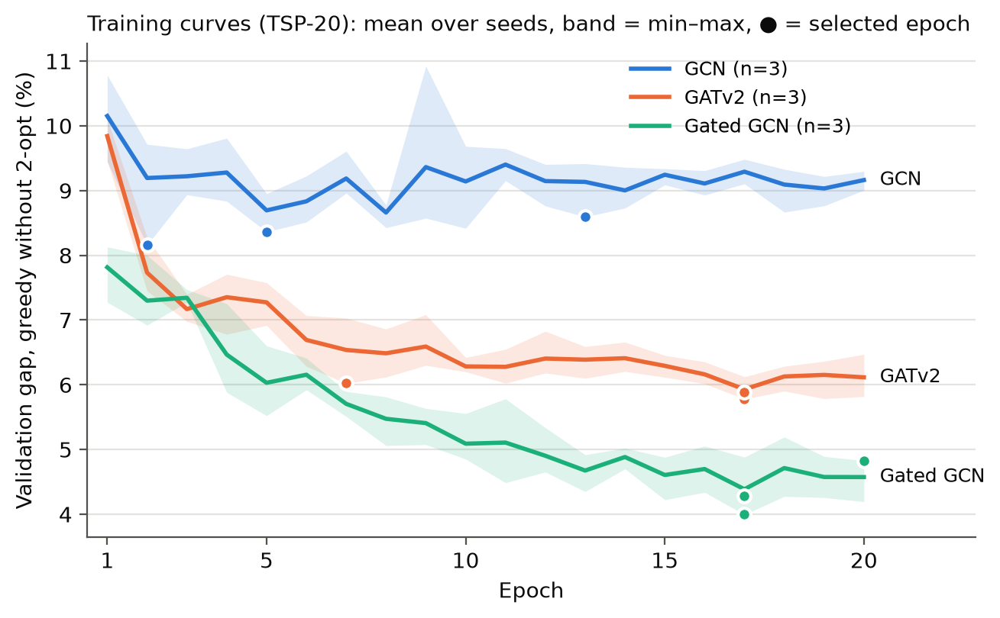
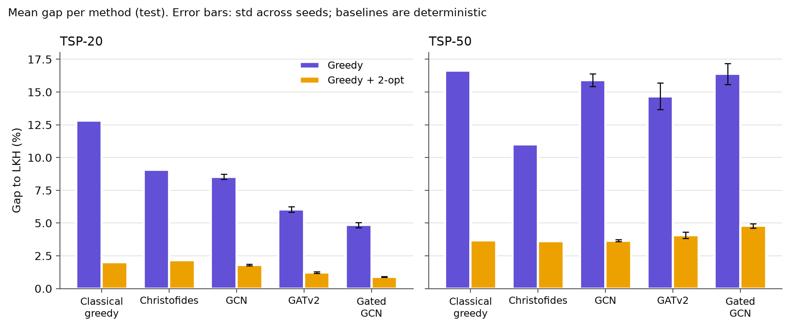

# GNNs for the TSP — phase 1 (supervised learning)

CMU project with Prof. Soummya. Phase 1 trains graph neural networks (GNNs) to imitate a
reference solver (LKH) on the travelling salesman problem (TSP) and compares three
architectures — **GCN**, **GATv2** and **residual Gated GCN** (Joshi et al. 2019) — with
classical heuristics.

```
random instances ──► LKH (elkai) ──► labels: is the edge in the optimal tour? (0/1)
        │
        └─► k-NN graph (k=10) ──► GNN ──► probability of each edge (heatmap)
                                              │
                         greedy decoding (union-find) ──► 2-opt ──► tour
                                                                      │
                                                    optimality gap with respect to LKH
```

Study guide in plain language (in Portuguese): [`docs/fase1_explicacao.md`](docs/fase1_explicacao.md).

## Results at a glance

Trained on TSP-20 (12,000 instances, 20 epochs, 3 seeds); tested on 1,000 TSP-20 instances
and 500 TSP-50 instances (generalization). Mean gap to LKH (%); models: mean ± std across
seeds; baselines: deterministic.

| Method | TSP-20 greedy | TSP-20 + 2-opt | TSP-50 greedy | TSP-50 + 2-opt | Selected epochs |
|---|---|---|---|---|---|
| Classical greedy | 12.83 | 2.02 | 16.63 | 3.66 | — |
| Christofides | 9.06 | 2.16 | **11.02** | **3.63** | — |
| GCN | 8.53 ± 0.19 | 1.79 ± 0.06 | 15.91 ± 0.49 | 3.66 ± 0.07 | 13, 2, 5 |
| GATv2 | 6.04 ± 0.22 | 1.23 ± 0.07 | 14.68 ± 1.02 | 4.07 ± 0.25 | 17, 7, 17 |
| Gated GCN | **4.85 ± 0.20** | **0.90 ± 0.03** | 16.38 ± 0.80 | 4.78 ± 0.17 | 17, 20, 17 |
| TAGCN K=2 | 7.03 ± 0.49 | 1.46 ± 0.04 | 16.40 ± 4.46 | 3.87 ± 0.87 | 1, 1, 18 |
| TAGCN K=3 | 6.44 ± 0.25 | 1.43 ± 0.03 | 15.47 ± 0.06 | 3.66 ± 0.08 | 12, 1, 4 |
| TAGCN K=2, last.pt | 7.53 ± 0.20 | 1.41 ± 0.12 | 20.18 ± 1.06 | 4.58 ± 0.15 | 20, 20, 20 |
| TAGCN K=3, last.pt | 7.28 ± 0.12 | 1.46 ± 0.07 | 17.36 ± 0.98 | 4.16 ± 0.15 | 20, 20, 20 |

*last.pt*: epoch 20 of reruns with the same seeds. Selection by validation gap is unstable for TAGCN (the gap is flat from epoch 1 and reruns pick different epochs), so the selection rule will be revised; details in [`docs/tagcn_report.md`](docs/tagcn_report.md).

Paired per-instance comparisons (two-sided Wilcoxon test; significant if the largest p-value
across the 3 seeds is < 0.05/12 ≈ 0.0042, Bonferroni correction for 12 tests):

| Comparison | TSP-20 | TSP-50 |
|---|---|---|
| model + 2-opt vs. greedy + 2-opt | GCN n.s. · GATv2 **better** · Gated **better** | GCN n.s. · GATv2 n.s. · Gated **worse** |
| model without 2-opt vs. classical greedy | GCN, GATv2 and Gated **better** | GATv2 **better** · GCN and Gated n.s. |

**Reading:** on TSP-20 (the training distribution) the ranking Gated < GATv2 < GCN is robust
and the models beat the baselines. On TSP-50 generalization fails: no model reaches
Christofides and the ranking flips (the best model on TSP-20 is the worst on TSP-50). This is
consistent with the change in the scale of the distances (see [Recorded decisions](#recorded-decisions)),
but does not yet prove it. Full tables: `results/table.md` (generated by `scripts/summarize.py`).





## Project structure

```
gnn-tsp/
├── src/tsp_gnn/            reusable code (import tsp_gnn)
│   ├── data.py             uniform instances in [0,1]², LKH tours, .npz
│   ├── graph.py            instance -> torch_geometric Data (k-NN graph, labels, opt_len)
│   ├── decode.py           heatmap, greedy with union-find, 2-opt, verify_tour, gap
│   ├── baselines.py        greedy by distance and Christofides (networkx)
│   ├── models.py           EdgeGNN: GCN, GATv2, Gated GCN (hand-written layer), TAGCN
│   ├── train.py            loss, epochs, per-graph prediction, evaluation
│   └── utils.py            seed, git_info, GPU memory limit
├── scripts/                what is run from the command line
│   ├── make_dataset.py     generates a dataset (.npz) with LKH tours
│   ├── graph_stats.py      statistics of the k-NN graphs (coverage, scale)
│   ├── check_decode.py     decoding sanity check with the true labels
│   ├── baselines.py        gaps of the classical heuristics
│   ├── train_model.py      training + final test evaluation
│   ├── evaluate.py         re-evaluates a best.pt without retraining
│   └── summarize.py        tables, paired tests and figures
├── tests/                  pytest (100 tests, ~45 s)
├── docs/                   study guide and figures (in git)
├── data/                   datasets (not in git)
└── results/                baselines, runs, tables, figures (not in git)
```

## Installation

Shared server (T4 GPU): work only inside this folder and install packages only in `.venv`.

```bash
source env.sh      # activates .venv, PYTHONPATH=src, TMPDIR and OMP_NUM_THREADS=8
```

Versions used: Python 3.12.11, torch 2.14.1 (CUDA 13.0), torch-geometric 2.8.1,
elkai 2.0.1, networkx 3.7, numpy 2.5.4, scipy 1.18.1, matplotlib 3.11.2, pytest 9.1.1.
`torch_cluster` is not needed: the k-NN is computed in plain PyTorch (`torch.cdist` + `topk`).

## How to reproduce (one step at a time)

```bash
source env.sh
pytest -q tests/                                   # 100 tests

# Step 1 — data (LKH, up to 8 processes; ~1.5 min in total)
python scripts/make_dataset.py --n 20 --num 12000 --seed 1 --out data/tsp20_train.npz
python scripts/make_dataset.py --n 20 --num 500   --seed 2 --out data/tsp20_val.npz
python scripts/make_dataset.py --n 20 --num 1000  --seed 3 --out data/tsp20_test.npz
python scripts/make_dataset.py --n 50 --num 500   --seed 4 --out data/tsp50_test.npz

# Step 2 — k-NN graphs
python scripts/graph_stats.py --data data/tsp20_test.npz data/tsp50_test.npz --k 10

# Step 3 — decoding sanity check (true labels used as probabilities)
python scripts/check_decode.py --data data/tsp20_test.npz data/tsp50_test.npz

# Step 4 — baselines -> results/baselines.json (+ _per_instance.npz)
python scripts/baselines.py

# Steps 5–6 — training (GPU, < 6 GB; ~1.5 min GCN, ~4.5 min GATv2/Gated per run)
for s in 0 1 2; do for m in gcn gat gated; do
  mkdir -p results/runs/${m}_seed$s
  nice -n 10 python -u scripts/train_model.py --model $m --seed $s > results/runs/${m}_seed$s/train.log 2>&1
done; done
python scripts/evaluate.py --run-dir results/runs/gated_seed0   # optional: re-evaluate

# Step 7 — tables and figures -> results/table.md, results/figs/
python scripts/summarize.py
```

Each run writes to `results/runs/<model>_seed<s>/`: `best.pt` (best epoch by validation
gap), `history.json`, `train.log`, `eval.json` (with `git_commit`) and
`eval_per_instance.npz` (per-instance gaps, same keys as the baselines).

**Note on the existing runs:** the 9 runs in `results/runs/` were produced before the code
was translated to English, so their `train.log` files and printed messages are in
Portuguese. The data formats (`eval.json`, `history.json` and `.npz` keys) were already in
English and did not change; translating the code changed no numbers (all outputs were
re-checked value by value). New runs log in English.

## Configuration

| | |
|---|---|
| Data | cities uniform in [0,1]²; training 12,000 × TSP-20 (seed 1), validation 500 × TSP-20 (seed 2), test 1,000 × TSP-20 (seed 3) and 500 × TSP-50 (seed 4) |
| Labels | LKH tour via elkai (distances × 10⁶ rounded to integers); means 3.83–3.85 (TSP-20, in the 3 sets) and 5.68 (TSP-50), in line with the optimal values in the literature (3.83 / 5.70); LKH = exact optimum on 7-city instances (brute force, `tests/test_data.py`) |
| Graph | k-NN with k=10, both directions; `edge_attr` = distance **without normalization** |
| Models | `EdgeGNN(kind, hidden=64, layers=6)`: embeddings → 6 layers (residual + BatchNorm) → MLP([h_i, h_j, e_ij]) → one logit per edge. GATv2 with 4 heads × 16 dims. Parameters: GCN 42,625, GATv2 92,929, Gated 143,233 (see the model table below) |
| Training | `BCEWithLogitsLoss(pos_weight = neg/pos ≈ 5.05)`, Adam lr 1e-3, cosine annealing, 20 epochs, batch 64; model selection **only** by the greedy gap on validation; GPU limited to 5.5 GiB (actual peak < 200 MB) |
| Evaluation | greedy and greedy + 2-opt; every tour verified (`verify_tour`); gap = 100·(L/L_LKH − 1) |

## Models

All encoders share the input embeddings (coordinates 2→64, distance 1→64), the residual +
normalization wrapper `h ← h + ReLU(Norm(conv(h)))` (Gated GCN has its own) and the edge head
MLP([h_i, h_j, e_ij]); H = 64 and a reach of 6 hops for every model.

| Model | `--model` | Layer | Layers × hops | Uses distances in the encoder | Parameters |
|---|---|---|---|---|---|
| GCN (Kipf & Welling 2017) | `gcn` | `GCNConv`: degree-normalized mean | 6 × 1 | no | 42,625 |
| GATv2 (Brody et al. 2022) | `gat` | `GATv2Conv`, 4 heads × 16, attention with e_ij | 6 × 1 | yes | 92,929 |
| Gated GCN (Joshi et al. 2019) | `gated` | hand-written, edge gates, updates e_ij | 6 × 1 | yes | 143,233 |
| TAGCN, K=2 (Du et al. 2017) | `tagcn --tag-k 2` | `TAGConv`: Σ_{k=0..K} Â^k H W_k | 3 × 2 | no | 54,337 |
| TAGCN, K=3 | `tagcn --tag-k 3` | `TAGConv` | 2 × 3 | no | 50,049 |

TAGCN results (phase 1 and phase 2 protocol, next to the other three models):
[`docs/tagcn_report.md`](docs/tagcn_report.md).

## Recorded decisions

- **k = 10 in the k-NN graph.** Coverage of the tour edges: 99.955% (TSP-20) and 99.920%
  (TSP-50); 9/1000 and 20/500 graphs have one tour edge outside the graph (always exactly one).
  With k=15 coverage is ~100%, but the fraction of positives drops from ~16.6% to ~11.5%. The
  decoder has a fallback (pairs outside the graph, by distance), tested with k=3.
- **2-opt: "best swap per i".** For each *i*, apply the best swap (*i*, *j*) and move on;
  repeat until nothing improves (`decode.two_opt`). Kept because it is correct (always ends in
  a local optimum — checked on every instance), fast, and **the same function** for the
  models and the baselines. "2-opt" is not a single number — the strategy decides which local
  optimum is reached:

  | Mean gap (%) | Ours (best per *i*) | Best global swap | First improvement | Previous run (reference) |
  |---|---|---|---|---|
  | TSP-20 greedy + 2-opt | 2.02 | 1.31 | 2.59 | 1.90 |
  | TSP-20 Christofides + 2-opt | 2.16 | 1.65 | 2.32 | 2.11 |
  | TSP-50 greedy + 2-opt | 3.66 | 2.78 | 4.14 | 3.26 |
  | TSP-50 Christofides + 2-opt | 3.63 | 2.85 | 3.83 | 3.51 |

  Without 2-opt, our values match the reference (greedy 12.83 / 16.63; Christofides
  9.06 / 11.02). The variant used in the reference run was not identified.
- **Distances without normalization in phase 1.** On TSP-50 distances are ~0.58× those of
  TSP-20 (graph edges 0.2198 vs. 0.3828; tour edges 0.1136 vs. 0.1925; theory ≈ √(20/50) = 0.63).
  The goal of phase 1 is to **show** the generalization problem; normalization (e.g. × √n or
  ÷ mean k-NN distance) is left for phase 2. BatchNorm in `eval` mode, which uses the TSP-20
  statistics, probably contributes as well.
- **Same H and L for the three models.** H=64, L=6 for all; the models therefore have
  different capacities (Gated ≈ 3.4× the parameters of GCN). Future work: match the number of
  parameters by adjusting H per model and check whether the ranking holds.
- **Conservative statistical criterion.** The paired comparisons use the **largest** p-value
  of the 3 seeds (significant only if it is significant in all three runs). Why it matters:
  with seed 0 alone, GATv2 + 2-opt on TSP-50 was "worse" (p = 2e-4); with 3 seeds it is n.s.
- **`git_dirty` on seeds 1 and 2.** The `eval.json` files of seeds 1 and 2 have
  `git_dirty: true` because `scripts/summarize.py` and `tests/test_summarize.py` were written
  while those runs were training. Checked with `git diff 5d14168`: no file used for training
  changed (only those two new files were uncommitted). All 9 runs used the code of commit
  `5d14168`. The baselines come from commit `d0e78f9`; the only difference is that `git_info`
  moved to `utils.py`, with the numbers checked to be identical.
- **Reproducibility.** Fixed seeds everywhere (data, batch order, weights). `scatter` on the
  GPU uses atomic additions, so two runs with the same seed are nearly, but not bit-for-bit,
  identical.

## Limitations and next steps

- A single distribution (uniform) and small sizes (20 / 50); training on TSP-20 only.
- Phase 2: normalize the distances, train on TSP-50 (`tsp50_train`), more epochs for
  GATv2/Gated (their curves are still going down), match parameters across models.

## References

- Joshi, Laurent & Bresson (2019). *An Efficient Graph Convolutional Network Technique for the Travelling Salesman Problem.*
- Bresson & Laurent (2017). *Residual Gated Graph ConvNets.*
- Kipf & Welling (2017). *Semi-Supervised Classification with Graph Convolutional Networks.*
- Du, Zhang, Wu, Moura & Kar (2017). *Topology Adaptive Graph Convolutional Networks* (TAGCN).
- Brody, Alon & Yahav (2022). *How Attentive are Graph Attention Networks?* (GATv2)
- Helsgaun (2000). *An Effective Implementation of the Lin–Kernighan Traveling Salesman Heuristic* (LKH).
- Christofides (1976). *Worst-case analysis of a new heuristic for the travelling salesman problem.*
- Kool, van Hoof & Welling (2019). *Attention, Learn to Solve Routing Problems!* (reference values for TSP-20/50)
