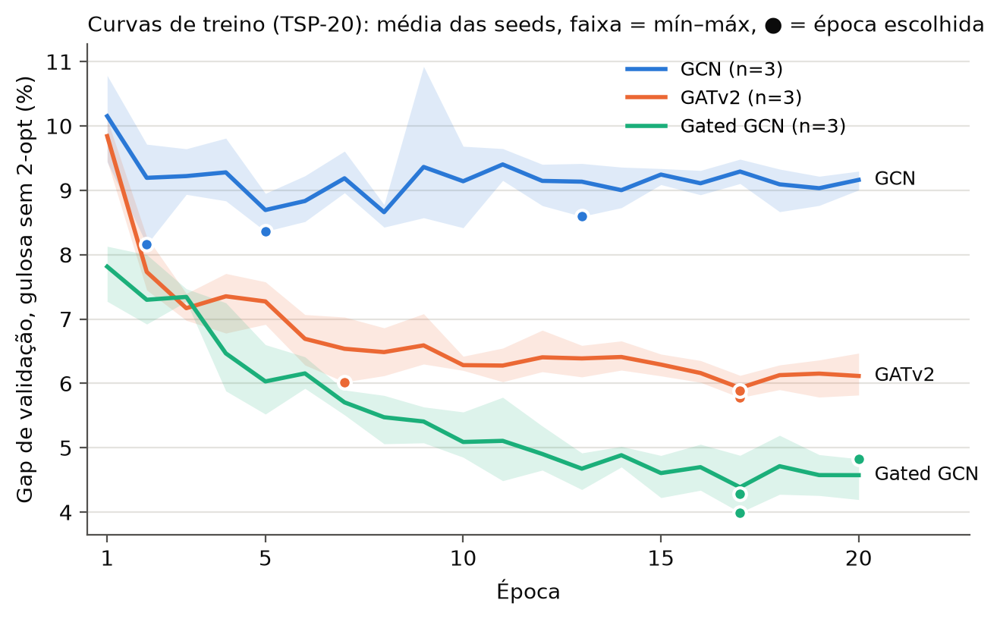
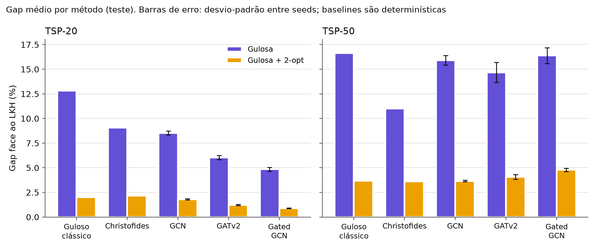

# GNN para o TSP — fase 1 (aprendizagem supervisionada)

Projeto na CMU com o Prof. Soummya. A fase 1 treina redes neuronais de grafos (GNN) a
imitar um solver de referência (LKH) no problema do caixeiro-viajante (TSP) e compara três
arquiteturas — **GCN**, **GATv2** e **Gated GCN residual** (Joshi et al. 2019) — com
heurísticas clássicas.

```
instâncias aleatórias ──► LKH (elkai) ──► rótulos: aresta no tour ótimo? (0/1)
        │
        └─► grafo k-NN (k=10) ──► GNN ──► probabilidade de cada aresta (heatmap)
                                              │
                         decodificação gulosa (union-find) ──► 2-opt ──► tour
                                                                        │
                                                    gap de otimalidade face ao LKH
```

Guia de estudo em linguagem simples: [`docs/fase1_explicacao.md`](docs/fase1_explicacao.md).

## Resultados em resumo

Treino em TSP-20 (12 000 instâncias, 20 épocas, 3 seeds); teste em 1 000 instâncias de TSP-20
e 500 de TSP-50 (generalização). Gap médio face ao LKH (%); modelos: média ± desvio-padrão
entre seeds; baselines: determinísticas.

| Método | TSP-20 gulosa | TSP-20 + 2-opt | TSP-50 gulosa | TSP-50 + 2-opt | Épocas escolhidas |
|---|---|---|---|---|---|
| Guloso clássico | 12,83 | 2,02 | 16,63 | 3,66 | — |
| Christofides | 9,06 | 2,16 | **11,02** | **3,63** | — |
| GCN | 8,53 ± 0,19 | 1,79 ± 0,06 | 15,91 ± 0,49 | 3,66 ± 0,07 | 13, 2, 5 |
| GATv2 | 6,04 ± 0,22 | 1,23 ± 0,07 | 14,68 ± 1,02 | 4,07 ± 0,25 | 17, 7, 17 |
| Gated GCN | **4,85 ± 0,20** | **0,90 ± 0,03** | 16,38 ± 0,80 | 4,78 ± 0,17 | 17, 20, 17 |

Comparações emparelhadas por instância (teste de Wilcoxon bilateral; significativo se o maior
p-valor entre as 3 seeds < 0,05/12 ≈ 0,0042, correção de Bonferroni para 12 testes):

| Comparação | TSP-20 | TSP-50 |
|---|---|---|
| modelo + 2-opt vs. guloso + 2-opt | GCN n.s. · GATv2 **melhor** · Gated **melhor** | GCN n.s. · GATv2 n.s. · Gated **pior** |
| modelo sem 2-opt vs. guloso clássico | GCN, GATv2 e Gated **melhores** | GATv2 **melhor** · GCN e Gated n.s. |

**Leitura:** em TSP-20 (a distribuição de treino) a ordem Gated < GATv2 < GCN é robusta e os
modelos batem as baselines. Em TSP-50 a generalização falha: nenhum modelo chega ao
Christofides e a ordem inverte-se (o melhor modelo em TSP-20 é o pior em TSP-50). É coerente
com a mudança de escala das distâncias (ver [Decisões](#decisões-registadas)), mas ainda não
o prova. Tabelas completas: `results/tabela.md` (gerada por `scripts/summarize.py`).





## Estrutura do projeto

```
gnn-tsp/
├── src/tsp_gnn/            código reutilizável (import tsp_gnn)
│   ├── data.py             instâncias uniformes em [0,1]², tours do LKH, .npz
│   ├── graph.py            instância -> torch_geometric Data (grafo k-NN, rótulos, opt_len)
│   ├── decode.py           heatmap, gulosa com union-find, 2-opt, verify_tour, gap
│   ├── baselines.py        guloso por distância e Christofides (networkx)
│   ├── models.py           EdgeGNN: GCN, GATv2, Gated GCN (camada feita à mão)
│   ├── train.py            perda, épocas, previsão por grafo, avaliação
│   └── utils.py            seed, git_info, limite de memória da GPU
├── scripts/                o que se corre na linha de comandos
│   ├── make_dataset.py     gera um conjunto (.npz) com tours do LKH
│   ├── graph_stats.py      estatísticas dos grafos k-NN (cobertura, escala)
│   ├── check_decode.py     sanidade da decodificação com os rótulos verdadeiros
│   ├── baselines.py        gaps das heurísticas clássicas
│   ├── train_model.py      treino + avaliação final no teste
│   ├── evaluate.py         reavalia um best.pt sem treinar
│   └── summarize.py        tabelas, testes emparelhados e figuras
├── tests/                  pytest (38 testes, ~13 s)
├── docs/                   guia de estudo e figuras (no git)
├── data/                   conjuntos de dados (fora do git)
└── results/                baselines, corridas, tabelas, figuras (fora do git)
```

## Instalação

Servidor partilhado (GPU T4): trabalhar só nesta pasta e instalar pacotes só na `.venv`.

```bash
source env.sh      # ativa a .venv, PYTHONPATH=src, TMPDIR e OMP_NUM_THREADS=8
```

Versões usadas: Python 3.12.11, torch 2.14.1 (CUDA 13.0), torch-geometric 2.8.1,
elkai 2.0.1, networkx 3.7, numpy 2.5.4, scipy 1.18.1, matplotlib 3.11.2, pytest 9.1.1.
Não é preciso `torch_cluster`: o k-NN é calculado em PyTorch puro (`torch.cdist` + `topk`).

## Como reproduzir (um passo de cada vez)

```bash
source env.sh
pytest -q tests/                                   # 38 testes

# Passo 1 — dados (LKH, até 8 processos; ~1,5 min no total)
python scripts/make_dataset.py --n 20 --num 12000 --seed 1 --out data/tsp20_train.npz
python scripts/make_dataset.py --n 20 --num 500   --seed 2 --out data/tsp20_val.npz
python scripts/make_dataset.py --n 20 --num 1000  --seed 3 --out data/tsp20_test.npz
python scripts/make_dataset.py --n 50 --num 500   --seed 4 --out data/tsp50_test.npz

# Passo 2 — grafos k-NN
python scripts/graph_stats.py --data data/tsp20_test.npz data/tsp50_test.npz --k 10

# Passo 3 — sanidade da decodificação (rótulos verdadeiros como probabilidades)
python scripts/check_decode.py --data data/tsp20_test.npz data/tsp50_test.npz

# Passo 4 — baselines -> results/baselines.json (+ _per_instance.npz)
python scripts/baselines.py

# Passos 5–6 — treino (GPU, < 6 GB; ~1,5 min GCN, ~4,5 min GATv2/Gated por corrida)
for s in 0 1 2; do for m in gcn gat gated; do
  mkdir -p results/runs/${m}_seed$s
  nice -n 10 python -u scripts/train_model.py --model $m --seed $s > results/runs/${m}_seed$s/train.log 2>&1
done; done
python scripts/evaluate.py --run-dir results/runs/gated_seed0   # opcional: reavaliar

# Passo 7 — tabelas e figuras -> results/tabela.md, results/figs/
python scripts/summarize.py
```

Cada corrida grava em `results/runs/<modelo>_seed<s>/`: `best.pt` (melhor época pelo gap de
validação), `history.json`, `train.log`, `eval.json` (com `git_commit`) e
`eval_per_instance.npz` (gaps por instância, mesmas chaves que as baselines).

## Configuração

| | |
|---|---|
| Dados | cidades uniformes em [0,1]²; treino 12 000 × TSP-20 (seed 1), validação 500 × TSP-20 (seed 2), teste 1 000 × TSP-20 (seed 3) e 500 × TSP-50 (seed 4) |
| Rótulos | tour do LKH via elkai (distâncias × 10⁶ arredondadas a inteiros); médias 3,83–3,85 (TSP-20, nos 3 conjuntos) e 5,68 (TSP-50), em linha com os valores ótimos da literatura (3,83 / 5,70); LKH = ótimo exato em instâncias de 7 cidades (força bruta, `tests/test_data.py`) |
| Grafo | k-NN com k=10, nos dois sentidos; `edge_attr` = distância **sem normalização** |
| Modelos | `EdgeGNN(kind, hidden=64, layers=6)`: embeddings → 6 camadas (residual + BatchNorm) → MLP([h_i, h_j, e_ij]) → logit por aresta. GATv2 com 4 cabeças × 16 dims. Parâmetros: GCN 42 625, GATv2 92 929, Gated 143 233 |
| Treino | `BCEWithLogitsLoss(pos_weight = neg/pos ≈ 5,05)`, Adam lr 1e-3, cosine annealing, 20 épocas, batch 64; seleção do modelo **só** pelo gap guloso na validação; GPU limitada a 5,5 GiB (pico real < 200 MB) |
| Avaliação | gulosa e gulosa + 2-opt; todos os tours verificados (`verify_tour`); gap = 100·(L/L_LKH − 1) |

## Decisões registadas

- **k = 10 no grafo k-NN.** Cobertura das arestas do tour: 99,955% (TSP-20) e 99,920% (TSP-50);
  9/1000 e 20/500 grafos têm uma aresta do tour fora do grafo (sempre exatamente uma). Com
  k=15 a cobertura é ~100%, mas a fração de positivas desce de ~16,6% para ~11,5%. A
  decodificação tem um "plano B" (pares fora do grafo por distância), testado com k=3.
- **2-opt: "melhor troca por i".** Para cada *i*, aplica a melhor troca (*i*, *j*) e continua;
  repete até não haver melhoria (`decode.two_opt`). Mantido por estar correto (termina sempre
  num ótimo local — verificado em todas as instâncias), ser rápido e ser **a mesma função**
  para os modelos e para as baselines. O "2-opt" não é um número único — a estratégia decide
  a que ótimo local se chega:

  | Gap médio (%) | Nosso (melhor por *i*) | Melhor troca global | Primeira melhoria | Corrida anterior (referência) |
  |---|---|---|---|---|
  | TSP-20 guloso + 2-opt | 2,02 | 1,31 | 2,59 | 1,90 |
  | TSP-20 Christofides + 2-opt | 2,16 | 1,65 | 2,32 | 2,11 |
  | TSP-50 guloso + 2-opt | 3,66 | 2,78 | 4,14 | 3,26 |
  | TSP-50 Christofides + 2-opt | 3,63 | 2,85 | 3,83 | 3,51 |

  Sem 2-opt, os nossos valores coincidem com a referência (guloso 12,83 / 16,63; Christofides
  9,06 / 11,02). A variante da referência não foi identificada.
- **Distâncias sem normalização na fase 1.** Em TSP-50 as distâncias são ~0,58× as de TSP-20
  (arestas do grafo 0,2198 vs. 0,3828; do tour 0,1136 vs. 0,1925; teoria ≈ √(20/50) = 0,63).
  O objetivo da fase 1 é **mostrar** o problema de generalização; a normalização (ex.: × √n ou
  ÷ média das distâncias do k-NN) fica para a fase 2. Também contribui provavelmente a
  BatchNorm em modo `eval`, que usa as estatísticas do TSP-20.
- **Mesmo H e L para os três modelos.** H=64, L=6 para todos; os modelos têm portanto
  capacidades diferentes (Gated ≈ 3,4× os parâmetros do GCN). Trabalho futuro: igualar o nº de
  parâmetros ajustando H por modelo e ver se a ordem se mantém.
- **Critério estatístico conservador.** Nas comparações emparelhadas usa-se o **maior**
  p-valor das 3 seeds (só é significativo se o for nas três corridas). Exemplo de porque
  importa: só com a seed 0, o GATv2 + 2-opt em TSP-50 era "pior" (p = 2e-4); com 3 seeds é n.s.
- **`git_dirty` nas seeds 1 e 2.** Os `eval.json` das seeds 1 e 2 têm `git_dirty: true`
  porque `scripts/summarize.py` e `tests/test_summarize.py` foram escritos enquanto essas
  corridas treinavam. Confirmado com `git diff 5d14168`: nenhum ficheiro usado no treino mudou
  (só havia esses dois ficheiros novos por gravar). As 9 corridas usaram o código do commit
  `5d14168`. As baselines são do commit `d0e78f9`; a única diferença é `git_info` ter passado
  para `utils.py`, com números verificados como idênticos.
- **Reprodutibilidade.** Seeds fixas em todo o lado (dados, ordem dos batches, pesos). O
  `scatter` na GPU usa somas atómicas, por isso duas corridas com a mesma seed são quase, mas
  não bit a bit, iguais.

## Limitações e próximos passos

- Uma só distribuição (uniforme) e tamanhos pequenos (20 / 50); treino só em TSP-20.
- Fase 2: normalização das distâncias, treino em TSP-50 (`tsp50_train`), mais épocas para
  GATv2/Gated (as curvas ainda descem), parâmetros igualados entre modelos.

## Referências

- Joshi, Laurent & Bresson (2019). *An Efficient Graph Convolutional Network Technique for the Travelling Salesman Problem.*
- Bresson & Laurent (2017). *Residual Gated Graph ConvNets.*
- Kipf & Welling (2017). *Semi-Supervised Classification with Graph Convolutional Networks.*
- Brody, Alon & Yahav (2022). *How Attentive are Graph Attention Networks?* (GATv2)
- Helsgaun (2000). *An Effective Implementation of the Lin–Kernighan Traveling Salesman Heuristic* (LKH).
- Christofides (1976). *Worst-case analysis of a new heuristic for the travelling salesman problem.*
- Kool, van Hoof & Welling (2019). *Attention, Learn to Solve Routing Problems!* (valores de referência TSP-20/50)
