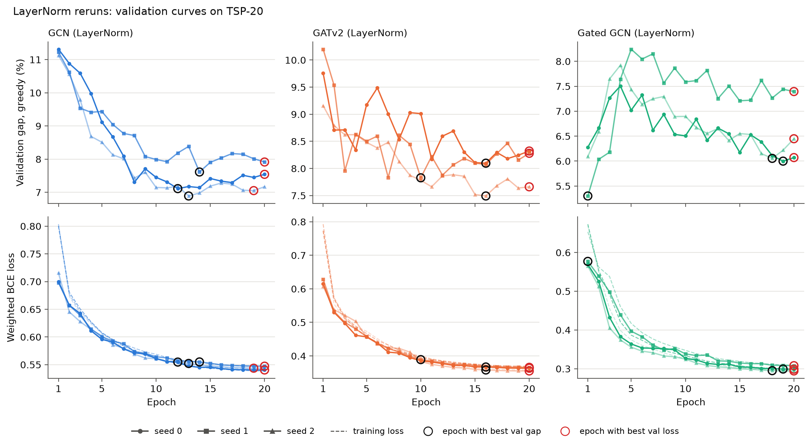

# Phase 2 — checks (points 1 to 4)

Generated by `scripts/phase2_checks_report.py` on 2026-10-19.
All models: H=64, L=6, 12000 training instances, 20 epochs, seeds 0, 1, 2; trained on TSP-20 unless stated otherwise.

Configurations:

- `phase1` — Phase 1 (k=10, BatchNorm, raw distances)
- `knn_mean` — Exp. 1: edge_norm knn_mean
- `kfrac` — Phase 1 models, test graphs k = 0.5 n
- `knn_mean_kfrac` — knn_mean models, test graphs k = 0.5 n
- `bn_batch` — Exp. 2b: phase 1 models, BatchNorm batch statistics
- `layernorm` — Exp. 3 LayerNorm (batch 2 runs, best val gap), k = 10
- `layernorm_kfrac` — Exp. 3 LayerNorm (batch 2 runs, best val gap), k = 0.5 n
- `ln_gap` — Check 1: LayerNorm rerun, checkpoint best.pt, k = 10
- `ln_gap_kfrac` — Check 1: LayerNorm rerun, checkpoint best.pt, k = 0.5 n
- `ln_loss` — Check 1: LayerNorm rerun, checkpoint best_loss.pt, k = 10
- `ln_loss_kfrac` — Check 1: LayerNorm rerun, checkpoint best_loss.pt, k = 0.5 n
- `ln_last` — Check 1: LayerNorm rerun, checkpoint last.pt, k = 10
- `ln_last_kfrac` — Check 1: LayerNorm rerun, checkpoint last.pt, k = 0.5 n
- `train50` — Control: trained on TSP-50, k = 10
- `train50_kfrac` — Check 2: trained on TSP-50 with k = 0.5 n (train and test graphs)

## Summary

1. **Check 1 — selected epochs** (9 LayerNorm reruns): best val gap at epochs [1, 10, 12, 13, 14, 16, 16, 18, 19] (1 at epoch ≤ 5); best val loss at epochs [19, 20, 20, 20, 20, 20, 20, 20, 20].
2. **Check 1 — checkpoint choice, greedy, k = 10**: loss vs. gap on TSP-20: 0 better / 0 worse of 3 (mean +0.20 pp); loss vs. gap on TSP-50: 0 better / 0 worse of 3 (mean +0.47 pp); loss vs. gap on TSP-100: 0 better / 0 worse of 3 (mean +0.83 pp); last vs. gap on TSP-20: 0 better / 0 worse of 3 (mean +0.21 pp); last vs. gap on TSP-50: 0 better / 0 worse of 3 (mean +0.48 pp); last vs. gap on TSP-100: 0 better / 0 worse of 3 (mean +0.83 pp).
3. **Check 1 — checkpoint choice, greedy, k = 0.5 n**: loss vs. gap on TSP-20: 0 better / 0 worse of 3 (mean +0.20 pp); loss vs. gap on TSP-50: 0 better / 0 worse of 3 (mean +0.59 pp); loss vs. gap on TSP-100: 0 better / 0 worse of 3 (mean +0.54 pp); last vs. gap on TSP-20: 0 better / 0 worse of 3 (mean +0.21 pp); last vs. gap on TSP-50: 0 better / 0 worse of 3 (mean +0.59 pp); last vs. gap on TSP-100: 0 better / 0 worse of 3 (mean +0.53 pp).
4. **Check 1 — rerun vs. experiment 3** (same command, best val gap): 0 of 36 cells differ significantly; mean |diff.| 0.53 pp.
5. **Check 2 — TSP-50 control with k = 0.5 n**, greedy gap on TSP-50: GCN 13.49% (k = 10: 14.32%; LayerNorm TSP-20 + k = 0.5 n: 11.29%); GATv2 13.04% (k = 10: 12.59%; LayerNorm TSP-20 + k = 0.5 n: 12.79%); Gated GCN 12.29% (k = 10: 11.39%; LayerNorm TSP-20 + k = 0.5 n: 11.32%).
6. **Check 3 — trade-off** (greedy, vs. phase 1): configurations that improve TSP-50 but lose more than 0.5 pp on TSP-20: knn_mean_kfrac/GATv2 (TSP-20 +1.37, TSP-50 -1.14), bn_batch/GCN (TSP-20 +1.06, TSP-50 -1.26), layernorm/Gated GCN (TSP-20 +1.19, TSP-50 -1.85), layernorm_kfrac/GATv2 (TSP-20 +1.99, TSP-50 -3.41), layernorm_kfrac/Gated GCN (TSP-20 +1.19, TSP-50 -5.91), ln_gap/Gated GCN (TSP-20 +1.41, TSP-50 -0.41), ln_gap_kfrac/GATv2 (TSP-20 +2.04, TSP-50 -1.89), ln_gap_kfrac/Gated GCN (TSP-20 +1.41, TSP-50 -5.06), ln_loss_kfrac/GATv2 (TSP-20 +2.14, TSP-50 -1.61), ln_loss_kfrac/Gated GCN (TSP-20 +1.86, TSP-50 -3.55), ln_last_kfrac/GATv2 (TSP-20 +2.14, TSP-50 -1.61), ln_last_kfrac/Gated GCN (TSP-20 +1.86, TSP-50 -3.55), train50/GCN (TSP-20 +1.71, TSP-50 -1.58), train50/GATv2 (TSP-20 +5.58, TSP-50 -2.09), train50/Gated GCN (TSP-20 +2.70, TSP-50 -4.99), train50_kfrac/GCN (TSP-20 +1.45, TSP-50 -2.42), train50_kfrac/GATv2 (TSP-20 +5.89, TSP-50 -1.64), train50_kfrac/Gated GCN (TSP-20 +6.14, TSP-50 -4.09).
7. **Check 4 — TSP-50 with 2-opt**: 3 of 45 configuration/model pairs are significantly better than **both** baselines + 2-opt. Lowest mean gap per model: GCN: ln_loss_kfrac 2.99%; GATv2: layernorm_kfrac 3.02%; Gated GCN: train50 2.96%.
8. **Check 4 — TSP-100 with 2-opt**: 0 of 45 configuration/model pairs are significantly better than **both** baselines + 2-opt. Lowest mean gap per model: GCN: ln_gap_kfrac 3.88%; GATv2: layernorm_kfrac 3.73%; Gated GCN: train50_kfrac 3.81%.

## Table 1 — mean gap to LKH (%), every configuration on TSP-20, TSP-50 and TSP-100 (check 3)

Models: mean ± std across the 3 seeds. "missing" = expected but not found.

| Model | Configuration | TSP-20 greedy | TSP-20 + 2-opt | TSP-50 greedy | TSP-50 + 2-opt | TSP-100 greedy | TSP-100 + 2-opt |
|---|---|---|---|---|---|---|---|
| Classical greedy | baseline | 12.83 | 2.02 | 16.63 | 3.66 | 17.71 | 4.29 |
| Christofides | baseline | 9.06 | 2.16 | 11.02 | 3.63 | 12.07 | 4.40 |
| GCN | phase1 | 8.53 ± 0.19 | 1.79 ± 0.06 | 15.91 ± 0.49 | 3.66 ± 0.07 | 20.09 ± 0.81 | 5.07 ± 0.23 |
| GCN | knn_mean | 8.72 ± 0.47 | 1.92 ± 0.15 | 15.16 ± 0.24 | 3.51 ± 0.17 | 17.78 ± 0.80 | 4.54 ± 0.11 |
| GCN | kfrac | 8.53 ± 0.19 | 1.79 ± 0.06 | 12.60 ± 0.15 | 3.32 ± 0.08 | 14.23 ± 0.14 | 4.07 ± 0.03 |
| GCN | knn_mean_kfrac | 8.72 ± 0.47 | 1.92 ± 0.15 | 12.37 ± 0.75 | 3.31 ± 0.08 | 13.86 ± 0.67 | 4.01 ± 0.24 |
| GCN | bn_batch | 9.59 ± 0.47 | 1.77 ± 0.07 | 14.65 ± 0.42 | 3.58 ± 0.06 | 18.60 ± 0.44 | 4.72 ± 0.14 |
| GCN | layernorm | 7.85 ± 0.25 | 1.64 ± 0.09 | 16.04 ± 0.42 | 3.54 ± 0.24 | 17.38 ± 0.29 | 4.37 ± 0.06 |
| GCN | layernorm_kfrac | 7.85 ± 0.25 | 1.64 ± 0.09 | 11.39 ± 0.26 | 3.10 ± 0.16 | 12.94 ± 0.77 | 3.90 ± 0.08 |
| GCN | ln_gap | 7.76 ± 0.26 | 1.66 ± 0.05 | 16.22 ± 0.60 | 3.50 ± 0.16 | 17.27 ± 0.56 | 4.30 ± 0.09 |
| GCN | ln_gap_kfrac | 7.76 ± 0.26 | 1.66 ± 0.05 | 11.29 ± 0.23 | 3.01 ± 0.03 | 12.86 ± 0.49 | 3.88 ± 0.06 |
| GCN | ln_loss | 7.83 ± 0.29 | 1.69 ± 0.04 | 16.20 ± 0.70 | 3.64 ± 0.21 | 16.97 ± 0.42 | 4.28 ± 0.03 |
| GCN | ln_loss_kfrac | 7.83 ± 0.29 | 1.69 ± 0.04 | 11.26 ± 0.35 | 2.99 ± 0.08 | 13.02 ± 0.49 | 3.91 ± 0.08 |
| GCN | ln_last | 7.86 ± 0.25 | 1.68 ± 0.06 | 16.23 ± 0.66 | 3.64 ± 0.21 | 16.98 ± 0.41 | 4.30 ± 0.03 |
| GCN | ln_last_kfrac | 7.86 ± 0.25 | 1.68 ± 0.06 | 11.26 ± 0.34 | 3.00 ± 0.06 | 13.00 ± 0.51 | 3.90 ± 0.10 |
| GCN | train50 | 10.25 ± 0.45 | 1.86 ± 0.04 | 14.32 ± 0.22 | 3.28 ± 0.07 | 16.74 ± 0.08 | 4.11 ± 0.06 |
| GCN | train50_kfrac | 9.98 ± 0.26 | 1.81 ± 0.04 | 13.49 ± 0.03 | 3.25 ± 0.12 | 14.71 ± 0.11 | 3.92 ± 0.02 |
| GATv2 | phase1 | 6.04 ± 0.22 | 1.23 ± 0.07 | 14.68 ± 1.02 | 4.07 ± 0.25 | 20.49 ± 2.66 | 5.63 ± 0.51 |
| GATv2 | knn_mean | 7.41 ± 0.17 | 1.31 ± 0.01 | 17.76 ± 0.46 | 4.16 ± 0.24 | 19.96 ± 0.63 | 5.18 ± 0.33 |
| GATv2 | kfrac | 6.04 ± 0.22 | 1.23 ± 0.07 | 12.27 ± 0.45 | 3.99 ± 0.35 | 14.31 ± 0.76 | 4.60 ± 0.40 |
| GATv2 | knn_mean_kfrac | 7.41 ± 0.17 | 1.31 ± 0.01 | 13.54 ± 0.57 | 3.78 ± 0.16 | 14.77 ± 0.60 | 4.42 ± 0.24 |
| GATv2 | bn_batch | 5.99 ± 0.11 | 1.25 ± 0.06 | 12.07 ± 1.01 | 3.58 ± 0.14 | 15.82 ± 0.96 | 4.53 ± 0.10 |
| GATv2 | layernorm | 8.03 ± 0.13 | 1.55 ± 0.05 | 15.74 ± 0.04 | 3.63 ± 0.24 | 18.29 ± 1.06 | 4.67 ± 0.49 |
| GATv2 | layernorm_kfrac | 8.03 ± 0.13 | 1.55 ± 0.05 | 11.27 ± 1.04 | 3.02 ± 0.51 | 12.50 ± 0.99 | 3.73 ± 0.34 |
| GATv2 | ln_gap | 8.08 ± 0.05 | 1.49 ± 0.02 | 16.54 ± 0.20 | 4.10 ± 0.29 | 20.28 ± 0.80 | 5.47 ± 0.18 |
| GATv2 | ln_gap_kfrac | 8.08 ± 0.05 | 1.49 ± 0.02 | 12.79 ± 0.83 | 3.70 ± 0.35 | 13.85 ± 0.50 | 4.29 ± 0.30 |
| GATv2 | ln_loss | 8.18 ± 0.18 | 1.52 ± 0.03 | 16.64 ± 0.23 | 4.12 ± 0.20 | 20.47 ± 0.49 | 5.49 ± 0.12 |
| GATv2 | ln_loss_kfrac | 8.18 ± 0.18 | 1.52 ± 0.03 | 13.07 ± 0.51 | 3.76 ± 0.26 | 14.25 ± 0.19 | 4.33 ± 0.10 |
| GATv2 | ln_last | 8.18 ± 0.18 | 1.52 ± 0.03 | 16.64 ± 0.23 | 4.12 ± 0.20 | 20.47 ± 0.49 | 5.49 ± 0.12 |
| GATv2 | ln_last_kfrac | 8.18 ± 0.18 | 1.52 ± 0.03 | 13.07 ± 0.51 | 3.76 ± 0.26 | 14.25 ± 0.19 | 4.33 ± 0.10 |
| GATv2 | train50 | 11.63 ± 0.84 | 1.81 ± 0.15 | 12.59 ± 0.15 | 3.17 ± 0.17 | 15.39 ± 0.29 | 4.33 ± 0.03 |
| GATv2 | train50_kfrac | 11.93 ± 0.09 | 1.75 ± 0.07 | 13.04 ± 0.17 | 3.40 ± 0.05 | 15.79 ± 0.33 | 4.58 ± 0.06 |
| Gated GCN | phase1 | 4.85 ± 0.20 | 0.90 ± 0.03 | 16.38 ± 0.80 | 4.78 ± 0.17 | 23.96 ± 0.34 | 7.19 ± 0.16 |
| Gated GCN | knn_mean | 4.79 ± 0.20 | 0.94 ± 0.08 | 15.75 ± 0.71 | 4.21 ± 0.11 | 20.97 ± 2.05 | 5.89 ± 0.41 |
| Gated GCN | kfrac | 4.85 ± 0.20 | 0.90 ± 0.03 | 13.74 ± 0.60 | 4.48 ± 0.35 | 15.83 ± 0.87 | 5.39 ± 0.51 |
| Gated GCN | knn_mean_kfrac | 4.79 ± 0.20 | 0.94 ± 0.08 | 13.67 ± 0.33 | 4.41 ± 0.14 | 15.94 ± 0.25 | 5.48 ± 0.20 |
| Gated GCN | bn_batch | 4.76 ± 0.16 | 0.93 ± 0.05 | 14.38 ± 0.19 | 4.52 ± 0.09 | 18.82 ± 0.96 | 5.88 ± 0.29 |
| Gated GCN | layernorm | 6.04 ± 0.66 | 1.33 ± 0.07 | 14.53 ± 1.52 | 3.60 ± 0.69 | 18.03 ± 3.70 | 4.83 ± 1.48 |
| Gated GCN | layernorm_kfrac | 6.04 ± 0.66 | 1.33 ± 0.07 | 10.47 ± 2.02 | 3.18 ± 0.73 | 12.52 ± 1.64 | 3.94 ± 0.73 |
| Gated GCN | ln_gap | 6.26 ± 0.77 | 1.42 ± 0.17 | 15.97 ± 3.06 | 4.23 ± 1.06 | 21.54 ± 5.15 | 6.09 ± 1.92 |
| Gated GCN | ln_gap_kfrac | 6.26 ± 0.77 | 1.42 ± 0.17 | 11.32 ± 2.02 | 3.52 ± 0.73 | 13.44 ± 1.81 | 4.23 ± 0.73 |
| Gated GCN | ln_loss | 6.70 ± 0.16 | 1.49 ± 0.05 | 17.32 ± 1.76 | 4.81 ± 0.46 | 24.13 ± 1.86 | 7.11 ± 0.56 |
| Gated GCN | ln_loss_kfrac | 6.70 ± 0.16 | 1.49 ± 0.05 | 12.83 ± 0.29 | 3.96 ± 0.30 | 14.50 ± 0.20 | 4.75 ± 0.09 |
| Gated GCN | ln_last | 6.70 ± 0.16 | 1.49 ± 0.05 | 17.32 ± 1.76 | 4.81 ± 0.46 | 24.13 ± 1.86 | 7.11 ± 0.56 |
| Gated GCN | ln_last_kfrac | 6.70 ± 0.16 | 1.49 ± 0.05 | 12.83 ± 0.29 | 3.96 ± 0.30 | 14.50 ± 0.20 | 4.74 ± 0.09 |
| Gated GCN | train50 | 7.55 ± 0.31 | 1.47 ± 0.15 | 11.39 ± 0.02 | 2.96 ± 0.13 | 15.20 ± 0.34 | 4.22 ± 0.11 |
| Gated GCN | train50_kfrac | 10.98 ± 0.25 | 1.65 ± 0.04 | 12.29 ± 0.02 | 2.99 ± 0.12 | 14.13 ± 1.82 | 3.81 ± 0.61 |

## Table 2 — trade-off: greedy gap and change vs. phase 1 (pp, negative = better)

| Model | Configuration | TSP-20 | Δ TSP-20 | TSP-50 | Δ TSP-50 | TSP-100 | Δ TSP-100 |
|---|---|---|---|---|---|---|---|
| GCN | phase1 | 8.53 | — | 15.91 | — | 20.09 | — |
| GCN | knn_mean | 8.72 | +0.19 | 15.16 | -0.75 | 17.78 | -2.31 |
| GCN | kfrac | 8.53 | +0.00 | 12.60 | -3.30 | 14.23 | -5.86 |
| GCN | knn_mean_kfrac | 8.72 | +0.19 | 12.37 | -3.53 | 13.86 | -6.23 |
| GCN | bn_batch | 9.59 | +1.06 | 14.65 | -1.26 | 18.60 | -1.49 |
| GCN | layernorm | 7.85 | -0.68 | 16.04 | +0.13 | 17.38 | -2.71 |
| GCN | layernorm_kfrac | 7.85 | -0.68 | 11.39 | -4.52 | 12.94 | -7.14 |
| GCN | ln_gap | 7.76 | -0.78 | 16.22 | +0.31 | 17.27 | -2.82 |
| GCN | ln_gap_kfrac | 7.76 | -0.78 | 11.29 | -4.62 | 12.86 | -7.23 |
| GCN | ln_loss | 7.83 | -0.70 | 16.20 | +0.29 | 16.97 | -3.12 |
| GCN | ln_loss_kfrac | 7.83 | -0.70 | 11.26 | -4.65 | 13.02 | -7.07 |
| GCN | ln_last | 7.86 | -0.67 | 16.23 | +0.32 | 16.98 | -3.11 |
| GCN | ln_last_kfrac | 7.86 | -0.67 | 11.26 | -4.64 | 13.00 | -7.08 |
| GCN | train50 | 10.25 | +1.71 | 14.32 | -1.58 | 16.74 | -3.35 |
| GCN | train50_kfrac | 9.98 | +1.45 | 13.49 | -2.42 | 14.71 | -5.38 |
| GATv2 | phase1 | 6.04 | — | 14.68 | — | 20.49 | — |
| GATv2 | knn_mean | 7.41 | +1.37 | 17.76 | +3.08 | 19.96 | -0.52 |
| GATv2 | kfrac | 6.04 | +0.00 | 12.27 | -2.41 | 14.31 | -6.18 |
| GATv2 | knn_mean_kfrac | 7.41 | +1.37 | 13.54 | -1.14 | 14.77 | -5.71 |
| GATv2 | bn_batch | 5.99 | -0.05 | 12.07 | -2.61 | 15.82 | -4.67 |
| GATv2 | layernorm | 8.03 | +1.99 | 15.74 | +1.06 | 18.29 | -2.20 |
| GATv2 | layernorm_kfrac | 8.03 | +1.99 | 11.27 | -3.41 | 12.50 | -7.98 |
| GATv2 | ln_gap | 8.08 | +2.04 | 16.54 | +1.86 | 20.28 | -0.20 |
| GATv2 | ln_gap_kfrac | 8.08 | +2.04 | 12.79 | -1.89 | 13.85 | -6.63 |
| GATv2 | ln_loss | 8.18 | +2.14 | 16.64 | +1.96 | 20.47 | -0.01 |
| GATv2 | ln_loss_kfrac | 8.18 | +2.14 | 13.07 | -1.61 | 14.25 | -6.24 |
| GATv2 | ln_last | 8.18 | +2.14 | 16.64 | +1.96 | 20.47 | -0.01 |
| GATv2 | ln_last_kfrac | 8.18 | +2.14 | 13.07 | -1.61 | 14.25 | -6.24 |
| GATv2 | train50 | 11.63 | +5.58 | 12.59 | -2.09 | 15.39 | -5.09 |
| GATv2 | train50_kfrac | 11.93 | +5.89 | 13.04 | -1.64 | 15.79 | -4.70 |
| Gated GCN | phase1 | 4.85 | — | 16.38 | — | 23.96 | — |
| Gated GCN | knn_mean | 4.79 | -0.05 | 15.75 | -0.63 | 20.97 | -2.99 |
| Gated GCN | kfrac | 4.85 | +0.00 | 13.74 | -2.64 | 15.83 | -8.13 |
| Gated GCN | knn_mean_kfrac | 4.79 | -0.05 | 13.67 | -2.71 | 15.94 | -8.02 |
| Gated GCN | bn_batch | 4.76 | -0.09 | 14.38 | -2.00 | 18.82 | -5.14 |
| Gated GCN | layernorm | 6.04 | +1.19 | 14.53 | -1.85 | 18.03 | -5.93 |
| Gated GCN | layernorm_kfrac | 6.04 | +1.19 | 10.47 | -5.91 | 12.52 | -11.44 |
| Gated GCN | ln_gap | 6.26 | +1.41 | 15.97 | -0.41 | 21.54 | -2.42 |
| Gated GCN | ln_gap_kfrac | 6.26 | +1.41 | 11.32 | -5.06 | 13.44 | -10.52 |
| Gated GCN | ln_loss | 6.70 | +1.86 | 17.32 | +0.93 | 24.13 | +0.17 |
| Gated GCN | ln_loss_kfrac | 6.70 | +1.86 | 12.83 | -3.55 | 14.50 | -9.46 |
| Gated GCN | ln_last | 6.70 | +1.86 | 17.32 | +0.93 | 24.13 | +0.17 |
| Gated GCN | ln_last_kfrac | 6.70 | +1.86 | 12.83 | -3.55 | 14.50 | -9.46 |
| Gated GCN | train50 | 7.55 | +2.70 | 11.39 | -4.99 | 15.20 | -8.76 |
| Gated GCN | train50_kfrac | 10.98 | +6.14 | 12.29 | -4.09 | 14.13 | -9.83 |

## Check 1 — LayerNorm checkpoints

Top: validation gap (greedy, TSP-20) per epoch. Bottom: validation loss (solid) and training loss (dashed). Black circle: epoch with the best validation gap (`best.pt`); red circle: best validation loss (`best_loss.pt`); the last epoch is `last.pt`.

| Model | Seed | Epoch: best val gap | Epoch: best val loss | val gap at (gap / loss / last) | val loss at (gap / loss / last) |
|---|---|---|---|---|---|
| GATv2 | 0 | 16 | 20 | 8.10 / 8.32 / 8.32 | 0.3670 / 0.3634 / 0.3634 |
| GATv2 | 1 | 10 | 20 | 7.83 / 8.28 / 8.28 | 0.3890 / 0.3660 / 0.3660 |
| GATv2 | 2 | 16 | 20 | 7.49 / 7.66 / 7.66 | 0.3581 / 0.3552 / 0.3552 |
| Gated GCN | 0 | 19 | 20 | 6.00 / 6.07 / 6.07 | 0.2992 / 0.2989 / 0.2989 |
| Gated GCN | 1 | 1 | 20 | 5.30 / 7.39 / 7.39 | 0.5771 / 0.3080 / 0.3080 |
| Gated GCN | 2 | 18 | 20 | 6.05 / 6.45 / 6.45 | 0.2951 / 0.2943 / 0.2943 |
| GCN | 0 | 12 | 20 | 7.11 / 7.54 / 7.54 | 0.5547 / 0.5404 / 0.5404 |
| GCN | 1 | 14 | 20 | 7.61 / 7.91 / 7.91 | 0.5549 / 0.5473 / 0.5473 |
| GCN | 2 | 13 | 19 | 6.89 / 7.05 / 7.17 | 0.5522 / 0.5436 / 0.5437 |

## Table 3 — paired comparisons for checks 1 and 2

Diff. = configuration − reference (negative = the configuration is better). Bonferroni: 0.05/252 tests, threshold 1.98e-04. *Equal* = difference ≤ 1e-06 pp. Two-sided Wilcoxon test per seed (ties dropped); *max p* is the largest p-value across the 3 seeds; significant only if max p is below the Bonferroni threshold and the median has the same sign in every seed.

| Configuration − reference | Model | Dataset | Method | Better | Equal | Worse | Mean diff. (pp) | Median diff. (pp) | max p (seeds) | Conclusion |
|---|---|---|---|---|---|---|---|---|---|---|
| ln_loss − ln_gap | GCN | TSP-20 | greedy | 18.1% | 63.0% | 18.9% | +0.07 | +0.00 | 4.4e-01 | n.s. |
| ln_loss − ln_gap | GCN | TSP-20 | + 2-opt | 9.2% | 80.8% | 9.9% | +0.04 | +0.00 | 6.9e-01 | n.s. |
| ln_loss − ln_gap | GCN | TSP-50 | greedy | 38.5% | 23.2% | 38.3% | -0.02 | +0.00 | 8.7e-01 | n.s. |
| ln_loss − ln_gap | GCN | TSP-50 | + 2-opt | 28.6% | 38.1% | 33.3% | +0.15 | +0.00 | 4.3e-01 | n.s. |
| ln_loss − ln_gap | GCN | TSP-100 | greedy | 50.1% | 4.3% | 45.7% | -0.30 | -0.05 | 8.8e-01 | n.s. |
| ln_loss − ln_gap | GCN | TSP-100 | + 2-opt | 44.2% | 10.7% | 45.1% | -0.03 | +0.00 | 8.3e-01 | n.s. |
| ln_loss − ln_gap | GATv2 | TSP-20 | greedy | 12.8% | 73.9% | 13.3% | +0.10 | +0.00 | 5.0e-01 | n.s. |
| ln_loss − ln_gap | GATv2 | TSP-20 | + 2-opt | 7.6% | 85.1% | 7.3% | +0.03 | +0.00 | 9.1e-01 | n.s. |
| ln_loss − ln_gap | GATv2 | TSP-50 | greedy | 26.9% | 44.7% | 28.3% | +0.10 | +0.00 | 9.2e-01 | n.s. |
| ln_loss − ln_gap | GATv2 | TSP-50 | + 2-opt | 23.1% | 55.2% | 21.7% | +0.02 | +0.00 | 9.6e-01 | n.s. |
| ln_loss − ln_gap | GATv2 | TSP-100 | greedy | 37.3% | 22.8% | 39.9% | +0.19 | +0.08 | 9.4e-01 | n.s. |
| ln_loss − ln_gap | GATv2 | TSP-100 | + 2-opt | 35.7% | 29.7% | 34.6% | +0.02 | +0.00 | 7.2e-01 | n.s. |
| ln_loss − ln_gap | Gated GCN | TSP-20 | greedy | 20.1% | 60.7% | 19.1% | +0.44 | +0.00 | 8.1e-01 | n.s. |
| ln_loss − ln_gap | Gated GCN | TSP-20 | + 2-opt | 11.9% | 75.6% | 12.4% | +0.07 | +0.00 | 6.5e-01 | n.s. |
| ln_loss − ln_gap | Gated GCN | TSP-50 | greedy | 25.5% | 38.2% | 36.3% | +1.34 | +1.25 | 8.6e-01 | n.s. |
| ln_loss − ln_gap | Gated GCN | TSP-50 | + 2-opt | 22.1% | 43.9% | 34.1% | +0.59 | +0.46 | 7.7e-01 | n.s. |
| ln_loss − ln_gap | Gated GCN | TSP-100 | greedy | 28.6% | 16.4% | 55.0% | +2.59 | +2.18 | 5.0e-01 | n.s. |
| ln_loss − ln_gap | Gated GCN | TSP-100 | + 2-opt | 26.9% | 20.7% | 52.4% | +1.02 | +0.87 | 2.1e-01 | n.s. |
| ln_last − ln_gap | GCN | TSP-20 | greedy | 17.8% | 63.3% | 18.9% | +0.10 | +0.00 | 9.4e-01 | n.s. |
| ln_last − ln_gap | GCN | TSP-20 | + 2-opt | 9.0% | 81.4% | 9.6% | +0.02 | +0.00 | 7.0e-01 | n.s. |
| ln_last − ln_gap | GCN | TSP-50 | greedy | 38.5% | 23.2% | 38.3% | +0.01 | +0.00 | 8.7e-01 | n.s. |
| ln_last − ln_gap | GCN | TSP-50 | + 2-opt | 28.4% | 38.7% | 32.9% | +0.15 | +0.00 | 4.5e-01 | n.s. |
| ln_last − ln_gap | GCN | TSP-100 | greedy | 49.3% | 4.5% | 46.2% | -0.29 | -0.05 | 8.8e-01 | n.s. |
| ln_last − ln_gap | GCN | TSP-100 | + 2-opt | 42.9% | 11.4% | 45.7% | -0.00 | +0.00 | 4.4e-01 | n.s. |
| ln_last − ln_gap | GATv2 | TSP-20 | greedy | 12.8% | 73.9% | 13.3% | +0.10 | +0.00 | 5.0e-01 | n.s. |
| ln_last − ln_gap | GATv2 | TSP-20 | + 2-opt | 7.6% | 85.1% | 7.3% | +0.03 | +0.00 | 9.1e-01 | n.s. |
| ln_last − ln_gap | GATv2 | TSP-50 | greedy | 26.9% | 44.7% | 28.3% | +0.10 | +0.00 | 9.2e-01 | n.s. |
| ln_last − ln_gap | GATv2 | TSP-50 | + 2-opt | 23.1% | 55.2% | 21.7% | +0.02 | +0.00 | 9.6e-01 | n.s. |
| ln_last − ln_gap | GATv2 | TSP-100 | greedy | 37.3% | 22.8% | 39.9% | +0.19 | +0.08 | 9.4e-01 | n.s. |
| ln_last − ln_gap | GATv2 | TSP-100 | + 2-opt | 35.7% | 29.7% | 34.6% | +0.02 | +0.00 | 7.2e-01 | n.s. |
| ln_last − ln_gap | Gated GCN | TSP-20 | greedy | 20.1% | 60.7% | 19.1% | +0.44 | +0.00 | 8.1e-01 | n.s. |
| ln_last − ln_gap | Gated GCN | TSP-20 | + 2-opt | 11.9% | 75.6% | 12.4% | +0.07 | +0.00 | 6.5e-01 | n.s. |
| ln_last − ln_gap | Gated GCN | TSP-50 | greedy | 25.5% | 38.2% | 36.3% | +1.34 | +1.25 | 8.6e-01 | n.s. |
| ln_last − ln_gap | Gated GCN | TSP-50 | + 2-opt | 22.1% | 43.9% | 34.1% | +0.59 | +0.46 | 7.7e-01 | n.s. |
| ln_last − ln_gap | Gated GCN | TSP-100 | greedy | 28.6% | 16.4% | 55.0% | +2.59 | +2.18 | 5.0e-01 | n.s. |
| ln_last − ln_gap | Gated GCN | TSP-100 | + 2-opt | 26.9% | 20.7% | 52.4% | +1.02 | +0.87 | 2.1e-01 | n.s. |
| ln_loss_kfrac − ln_gap_kfrac | GCN | TSP-20 | greedy | 18.1% | 63.0% | 18.9% | +0.07 | +0.00 | 4.4e-01 | n.s. |
| ln_loss_kfrac − ln_gap_kfrac | GCN | TSP-20 | + 2-opt | 9.2% | 80.8% | 9.9% | +0.04 | +0.00 | 6.9e-01 | n.s. |
| ln_loss_kfrac − ln_gap_kfrac | GCN | TSP-50 | greedy | 38.3% | 24.5% | 37.2% | -0.03 | +0.00 | 9.2e-01 | n.s. |
| ln_loss_kfrac − ln_gap_kfrac | GCN | TSP-50 | + 2-opt | 28.9% | 42.7% | 28.4% | -0.02 | +0.00 | 9.8e-01 | n.s. |
| ln_loss_kfrac − ln_gap_kfrac | GCN | TSP-100 | greedy | 47.7% | 3.6% | 48.7% | +0.16 | +0.03 | 9.2e-01 | n.s. |
| ln_loss_kfrac − ln_gap_kfrac | GCN | TSP-100 | + 2-opt | 43.9% | 11.2% | 44.9% | +0.04 | +0.00 | 4.4e-01 | n.s. |
| ln_loss_kfrac − ln_gap_kfrac | GATv2 | TSP-20 | greedy | 12.8% | 73.9% | 13.3% | +0.10 | +0.00 | 5.0e-01 | n.s. |
| ln_loss_kfrac − ln_gap_kfrac | GATv2 | TSP-20 | + 2-opt | 7.6% | 85.1% | 7.3% | +0.03 | +0.00 | 9.1e-01 | n.s. |
| ln_loss_kfrac − ln_gap_kfrac | GATv2 | TSP-50 | greedy | 23.7% | 48.9% | 27.4% | +0.28 | +0.00 | 6.1e-02 | n.s. |
| ln_loss_kfrac − ln_gap_kfrac | GATv2 | TSP-50 | + 2-opt | 19.2% | 60.0% | 20.8% | +0.05 | +0.00 | 4.1e-01 | n.s. |
| ln_loss_kfrac − ln_gap_kfrac | GATv2 | TSP-100 | greedy | 32.6% | 28.1% | 39.3% | +0.40 | +0.14 | 1.6e-01 | n.s. |
| ln_loss_kfrac − ln_gap_kfrac | GATv2 | TSP-100 | + 2-opt | 30.0% | 36.6% | 33.4% | +0.04 | +0.00 | 8.3e-01 | n.s. |
| ln_loss_kfrac − ln_gap_kfrac | Gated GCN | TSP-20 | greedy | 20.1% | 60.7% | 19.1% | +0.44 | +0.00 | 8.1e-01 | n.s. |
| ln_loss_kfrac − ln_gap_kfrac | Gated GCN | TSP-20 | + 2-opt | 11.9% | 75.6% | 12.4% | +0.07 | +0.00 | 6.5e-01 | n.s. |
| ln_loss_kfrac − ln_gap_kfrac | Gated GCN | TSP-50 | greedy | 18.3% | 45.4% | 36.3% | +1.51 | +1.11 | 1.1e-01 | n.s. |
| ln_loss_kfrac − ln_gap_kfrac | Gated GCN | TSP-50 | + 2-opt | 19.9% | 51.7% | 28.5% | +0.45 | +0.40 | 8.5e-01 | n.s. |
| ln_loss_kfrac − ln_gap_kfrac | Gated GCN | TSP-100 | greedy | 27.5% | 29.7% | 42.8% | +1.05 | +0.97 | 7.1e-01 | n.s. |
| ln_loss_kfrac − ln_gap_kfrac | Gated GCN | TSP-100 | + 2-opt | 23.6% | 35.8% | 40.6% | +0.51 | +0.38 | 2.0e-01 | n.s. |
| ln_last_kfrac − ln_gap_kfrac | GCN | TSP-20 | greedy | 17.8% | 63.3% | 18.9% | +0.10 | +0.00 | 9.4e-01 | n.s. |
| ln_last_kfrac − ln_gap_kfrac | GCN | TSP-20 | + 2-opt | 9.0% | 81.4% | 9.6% | +0.02 | +0.00 | 7.0e-01 | n.s. |
| ln_last_kfrac − ln_gap_kfrac | GCN | TSP-50 | greedy | 37.9% | 24.9% | 37.1% | -0.03 | +0.00 | 9.2e-01 | n.s. |
| ln_last_kfrac − ln_gap_kfrac | GCN | TSP-50 | + 2-opt | 28.3% | 42.9% | 28.8% | -0.01 | +0.00 | 9.8e-01 | n.s. |
| ln_last_kfrac − ln_gap_kfrac | GCN | TSP-100 | greedy | 47.6% | 3.7% | 48.7% | +0.15 | +0.03 | 9.2e-01 | n.s. |
| ln_last_kfrac − ln_gap_kfrac | GCN | TSP-100 | + 2-opt | 44.0% | 10.9% | 45.1% | +0.02 | +0.00 | 4.9e-01 | n.s. |
| ln_last_kfrac − ln_gap_kfrac | GATv2 | TSP-20 | greedy | 12.8% | 73.9% | 13.3% | +0.10 | +0.00 | 5.0e-01 | n.s. |
| ln_last_kfrac − ln_gap_kfrac | GATv2 | TSP-20 | + 2-opt | 7.6% | 85.1% | 7.3% | +0.03 | +0.00 | 9.1e-01 | n.s. |
| ln_last_kfrac − ln_gap_kfrac | GATv2 | TSP-50 | greedy | 23.7% | 48.9% | 27.4% | +0.28 | +0.00 | 6.1e-02 | n.s. |
| ln_last_kfrac − ln_gap_kfrac | GATv2 | TSP-50 | + 2-opt | 19.2% | 60.0% | 20.8% | +0.05 | +0.00 | 4.1e-01 | n.s. |
| ln_last_kfrac − ln_gap_kfrac | GATv2 | TSP-100 | greedy | 32.6% | 28.1% | 39.3% | +0.40 | +0.14 | 1.6e-01 | n.s. |
| ln_last_kfrac − ln_gap_kfrac | GATv2 | TSP-100 | + 2-opt | 30.0% | 36.6% | 33.4% | +0.04 | +0.00 | 8.3e-01 | n.s. |
| ln_last_kfrac − ln_gap_kfrac | Gated GCN | TSP-20 | greedy | 20.1% | 60.7% | 19.1% | +0.44 | +0.00 | 8.1e-01 | n.s. |
| ln_last_kfrac − ln_gap_kfrac | Gated GCN | TSP-20 | + 2-opt | 11.9% | 75.6% | 12.4% | +0.07 | +0.00 | 6.5e-01 | n.s. |
| ln_last_kfrac − ln_gap_kfrac | Gated GCN | TSP-50 | greedy | 18.3% | 45.4% | 36.3% | +1.51 | +1.11 | 1.1e-01 | n.s. |
| ln_last_kfrac − ln_gap_kfrac | Gated GCN | TSP-50 | + 2-opt | 19.9% | 51.7% | 28.5% | +0.45 | +0.40 | 8.5e-01 | n.s. |
| ln_last_kfrac − ln_gap_kfrac | Gated GCN | TSP-100 | greedy | 27.5% | 29.7% | 42.8% | +1.06 | +0.97 | 7.1e-01 | n.s. |
| ln_last_kfrac − ln_gap_kfrac | Gated GCN | TSP-100 | + 2-opt | 23.6% | 35.9% | 40.5% | +0.51 | +0.38 | 2.4e-01 | n.s. |
| ln_gap − layernorm | GCN | TSP-20 | greedy | 35.2% | 29.7% | 35.1% | -0.09 | +0.00 | 7.6e-01 | n.s. |
| ln_gap − layernorm | GCN | TSP-20 | + 2-opt | 20.2% | 59.8% | 20.0% | +0.02 | +0.00 | 5.4e-01 | n.s. |
| ln_gap − layernorm | GCN | TSP-50 | greedy | 47.3% | 1.1% | 51.5% | +0.18 | +0.20 | 1.7e-01 | n.s. |
| ln_gap − layernorm | GCN | TSP-50 | + 2-opt | 44.5% | 9.2% | 46.3% | -0.04 | +0.01 | 6.2e-01 | n.s. |
| ln_gap − layernorm | GCN | TSP-100 | greedy | 50.1% | 0.0% | 49.9% | -0.11 | -0.05 | 9.5e-01 | n.s. |
| ln_gap − layernorm | GCN | TSP-100 | + 2-opt | 49.9% | 0.4% | 49.7% | -0.07 | -0.00 | 8.5e-01 | n.s. |
| ln_gap − layernorm | GATv2 | TSP-20 | greedy | 43.0% | 19.9% | 37.1% | +0.05 | +0.00 | 9.7e-01 | n.s. |
| ln_gap − layernorm | GATv2 | TSP-20 | + 2-opt | 24.6% | 51.6% | 23.9% | -0.06 | +0.00 | 8.7e-01 | n.s. |
| ln_gap − layernorm | GATv2 | TSP-50 | greedy | 46.7% | 0.8% | 52.5% | +0.80 | +0.33 | 1.1e-01 | n.s. |
| ln_gap − layernorm | GATv2 | TSP-50 | + 2-opt | 41.0% | 5.8% | 53.2% | +0.47 | +0.24 | 1.6e-02 | n.s. |
| ln_gap − layernorm | GATv2 | TSP-100 | greedy | 39.2% | 0.0% | 60.8% | +1.99 | +1.89 | 1.3e-03 | n.s. |
| ln_gap − layernorm | GATv2 | TSP-100 | + 2-opt | 38.7% | 0.1% | 61.3% | +0.80 | +0.77 | 2.6e-03 | n.s. |
| ln_gap − layernorm | Gated GCN | TSP-20 | greedy | 29.6% | 42.5% | 27.9% | +0.23 | +0.00 | 8.6e-01 | n.s. |
| ln_gap − layernorm | Gated GCN | TSP-20 | + 2-opt | 15.8% | 65.9% | 18.3% | +0.09 | +0.00 | 1.8e-01 | n.s. |
| ln_gap − layernorm | Gated GCN | TSP-50 | greedy | 36.7% | 14.1% | 49.1% | +1.44 | +1.56 | 6.2e-01 | n.s. |
| ln_gap − layernorm | Gated GCN | TSP-50 | + 2-opt | 31.8% | 22.4% | 45.8% | +0.62 | +0.64 | 7.0e-01 | n.s. |
| ln_gap − layernorm | Gated GCN | TSP-100 | greedy | 32.9% | 5.1% | 61.9% | +3.52 | +3.38 | 6.8e-01 | n.s. |
| ln_gap − layernorm | Gated GCN | TSP-100 | + 2-opt | 32.5% | 9.1% | 58.5% | +1.26 | +1.18 | 4.9e-01 | n.s. |
| ln_gap_kfrac − layernorm_kfrac | GCN | TSP-20 | greedy | 35.2% | 29.7% | 35.1% | -0.09 | +0.00 | 7.6e-01 | n.s. |
| ln_gap_kfrac − layernorm_kfrac | GCN | TSP-20 | + 2-opt | 20.2% | 59.8% | 20.0% | +0.02 | +0.00 | 5.4e-01 | n.s. |
| ln_gap_kfrac − layernorm_kfrac | GCN | TSP-50 | greedy | 51.5% | 2.5% | 46.0% | -0.10 | -0.15 | 2.7e-01 | n.s. |
| ln_gap_kfrac − layernorm_kfrac | GCN | TSP-50 | + 2-opt | 45.2% | 11.4% | 43.4% | -0.08 | +0.00 | 7.0e-01 | n.s. |
| ln_gap_kfrac − layernorm_kfrac | GCN | TSP-100 | greedy | 50.4% | 0.1% | 49.5% | -0.09 | -0.04 | 7.2e-03 | n.s. |
| ln_gap_kfrac − layernorm_kfrac | GCN | TSP-100 | + 2-opt | 48.7% | 0.5% | 50.8% | -0.02 | +0.03 | 4.2e-01 | n.s. |
| ln_gap_kfrac − layernorm_kfrac | GATv2 | TSP-20 | greedy | 43.0% | 19.9% | 37.1% | +0.05 | +0.00 | 9.7e-01 | n.s. |
| ln_gap_kfrac − layernorm_kfrac | GATv2 | TSP-20 | + 2-opt | 24.6% | 51.6% | 23.9% | -0.06 | +0.00 | 8.7e-01 | n.s. |
| ln_gap_kfrac − layernorm_kfrac | GATv2 | TSP-50 | greedy | 40.0% | 1.6% | 58.4% | +1.51 | +1.11 | 1.3e-03 | n.s. |
| ln_gap_kfrac − layernorm_kfrac | GATv2 | TSP-50 | + 2-opt | 36.5% | 9.1% | 54.4% | +0.68 | +0.35 | 4.8e-03 | n.s. |
| ln_gap_kfrac − layernorm_kfrac | GATv2 | TSP-100 | greedy | 40.0% | 0.1% | 59.9% | +1.35 | +1.27 | 1.1e-02 | n.s. |
| ln_gap_kfrac − layernorm_kfrac | GATv2 | TSP-100 | + 2-opt | 40.3% | 0.6% | 59.1% | +0.56 | +0.53 | 6.6e-03 | n.s. |
| ln_gap_kfrac − layernorm_kfrac | Gated GCN | TSP-20 | greedy | 29.6% | 42.5% | 27.9% | +0.23 | +0.00 | 8.6e-01 | n.s. |
| ln_gap_kfrac − layernorm_kfrac | Gated GCN | TSP-20 | + 2-opt | 15.8% | 65.9% | 18.3% | +0.09 | +0.00 | 1.8e-01 | n.s. |
| ln_gap_kfrac − layernorm_kfrac | Gated GCN | TSP-50 | greedy | 36.9% | 18.5% | 44.6% | +0.85 | +0.83 | 6.7e-01 | n.s. |
| ln_gap_kfrac − layernorm_kfrac | Gated GCN | TSP-50 | + 2-opt | 32.1% | 30.4% | 37.5% | +0.34 | +0.42 | 1.7e-01 | n.s. |
| ln_gap_kfrac − layernorm_kfrac | Gated GCN | TSP-100 | greedy | 41.2% | 6.7% | 52.1% | +0.92 | +0.83 | 8.4e-01 | n.s. |
| ln_gap_kfrac − layernorm_kfrac | Gated GCN | TSP-100 | + 2-opt | 37.7% | 12.4% | 49.9% | +0.29 | +0.36 | 3.5e-01 | n.s. |
| train50_kfrac − train50 | GCN | TSP-20 | greedy | 41.8% | 19.4% | 38.8% | -0.26 | +0.00 | 5.2e-01 | n.s. |
| train50_kfrac − train50 | GCN | TSP-20 | + 2-opt | 24.7% | 52.2% | 23.1% | -0.05 | +0.00 | 9.3e-01 | n.s. |
| train50_kfrac − train50 | GCN | TSP-50 | greedy | 55.3% | 0.0% | 44.7% | -0.84 | -0.72 | 1.2e-01 | n.s. |
| train50_kfrac − train50 | GCN | TSP-50 | + 2-opt | 46.9% | 4.3% | 48.7% | -0.02 | +0.00 | 8.5e-01 | n.s. |
| train50_kfrac − train50 | GCN | TSP-100 | greedy | 64.3% | 0.0% | 35.7% | -2.03 | -1.84 | 4.6e-12 | **better** |
| train50_kfrac − train50 | GCN | TSP-100 | + 2-opt | 54.5% | 0.0% | 45.5% | -0.19 | -0.24 | 1.6e-01 | n.s. |
| train50_kfrac − train50 | GATv2 | TSP-20 | greedy | 45.1% | 4.1% | 50.8% | +0.30 | +0.23 | 3.0e-01 | n.s. |
| train50_kfrac − train50 | GATv2 | TSP-20 | + 2-opt | 32.3% | 36.4% | 31.3% | -0.07 | +0.00 | 6.9e-01 | n.s. |
| train50_kfrac − train50 | GATv2 | TSP-50 | greedy | 47.2% | 0.4% | 52.4% | +0.45 | +0.40 | 8.3e-01 | n.s. |
| train50_kfrac − train50 | GATv2 | TSP-50 | + 2-opt | 44.5% | 5.1% | 50.4% | +0.23 | +0.04 | 5.4e-01 | n.s. |
| train50_kfrac − train50 | GATv2 | TSP-100 | greedy | 48.5% | 0.0% | 51.5% | +0.40 | +0.26 | 6.6e-01 | n.s. |
| train50_kfrac − train50 | GATv2 | TSP-100 | + 2-opt | 47.3% | 0.1% | 52.7% | +0.25 | +0.23 | 2.5e-01 | n.s. |
| train50_kfrac − train50 | Gated GCN | TSP-20 | greedy | 31.2% | 4.7% | 64.0% | +3.43 | +2.63 | 1.2e-23 | **worse** |
| train50_kfrac − train50 | Gated GCN | TSP-20 | + 2-opt | 27.0% | 40.4% | 32.7% | +0.18 | +0.00 | 1.1e-01 | n.s. |
| train50_kfrac − train50 | Gated GCN | TSP-50 | greedy | 44.3% | 1.8% | 53.9% | +0.90 | +0.55 | 1.5e-02 | n.s. |
| train50_kfrac − train50 | Gated GCN | TSP-50 | + 2-opt | 44.2% | 8.7% | 47.1% | +0.03 | +0.00 | 5.5e-01 | n.s. |
| train50_kfrac − train50 | Gated GCN | TSP-100 | greedy | 56.6% | 0.1% | 43.3% | -1.07 | -1.17 | 4.0e-03 | n.s. |
| train50_kfrac − train50 | Gated GCN | TSP-100 | + 2-opt | 55.6% | 0.3% | 44.1% | -0.40 | -0.40 | 1.5e-03 | n.s. |
| ln_gap − phase1 | GCN | TSP-20 | greedy | 48.2% | 13.2% | 38.5% | -0.78 | +0.00 | 1.7e-02 | n.s. |
| ln_gap − phase1 | GCN | TSP-20 | + 2-opt | 27.5% | 47.2% | 25.3% | -0.13 | +0.00 | 9.9e-01 | n.s. |
| ln_gap − phase1 | GCN | TSP-50 | greedy | 50.3% | 0.1% | 49.7% | +0.31 | +0.16 | 5.6e-01 | n.s. |
| ln_gap − phase1 | GCN | TSP-50 | + 2-opt | 51.7% | 2.9% | 45.5% | -0.16 | -0.13 | 8.6e-01 | n.s. |
| ln_gap − phase1 | GCN | TSP-100 | greedy | 66.3% | 0.0% | 33.7% | -2.82 | -2.78 | 9.5e-14 | **better** |
| ln_gap − phase1 | GCN | TSP-100 | + 2-opt | 60.1% | 0.0% | 39.9% | -0.77 | -0.68 | 6.4e-05 | **better** |
| ln_gap − phase1 | GATv2 | TSP-20 | greedy | 34.0% | 12.3% | 53.7% | +2.04 | +0.48 | 2.3e-13 | **worse** |
| ln_gap − phase1 | GATv2 | TSP-20 | + 2-opt | 24.4% | 45.4% | 30.2% | +0.26 | +0.00 | 4.0e-02 | n.s. |
| ln_gap − phase1 | GATv2 | TSP-50 | greedy | 42.2% | 0.0% | 57.8% | +1.86 | +1.66 | 7.9e-02 | n.s. |
| ln_gap − phase1 | GATv2 | TSP-50 | + 2-opt | 48.9% | 1.5% | 49.7% | +0.03 | -0.01 | 1.9e-01 | n.s. |
| ln_gap − phase1 | GATv2 | TSP-100 | greedy | 51.2% | 0.0% | 48.8% | -0.20 | -0.17 | 8.9e-03 | n.s. |
| ln_gap − phase1 | GATv2 | TSP-100 | + 2-opt | 53.1% | 0.0% | 46.9% | -0.16 | -0.28 | 6.5e-01 | n.s. |
| ln_gap − phase1 | Gated GCN | TSP-20 | greedy | 30.0% | 15.9% | 54.1% | +1.41 | +0.46 | 1.8e-06 | **worse** |
| ln_gap − phase1 | Gated GCN | TSP-20 | + 2-opt | 18.0% | 49.4% | 32.7% | +0.52 | +0.00 | 7.4e-10 | **worse** |
| ln_gap − phase1 | Gated GCN | TSP-50 | greedy | 53.1% | 0.1% | 46.8% | -0.41 | -0.73 | 7.2e-01 | n.s. |
| ln_gap − phase1 | Gated GCN | TSP-50 | + 2-opt | 54.9% | 1.8% | 43.3% | -0.56 | -0.42 | 7.0e-02 | n.s. |
| ln_gap − phase1 | Gated GCN | TSP-100 | greedy | 61.3% | 0.0% | 38.7% | -2.42 | -2.27 | 8.5e-06 | n.s. |
| ln_gap − phase1 | Gated GCN | TSP-100 | + 2-opt | 62.2% | 0.0% | 37.8% | -1.10 | -1.12 | 1.1e-01 | n.s. |
| ln_gap_kfrac − phase1 | GCN | TSP-20 | greedy | 48.2% | 13.2% | 38.5% | -0.78 | +0.00 | 1.7e-02 | n.s. |
| ln_gap_kfrac − phase1 | GCN | TSP-20 | + 2-opt | 27.5% | 47.2% | 25.3% | -0.13 | +0.00 | 9.9e-01 | n.s. |
| ln_gap_kfrac − phase1 | GCN | TSP-50 | greedy | 73.2% | 0.1% | 26.7% | -4.62 | -4.43 | 2.5e-27 | **better** |
| ln_gap_kfrac − phase1 | GCN | TSP-50 | + 2-opt | 56.6% | 2.1% | 41.3% | -0.64 | -0.46 | 2.6e-04 | n.s. |
| ln_gap_kfrac − phase1 | GCN | TSP-100 | greedy | 87.4% | 0.0% | 12.6% | -7.23 | -7.25 | 7.8e-56 | **better** |
| ln_gap_kfrac − phase1 | GCN | TSP-100 | + 2-opt | 68.3% | 0.0% | 31.7% | -1.19 | -1.09 | 9.1e-17 | **better** |
| ln_gap_kfrac − phase1 | GATv2 | TSP-20 | greedy | 34.0% | 12.3% | 53.7% | +2.04 | +0.48 | 2.3e-13 | **worse** |
| ln_gap_kfrac − phase1 | GATv2 | TSP-20 | + 2-opt | 24.4% | 45.4% | 30.2% | +0.26 | +0.00 | 4.0e-02 | n.s. |
| ln_gap_kfrac − phase1 | GATv2 | TSP-50 | greedy | 60.8% | 0.2% | 39.0% | -1.89 | -1.83 | 4.0e-07 | **better** |
| ln_gap_kfrac − phase1 | GATv2 | TSP-50 | + 2-opt | 53.7% | 1.8% | 44.5% | -0.36 | -0.31 | 7.7e-02 | n.s. |
| ln_gap_kfrac − phase1 | GATv2 | TSP-100 | greedy | 85.0% | 0.0% | 15.0% | -6.63 | -6.75 | 2.3e-44 | **better** |
| ln_gap_kfrac − phase1 | GATv2 | TSP-100 | + 2-opt | 69.9% | 0.0% | 30.1% | -1.35 | -1.36 | 9.8e-18 | **better** |
| ln_gap_kfrac − phase1 | Gated GCN | TSP-20 | greedy | 30.0% | 15.9% | 54.1% | +1.41 | +0.46 | 1.8e-06 | **worse** |
| ln_gap_kfrac − phase1 | Gated GCN | TSP-20 | + 2-opt | 18.0% | 49.4% | 32.7% | +0.52 | +0.00 | 7.4e-10 | **worse** |
| ln_gap_kfrac − phase1 | Gated GCN | TSP-50 | greedy | 74.4% | 0.0% | 25.6% | -5.06 | -4.91 | 4.7e-19 | **better** |
| ln_gap_kfrac − phase1 | Gated GCN | TSP-50 | + 2-opt | 63.8% | 0.9% | 35.3% | -1.27 | -1.15 | 4.9e-05 | **better** |
| ln_gap_kfrac − phase1 | Gated GCN | TSP-100 | greedy | 93.1% | 0.0% | 6.9% | -10.52 | -10.35 | 5.6e-76 | **better** |
| ln_gap_kfrac − phase1 | Gated GCN | TSP-100 | + 2-opt | 82.7% | 0.0% | 17.3% | -2.96 | -2.93 | 1.4e-49 | **better** |
| ln_loss − phase1 | GCN | TSP-20 | greedy | 47.8% | 13.1% | 39.1% | -0.70 | +0.00 | 6.3e-02 | n.s. |
| ln_loss − phase1 | GCN | TSP-20 | + 2-opt | 26.7% | 46.8% | 26.4% | -0.10 | +0.00 | 7.3e-01 | n.s. |
| ln_loss − phase1 | GCN | TSP-50 | greedy | 48.5% | 0.1% | 51.4% | +0.29 | +0.34 | 3.2e-01 | n.s. |
| ln_loss − phase1 | GCN | TSP-50 | + 2-opt | 48.5% | 2.3% | 49.1% | -0.01 | +0.02 | 9.6e-01 | n.s. |
| ln_loss − phase1 | GCN | TSP-100 | greedy | 67.3% | 0.0% | 32.7% | -3.12 | -3.04 | 4.9e-13 | **better** |
| ln_loss − phase1 | GCN | TSP-100 | + 2-opt | 62.8% | 0.1% | 37.1% | -0.79 | -0.78 | 1.7e-06 | **better** |
| ln_loss − phase1 | GATv2 | TSP-20 | greedy | 33.7% | 12.3% | 53.9% | +2.14 | +0.55 | 9.6e-13 | **worse** |
| ln_loss − phase1 | GATv2 | TSP-20 | + 2-opt | 24.7% | 44.7% | 30.6% | +0.29 | +0.00 | 3.7e-02 | n.s. |
| ln_loss − phase1 | GATv2 | TSP-50 | greedy | 41.7% | 0.0% | 58.3% | +1.96 | +1.94 | 3.5e-02 | n.s. |
| ln_loss − phase1 | GATv2 | TSP-50 | + 2-opt | 49.1% | 1.3% | 49.6% | +0.05 | -0.00 | 3.7e-01 | n.s. |
| ln_loss − phase1 | GATv2 | TSP-100 | greedy | 49.7% | 0.0% | 50.3% | -0.01 | -0.11 | 3.5e-03 | n.s. |
| ln_loss − phase1 | GATv2 | TSP-100 | + 2-opt | 51.2% | 0.1% | 48.7% | -0.14 | -0.09 | 5.4e-01 | n.s. |
| ln_loss − phase1 | Gated GCN | TSP-20 | greedy | 29.0% | 19.7% | 51.3% | +1.86 | +0.16 | 1.0e-13 | n.s. |
| ln_loss − phase1 | Gated GCN | TSP-20 | + 2-opt | 16.6% | 51.7% | 31.7% | +0.59 | +0.00 | 1.2e-10 | **worse** |
| ln_loss − phase1 | Gated GCN | TSP-50 | greedy | 46.3% | 0.2% | 53.5% | +0.93 | +0.81 | 8.4e-01 | n.s. |
| ln_loss − phase1 | Gated GCN | TSP-50 | + 2-opt | 49.0% | 2.2% | 48.8% | +0.03 | +0.07 | 6.8e-01 | n.s. |
| ln_loss − phase1 | Gated GCN | TSP-100 | greedy | 49.5% | 0.0% | 50.5% | +0.17 | +0.24 | 5.6e-02 | n.s. |
| ln_loss − phase1 | Gated GCN | TSP-100 | + 2-opt | 50.7% | 0.0% | 49.3% | -0.08 | -0.06 | 6.3e-02 | n.s. |
| ln_loss_kfrac − phase1 | GCN | TSP-20 | greedy | 47.8% | 13.1% | 39.1% | -0.70 | +0.00 | 6.3e-02 | n.s. |
| ln_loss_kfrac − phase1 | GCN | TSP-20 | + 2-opt | 26.7% | 46.8% | 26.4% | -0.10 | +0.00 | 7.3e-01 | n.s. |
| ln_loss_kfrac − phase1 | GCN | TSP-50 | greedy | 73.5% | 0.0% | 26.5% | -4.65 | -4.27 | 3.4e-28 | **better** |
| ln_loss_kfrac − phase1 | GCN | TSP-50 | + 2-opt | 57.3% | 2.1% | 40.5% | -0.66 | -0.47 | 4.2e-04 | n.s. |
| ln_loss_kfrac − phase1 | GCN | TSP-100 | greedy | 87.9% | 0.0% | 12.1% | -7.07 | -7.27 | 8.5e-57 | **better** |
| ln_loss_kfrac − phase1 | GCN | TSP-100 | + 2-opt | 67.1% | 0.0% | 32.9% | -1.16 | -1.11 | 7.7e-15 | **better** |
| ln_loss_kfrac − phase1 | GATv2 | TSP-20 | greedy | 33.7% | 12.3% | 53.9% | +2.14 | +0.55 | 9.6e-13 | **worse** |
| ln_loss_kfrac − phase1 | GATv2 | TSP-20 | + 2-opt | 24.7% | 44.7% | 30.6% | +0.29 | +0.00 | 3.7e-02 | n.s. |
| ln_loss_kfrac − phase1 | GATv2 | TSP-50 | greedy | 58.9% | 0.1% | 40.9% | -1.61 | -1.55 | 4.6e-03 | n.s. |
| ln_loss_kfrac − phase1 | GATv2 | TSP-50 | + 2-opt | 53.9% | 1.5% | 44.6% | -0.31 | -0.31 | 3.2e-02 | n.s. |
| ln_loss_kfrac − phase1 | GATv2 | TSP-100 | greedy | 81.9% | 0.0% | 18.1% | -6.24 | -6.21 | 1.1e-35 | **better** |
| ln_loss_kfrac − phase1 | GATv2 | TSP-100 | + 2-opt | 67.7% | 0.0% | 32.3% | -1.30 | -1.31 | 1.5e-12 | **better** |
| ln_loss_kfrac − phase1 | Gated GCN | TSP-20 | greedy | 29.0% | 19.7% | 51.3% | +1.86 | +0.16 | 1.0e-13 | n.s. |
| ln_loss_kfrac − phase1 | Gated GCN | TSP-20 | + 2-opt | 16.6% | 51.7% | 31.7% | +0.59 | +0.00 | 1.2e-10 | **worse** |
| ln_loss_kfrac − phase1 | Gated GCN | TSP-50 | greedy | 68.1% | 0.1% | 31.8% | -3.55 | -3.61 | 2.9e-15 | **better** |
| ln_loss_kfrac − phase1 | Gated GCN | TSP-50 | + 2-opt | 60.1% | 1.5% | 38.5% | -0.82 | -0.73 | 7.3e-05 | **better** |
| ln_loss_kfrac − phase1 | Gated GCN | TSP-100 | greedy | 90.8% | 0.0% | 9.2% | -9.46 | -9.22 | 1.3e-74 | **better** |
| ln_loss_kfrac − phase1 | Gated GCN | TSP-100 | + 2-opt | 78.1% | 0.0% | 21.9% | -2.45 | -2.47 | 2.4e-41 | **better** |
| ln_last − phase1 | GCN | TSP-20 | greedy | 47.6% | 13.2% | 39.2% | -0.67 | +0.00 | 6.3e-02 | n.s. |
| ln_last − phase1 | GCN | TSP-20 | + 2-opt | 27.1% | 46.4% | 26.5% | -0.11 | +0.00 | 7.3e-01 | n.s. |
| ln_last − phase1 | GCN | TSP-50 | greedy | 48.1% | 0.1% | 51.9% | +0.32 | +0.40 | 3.2e-01 | n.s. |
| ln_last − phase1 | GCN | TSP-50 | + 2-opt | 48.7% | 2.3% | 48.9% | -0.01 | -0.02 | 9.6e-01 | n.s. |
| ln_last − phase1 | GCN | TSP-100 | greedy | 67.1% | 0.0% | 32.9% | -3.11 | -3.03 | 4.9e-13 | **better** |
| ln_last − phase1 | GCN | TSP-100 | + 2-opt | 62.2% | 0.0% | 37.8% | -0.77 | -0.78 | 3.2e-05 | **better** |
| ln_last − phase1 | GATv2 | TSP-20 | greedy | 33.7% | 12.3% | 53.9% | +2.14 | +0.55 | 9.6e-13 | **worse** |
| ln_last − phase1 | GATv2 | TSP-20 | + 2-opt | 24.7% | 44.7% | 30.6% | +0.29 | +0.00 | 3.7e-02 | n.s. |
| ln_last − phase1 | GATv2 | TSP-50 | greedy | 41.7% | 0.0% | 58.3% | +1.96 | +1.94 | 3.5e-02 | n.s. |
| ln_last − phase1 | GATv2 | TSP-50 | + 2-opt | 49.1% | 1.3% | 49.6% | +0.05 | -0.00 | 3.7e-01 | n.s. |
| ln_last − phase1 | GATv2 | TSP-100 | greedy | 49.7% | 0.0% | 50.3% | -0.01 | -0.11 | 3.5e-03 | n.s. |
| ln_last − phase1 | GATv2 | TSP-100 | + 2-opt | 51.2% | 0.1% | 48.7% | -0.14 | -0.09 | 5.4e-01 | n.s. |
| ln_last − phase1 | Gated GCN | TSP-20 | greedy | 29.0% | 19.7% | 51.3% | +1.86 | +0.16 | 1.0e-13 | n.s. |
| ln_last − phase1 | Gated GCN | TSP-20 | + 2-opt | 16.6% | 51.7% | 31.7% | +0.59 | +0.00 | 1.2e-10 | **worse** |
| ln_last − phase1 | Gated GCN | TSP-50 | greedy | 46.3% | 0.2% | 53.5% | +0.93 | +0.81 | 8.4e-01 | n.s. |
| ln_last − phase1 | Gated GCN | TSP-50 | + 2-opt | 49.0% | 2.2% | 48.8% | +0.03 | +0.07 | 6.8e-01 | n.s. |
| ln_last − phase1 | Gated GCN | TSP-100 | greedy | 49.5% | 0.0% | 50.5% | +0.17 | +0.24 | 5.6e-02 | n.s. |
| ln_last − phase1 | Gated GCN | TSP-100 | + 2-opt | 50.7% | 0.0% | 49.3% | -0.08 | -0.06 | 6.3e-02 | n.s. |
| ln_last_kfrac − phase1 | GCN | TSP-20 | greedy | 47.6% | 13.2% | 39.2% | -0.67 | +0.00 | 6.3e-02 | n.s. |
| ln_last_kfrac − phase1 | GCN | TSP-20 | + 2-opt | 27.1% | 46.4% | 26.5% | -0.11 | +0.00 | 7.3e-01 | n.s. |
| ln_last_kfrac − phase1 | GCN | TSP-50 | greedy | 73.5% | 0.0% | 26.5% | -4.64 | -4.27 | 3.4e-28 | **better** |
| ln_last_kfrac − phase1 | GCN | TSP-50 | + 2-opt | 57.5% | 2.1% | 40.4% | -0.65 | -0.47 | 4.2e-04 | n.s. |
| ln_last_kfrac − phase1 | GCN | TSP-100 | greedy | 88.0% | 0.0% | 12.0% | -7.08 | -7.22 | 8.5e-57 | **better** |
| ln_last_kfrac − phase1 | GCN | TSP-100 | + 2-opt | 67.4% | 0.0% | 32.6% | -1.17 | -1.18 | 2.9e-16 | **better** |
| ln_last_kfrac − phase1 | GATv2 | TSP-20 | greedy | 33.7% | 12.3% | 53.9% | +2.14 | +0.55 | 9.6e-13 | **worse** |
| ln_last_kfrac − phase1 | GATv2 | TSP-20 | + 2-opt | 24.7% | 44.7% | 30.6% | +0.29 | +0.00 | 3.7e-02 | n.s. |
| ln_last_kfrac − phase1 | GATv2 | TSP-50 | greedy | 58.9% | 0.1% | 40.9% | -1.61 | -1.55 | 4.6e-03 | n.s. |
| ln_last_kfrac − phase1 | GATv2 | TSP-50 | + 2-opt | 53.9% | 1.5% | 44.6% | -0.31 | -0.31 | 3.2e-02 | n.s. |
| ln_last_kfrac − phase1 | GATv2 | TSP-100 | greedy | 81.9% | 0.0% | 18.1% | -6.24 | -6.21 | 1.1e-35 | **better** |
| ln_last_kfrac − phase1 | GATv2 | TSP-100 | + 2-opt | 67.7% | 0.0% | 32.3% | -1.30 | -1.31 | 1.5e-12 | **better** |
| ln_last_kfrac − phase1 | Gated GCN | TSP-20 | greedy | 29.0% | 19.7% | 51.3% | +1.86 | +0.16 | 1.0e-13 | n.s. |
| ln_last_kfrac − phase1 | Gated GCN | TSP-20 | + 2-opt | 16.6% | 51.7% | 31.7% | +0.59 | +0.00 | 1.2e-10 | **worse** |
| ln_last_kfrac − phase1 | Gated GCN | TSP-50 | greedy | 68.1% | 0.1% | 31.8% | -3.55 | -3.61 | 2.9e-15 | **better** |
| ln_last_kfrac − phase1 | Gated GCN | TSP-50 | + 2-opt | 60.1% | 1.5% | 38.5% | -0.82 | -0.73 | 7.3e-05 | **better** |
| ln_last_kfrac − phase1 | Gated GCN | TSP-100 | greedy | 90.8% | 0.0% | 9.2% | -9.46 | -9.22 | 1.3e-74 | **better** |
| ln_last_kfrac − phase1 | Gated GCN | TSP-100 | + 2-opt | 78.1% | 0.0% | 21.9% | -2.45 | -2.47 | 2.4e-41 | **better** |
| train50_kfrac − phase1 | GCN | TSP-20 | greedy | 34.3% | 17.1% | 48.6% | +1.45 | +0.00 | 8.1e-09 | **worse** |
| train50_kfrac − phase1 | GCN | TSP-20 | + 2-opt | 24.8% | 49.8% | 25.4% | +0.01 | +0.00 | 8.4e-01 | n.s. |
| train50_kfrac − phase1 | GCN | TSP-50 | greedy | 64.2% | 0.0% | 35.8% | -2.42 | -2.65 | 4.2e-09 | **better** |
| train50_kfrac − phase1 | GCN | TSP-50 | + 2-opt | 52.8% | 2.5% | 44.7% | -0.40 | -0.21 | 1.3e-01 | n.s. |
| train50_kfrac − phase1 | GCN | TSP-100 | greedy | 79.3% | 0.0% | 20.7% | -5.38 | -5.48 | 2.1e-45 | **better** |
| train50_kfrac − phase1 | GCN | TSP-100 | + 2-opt | 66.6% | 0.0% | 33.4% | -1.15 | -1.12 | 1.0e-12 | **better** |
| train50_kfrac − phase1 | GATv2 | TSP-20 | greedy | 22.8% | 3.6% | 73.6% | +5.89 | +5.07 | 2.7e-66 | **worse** |
| train50_kfrac − phase1 | GATv2 | TSP-20 | + 2-opt | 25.4% | 38.3% | 36.3% | +0.51 | +0.00 | 2.9e-06 | **worse** |
| train50_kfrac − phase1 | GATv2 | TSP-50 | greedy | 57.7% | 0.0% | 42.3% | -1.64 | -1.50 | 2.3e-01 | n.s. |
| train50_kfrac − phase1 | GATv2 | TSP-50 | + 2-opt | 56.3% | 2.1% | 41.6% | -0.66 | -0.51 | 1.8e-03 | n.s. |
| train50_kfrac − phase1 | GATv2 | TSP-100 | greedy | 75.5% | 0.0% | 24.5% | -4.70 | -4.37 | 1.2e-10 | **better** |
| train50_kfrac − phase1 | GATv2 | TSP-100 | + 2-opt | 64.8% | 0.0% | 35.2% | -1.05 | -1.06 | 4.3e-06 | **better** |
| train50_kfrac − phase1 | Gated GCN | TSP-20 | greedy | 19.5% | 3.3% | 77.2% | +6.14 | +5.57 | 1.2e-70 | **worse** |
| train50_kfrac − phase1 | Gated GCN | TSP-20 | + 2-opt | 20.5% | 39.8% | 39.7% | +0.76 | +0.00 | 2.3e-15 | **worse** |
| train50_kfrac − phase1 | Gated GCN | TSP-50 | greedy | 68.7% | 0.0% | 31.3% | -4.09 | -4.05 | 7.0e-17 | **better** |
| train50_kfrac − phase1 | Gated GCN | TSP-50 | + 2-opt | 67.5% | 1.5% | 31.0% | -1.79 | -1.55 | 7.2e-20 | **better** |
| train50_kfrac − phase1 | Gated GCN | TSP-100 | greedy | 91.5% | 0.0% | 8.5% | -9.83 | -9.79 | 2.7e-63 | **better** |
| train50_kfrac − phase1 | Gated GCN | TSP-100 | + 2-opt | 87.6% | 0.0% | 12.4% | -3.38 | -3.25 | 3.1e-49 | **better** |

## Table 4 — baselines (deterministic)

| Baseline | TSP-20 greedy | TSP-20 + 2-opt | TSP-50 greedy | TSP-50 + 2-opt | TSP-100 greedy | TSP-100 + 2-opt |
|---|---|---|---|---|---|---|
| Classical greedy | 12.83 | 2.02 | 16.63 | 3.66 | 17.71 | 4.29 |
| Christofides | 9.06 | 2.16 | 11.02 | 3.63 | 12.07 | 4.40 |

## Table 5 — every configuration + 2-opt against the baselines + 2-opt (check 4)

Diff. = model − baseline (negative = the model is better). Bonferroni: 0.05/180 tests, threshold 2.78e-04. *Equal* = difference ≤ 1e-06 pp. Two-sided Wilcoxon test per seed (ties dropped); *max p* is the largest p-value across the 3 seeds; significant only if max p is below the Bonferroni threshold and the median has the same sign in every seed.

| Configuration + 2-opt vs. | Model | Dataset | Model gap | Baseline gap | Better | Equal | Worse | Mean diff. (pp) | Median diff. (pp) | max p (seeds) | Conclusion |
|---|---|---|---|---|---|---|---|---|---|---|---|
| phase1 vs. Classical greedy + 2-opt | GCN | TSP-50 | 3.66 | 3.66 | 50.2% | 0.3% | 49.5% | -0.01 | -0.04 | 8.5e-01 | n.s. |
| phase1 vs. Classical greedy + 2-opt | GCN | TSP-100 | 5.07 | 4.29 | 38.4% | 0.0% | 61.6% | +0.78 | +0.78 | 7.9e-06 | **worse** |
| phase1 vs. Classical greedy + 2-opt | GATv2 | TSP-50 | 4.07 | 3.66 | 44.7% | 0.1% | 55.1% | +0.40 | +0.38 | 2.9e-01 | n.s. |
| phase1 vs. Classical greedy + 2-opt | GATv2 | TSP-100 | 5.63 | 4.29 | 31.9% | 0.0% | 68.1% | +1.34 | +1.27 | 1.6e-11 | **worse** |
| phase1 vs. Classical greedy + 2-opt | Gated GCN | TSP-50 | 4.78 | 3.66 | 39.8% | 0.1% | 60.1% | +1.12 | +1.02 | 1.5e-07 | **worse** |
| phase1 vs. Classical greedy + 2-opt | Gated GCN | TSP-100 | 7.19 | 4.29 | 18.3% | 0.0% | 81.7% | +2.90 | +2.90 | 1.3e-48 | **worse** |
| phase1 vs. Christofides + 2-opt | GCN | TSP-50 | 3.66 | 3.63 | 53.3% | 0.2% | 46.5% | +0.03 | -0.26 | 9.9e-01 | n.s. |
| phase1 vs. Christofides + 2-opt | GCN | TSP-100 | 5.07 | 4.40 | 40.5% | 0.0% | 59.5% | +0.67 | +0.55 | 1.0e-03 | n.s. |
| phase1 vs. Christofides + 2-opt | GATv2 | TSP-50 | 4.07 | 3.63 | 46.5% | 0.1% | 53.4% | +0.44 | +0.27 | 5.2e-01 | n.s. |
| phase1 vs. Christofides + 2-opt | GATv2 | TSP-100 | 5.63 | 4.40 | 34.0% | 0.0% | 66.0% | +1.23 | +1.10 | 2.5e-09 | **worse** |
| phase1 vs. Christofides + 2-opt | Gated GCN | TSP-50 | 4.78 | 3.63 | 39.3% | 0.0% | 60.7% | +1.16 | +1.01 | 9.6e-07 | **worse** |
| phase1 vs. Christofides + 2-opt | Gated GCN | TSP-100 | 7.19 | 4.40 | 18.0% | 0.0% | 82.0% | +2.80 | +2.72 | 1.6e-52 | **worse** |
| knn_mean vs. Classical greedy + 2-opt | GCN | TSP-50 | 3.51 | 3.66 | 52.0% | 0.3% | 47.7% | -0.15 | -0.10 | 6.8e-01 | n.s. |
| knn_mean vs. Classical greedy + 2-opt | GCN | TSP-100 | 4.54 | 4.29 | 44.9% | 0.0% | 55.1% | +0.24 | +0.32 | 9.5e-02 | n.s. |
| knn_mean vs. Classical greedy + 2-opt | GATv2 | TSP-50 | 4.16 | 3.66 | 45.5% | 0.4% | 54.1% | +0.50 | +0.22 | 1.6e-01 | n.s. |
| knn_mean vs. Classical greedy + 2-opt | GATv2 | TSP-100 | 5.18 | 4.29 | 37.7% | 0.0% | 62.3% | +0.88 | +0.83 | 6.6e-06 | **worse** |
| knn_mean vs. Classical greedy + 2-opt | Gated GCN | TSP-50 | 4.21 | 3.66 | 43.3% | 0.2% | 56.5% | +0.55 | +0.46 | 2.2e-03 | n.s. |
| knn_mean vs. Classical greedy + 2-opt | Gated GCN | TSP-100 | 5.89 | 4.29 | 28.0% | 0.0% | 72.0% | +1.60 | +1.58 | 3.6e-20 | **worse** |
| knn_mean vs. Christofides + 2-opt | GCN | TSP-50 | 3.51 | 3.63 | 53.7% | 0.1% | 46.3% | -0.12 | -0.30 | 1.0e+00 | n.s. |
| knn_mean vs. Christofides + 2-opt | GCN | TSP-100 | 4.54 | 4.40 | 50.2% | 0.0% | 49.8% | +0.14 | -0.02 | 9.6e-01 | n.s. |
| knn_mean vs. Christofides + 2-opt | GATv2 | TSP-50 | 4.16 | 3.63 | 47.2% | 0.0% | 52.8% | +0.53 | +0.21 | 3.5e-01 | n.s. |
| knn_mean vs. Christofides + 2-opt | GATv2 | TSP-100 | 5.18 | 4.40 | 41.1% | 0.0% | 58.9% | +0.78 | +0.54 | 1.2e-04 | **worse** |
| knn_mean vs. Christofides + 2-opt | Gated GCN | TSP-50 | 4.21 | 3.63 | 45.9% | 0.0% | 54.1% | +0.58 | +0.33 | 1.7e-02 | n.s. |
| knn_mean vs. Christofides + 2-opt | Gated GCN | TSP-100 | 5.89 | 4.40 | 30.3% | 0.0% | 69.7% | +1.50 | +1.40 | 7.5e-16 | **worse** |
| kfrac vs. Classical greedy + 2-opt | GCN | TSP-50 | 3.32 | 3.66 | 52.3% | 0.3% | 47.3% | -0.34 | -0.11 | 3.1e-01 | n.s. |
| kfrac vs. Classical greedy + 2-opt | GCN | TSP-100 | 4.07 | 4.29 | 53.0% | 0.0% | 47.0% | -0.22 | -0.15 | 1.5e-01 | n.s. |
| kfrac vs. Classical greedy + 2-opt | GATv2 | TSP-50 | 3.99 | 3.66 | 45.4% | 0.0% | 54.6% | +0.32 | +0.33 | 9.2e-01 | n.s. |
| kfrac vs. Classical greedy + 2-opt | GATv2 | TSP-100 | 4.60 | 4.29 | 45.7% | 0.1% | 54.2% | +0.31 | +0.27 | 3.7e-01 | n.s. |
| kfrac vs. Classical greedy + 2-opt | Gated GCN | TSP-50 | 4.48 | 3.66 | 42.5% | 0.1% | 57.5% | +0.82 | +0.71 | 4.2e-03 | n.s. |
| kfrac vs. Classical greedy + 2-opt | Gated GCN | TSP-100 | 5.39 | 4.29 | 36.5% | 0.0% | 63.5% | +1.09 | +1.10 | 5.3e-04 | n.s. |
| kfrac vs. Christofides + 2-opt | GCN | TSP-50 | 3.32 | 3.63 | 54.2% | 0.1% | 45.7% | -0.31 | -0.36 | 1.2e-01 | n.s. |
| kfrac vs. Christofides + 2-opt | GCN | TSP-100 | 4.07 | 4.40 | 57.1% | 0.0% | 42.9% | -0.32 | -0.39 | 2.2e-03 | n.s. |
| kfrac vs. Christofides + 2-opt | GATv2 | TSP-50 | 3.99 | 3.63 | 48.6% | 0.0% | 51.4% | +0.36 | +0.13 | 4.4e-01 | n.s. |
| kfrac vs. Christofides + 2-opt | GATv2 | TSP-100 | 4.60 | 4.40 | 48.6% | 0.0% | 51.4% | +0.21 | +0.06 | 1.2e-01 | n.s. |
| kfrac vs. Christofides + 2-opt | Gated GCN | TSP-50 | 4.48 | 3.63 | 44.2% | 0.0% | 55.8% | +0.85 | +0.47 | 1.2e-02 | n.s. |
| kfrac vs. Christofides + 2-opt | Gated GCN | TSP-100 | 5.39 | 4.40 | 37.9% | 0.0% | 62.1% | +0.99 | +0.92 | 2.6e-03 | n.s. |
| knn_mean_kfrac vs. Classical greedy + 2-opt | GCN | TSP-50 | 3.31 | 3.66 | 53.9% | 0.5% | 45.6% | -0.35 | -0.21 | 1.1e-01 | n.s. |
| knn_mean_kfrac vs. Classical greedy + 2-opt | GCN | TSP-100 | 4.01 | 4.29 | 53.9% | 0.0% | 46.1% | -0.29 | -0.22 | 5.7e-01 | n.s. |
| knn_mean_kfrac vs. Classical greedy + 2-opt | GATv2 | TSP-50 | 3.78 | 3.66 | 48.9% | 0.1% | 51.0% | +0.12 | +0.02 | 7.2e-01 | n.s. |
| knn_mean_kfrac vs. Classical greedy + 2-opt | GATv2 | TSP-100 | 4.42 | 4.29 | 46.7% | 0.0% | 53.3% | +0.13 | +0.21 | 2.9e-01 | n.s. |
| knn_mean_kfrac vs. Classical greedy + 2-opt | Gated GCN | TSP-50 | 4.41 | 3.66 | 43.9% | 0.0% | 56.1% | +0.74 | +0.63 | 2.1e-03 | n.s. |
| knn_mean_kfrac vs. Classical greedy + 2-opt | Gated GCN | TSP-100 | 5.48 | 4.29 | 34.9% | 0.0% | 65.1% | +1.18 | +1.19 | 2.7e-11 | **worse** |
| knn_mean_kfrac vs. Christofides + 2-opt | GCN | TSP-50 | 3.31 | 3.63 | 56.1% | 0.1% | 43.7% | -0.32 | -0.42 | 2.8e-02 | n.s. |
| knn_mean_kfrac vs. Christofides + 2-opt | GCN | TSP-100 | 4.01 | 4.40 | 57.9% | 0.0% | 42.1% | -0.39 | -0.42 | 9.4e-02 | n.s. |
| knn_mean_kfrac vs. Christofides + 2-opt | GATv2 | TSP-50 | 3.78 | 3.63 | 51.1% | 0.1% | 48.8% | +0.15 | -0.05 | 9.5e-01 | n.s. |
| knn_mean_kfrac vs. Christofides + 2-opt | GATv2 | TSP-100 | 4.42 | 4.40 | 49.7% | 0.0% | 50.3% | +0.02 | +0.01 | 6.0e-01 | n.s. |
| knn_mean_kfrac vs. Christofides + 2-opt | Gated GCN | TSP-50 | 4.41 | 3.63 | 44.7% | 0.0% | 55.3% | +0.78 | +0.45 | 5.9e-03 | n.s. |
| knn_mean_kfrac vs. Christofides + 2-opt | Gated GCN | TSP-100 | 5.48 | 4.40 | 35.6% | 0.0% | 64.4% | +1.08 | +0.91 | 4.0e-10 | **worse** |
| bn_batch vs. Classical greedy + 2-opt | GCN | TSP-50 | 3.58 | 3.66 | 49.7% | 0.2% | 50.1% | -0.08 | -0.04 | 8.6e-01 | n.s. |
| bn_batch vs. Classical greedy + 2-opt | GCN | TSP-100 | 4.72 | 4.29 | 42.9% | 0.0% | 57.1% | +0.43 | +0.44 | 4.3e-02 | n.s. |
| bn_batch vs. Classical greedy + 2-opt | GATv2 | TSP-50 | 3.58 | 3.66 | 49.7% | 0.2% | 50.1% | -0.08 | +0.01 | 5.9e-01 | n.s. |
| bn_batch vs. Classical greedy + 2-opt | GATv2 | TSP-100 | 4.53 | 4.29 | 46.5% | 0.0% | 53.5% | +0.23 | +0.27 | 1.6e-01 | n.s. |
| bn_batch vs. Classical greedy + 2-opt | Gated GCN | TSP-50 | 4.52 | 3.66 | 41.2% | 0.1% | 58.7% | +0.86 | +0.76 | 7.9e-06 | **worse** |
| bn_batch vs. Classical greedy + 2-opt | Gated GCN | TSP-100 | 5.88 | 4.29 | 29.5% | 0.0% | 70.5% | +1.59 | +1.50 | 4.7e-23 | **worse** |
| bn_batch vs. Christofides + 2-opt | GCN | TSP-50 | 3.58 | 3.63 | 53.0% | 0.2% | 46.8% | -0.05 | -0.25 | 6.2e-01 | n.s. |
| bn_batch vs. Christofides + 2-opt | GCN | TSP-100 | 4.72 | 4.40 | 46.9% | 0.0% | 53.1% | +0.33 | +0.19 | 3.3e-01 | n.s. |
| bn_batch vs. Christofides + 2-opt | GATv2 | TSP-50 | 3.58 | 3.63 | 52.1% | 0.1% | 47.9% | -0.04 | -0.21 | 6.3e-01 | n.s. |
| bn_batch vs. Christofides + 2-opt | GATv2 | TSP-100 | 4.53 | 4.40 | 50.5% | 0.0% | 49.5% | +0.13 | -0.01 | 8.6e-01 | n.s. |
| bn_batch vs. Christofides + 2-opt | Gated GCN | TSP-50 | 4.52 | 3.63 | 42.3% | 0.0% | 57.7% | +0.89 | +0.70 | 8.2e-06 | **worse** |
| bn_batch vs. Christofides + 2-opt | Gated GCN | TSP-100 | 5.88 | 4.40 | 30.9% | 0.0% | 69.1% | +1.49 | +1.35 | 1.2e-20 | **worse** |
| layernorm vs. Classical greedy + 2-opt | GCN | TSP-50 | 3.54 | 3.66 | 49.5% | 0.7% | 49.7% | -0.12 | -0.01 | 2.5e-01 | n.s. |
| layernorm vs. Classical greedy + 2-opt | GCN | TSP-100 | 4.37 | 4.29 | 46.9% | 0.1% | 53.1% | +0.08 | +0.21 | 6.3e-01 | n.s. |
| layernorm vs. Classical greedy + 2-opt | GATv2 | TSP-50 | 3.63 | 3.66 | 49.7% | 0.8% | 49.5% | -0.03 | +0.03 | 3.0e-01 | n.s. |
| layernorm vs. Classical greedy + 2-opt | GATv2 | TSP-100 | 4.67 | 4.29 | 43.5% | 0.2% | 56.3% | +0.37 | +0.39 | 5.0e-01 | n.s. |
| layernorm vs. Classical greedy + 2-opt | Gated GCN | TSP-50 | 3.60 | 3.66 | 48.7% | 1.9% | 49.5% | -0.06 | +0.27 | 7.8e-03 | n.s. |
| layernorm vs. Classical greedy + 2-opt | Gated GCN | TSP-100 | 4.83 | 4.29 | 43.4% | 1.3% | 55.3% | +0.53 | +0.70 | 6.9e-02 | n.s. |
| layernorm vs. Christofides + 2-opt | GCN | TSP-50 | 3.54 | 3.63 | 53.2% | 0.1% | 46.7% | -0.09 | -0.24 | 5.7e-01 | n.s. |
| layernorm vs. Christofides + 2-opt | GCN | TSP-100 | 4.37 | 4.40 | 53.0% | 0.0% | 47.0% | -0.03 | -0.16 | 7.7e-01 | n.s. |
| layernorm vs. Christofides + 2-opt | GATv2 | TSP-50 | 3.63 | 3.63 | 52.9% | 0.0% | 47.1% | +0.00 | -0.21 | 1.7e-01 | n.s. |
| layernorm vs. Christofides + 2-opt | GATv2 | TSP-100 | 4.67 | 4.40 | 48.9% | 0.0% | 51.1% | +0.27 | +0.10 | 6.5e-01 | n.s. |
| layernorm vs. Christofides + 2-opt | Gated GCN | TSP-50 | 3.60 | 3.63 | 52.1% | 0.0% | 47.9% | -0.03 | -0.20 | 6.3e-04 | n.s. |
| layernorm vs. Christofides + 2-opt | Gated GCN | TSP-100 | 4.83 | 4.40 | 47.1% | 0.0% | 52.9% | +0.43 | +0.40 | 7.3e-04 | n.s. |
| layernorm_kfrac vs. Classical greedy + 2-opt | GCN | TSP-50 | 3.10 | 3.66 | 54.9% | 0.3% | 44.8% | -0.57 | -0.26 | 1.9e-02 | n.s. |
| layernorm_kfrac vs. Classical greedy + 2-opt | GCN | TSP-100 | 3.90 | 4.29 | 54.9% | 0.0% | 45.1% | -0.39 | -0.28 | 1.8e-02 | n.s. |
| layernorm_kfrac vs. Classical greedy + 2-opt | GATv2 | TSP-50 | 3.02 | 3.66 | 58.0% | 0.4% | 41.6% | -0.64 | -0.45 | 6.1e-01 | n.s. |
| layernorm_kfrac vs. Classical greedy + 2-opt | GATv2 | TSP-100 | 3.73 | 4.29 | 58.1% | 0.0% | 41.9% | -0.57 | -0.50 | 1.9e-01 | n.s. |
| layernorm_kfrac vs. Classical greedy + 2-opt | Gated GCN | TSP-50 | 3.18 | 3.66 | 55.4% | 0.7% | 43.9% | -0.48 | -0.21 | 4.3e-02 | n.s. |
| layernorm_kfrac vs. Classical greedy + 2-opt | Gated GCN | TSP-100 | 3.94 | 4.29 | 55.3% | 0.1% | 44.7% | -0.35 | -0.31 | 5.9e-04 | n.s. |
| layernorm_kfrac vs. Christofides + 2-opt | GCN | TSP-50 | 3.10 | 3.63 | 59.7% | 0.0% | 40.3% | -0.53 | -0.72 | 2.9e-03 | n.s. |
| layernorm_kfrac vs. Christofides + 2-opt | GCN | TSP-100 | 3.90 | 4.40 | 59.9% | 0.0% | 40.1% | -0.50 | -0.55 | 4.1e-05 | **better** |
| layernorm_kfrac vs. Christofides + 2-opt | GATv2 | TSP-50 | 3.02 | 3.63 | 58.5% | 0.0% | 41.5% | -0.61 | -0.70 | 5.5e-01 | n.s. |
| layernorm_kfrac vs. Christofides + 2-opt | GATv2 | TSP-100 | 3.73 | 4.40 | 61.6% | 0.0% | 38.4% | -0.67 | -0.68 | 1.3e-02 | n.s. |
| layernorm_kfrac vs. Christofides + 2-opt | Gated GCN | TSP-50 | 3.18 | 3.63 | 57.8% | 0.0% | 42.2% | -0.45 | -0.64 | 2.0e-01 | n.s. |
| layernorm_kfrac vs. Christofides + 2-opt | Gated GCN | TSP-100 | 3.94 | 4.40 | 59.2% | 0.0% | 40.8% | -0.45 | -0.54 | 8.3e-03 | n.s. |
| ln_gap vs. Classical greedy + 2-opt | GCN | TSP-50 | 3.50 | 3.66 | 50.9% | 0.6% | 48.5% | -0.17 | -0.02 | 9.2e-01 | n.s. |
| ln_gap vs. Classical greedy + 2-opt | GCN | TSP-100 | 4.30 | 4.29 | 48.5% | 0.0% | 51.5% | +0.01 | +0.07 | 6.1e-01 | n.s. |
| ln_gap vs. Classical greedy + 2-opt | GATv2 | TSP-50 | 4.10 | 3.66 | 45.6% | 0.4% | 54.0% | +0.43 | +0.20 | 3.9e-01 | n.s. |
| ln_gap vs. Classical greedy + 2-opt | GATv2 | TSP-100 | 5.47 | 4.29 | 33.4% | 0.0% | 66.6% | +1.17 | +1.18 | 1.1e-12 | **worse** |
| ln_gap vs. Classical greedy + 2-opt | Gated GCN | TSP-50 | 4.23 | 3.66 | 43.1% | 1.3% | 55.5% | +0.56 | +0.64 | 1.2e-03 | n.s. |
| ln_gap vs. Classical greedy + 2-opt | Gated GCN | TSP-100 | 6.09 | 4.29 | 31.3% | 0.7% | 68.0% | +1.79 | +1.89 | 8.1e-04 | n.s. |
| ln_gap vs. Christofides + 2-opt | GCN | TSP-50 | 3.50 | 3.63 | 52.4% | 0.0% | 47.6% | -0.13 | -0.20 | 5.2e-01 | n.s. |
| ln_gap vs. Christofides + 2-opt | GCN | TSP-100 | 4.30 | 4.40 | 52.1% | 0.0% | 47.9% | -0.09 | -0.14 | 8.5e-01 | n.s. |
| ln_gap vs. Christofides + 2-opt | GATv2 | TSP-50 | 4.10 | 3.63 | 47.3% | 0.1% | 52.7% | +0.47 | +0.28 | 7.5e-01 | n.s. |
| ln_gap vs. Christofides + 2-opt | GATv2 | TSP-100 | 5.47 | 4.40 | 36.7% | 0.0% | 63.3% | +1.07 | +0.87 | 6.3e-10 | **worse** |
| ln_gap vs. Christofides + 2-opt | Gated GCN | TSP-50 | 4.23 | 3.63 | 45.2% | 0.0% | 54.8% | +0.60 | +0.47 | 5.8e-04 | n.s. |
| ln_gap vs. Christofides + 2-opt | Gated GCN | TSP-100 | 6.09 | 4.40 | 31.6% | 0.0% | 68.4% | +1.69 | +1.59 | 8.9e-05 | n.s. |
| ln_gap_kfrac vs. Classical greedy + 2-opt | GCN | TSP-50 | 3.01 | 3.66 | 57.4% | 0.4% | 42.2% | -0.65 | -0.41 | 7.0e-05 | **better** |
| ln_gap_kfrac vs. Classical greedy + 2-opt | GCN | TSP-100 | 3.88 | 4.29 | 55.9% | 0.0% | 44.1% | -0.42 | -0.38 | 4.9e-03 | n.s. |
| ln_gap_kfrac vs. Classical greedy + 2-opt | GATv2 | TSP-50 | 3.70 | 3.66 | 48.9% | 0.1% | 51.0% | +0.04 | +0.04 | 4.5e-01 | n.s. |
| ln_gap_kfrac vs. Classical greedy + 2-opt | GATv2 | TSP-100 | 4.29 | 4.29 | 49.8% | 0.0% | 50.2% | -0.01 | -0.01 | 3.3e-01 | n.s. |
| ln_gap_kfrac vs. Classical greedy + 2-opt | Gated GCN | TSP-50 | 3.52 | 3.66 | 52.4% | 0.3% | 47.3% | -0.15 | -0.07 | 8.7e-01 | n.s. |
| ln_gap_kfrac vs. Classical greedy + 2-opt | Gated GCN | TSP-100 | 4.23 | 4.29 | 50.3% | 0.1% | 49.7% | -0.06 | -0.01 | 3.9e-02 | n.s. |
| ln_gap_kfrac vs. Christofides + 2-opt | GCN | TSP-50 | 3.01 | 3.63 | 59.6% | 0.1% | 40.3% | -0.61 | -0.73 | 2.4e-05 | **better** |
| ln_gap_kfrac vs. Christofides + 2-opt | GCN | TSP-100 | 3.88 | 4.40 | 60.3% | 0.0% | 39.7% | -0.52 | -0.52 | 4.6e-06 | **better** |
| ln_gap_kfrac vs. Christofides + 2-opt | GATv2 | TSP-50 | 3.70 | 3.63 | 51.3% | 0.1% | 48.6% | +0.08 | -0.05 | 1.0e+00 | n.s. |
| ln_gap_kfrac vs. Christofides + 2-opt | GATv2 | TSP-100 | 4.29 | 4.40 | 54.6% | 0.0% | 45.4% | -0.11 | -0.28 | 8.2e-01 | n.s. |
| ln_gap_kfrac vs. Christofides + 2-opt | Gated GCN | TSP-50 | 3.52 | 3.63 | 54.6% | 0.0% | 45.4% | -0.11 | -0.45 | 4.5e-01 | n.s. |
| ln_gap_kfrac vs. Christofides + 2-opt | Gated GCN | TSP-100 | 4.23 | 4.40 | 54.7% | 0.0% | 45.3% | -0.16 | -0.23 | 2.9e-01 | n.s. |
| ln_loss vs. Classical greedy + 2-opt | GCN | TSP-50 | 3.64 | 3.66 | 47.7% | 0.5% | 51.8% | -0.02 | +0.04 | 5.3e-01 | n.s. |
| ln_loss vs. Classical greedy + 2-opt | GCN | TSP-100 | 4.28 | 4.29 | 49.5% | 0.0% | 50.5% | -0.02 | +0.05 | 9.4e-01 | n.s. |
| ln_loss vs. Classical greedy + 2-opt | GATv2 | TSP-50 | 4.12 | 3.66 | 45.3% | 0.3% | 54.4% | +0.45 | +0.26 | 6.1e-02 | n.s. |
| ln_loss vs. Classical greedy + 2-opt | GATv2 | TSP-100 | 5.49 | 4.29 | 32.1% | 0.0% | 67.9% | +1.19 | +1.13 | 7.4e-15 | **worse** |
| ln_loss vs. Classical greedy + 2-opt | Gated GCN | TSP-50 | 4.81 | 3.66 | 38.7% | 0.1% | 61.2% | +1.15 | +1.02 | 5.6e-05 | **worse** |
| ln_loss vs. Classical greedy + 2-opt | Gated GCN | TSP-100 | 7.11 | 4.29 | 19.9% | 0.0% | 80.1% | +2.81 | +2.73 | 4.1e-41 | **worse** |
| ln_loss vs. Christofides + 2-opt | GCN | TSP-50 | 3.64 | 3.63 | 50.7% | 0.1% | 49.1% | +0.02 | -0.10 | 1.0e+00 | n.s. |
| ln_loss vs. Christofides + 2-opt | GCN | TSP-100 | 4.28 | 4.40 | 52.8% | 0.0% | 47.2% | -0.12 | -0.14 | 3.2e-01 | n.s. |
| ln_loss vs. Christofides + 2-opt | GATv2 | TSP-50 | 4.12 | 3.63 | 48.1% | 0.0% | 51.9% | +0.49 | +0.17 | 2.3e-01 | n.s. |
| ln_loss vs. Christofides + 2-opt | GATv2 | TSP-100 | 5.49 | 4.40 | 37.0% | 0.0% | 63.0% | +1.09 | +0.91 | 2.8e-12 | **worse** |
| ln_loss vs. Christofides + 2-opt | Gated GCN | TSP-50 | 4.81 | 3.63 | 38.5% | 0.0% | 61.5% | +1.19 | +1.08 | 1.0e-04 | **worse** |
| ln_loss vs. Christofides + 2-opt | Gated GCN | TSP-100 | 7.11 | 4.40 | 18.9% | 0.0% | 81.1% | +2.71 | +2.58 | 1.0e-46 | **worse** |
| ln_loss_kfrac vs. Classical greedy + 2-opt | GCN | TSP-50 | 2.99 | 3.66 | 55.9% | 0.5% | 43.6% | -0.67 | -0.30 | 2.0e-04 | **better** |
| ln_loss_kfrac vs. Classical greedy + 2-opt | GCN | TSP-100 | 3.91 | 4.29 | 55.0% | 0.0% | 45.0% | -0.38 | -0.27 | 4.1e-02 | n.s. |
| ln_loss_kfrac vs. Classical greedy + 2-opt | GATv2 | TSP-50 | 3.76 | 3.66 | 49.9% | 0.1% | 50.0% | +0.09 | -0.08 | 2.8e-01 | n.s. |
| ln_loss_kfrac vs. Classical greedy + 2-opt | GATv2 | TSP-100 | 4.33 | 4.29 | 48.6% | 0.0% | 51.4% | +0.03 | +0.13 | 7.2e-01 | n.s. |
| ln_loss_kfrac vs. Classical greedy + 2-opt | Gated GCN | TSP-50 | 3.96 | 3.66 | 47.1% | 0.0% | 52.9% | +0.30 | +0.12 | 9.4e-01 | n.s. |
| ln_loss_kfrac vs. Classical greedy + 2-opt | Gated GCN | TSP-100 | 4.75 | 4.29 | 44.4% | 0.0% | 55.6% | +0.45 | +0.46 | 7.0e-03 | n.s. |
| ln_loss_kfrac vs. Christofides + 2-opt | GCN | TSP-50 | 2.99 | 3.63 | 58.7% | 0.0% | 41.3% | -0.64 | -0.74 | 1.4e-05 | **better** |
| ln_loss_kfrac vs. Christofides + 2-opt | GCN | TSP-100 | 3.91 | 4.40 | 58.0% | 0.0% | 42.0% | -0.48 | -0.50 | 4.3e-04 | n.s. |
| ln_loss_kfrac vs. Christofides + 2-opt | GATv2 | TSP-50 | 3.76 | 3.63 | 50.5% | 0.1% | 49.4% | +0.13 | +0.01 | 5.6e-01 | n.s. |
| ln_loss_kfrac vs. Christofides + 2-opt | GATv2 | TSP-100 | 4.33 | 4.40 | 53.7% | 0.0% | 46.3% | -0.07 | -0.26 | 7.0e-01 | n.s. |
| ln_loss_kfrac vs. Christofides + 2-opt | Gated GCN | TSP-50 | 3.96 | 3.63 | 49.1% | 0.0% | 50.9% | +0.34 | +0.09 | 5.8e-01 | n.s. |
| ln_loss_kfrac vs. Christofides + 2-opt | Gated GCN | TSP-100 | 4.75 | 4.40 | 46.5% | 0.0% | 53.5% | +0.35 | +0.24 | 3.5e-02 | n.s. |
| ln_last vs. Classical greedy + 2-opt | GCN | TSP-50 | 3.64 | 3.66 | 47.6% | 0.5% | 51.9% | -0.02 | +0.04 | 5.3e-01 | n.s. |
| ln_last vs. Classical greedy + 2-opt | GCN | TSP-100 | 4.30 | 4.29 | 48.9% | 0.0% | 51.1% | +0.01 | +0.06 | 9.4e-01 | n.s. |
| ln_last vs. Classical greedy + 2-opt | GATv2 | TSP-50 | 4.12 | 3.66 | 45.3% | 0.3% | 54.4% | +0.45 | +0.26 | 6.1e-02 | n.s. |
| ln_last vs. Classical greedy + 2-opt | GATv2 | TSP-100 | 5.49 | 4.29 | 32.1% | 0.0% | 67.9% | +1.19 | +1.13 | 7.4e-15 | **worse** |
| ln_last vs. Classical greedy + 2-opt | Gated GCN | TSP-50 | 4.81 | 3.66 | 38.7% | 0.1% | 61.2% | +1.15 | +1.02 | 5.6e-05 | **worse** |
| ln_last vs. Classical greedy + 2-opt | Gated GCN | TSP-100 | 7.11 | 4.29 | 19.9% | 0.0% | 80.1% | +2.81 | +2.73 | 4.1e-41 | **worse** |
| ln_last vs. Christofides + 2-opt | GCN | TSP-50 | 3.64 | 3.63 | 50.6% | 0.1% | 49.3% | +0.01 | -0.11 | 1.0e+00 | n.s. |
| ln_last vs. Christofides + 2-opt | GCN | TSP-100 | 4.30 | 4.40 | 52.3% | 0.0% | 47.7% | -0.09 | -0.12 | 3.3e-01 | n.s. |
| ln_last vs. Christofides + 2-opt | GATv2 | TSP-50 | 4.12 | 3.63 | 48.1% | 0.0% | 51.9% | +0.49 | +0.17 | 2.3e-01 | n.s. |
| ln_last vs. Christofides + 2-opt | GATv2 | TSP-100 | 5.49 | 4.40 | 37.0% | 0.0% | 63.0% | +1.09 | +0.91 | 2.8e-12 | **worse** |
| ln_last vs. Christofides + 2-opt | Gated GCN | TSP-50 | 4.81 | 3.63 | 38.5% | 0.0% | 61.5% | +1.19 | +1.08 | 1.0e-04 | **worse** |
| ln_last vs. Christofides + 2-opt | Gated GCN | TSP-100 | 7.11 | 4.40 | 18.9% | 0.0% | 81.1% | +2.71 | +2.58 | 1.0e-46 | **worse** |
| ln_last_kfrac vs. Classical greedy + 2-opt | GCN | TSP-50 | 3.00 | 3.66 | 55.9% | 0.5% | 43.7% | -0.66 | -0.30 | 2.0e-04 | **better** |
| ln_last_kfrac vs. Classical greedy + 2-opt | GCN | TSP-100 | 3.90 | 4.29 | 55.1% | 0.0% | 44.9% | -0.40 | -0.29 | 4.1e-02 | n.s. |
| ln_last_kfrac vs. Classical greedy + 2-opt | GATv2 | TSP-50 | 3.76 | 3.66 | 49.9% | 0.1% | 50.0% | +0.09 | -0.08 | 2.8e-01 | n.s. |
| ln_last_kfrac vs. Classical greedy + 2-opt | GATv2 | TSP-100 | 4.33 | 4.29 | 48.6% | 0.0% | 51.4% | +0.03 | +0.13 | 7.2e-01 | n.s. |
| ln_last_kfrac vs. Classical greedy + 2-opt | Gated GCN | TSP-50 | 3.96 | 3.66 | 47.1% | 0.0% | 52.9% | +0.30 | +0.12 | 9.4e-01 | n.s. |
| ln_last_kfrac vs. Classical greedy + 2-opt | Gated GCN | TSP-100 | 4.74 | 4.29 | 44.5% | 0.0% | 55.5% | +0.45 | +0.45 | 7.0e-03 | n.s. |
| ln_last_kfrac vs. Christofides + 2-opt | GCN | TSP-50 | 3.00 | 3.63 | 58.9% | 0.0% | 41.1% | -0.63 | -0.74 | 1.4e-05 | **better** |
| ln_last_kfrac vs. Christofides + 2-opt | GCN | TSP-100 | 3.90 | 4.40 | 58.5% | 0.0% | 41.5% | -0.50 | -0.52 | 4.3e-04 | n.s. |
| ln_last_kfrac vs. Christofides + 2-opt | GATv2 | TSP-50 | 3.76 | 3.63 | 50.5% | 0.1% | 49.4% | +0.13 | +0.01 | 5.6e-01 | n.s. |
| ln_last_kfrac vs. Christofides + 2-opt | GATv2 | TSP-100 | 4.33 | 4.40 | 53.7% | 0.0% | 46.3% | -0.07 | -0.26 | 7.0e-01 | n.s. |
| ln_last_kfrac vs. Christofides + 2-opt | Gated GCN | TSP-50 | 3.96 | 3.63 | 49.1% | 0.0% | 50.9% | +0.34 | +0.09 | 5.8e-01 | n.s. |
| ln_last_kfrac vs. Christofides + 2-opt | Gated GCN | TSP-100 | 4.74 | 4.40 | 46.5% | 0.0% | 53.5% | +0.34 | +0.23 | 3.5e-02 | n.s. |
| train50 vs. Classical greedy + 2-opt | GCN | TSP-50 | 3.28 | 3.66 | 53.2% | 0.7% | 46.1% | -0.39 | -0.12 | 5.4e-02 | n.s. |
| train50 vs. Classical greedy + 2-opt | GCN | TSP-100 | 4.11 | 4.29 | 52.7% | 0.1% | 47.2% | -0.18 | -0.13 | 3.1e-01 | n.s. |
| train50 vs. Classical greedy + 2-opt | GATv2 | TSP-50 | 3.17 | 3.66 | 55.9% | 0.0% | 44.1% | -0.49 | -0.35 | 6.4e-02 | n.s. |
| train50 vs. Classical greedy + 2-opt | GATv2 | TSP-100 | 4.33 | 4.29 | 48.3% | 0.0% | 51.7% | +0.04 | +0.10 | 5.6e-01 | n.s. |
| train50 vs. Classical greedy + 2-opt | Gated GCN | TSP-50 | 2.96 | 3.66 | 58.8% | 0.1% | 41.1% | -0.70 | -0.46 | 3.4e-04 | n.s. |
| train50 vs. Classical greedy + 2-opt | Gated GCN | TSP-100 | 4.22 | 4.29 | 51.9% | 0.0% | 48.1% | -0.08 | -0.13 | 6.5e-01 | n.s. |
| train50 vs. Christofides + 2-opt | GCN | TSP-50 | 3.28 | 3.63 | 57.2% | 0.0% | 42.8% | -0.35 | -0.60 | 5.7e-03 | n.s. |
| train50 vs. Christofides + 2-opt | GCN | TSP-100 | 4.11 | 4.40 | 56.3% | 0.0% | 43.7% | -0.29 | -0.38 | 4.5e-02 | n.s. |
| train50 vs. Christofides + 2-opt | GATv2 | TSP-50 | 3.17 | 3.63 | 56.9% | 0.0% | 43.1% | -0.46 | -0.50 | 3.7e-02 | n.s. |
| train50 vs. Christofides + 2-opt | GATv2 | TSP-100 | 4.33 | 4.40 | 53.3% | 0.0% | 46.7% | -0.06 | -0.23 | 3.8e-01 | n.s. |
| train50 vs. Christofides + 2-opt | Gated GCN | TSP-50 | 2.96 | 3.63 | 61.1% | 0.0% | 38.9% | -0.67 | -0.83 | 9.3e-06 | **better** |
| train50 vs. Christofides + 2-opt | Gated GCN | TSP-100 | 4.22 | 4.40 | 54.3% | 0.0% | 45.7% | -0.18 | -0.27 | 2.4e-01 | n.s. |
| train50_kfrac vs. Classical greedy + 2-opt | GCN | TSP-50 | 3.25 | 3.66 | 53.2% | 0.7% | 46.1% | -0.41 | -0.15 | 6.7e-02 | n.s. |
| train50_kfrac vs. Classical greedy + 2-opt | GCN | TSP-100 | 3.92 | 4.29 | 53.7% | 0.0% | 46.3% | -0.37 | -0.22 | 4.8e-03 | n.s. |
| train50_kfrac vs. Classical greedy + 2-opt | GATv2 | TSP-50 | 3.40 | 3.66 | 52.7% | 0.1% | 47.3% | -0.26 | -0.17 | 2.3e-01 | n.s. |
| train50_kfrac vs. Classical greedy + 2-opt | GATv2 | TSP-100 | 4.58 | 4.29 | 45.5% | 0.0% | 54.5% | +0.29 | +0.29 | 1.2e-01 | n.s. |
| train50_kfrac vs. Classical greedy + 2-opt | Gated GCN | TSP-50 | 2.99 | 3.66 | 56.5% | 0.3% | 43.3% | -0.67 | -0.42 | 1.4e-03 | n.s. |
| train50_kfrac vs. Classical greedy + 2-opt | Gated GCN | TSP-100 | 3.81 | 4.29 | 57.1% | 0.0% | 42.9% | -0.48 | -0.36 | 5.2e-02 | n.s. |
| train50_kfrac vs. Christofides + 2-opt | GCN | TSP-50 | 3.25 | 3.63 | 55.7% | 0.1% | 44.3% | -0.38 | -0.40 | 1.3e-02 | n.s. |
| train50_kfrac vs. Christofides + 2-opt | GCN | TSP-100 | 3.92 | 4.40 | 58.9% | 0.0% | 41.1% | -0.47 | -0.62 | 2.6e-06 | **better** |
| train50_kfrac vs. Christofides + 2-opt | GATv2 | TSP-50 | 3.40 | 3.63 | 55.1% | 0.0% | 44.9% | -0.22 | -0.32 | 5.0e-02 | n.s. |
| train50_kfrac vs. Christofides + 2-opt | GATv2 | TSP-100 | 4.58 | 4.40 | 49.3% | 0.0% | 50.7% | +0.18 | +0.03 | 6.2e-01 | n.s. |
| train50_kfrac vs. Christofides + 2-opt | Gated GCN | TSP-50 | 2.99 | 3.63 | 60.7% | 0.1% | 39.2% | -0.64 | -0.75 | 2.1e-05 | **better** |
| train50_kfrac vs. Christofides + 2-opt | Gated GCN | TSP-100 | 3.81 | 4.40 | 60.8% | 0.0% | 39.2% | -0.58 | -0.70 | 6.2e-01 | n.s. |

## Decisions

Choices made without asking (the most conservative option each time):

1. Check 1 retrains the 9 LayerNorm models (same command as experiment 3 plus `--extra-checkpoints`) into new folders `results/runs/<model>_layernorm_ckpt_seed<s>`; the experiment 3 runs are untouched. Training on the GPU is **not bit-reproducible** (PyG scatter operations use atomics: two identical runs differ by ~2e-3 in the weights after 3 epochs, checked before launching), so the rerun's best-val-gap checkpoint (`ln_gap`) is a new sample, not a copy of experiment 3; Table 3 compares the two.
2. `--extra-checkpoints` only adds files (`best_loss.pt`, `last.pt`); `best.pt` is still the best validation gap and is the checkpoint evaluated at the end of training. The flag is off by default, so step 5 (training-set size) keeps the phase 1 selection by validation gap.
3. "Best validation loss" uses the same weighted BCE as training (pos_weight from the training data), on TSP-20 validation. Ties keep the earliest epoch.
4. Each LayerNorm checkpoint is evaluated on TSP-20/50/100 with k = 10 and with k = 0.5 n (the k = 0.5 n evaluation includes TSP-20, where it is the same graph as k = 10).
5. Check 2 (`train50_kfrac`): `--k-frac 0.5` for training, validation and test graphs (k = 25 on TSP-50, k = 50 on TSP-100, k = 10 on TSP-20); everything else as in the batch 2 control. It is also evaluated on TSP-20 for check 3.
6. Check 3: the TSP-50-trained models of batch 2 (`train50`) are evaluated on TSP-20 in a new folder (`results/phase2_checks/train50_tsp20/`). For `kfrac` and `knn_mean_kfrac` the TSP-20 column is the k = 10 evaluation (same graph). Every configuration now has TSP-20.
7. Check 4 tests **every** configuration with 2-opt against the two baselines with 2-opt (not only the best ones), because picking the best configuration on the test set and then testing it on the same test set would bias the test; the best configuration per model is then read from the table. Bonferroni is applied over all tests of Table 5. Baselines are deterministic, so seed s of the model is compared with the same baseline gaps for every seed.
8. Conservative reading of the rules: nothing from phase 1, experiment 1 or batch 2 was rewritten (new folders only); a failed step is logged and the steps that depend on it are skipped; the report is copied to `docs/` but not committed.

## Missing results

None: every configuration has all 3 seeds.
