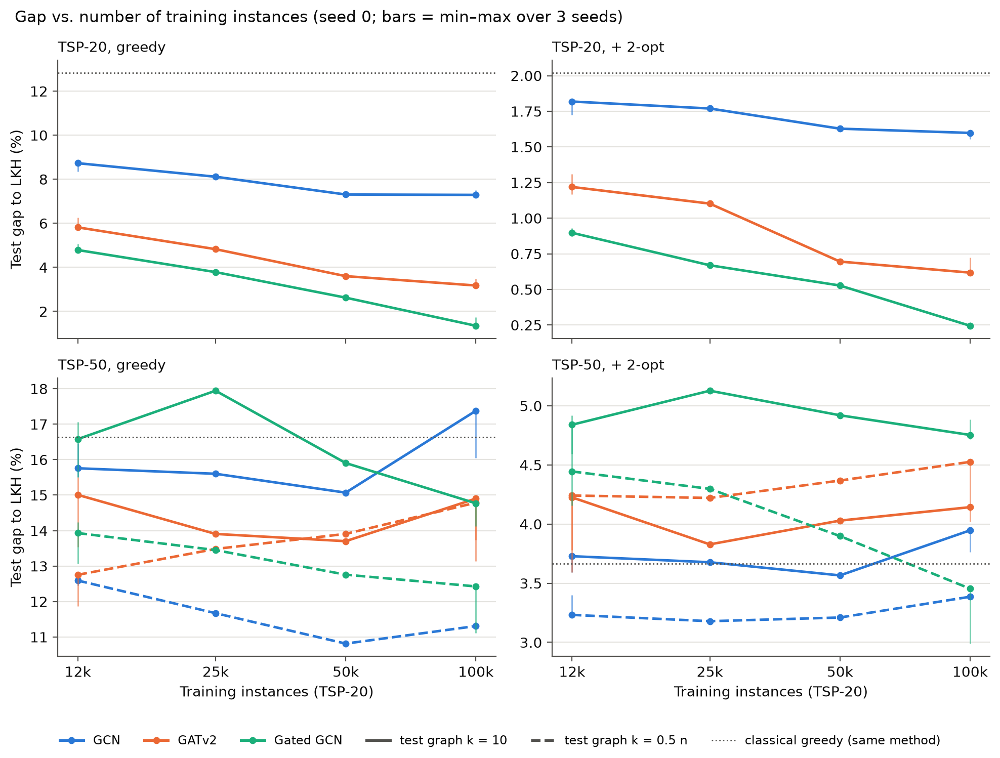

# Phase 2, step 5 — more training data

Generated by `scripts/phase2_datasize_report.py` on 2026-10-19.
Three models with the phase 1 configuration (BatchNorm, k = 10, raw distances, H=64, L=6, 20 epochs), trained on TSP-20 with 12k (phase 1), 25k, 50k and 100k instances; evaluated on TSP-20/50/100 with test graphs k = 10 and k = 0.5 n. Seeds: 0, 1, 2 at 12k and 100k; seed 0 only at 25k and 50k.

**More data also means more training.** All runs use 20 epochs with batch size 64, so the number of gradient steps grows with the data: 12k → 3 760 steps, 25k → 7 820, 50k → 15 640, 100k → 31 260. "More data" and "more training" are therefore not fully separated here: an improvement can come from either (a fixed-step control, e.g. 12k for ≈ 166 epochs, would be needed to separate them).

## Summary

1. **GCN**, greedy gap (seed 0, k = 10), 12k → 25k → 50k → 100k: TSP-20 8.73 → 8.11 → 7.31 → 7.29; TSP-50 15.76 → 15.60 → 15.07 → 17.38.
2. **GATv2**, greedy gap (seed 0, k = 10), 12k → 25k → 50k → 100k: TSP-20 5.81 → 4.82 → 3.60 → 3.17; TSP-50 15.01 → 13.91 → 13.70 → 14.90.
3. **Gated GCN**, greedy gap (seed 0, k = 10), 12k → 25k → 50k → 100k: TSP-20 4.79 → 3.78 → 2.62 → 1.35; TSP-50 16.58 → 17.94 → 15.91 → 14.77.
4. **100k vs. 12k, test graphs k = 10** (3 seeds, Table 3): TSP-20: 5 better / 0 worse of 6 (mean diff. -1.43 pp); TSP-50: 1 better / 0 worse of 6 (mean diff. -0.18 pp); TSP-100: 0 better / 0 worse of 6 (mean diff. +0.35 pp).
5. **100k vs. 12k, test graphs k = 0.5 n** (3 seeds, Table 3): TSP-20: 5 better / 0 worse of 6 (mean diff. -1.43 pp); TSP-50: 2 better / 0 worse of 6 (mean diff. -0.39 pp); TSP-100: 1 better / 2 worse of 6 (mean diff. +0.42 pp).

## Figure

Solid: test graphs k = 10; dashed: k = 0.5 n (TSP-50; identical to k = 10 on TSP-20). Points: seed 0. Vertical bars at 12k and 100k: min–max over the 3 seeds. Dotted grey: classical greedy (+ 2-opt).

## Table 1 — mean gap to LKH (%), seed 0

"missing" = expected but not found (failed or not yet run).

### Test graphs k = 10

| Model | Train | TSP-20 greedy | TSP-20 + 2-opt | TSP-50 greedy | TSP-50 + 2-opt | TSP-100 greedy | TSP-100 + 2-opt |
|---|---|---|---|---|---|---|---|
| Classical greedy | — | 12.83 | 2.02 | 16.63 | 3.66 | 17.71 | 4.29 |
| Christofides | — | 9.06 | 2.16 | 11.02 | 3.63 | 12.07 | 4.40 |
| GCN | 12k | 8.73 | 1.82 | 15.76 | 3.73 | 19.48 | 5.13 |
| GCN | 25k | 8.11 | 1.77 | 15.60 | 3.68 | 18.32 | 4.52 |
| GCN | 50k | 7.31 | 1.63 | 15.07 | 3.57 | 19.07 | 4.89 |
| GCN | 100k | 7.29 | 1.60 | 17.38 | 3.95 | 20.17 | 4.96 |
| GATv2 | 12k | 5.81 | 1.22 | 15.01 | 4.23 | 19.92 | 5.57 |
| GATv2 | 25k | 4.82 | 1.10 | 13.91 | 3.83 | 18.81 | 5.56 |
| GATv2 | 50k | 3.60 | 0.70 | 13.70 | 4.03 | 18.82 | 5.46 |
| GATv2 | 100k | 3.17 | 0.62 | 14.90 | 4.14 | 22.35 | 6.47 |
| Gated GCN | 12k | 4.79 | 0.90 | 16.58 | 4.84 | 24.35 | 7.36 |
| Gated GCN | 25k | 3.78 | 0.67 | 17.94 | 5.13 | 31.55 | 8.75 |
| Gated GCN | 50k | 2.62 | 0.53 | 15.91 | 4.92 | 24.91 | 7.62 |
| Gated GCN | 100k | 1.35 | 0.24 | 14.77 | 4.75 | 25.51 | 7.74 |

### Test graphs k = 0.5 n

| Model | Train | TSP-20 greedy | TSP-20 + 2-opt | TSP-50 greedy | TSP-50 + 2-opt | TSP-100 greedy | TSP-100 + 2-opt |
|---|---|---|---|---|---|---|---|
| Classical greedy | — | 12.83 | 2.02 | 16.63 | 3.66 | 17.71 | 4.29 |
| Christofides | — | 9.06 | 2.16 | 11.02 | 3.63 | 12.07 | 4.40 |
| GCN | 12k | 8.73 | 1.82 | 12.59 | 3.23 | 14.09 | 4.06 |
| GCN | 25k | 8.11 | 1.77 | 11.67 | 3.18 | 12.81 | 3.85 |
| GCN | 50k | 7.31 | 1.63 | 10.81 | 3.21 | 11.94 | 3.88 |
| GCN | 100k | 7.29 | 1.60 | 11.31 | 3.39 | 12.75 | 4.12 |
| GATv2 | 12k | 5.81 | 1.22 | 12.75 | 4.24 | 15.17 | 5.00 |
| GATv2 | 25k | 4.82 | 1.10 | 13.48 | 4.22 | 15.89 | 5.39 |
| GATv2 | 50k | 3.60 | 0.70 | 13.91 | 4.37 | 17.18 | 5.80 |
| GATv2 | 100k | 3.17 | 0.62 | 14.79 | 4.53 | 18.79 | 6.22 |
| Gated GCN | 12k | 4.79 | 0.90 | 13.93 | 4.44 | 16.38 | 5.76 |
| Gated GCN | 25k | 3.78 | 0.67 | 13.45 | 4.30 | 16.23 | 5.37 |
| Gated GCN | 50k | 2.62 | 0.53 | 12.76 | 3.90 | 16.05 | 5.26 |
| Gated GCN | 100k | 1.35 | 0.24 | 12.43 | 3.45 | 16.80 | 5.44 |

## Table 2 — mean ± std across seeds 0, 1, 2 (12k and 100k)

### Test graphs k = 10

| Model | Train | TSP-20 greedy | TSP-20 + 2-opt | TSP-50 greedy | TSP-50 + 2-opt | TSP-100 greedy | TSP-100 + 2-opt |
|---|---|---|---|---|---|---|---|
| GCN | 12k | 8.53 ± 0.19 | 1.79 ± 0.06 | 15.91 ± 0.49 | 3.66 ± 0.07 | 20.09 ± 0.81 | 5.07 ± 0.23 |
| GCN | 100k | 7.40 ± 0.11 | 1.59 ± 0.03 | 16.94 ± 0.77 | 3.86 ± 0.09 | 19.77 ± 0.89 | 4.92 ± 0.17 |
| GATv2 | 12k | 6.04 ± 0.22 | 1.23 ± 0.07 | 14.68 ± 1.02 | 4.07 ± 0.25 | 20.49 ± 2.66 | 5.63 ± 0.51 |
| GATv2 | 100k | 3.33 ± 0.15 | 0.66 ± 0.06 | 14.15 ± 0.65 | 4.10 ± 0.07 | 20.87 ± 1.79 | 6.14 ± 0.46 |
| Gated GCN | 12k | 4.85 ± 0.20 | 0.90 ± 0.03 | 16.38 ± 0.80 | 4.78 ± 0.17 | 23.96 ± 0.34 | 7.19 ± 0.16 |
| Gated GCN | 100k | 1.52 ± 0.19 | 0.26 ± 0.01 | 14.55 ± 0.37 | 4.78 ± 0.09 | 25.05 ± 1.23 | 7.79 ± 0.13 |

### Test graphs k = 0.5 n

| Model | Train | TSP-20 greedy | TSP-20 + 2-opt | TSP-50 greedy | TSP-50 + 2-opt | TSP-100 greedy | TSP-100 + 2-opt |
|---|---|---|---|---|---|---|---|
| GCN | 12k | 8.53 ± 0.19 | 1.79 ± 0.06 | 12.60 ± 0.15 | 3.32 ± 0.08 | 14.23 ± 0.14 | 4.07 ± 0.03 |
| GCN | 100k | 7.40 ± 0.11 | 1.59 ± 0.03 | 11.35 ± 0.06 | 3.39 ± 0.02 | 12.55 ± 0.18 | 4.07 ± 0.05 |
| GATv2 | 12k | 6.04 ± 0.22 | 1.23 ± 0.07 | 12.27 ± 0.45 | 3.99 ± 0.35 | 14.31 ± 0.76 | 4.60 ± 0.40 |
| GATv2 | 100k | 3.33 ± 0.15 | 0.66 ± 0.06 | 13.99 ± 0.82 | 4.36 ± 0.22 | 17.73 ± 0.92 | 5.77 ± 0.44 |
| Gated GCN | 12k | 4.85 ± 0.20 | 0.90 ± 0.03 | 13.74 ± 0.60 | 4.48 ± 0.35 | 15.83 ± 0.87 | 5.39 ± 0.51 |
| Gated GCN | 100k | 1.52 ± 0.19 | 0.26 ± 0.01 | 11.78 ± 0.66 | 3.20 ± 0.23 | 15.75 ± 0.93 | 5.09 ± 0.41 |

## Table 3 — paired per-instance comparisons, 100k vs. 12k

For each seed s, the gap of each test instance with 100k training instances is compared with phase 1 (12k, seed s); the table shows means across the 3 seed pairs. *Equal* = difference ≤ 1e-06 pp. Diff. = 100k − 12k (negative = more data helps). Two-sided Wilcoxon test (ties dropped); *max p* is the largest p-value across seeds. Significant only if max p < 1.39e-03 (Bonferroni: 0.05/36 tests) and the median has the same sign in every seed.

| Test graph | Model | Dataset | Method | Better | Equal | Worse | Mean diff. (pp) | Median diff. (pp) | max p (seeds) | Conclusion |
|---|---|---|---|---|---|---|---|---|---|---|
| k = 10 | GCN | TSP-20 | greedy | 53.6% | 7.5% | 38.9% | -1.13 | -0.52 | 8.1e-06 | **better** |
| k = 10 | GCN | TSP-20 | + 2-opt | 30.4% | 42.5% | 27.1% | -0.20 | +0.00 | 3.5e-01 | n.s. |
| k = 10 | GCN | TSP-50 | greedy | 45.4% | 0.0% | 54.6% | +1.04 | +0.87 | 1.7e-01 | n.s. |
| k = 10 | GCN | TSP-50 | + 2-opt | 46.8% | 1.5% | 51.7% | +0.20 | +0.17 | 2.9e-01 | n.s. |
| k = 10 | GCN | TSP-100 | greedy | 51.2% | 0.0% | 48.8% | -0.32 | -0.22 | 3.4e-02 | n.s. |
| k = 10 | GCN | TSP-100 | + 2-opt | 52.6% | 0.0% | 47.4% | -0.15 | -0.19 | 2.7e-01 | n.s. |
| k = 10 | GATv2 | TSP-20 | greedy | 61.8% | 15.8% | 22.4% | -2.71 | -1.24 | 3.2e-38 | **better** |
| k = 10 | GATv2 | TSP-20 | + 2-opt | 34.0% | 49.2% | 16.8% | -0.58 | +0.00 | 1.5e-18 | **better** |
| k = 10 | GATv2 | TSP-50 | greedy | 53.1% | 0.1% | 46.7% | -0.53 | -0.54 | 7.3e-01 | n.s. |
| k = 10 | GATv2 | TSP-50 | + 2-opt | 48.4% | 2.3% | 49.3% | +0.03 | +0.01 | 8.2e-01 | n.s. |
| k = 10 | GATv2 | TSP-100 | greedy | 48.2% | 0.0% | 51.8% | +0.39 | +0.45 | 2.2e-02 | n.s. |
| k = 10 | GATv2 | TSP-100 | + 2-opt | 44.2% | 0.0% | 55.8% | +0.51 | +0.43 | 5.1e-01 | n.s. |
| k = 10 | Gated GCN | TSP-20 | greedy | 61.7% | 25.0% | 13.3% | -3.33 | -0.94 | 1.3e-61 | **better** |
| k = 10 | Gated GCN | TSP-20 | + 2-opt | 32.1% | 57.8% | 10.1% | -0.64 | +0.00 | 5.8e-32 | **better** |
| k = 10 | Gated GCN | TSP-50 | greedy | 58.3% | 0.1% | 41.5% | -1.83 | -1.75 | 8.2e-05 | **better** |
| k = 10 | Gated GCN | TSP-50 | + 2-opt | 49.3% | 1.3% | 49.5% | +0.00 | +0.03 | 7.2e-01 | n.s. |
| k = 10 | Gated GCN | TSP-100 | greedy | 44.4% | 0.0% | 55.6% | +1.09 | +1.17 | 7.3e-01 | n.s. |
| k = 10 | Gated GCN | TSP-100 | + 2-opt | 43.1% | 0.0% | 56.9% | +0.60 | +0.57 | 1.9e-02 | n.s. |
| k = 0.5 n | GCN | TSP-20 | greedy | 53.6% | 7.5% | 38.9% | -1.13 | -0.52 | 8.1e-06 | **better** |
| k = 0.5 n | GCN | TSP-20 | + 2-opt | 30.4% | 42.5% | 27.1% | -0.20 | +0.00 | 3.5e-01 | n.s. |
| k = 0.5 n | GCN | TSP-50 | greedy | 56.2% | 0.0% | 43.8% | -1.25 | -1.00 | 3.7e-03 | n.s. |
| k = 0.5 n | GCN | TSP-50 | + 2-opt | 47.5% | 3.5% | 49.0% | +0.07 | +0.00 | 9.3e-01 | n.s. |
| k = 0.5 n | GCN | TSP-100 | greedy | 61.6% | 0.0% | 38.4% | -1.68 | -1.69 | 5.8e-08 | **better** |
| k = 0.5 n | GCN | TSP-100 | + 2-opt | 50.1% | 0.1% | 49.9% | -0.01 | -0.01 | 7.6e-01 | n.s. |
| k = 0.5 n | GATv2 | TSP-20 | greedy | 61.8% | 15.8% | 22.4% | -2.71 | -1.24 | 3.2e-38 | **better** |
| k = 0.5 n | GATv2 | TSP-20 | + 2-opt | 34.0% | 49.2% | 16.8% | -0.58 | +0.00 | 1.5e-18 | **better** |
| k = 0.5 n | GATv2 | TSP-50 | greedy | 40.7% | 0.5% | 58.7% | +1.72 | +1.48 | 7.5e-03 | n.s. |
| k = 0.5 n | GATv2 | TSP-50 | + 2-opt | 44.8% | 4.8% | 50.4% | +0.37 | +0.04 | 1.3e-01 | n.s. |
| k = 0.5 n | GATv2 | TSP-100 | greedy | 28.1% | 0.0% | 71.9% | +3.42 | +3.34 | 7.7e-27 | **worse** |
| k = 0.5 n | GATv2 | TSP-100 | + 2-opt | 34.5% | 0.0% | 65.5% | +1.16 | +0.99 | 5.5e-16 | **worse** |
| k = 0.5 n | Gated GCN | TSP-20 | greedy | 61.7% | 25.0% | 13.3% | -3.33 | -0.94 | 1.3e-61 | **better** |
| k = 0.5 n | Gated GCN | TSP-20 | + 2-opt | 32.1% | 57.8% | 10.1% | -0.64 | +0.00 | 5.8e-32 | **better** |
| k = 0.5 n | Gated GCN | TSP-50 | greedy | 59.9% | 1.3% | 38.9% | -1.97 | -1.55 | 8.0e-05 | **better** |
| k = 0.5 n | Gated GCN | TSP-50 | + 2-opt | 58.5% | 6.0% | 35.5% | -1.28 | -0.74 | 1.8e-09 | **better** |
| k = 0.5 n | Gated GCN | TSP-100 | greedy | 50.7% | 0.0% | 49.3% | -0.08 | -0.12 | 6.4e-01 | n.s. |
| k = 0.5 n | Gated GCN | TSP-100 | + 2-opt | 54.3% | 0.4% | 45.3% | -0.29 | -0.32 | 9.0e-02 | n.s. |

## Selected epochs

Epoch with the best TSP-20 validation gap (greedy), which is the checkpoint evaluated above.

| Model | 12k seed 0 | 12k seed 1 | 12k seed 2 | 25k seed 0 | 50k seed 0 | 100k seed 0 | 100k seed 1 | 100k seed 2 |
|---|---|---|---|---|---|---|---|---|
| GCN | 13 | 2 | 5 | 17 | 13 | 8 | 11 | 15 |
| GATv2 | 17 | 7 | 17 | 19 | 20 | 14 | 10 | 20 |
| Gated GCN | 17 | 20 | 17 | 15 | 15 | 20 | 18 | 15 |

## Decisions

Choices made without asking (the most conservative option each time):

1. `data/tsp20_train100k.npz`: 100000 TSP-20 instances, seed 8, LKH with the phase 1 settings. The 25k and 50k sets are its first 25000 and 50000 instances (`--num-train`), so 25k ⊂ 50k ⊂ 100k. The 12k point is phase 1, trained on a *different* file (`tsp20_train.npz`, seed 1): going from 12k to 25k also changes the instances, not only their number.
2. Validation (`tsp20_val`, used for model selection) and test sets are the phase 1 ones; nothing else changes (BatchNorm, k = 10, raw distances, batch size 64, lr 1e-3 with cosine schedule over 20 epochs).
3. Run names are `<model>_data<size>_seed<s>` (not `train50k`, to avoid confusion with the TSP-50 control `<model>_train50_seed<s>`).
4. k = 0.5 n evaluations include TSP-20 for the new models (k = 10 there, so they must equal the k = 10 values; a check). For the phase 1 models the TSP-20 k = 0.5 n column reuses the k = 10 evaluation, which is the same graph; their TSP-50/100 k = 0.5 n values are those of batch 2 (`results/phase2_batch2/kfrac05/`), not recomputed. k = 0.5 n evaluations use 64 graphs per forward pass (as in batch 2).
5. Table 1 and the figure use **seed 0** at every size, because 25k and 50k only have seed 0; Table 2 gives mean ± std across the 3 seeds where they exist (12k and 100k). Statistical tests (Table 3) compare only 100k with 12k, pairing seed s with seed s, as in batch 2; single-seed tests at 25k/50k were not run because they cannot separate the effect of the data from seed-to-seed variation.
6. The Bonferroni correction is applied over all tests of Table 3 (both kinds of test graph together).
7. Conservative reading of the rules: nothing from phase 1, experiment 1 or batch 2 was rewritten (new folders only); a failed step is logged and the steps that depend on it are skipped; the report is copied to `docs/` but not committed.

## Missing results

None.
