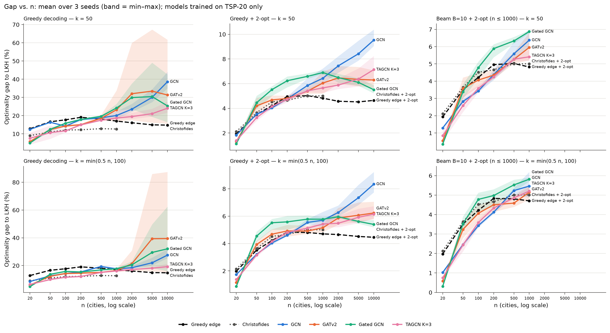
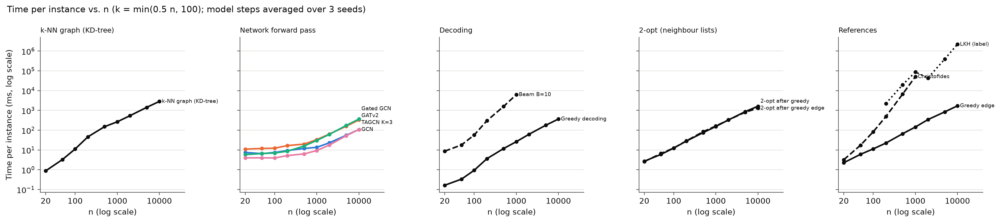

# Phase 2 — scale experiment: how far does the whole-instance GNN go?

Generated by `scripts/phase2_scale_report.py` on 2026-10-21 (results from commit(s) 1a65774, 36cb718, 4cd45e2).

## Setup

- **No retraining.** GCN, GATv2 and Gated GCN (phase 1) and TAGCN K=3, BatchNorm, best.pt, seeds 0–2, all trained on TSP-20 with k = 10 and raw distances.
- **Test sets.** TSP-20/50/100 are the phase 1 test sets; TSP-200 … TSP-10000 are new (uniform in [0,1]², LKH labels from the coordinates, `scripts/make_scale_data.py`). LKH uses 10 runs up to n = 1000 (as the phase 1 sets) and 1 run above, so the reference for n ≥ 2000 is slightly weaker; its time per instance is in Table 1. TSP-10000: the 3 instances were solved in parallel, so 3 instances took the wall time of one.
- **Graphs.** k-NN with a KD-tree (same edges as the phase 1 code): (a) k = 50; (b) k = min(0.5 n, 100) (= the earlier k = 0.5 n up to TSP-200). Never more than n − 1.
- **Decoding.** Sparse versions of the phase 1 decoders that give the same tours (tests/test_scale.py; Table 9): greedy at every n, beam B=10 up to n = 1000, B=100 on TSP-200 only.
- **2-opt.** Neighbour lists (the same k nearest neighbours) with don't-look bits: O(n·k) per sweep, limit 10 min per call (a timeout is reported, never hidden). It differs from the full 2-opt of phase 1, so every method here — baselines included — uses this 2-opt, with the k of the column.
- **Baselines.** Greedy edge (+ 2-opt) at every n; Christofides (+ 2-opt) up to n = 1000 (networkx, needs the complete graph).
- **Tests.** Paired Wilcoxon per instance, where there are ≥ 20 instances (n ≤ 1000); one test per seed, max p over the 3 seeds, the seeds' medians must agree in sign (a zero median is neutral); Bonferroni within each size (family = every model × k × comparison at that n). Below 20 instances only the mean difference and the count of better instances are given.

## Table 1 — Test sets and LKH time

| n | Instances | Seed | LKH runs | LKH time per instance (s): mean / max |
|---|---|---|---|---|
| 20 | 1000 | 3 | 10 | — (phase 1 set, not timed) |
| 50 | 500 | 4 | 10 | — (phase 1 set, not timed) |
| 100 | 500 | 5 | 10 | — (phase 1 set, not timed) |
| 200 | 100 | 9 | 10 | 2.2 / 5.9 |
| 500 | 50 | 10 | 10 | 19.7 / 41.8 |
| 1000 | 20 | 11 | 10 | 86.8 / 148.0 |
| 2000 | 10 | 12 | 1 | 43.4 / 62.2 |
| 5000 | 5 | 13 | 1 | 393.9 / 421.2 |
| 10000 | 3 | 14 | 1 | 2183.4 / 2336.3 |

## Table 2 — Gap (%) vs. n, greedy and greedy + 2-opt

Mean ± std over the 3 seeds of each seed's mean gap. Baselines are deterministic.

### k = 50

| Method | 20 | 50 | 100 | 200 | 500 | 1000 | 2000 | 5000 | 10000 |
|---|---|---|---|---|---|---|---|---|---|
| Greedy edge | 12.83 | 16.63 | 17.71 | 19.09 | 18.11 | 17.02 | 16.09 | 14.95 | 14.80 |
| Greedy edge + 2-opt | 1.93 | 3.50 | 4.22 | 4.96 | 5.02 | 4.82 | 4.58 | 4.52 | 4.64 |
| Christofides | 9.06 | 11.02 | 12.07 | 12.24 | 12.85 | 12.65 | — | — | — |
| Christofides + 2-opt | 2.12 | 3.64 | 4.52 | 4.66 | 5.01 | 5.01 | — | — | — |
| GCN greedy | 12.45 ± 0.22 | 16.36 ± 0.30 | 14.23 ± 0.14 | 17.89 ± 0.24 | 18.80 ± 0.99 | 20.07 ± 1.99 | 23.55 ± 2.52 | 30.05 ± 3.83 | 38.60 ± 4.83 |
| GCN greedy + 2-opt | 1.82 ± 0.02 | 3.53 ± 0.07 | 4.04 ± 0.13 | 4.77 ± 0.17 | 5.85 ± 0.52 | 6.44 ± 0.69 | 7.44 ± 0.69 | 8.42 ± 0.92 | 9.53 ± 0.74 |
| GATv2 greedy | 5.77 ± 0.13 | 12.39 ± 0.78 | 14.31 ± 0.76 | 15.04 ± 0.48 | 18.54 ± 1.67 | 23.21 ± 9.21 | 32.05 ± 24.20 | 33.46 ± 29.31 | 31.34 ± 26.32 |
| GATv2 greedy + 2-opt | 1.30 ± 0.07 | 4.20 ± 0.59 | 4.68 ± 0.35 | 4.80 ± 0.21 | 5.39 ± 0.30 | 6.05 ± 0.90 | 6.46 ± 0.84 | 6.35 ± 0.87 | 6.29 ± 0.73 |
| Gated GCN greedy | 4.99 ± 0.21 | 12.46 ± 1.03 | 15.83 ± 0.87 | 17.89 ± 0.88 | 19.64 ± 0.44 | 24.21 ± 1.94 | 29.92 ± 7.11 | 30.46 ± 16.22 | 25.36 ± 15.01 |
| Gated GCN greedy + 2-opt | 1.13 ± 0.05 | 4.46 ± 0.53 | 5.52 ± 0.44 | 6.24 ± 0.47 | 6.59 ± 0.23 | 6.90 ± 0.18 | 6.49 ± 0.37 | 6.10 ± 0.32 | 5.51 ± 0.34 |
| TAGCN K=3 greedy | 7.59 ± 3.24 | 10.66 ± 3.72 | 11.66 ± 0.75 | 14.94 ± 0.24 | 17.48 ± 0.65 | 18.69 ± 0.90 | 19.50 ± 1.80 | 21.08 ± 2.35 | 24.08 ± 3.18 |
| TAGCN K=3 greedy + 2-opt | 1.38 ± 0.06 | 3.25 ± 0.44 | 4.15 ± 0.14 | 4.73 ± 0.30 | 5.42 ± 0.17 | 5.66 ± 0.42 | 5.88 ± 0.46 | 6.38 ± 0.77 | 7.14 ± 0.98 |

### k = min(0.5 n, 100)

| Method | 20 | 50 | 100 | 200 | 500 | 1000 | 2000 | 5000 | 10000 |
|---|---|---|---|---|---|---|---|---|---|
| Greedy edge | 12.83 | 16.63 | 17.71 | 19.09 | 18.11 | 17.02 | 16.09 | 14.95 | 14.80 |
| Greedy edge + 2-opt | 1.98 | 3.51 | 4.22 | 4.83 | 4.81 | 4.70 | 4.66 | 4.52 | 4.46 |
| Christofides | 9.06 | 11.02 | 12.07 | 12.24 | 12.85 | 12.65 | — | — | — |
| Christofides + 2-opt | 2.13 | 3.63 | 4.52 | 4.66 | 5.01 | 5.01 | — | — | — |
| GCN greedy | 8.53 ± 0.19 | 12.60 ± 0.15 | 14.23 ± 0.14 | 15.47 ± 0.19 | 19.36 ± 0.64 | 17.59 ± 0.99 | 18.45 ± 1.24 | 22.02 ± 3.18 | 27.55 ± 3.87 |
| GCN greedy + 2-opt | 1.73 ± 0.04 | 3.21 ± 0.00 | 4.04 ± 0.13 | 4.61 ± 0.09 | 5.54 ± 0.22 | 5.70 ± 0.56 | 6.27 ± 0.44 | 7.35 ± 0.82 | 8.34 ± 0.79 |
| GATv2 greedy | 6.04 ± 0.22 | 12.27 ± 0.45 | 14.31 ± 0.76 | 14.54 ± 0.79 | 15.14 ± 0.50 | 16.41 ± 1.10 | 21.34 ± 8.25 | 39.34 ± 40.42 | 39.47 ± 41.56 |
| GATv2 greedy + 2-opt | 1.16 ± 0.04 | 3.93 ± 0.33 | 4.68 ± 0.35 | 4.92 ± 0.43 | 4.91 ± 0.34 | 5.15 ± 0.29 | 5.86 ± 0.65 | 6.07 ± 0.81 | 6.23 ± 0.71 |
| Gated GCN greedy | 4.85 ± 0.20 | 13.74 ± 0.60 | 15.83 ± 0.87 | 15.40 ± 0.79 | 16.92 ± 0.62 | 17.72 ± 0.56 | 20.54 ± 2.23 | 29.46 ± 17.56 | 32.08 ± 26.33 |
| Gated GCN greedy + 2-opt | 0.88 ± 0.05 | 4.54 ± 0.37 | 5.52 ± 0.44 | 5.58 ± 0.52 | 5.78 ± 0.33 | 5.78 ± 0.15 | 5.95 ± 0.11 | 5.61 ± 0.14 | 5.40 ± 0.28 |
| TAGCN K=3 greedy | 6.44 ± 0.25 | 10.01 ± 0.78 | 11.66 ± 0.75 | 12.16 ± 0.48 | 15.12 ± 0.37 | 16.14 ± 0.25 | 17.17 ± 0.26 | 18.13 ± 0.73 | 19.24 ± 1.88 |
| TAGCN K=3 greedy + 2-opt | 1.37 ± 0.08 | 3.16 ± 0.13 | 4.15 ± 0.14 | 4.81 ± 0.12 | 5.12 ± 0.16 | 5.43 ± 0.29 | 5.48 ± 0.47 | 5.92 ± 0.56 | 6.15 ± 0.50 |

## Table 3 — Beam search (%)

### k = 50

| Method | 20 | 50 | 100 | 200 | 500 | 1000 | 2000 | 5000 | 10000 |
|---|---|---|---|---|---|---|---|---|---|
| Greedy edge | 12.83 | 16.63 | 17.71 | 19.09 | 18.11 | 17.02 | 16.09 | 14.95 | 14.80 |
| Greedy edge + 2-opt | 1.93 | 3.50 | 4.22 | 4.96 | 5.02 | 4.82 | 4.58 | 4.52 | 4.64 |
| Christofides | 9.06 | 11.02 | 12.07 | 12.24 | 12.85 | 12.65 | — | — | — |
| Christofides + 2-opt | 2.12 | 3.64 | 4.52 | 4.66 | 5.01 | 5.01 | — | — | — |
| GCN B=10 | 4.89 ± 0.10 | 10.15 ± 0.16 | 10.02 ± 0.10 | 14.48 ± 0.07 | 17.10 ± 1.07 | 19.14 ± 2.04 | — | — | — |
| GCN B=10 + 2-opt | 1.29 ± 0.04 | 2.83 ± 0.10 | 3.43 ± 0.10 | 4.38 ± 0.30 | 5.59 ± 0.60 | 6.38 ± 0.54 | — | — | — |
| GCN B=100 | — | — | — | 12.03 ± 0.25 | — | — | — | — | — |
| GCN B=100 + 2-opt | — | — | — | 3.93 ± 0.09 | — | — | — | — | — |
| GATv2 B=10 | 1.20 ± 0.19 | 7.44 ± 0.73 | 9.96 ± 0.71 | 12.30 ± 0.52 | 17.33 ± 1.63 | 22.04 ± 9.06 | — | — | — |
| GATv2 B=10 + 2-opt | 0.55 ± 0.06 | 3.59 ± 0.58 | 4.06 ± 0.41 | 4.35 ± 0.29 | 5.27 ± 0.35 | 5.95 ± 0.80 | — | — | — |
| GATv2 B=100 | — | — | — | 9.89 ± 0.34 | — | — | — | — | — |
| GATv2 B=100 + 2-opt | — | — | — | 3.95 ± 0.22 | — | — | — | — | — |
| Gated GCN B=10 | 0.72 ± 0.03 | 6.88 ± 0.73 | 11.01 ± 0.79 | 14.74 ± 0.83 | 18.54 ± 0.40 | 23.43 ± 1.60 | — | — | — |
| Gated GCN B=10 + 2-opt | 0.35 ± 0.03 | 3.38 ± 0.41 | 4.78 ± 0.53 | 5.89 ± 0.44 | 6.33 ± 0.20 | 6.88 ± 0.09 | — | — | — |
| Gated GCN B=100 | — | — | — | 12.18 ± 0.58 | — | — | — | — | — |
| Gated GCN B=100 + 2-opt | — | — | — | 5.38 ± 0.29 | — | — | — | — | — |
| TAGCN K=3 B=10 | 3.04 ± 1.92 | 6.70 ± 3.06 | 8.36 ± 0.64 | 12.25 ± 0.12 | 16.26 ± 0.33 | 17.81 ± 0.63 | — | — | — |
| TAGCN K=3 B=10 + 2-opt | 0.84 ± 0.30 | 2.59 ± 0.51 | 3.59 ± 0.21 | 4.25 ± 0.12 | 5.27 ± 0.12 | 5.41 ± 0.36 | — | — | — |
| TAGCN K=3 B=100 | — | — | — | 10.20 ± 0.47 | — | — | — | — | — |
| TAGCN K=3 B=100 + 2-opt | — | — | — | 3.91 ± 0.21 | — | — | — | — | — |

### k = min(0.5 n, 100)

| Method | 20 | 50 | 100 | 200 | 500 | 1000 | 2000 | 5000 | 10000 |
|---|---|---|---|---|---|---|---|---|---|
| Greedy edge | 12.83 | 16.63 | 17.71 | 19.09 | 18.11 | 17.02 | 16.09 | 14.95 | 14.80 |
| Greedy edge + 2-opt | 1.98 | 3.51 | 4.22 | 4.83 | 4.81 | 4.70 | 4.66 | 4.52 | 4.46 |
| Christofides | 9.06 | 11.02 | 12.07 | 12.24 | 12.85 | 12.65 | — | — | — |
| Christofides + 2-opt | 2.13 | 3.63 | 4.52 | 4.66 | 5.01 | 5.01 | — | — | — |
| GCN B=10 | 3.12 ± 0.19 | 7.32 ± 0.21 | 10.02 ± 0.10 | 12.33 ± 0.18 | 16.81 ± 0.34 | 16.27 ± 1.06 | — | — | — |
| GCN B=10 + 2-opt | 1.02 ± 0.10 | 2.46 ± 0.10 | 3.43 ± 0.11 | 4.12 ± 0.08 | 5.23 ± 0.19 | 5.46 ± 0.67 | — | — | — |
| GCN B=100 | — | — | — | 9.93 ± 0.24 | — | — | — | — | — |
| GCN B=100 + 2-opt | — | — | — | 3.74 ± 0.06 | — | — | — | — | — |
| GATv2 B=10 | 1.37 ± 0.21 | 7.24 ± 0.45 | 9.96 ± 0.71 | 11.57 ± 0.52 | 13.47 ± 0.40 | 15.54 ± 1.14 | — | — | — |
| GATv2 B=10 + 2-opt | 0.58 ± 0.05 | 3.23 ± 0.42 | 4.06 ± 0.41 | 4.50 ± 0.32 | 4.59 ± 0.33 | 5.15 ± 0.38 | — | — | — |
| GATv2 B=100 | — | — | — | 9.48 ± 0.33 | — | — | — | — | — |
| GATv2 B=100 + 2-opt | — | — | — | 3.90 ± 0.41 | — | — | — | — | — |
| Gated GCN B=10 | 0.66 ± 0.05 | 7.75 ± 0.56 | 11.01 ± 0.79 | 12.05 ± 0.82 | 15.00 ± 0.31 | 16.39 ± 0.45 | — | — | — |
| Gated GCN B=10 + 2-opt | 0.32 ± 0.03 | 3.52 ± 0.36 | 4.78 ± 0.53 | 4.97 ± 0.51 | 5.52 ± 0.31 | 5.82 ± 0.10 | — | — | — |
| Gated GCN B=100 | — | — | — | 9.71 ± 0.37 | — | — | — | — | — |
| Gated GCN B=100 + 2-opt | — | — | — | 4.38 ± 0.42 | — | — | — | — | — |
| TAGCN K=3 B=10 | 2.12 ± 0.05 | 5.73 ± 0.73 | 8.36 ± 0.64 | 9.51 ± 0.70 | 13.23 ± 0.83 | 15.01 ± 0.48 | — | — | — |
| TAGCN K=3 B=10 + 2-opt | 0.75 ± 0.02 | 2.44 ± 0.30 | 3.59 ± 0.21 | 4.34 ± 0.17 | 4.86 ± 0.08 | 5.20 ± 0.18 | — | — | — |
| TAGCN K=3 B=100 | — | — | — | 7.91 ± 0.67 | — | — | — | — | — |
| TAGCN K=3 B=100 + 2-opt | — | — | — | 3.92 ± 0.17 | — | — | — | — | — |

## Table 4 — Paired tests against the baselines

Cell: verdict, mean difference model − baseline (pp; negative = model better), max p over seeds. Bonferroni thresholds: n = 20: 0.05/48 = 1.04e-03; n = 50: 0.05/48 = 1.04e-03; n = 100: 0.05/48 = 1.04e-03; n = 200: 0.05/48 = 1.04e-03; n = 500: 0.05/48 = 1.04e-03; n = 1000: 0.05/48 = 1.04e-03.

### greedy vs. greedy edge

| Model | k | 20 | 50 | 100 | 200 | 500 | 1000 |
|---|---|---|---|---|---|---|---|
| GCN | k = 50 | n.s. -0.38 (p 5.2e-01) | n.s. -0.27 (p 8.4e-01) | **better** -3.48 (p 3.7e-23) | n.s. -1.20 (p 1.2e-01) | n.s. +0.69 (p 9.5e-01) | n.s. +3.06 (p 3.6e-02) |
| GATv2 | k = 50 | **better** -7.06 (p 1.2e-79) | **better** -4.24 (p 7.5e-18) | **better** -3.40 (p 3.5e-14) | **better** -4.04 (p 5.4e-09) | n.s. +0.43 (p 6.5e-01) | n.s. +6.20 (p 9.3e-01) |
| Gated GCN | k = 50 | **better** -7.84 (p 3.9e-93) | **better** -4.16 (p 3.0e-17) | **better** -1.89 (p 2.3e-05) | n.s. -1.20 (p 4.7e-01) | n.s. +1.54 (p 5.4e-02) | **worse** +7.20 (p 3.8e-06) |
| TAGCN K=3 | k = 50 | **better** -5.24 (p 8.7e-11) | **better** -5.97 (p 4.8e-08) | **better** -6.05 (p 5.5e-50) | **better** -4.15 (p 5.4e-09) | n.s. -0.63 (p 9.4e-01) | n.s. +1.67 (p 2.3e-01) |
| GCN | k = min(0.5 n, 100) | **better** -4.29 (p 2.4e-36) | **better** -4.03 (p 2.3e-24) | **better** -3.48 (p 3.7e-23) | **better** -3.62 (p 2.5e-07) | n.s. +1.25 (p 2.4e-01) | n.s. +0.58 (p 9.3e-01) |
| GATv2 | k = min(0.5 n, 100) | **better** -6.79 (p 6.5e-74) | **better** -4.35 (p 1.3e-21) | **better** -3.40 (p 3.5e-14) | **better** -4.55 (p 4.8e-09) | **better** -2.97 (p 5.9e-05) | n.s. -0.61 (p 6.2e-01) |
| Gated GCN | k = min(0.5 n, 100) | **better** -7.98 (p 2.6e-92) | **better** -2.88 (p 5.6e-09) | **better** -1.89 (p 2.3e-05) | **better** -3.69 (p 2.0e-07) | n.s. -1.19 (p 1.2e-01) | n.s. +0.71 (p 7.3e-01) |
| TAGCN K=3 | k = min(0.5 n, 100) | **better** -6.39 (p 6.9e-72) | **better** -6.62 (p 3.4e-46) | **better** -6.05 (p 5.5e-50) | **better** -6.92 (p 3.1e-16) | **better** -2.99 (p 6.0e-06) | n.s. -0.88 (p 5.2e-01) |

### greedy + 2-opt vs. greedy edge + 2-opt

| Model | k | 20 | 50 | 100 | 200 | 500 | 1000 |
|---|---|---|---|---|---|---|---|
| GCN | k = 50 | n.s. -0.11 (p 2.4e-01) | n.s. +0.03 (p 9.3e-01) | n.s. -0.17 (p 8.8e-01) | n.s. -0.19 (p 8.9e-01) | n.s. +0.83 (p 4.2e-02) | **worse** +1.61 (p 1.0e-04) |
| GATv2 | k = 50 | **better** -0.63 (p 4.4e-08) | n.s. +0.70 (p 1.3e-01) | n.s. +0.47 (p 1.6e-01) | n.s. -0.16 (p 5.6e-01) | n.s. +0.37 (p 1.6e-01) | n.s. +1.23 (p 1.2e-01) |
| Gated GCN | k = 50 | **better** -0.80 (p 6.9e-15) | n.s. +0.96 (p 6.2e-03) | **worse** +1.30 (p 2.9e-08) | **worse** +1.28 (p 6.8e-04) | **worse** +1.57 (p 8.4e-08) | **worse** +2.08 (p 3.8e-06) |
| TAGCN K=3 | k = 50 | **better** -0.55 (p 2.2e-06) | n.s. -0.25 (p 7.5e-02) | n.s. -0.06 (p 7.5e-01) | n.s. -0.23 (p 4.0e-01) | n.s. +0.40 (p 2.0e-01) | n.s. +0.83 (p 4.0e-02) |
| GCN | k = min(0.5 n, 100) | n.s. -0.24 (p 1.2e-01) | n.s. -0.30 (p 1.1e-01) | n.s. -0.17 (p 8.8e-01) | n.s. -0.22 (p 6.7e-01) | n.s. +0.74 (p 3.1e-03) | n.s. +1.00 (p 3.0e-02) |
| GATv2 | k = min(0.5 n, 100) | **better** -0.82 (p 7.9e-14) | n.s. +0.42 (p 5.9e-01) | n.s. +0.47 (p 1.6e-01) | n.s. +0.09 (p 5.2e-01) | n.s. +0.11 (p 7.8e-01) | n.s. +0.45 (p 1.0e+00) |
| Gated GCN | k = min(0.5 n, 100) | **better** -1.10 (p 4.9e-25) | **worse** +1.03 (p 5.0e-04) | **worse** +1.30 (p 2.9e-08) | n.s. +0.75 (p 3.8e-01) | n.s. +0.97 (p 1.8e-03) | **worse** +1.07 (p 1.0e-04) |
| TAGCN K=3 | k = min(0.5 n, 100) | **better** -0.60 (p 6.3e-07) | n.s. -0.35 (p 1.9e-01) | n.s. -0.06 (p 7.5e-01) | n.s. -0.02 (p 7.7e-01) | n.s. +0.32 (p 1.7e-01) | n.s. +0.72 (p 3.6e-02) |

### B=10 + 2-opt vs. greedy edge + 2-opt

| Model | k | 20 | 50 | 100 | 200 | 500 | 1000 |
|---|---|---|---|---|---|---|---|
| GCN | k = 50 | **better** -0.65 (p 1.8e-13) | **better** -0.67 (p 5.9e-06) | **better** -0.79 (p 3.1e-07) | n.s. -0.58 (p 8.5e-02) | n.s. +0.56 (p 1.3e-01) | **worse** +1.55 (p 4.8e-05) |
| GATv2 | k = 50 | **better** -1.38 (p 1.6e-49) | n.s. +0.09 (p 7.1e-01) | n.s. -0.15 (p 3.3e-01) | n.s. -0.61 (p 1.1e-01) | n.s. +0.24 (p 7.3e-01) | n.s. +1.13 (p 9.7e-02) |
| Gated GCN | k = 50 | **better** -1.58 (p 8.5e-68) | n.s. -0.12 (p 3.1e-01) | n.s. +0.57 (p 8.5e-01) | n.s. +0.93 (p 5.4e-02) | **worse** +1.31 (p 2.1e-06) | **worse** +2.05 (p 3.8e-06) |
| TAGCN K=3 | k = 50 | **better** -1.09 (p 5.1e-17) | n.s. -0.91 (p 4.4e-02) | **better** -0.63 (p 1.6e-04) | n.s. -0.71 (p 4.1e-03) | n.s. +0.25 (p 6.1e-01) | n.s. +0.59 (p 1.8e-01) |
| GCN | k = min(0.5 n, 100) | **better** -0.95 (p 1.1e-17) | **better** -1.05 (p 8.8e-11) | **better** -0.79 (p 3.1e-07) | **better** -0.71 (p 5.6e-04) | n.s. +0.43 (p 1.1e-01) | n.s. +0.76 (p 4.7e-01) |
| GATv2 | k = min(0.5 n, 100) | **better** -1.39 (p 9.7e-46) | n.s. -0.28 (p 4.0e-01) | n.s. -0.15 (p 3.4e-01) | n.s. -0.33 (p 8.3e-01) | n.s. -0.22 (p 4.2e-01) | n.s. +0.44 (p 6.5e-01) |
| Gated GCN | k = min(0.5 n, 100) | **better** -1.66 (p 8.8e-68) | n.s. +0.01 (p 8.4e-01) | n.s. +0.56 (p 8.5e-01) | n.s. +0.15 (p 1.1e-01) | n.s. +0.72 (p 2.1e-02) | **worse** +1.11 (p 4.8e-05) |
| TAGCN K=3 | k = min(0.5 n, 100) | **better** -1.22 (p 1.4e-33) | **better** -1.07 (p 1.3e-07) | **better** -0.63 (p 1.5e-04) | n.s. -0.49 (p 6.4e-02) | n.s. +0.05 (p 9.6e-01) | n.s. +0.50 (p 1.4e-01) |

### greedy vs. Christofides

| Model | k | 20 | 50 | 100 | 200 | 500 | 1000 |
|---|---|---|---|---|---|---|---|
| GCN | k = 50 | **worse** +3.39 (p 1.6e-25) | **worse** +5.34 (p 5.8e-40) | **worse** +2.16 (p 4.0e-17) | **worse** +5.65 (p 4.5e-15) | **worse** +5.95 (p 5.3e-15) | **worse** +7.42 (p 1.9e-06) |
| GATv2 | k = 50 | **better** -3.28 (p 2.6e-42) | n.s. +1.37 (p 1.8e-02) | **worse** +2.24 (p 9.0e-15) | **worse** +2.80 (p 2.0e-08) | **worse** +5.69 (p 8.9e-15) | **worse** +10.56 (p 1.9e-06) |
| Gated GCN | k = 50 | **better** -4.07 (p 2.7e-53) | n.s. +1.45 (p 2.5e-01) | **worse** +3.76 (p 1.5e-30) | **worse** +5.65 (p 1.9e-15) | **worse** +6.79 (p 1.8e-15) | **worse** +11.56 (p 1.9e-06) |
| TAGCN K=3 | k = 50 | n.s. -1.47 (p 4.6e-05) | n.s. -0.36 (p 1.9e-04) | n.s. -0.41 (p 3.3e-01) | **worse** +2.70 (p 9.5e-09) | **worse** +4.62 (p 8.8e-12) | **worse** +6.04 (p 1.9e-06) |
| GCN | k = min(0.5 n, 100) | n.s. -0.52 (p 1.5e-03) | **worse** +1.58 (p 1.7e-06) | **worse** +2.16 (p 4.0e-17) | **worse** +3.23 (p 2.6e-10) | **worse** +6.50 (p 3.4e-14) | **worse** +4.95 (p 1.9e-06) |
| GATv2 | k = min(0.5 n, 100) | **better** -3.01 (p 2.6e-38) | n.s. +1.26 (p 1.1e-02) | **worse** +2.24 (p 9.0e-15) | **worse** +2.29 (p 1.6e-05) | **worse** +2.28 (p 4.3e-07) | **worse** +3.76 (p 2.7e-05) |
| Gated GCN | k = min(0.5 n, 100) | **better** -4.21 (p 3.8e-55) | **worse** +2.73 (p 1.7e-09) | **worse** +3.76 (p 1.5e-30) | **worse** +3.16 (p 2.3e-08) | **worse** +4.06 (p 1.0e-10) | **worse** +5.07 (p 3.8e-06) |
| TAGCN K=3 | k = min(0.5 n, 100) | **better** -2.62 (p 1.5e-28) | n.s. -1.01 (p 3.9e-02) | n.s. -0.41 (p 3.3e-01) | n.s. -0.08 (p 9.5e-01) | **worse** +2.26 (p 3.6e-05) | **worse** +3.49 (p 1.9e-06) |

### greedy + 2-opt vs. Christofides + 2-opt

| Model | k | 20 | 50 | 100 | 200 | 500 | 1000 |
|---|---|---|---|---|---|---|---|
| GCN | k = 50 | n.s. -0.29 (p 3.4e-03) | n.s. -0.11 (p 3.5e-01) | n.s. -0.48 (p 2.2e-03) | n.s. +0.11 (p 9.5e-01) | n.s. +0.85 (p 1.3e-02) | **worse** +1.43 (p 3.9e-04) |
| GATv2 | k = 50 | **better** -0.81 (p 1.3e-14) | n.s. +0.56 (p 9.7e-01) | n.s. +0.16 (p 5.7e-01) | n.s. +0.14 (p 6.3e-01) | n.s. +0.39 (p 4.2e-01) | n.s. +1.04 (p 3.5e-01) |
| Gated GCN | k = 50 | **better** -0.98 (p 1.6e-21) | n.s. +0.82 (p 3.4e-01) | **worse** +1.00 (p 2.5e-04) | **worse** +1.58 (p 4.3e-06) | **worse** +1.59 (p 9.8e-09) | **worse** +1.89 (p 1.3e-05) |
| TAGCN K=3 | k = 50 | **better** -0.73 (p 5.7e-12) | n.s. -0.39 (p 6.6e-01) | n.s. -0.37 (p 2.4e-02) | n.s. +0.07 (p 8.6e-01) | n.s. +0.41 (p 8.9e-02) | n.s. +0.65 (p 2.9e-01) |
| GCN | k = min(0.5 n, 100) | **better** -0.40 (p 1.6e-04) | n.s. -0.41 (p 1.8e-03) | n.s. -0.48 (p 2.2e-03) | n.s. -0.06 (p 7.9e-01) | n.s. +0.54 (p 3.4e-02) | n.s. +0.69 (p 2.5e-01) |
| GATv2 | k = min(0.5 n, 100) | **better** -0.98 (p 4.5e-22) | n.s. +0.30 (p 3.0e-01) | n.s. +0.16 (p 5.7e-01) | n.s. +0.26 (p 3.3e-01) | n.s. -0.09 (p 9.7e-02) | n.s. +0.14 (p 3.1e-01) |
| Gated GCN | k = min(0.5 n, 100) | **better** -1.26 (p 7.1e-37) | n.s. +0.91 (p 1.5e-02) | **worse** +1.00 (p 2.5e-04) | n.s. +0.92 (p 1.4e-01) | n.s. +0.77 (p 5.6e-03) | n.s. +0.77 (p 1.2e-02) |
| TAGCN K=3 | k = min(0.5 n, 100) | **better** -0.76 (p 1.2e-12) | **better** -0.47 (p 9.3e-04) | n.s. -0.37 (p 2.4e-02) | n.s. +0.15 (p 9.3e-01) | n.s. +0.12 (p 4.7e-01) | n.s. +0.42 (p 3.5e-01) |

### B=10 + 2-opt vs. Christofides + 2-opt

| Model | k | 20 | 50 | 100 | 200 | 500 | 1000 |
|---|---|---|---|---|---|---|---|
| GCN | k = 50 | **better** -0.83 (p 2.3e-15) | **better** -0.82 (p 2.6e-07) | **better** -1.09 (p 7.4e-21) | n.s. -0.28 (p 9.7e-01) | n.s. +0.58 (p 1.7e-01) | **worse** +1.37 (p 1.9e-06) |
| GATv2 | k = 50 | **better** -1.57 (p 6.4e-60) | n.s. -0.05 (p 9.1e-02) | n.s. -0.46 (p 4.6e-01) | n.s. -0.31 (p 8.4e-01) | n.s. +0.26 (p 9.0e-01) | n.s. +0.95 (p 1.6e-01) |
| Gated GCN | k = 50 | **better** -1.76 (p 1.8e-75) | n.s. -0.26 (p 7.9e-01) | n.s. +0.26 (p 5.8e-04) | **worse** +1.22 (p 4.1e-04) | **worse** +1.33 (p 1.5e-06) | **worse** +1.87 (p 3.8e-06) |
| TAGCN K=3 | k = 50 | **better** -1.27 (p 5.4e-24) | **better** -1.05 (p 2.6e-04) | **better** -0.94 (p 9.4e-13) | n.s. -0.41 (p 1.1e-01) | n.s. +0.27 (p 2.9e-01) | n.s. +0.40 (p 4.5e-01) |
| GCN | k = min(0.5 n, 100) | **better** -1.11 (p 4.3e-27) | **better** -1.17 (p 4.2e-16) | **better** -1.09 (p 7.4e-21) | n.s. -0.54 (p 1.6e-02) | n.s. +0.23 (p 9.6e-01) | n.s. +0.45 (p 6.7e-01) |
| GATv2 | k = min(0.5 n, 100) | **better** -1.55 (p 7.0e-56) | n.s. -0.40 (p 5.3e-01) | n.s. -0.46 (p 4.7e-01) | n.s. -0.16 (p 7.8e-01) | n.s. -0.42 (p 6.3e-01) | n.s. +0.14 (p 6.7e-01) |
| Gated GCN | k = min(0.5 n, 100) | **better** -1.82 (p 1.7e-81) | n.s. -0.11 (p 5.7e-01) | n.s. +0.26 (p 5.8e-04) | n.s. +0.31 (p 1.3e-01) | n.s. +0.52 (p 2.0e-01) | n.s. +0.81 (p 3.7e-03) |
| TAGCN K=3 | k = min(0.5 n, 100) | **better** -1.38 (p 1.2e-46) | **better** -1.19 (p 2.2e-13) | **better** -0.94 (p 9.3e-13) | n.s. -0.33 (p 2.2e-01) | n.s. -0.15 (p 7.8e-01) | n.s. +0.20 (p 6.7e-01) |

## Table 5 — Sizes with fewer than 20 instances (no test)

Mean difference model − baseline (pp) and instances where the model is better, over the 3 seeds.

| Model | k | Comparison | 2000 | 5000 | 10000 |
|---|---|---|---|---|---|
| GCN | k = 50 | greedy vs. greedy edge | +7.46 (0/30 better) | +15.10 (0/15 better) | +23.80 (0/9 better) |
| GCN | k = 50 | greedy + 2-opt vs. greedy edge + 2-opt | +2.86 (0/30 better) | +3.90 (0/15 better) | +4.89 (0/9 better) |
| GATv2 | k = 50 | greedy vs. greedy edge | +15.97 (3/30 better) | +18.51 (2/15 better) | +16.54 (2/9 better) |
| GATv2 | k = 50 | greedy + 2-opt vs. greedy edge + 2-opt | +1.89 (0/30 better) | +1.83 (0/15 better) | +1.65 (0/9 better) |
| Gated GCN | k = 50 | greedy vs. greedy edge | +13.83 (0/30 better) | +15.51 (0/15 better) | +10.56 (1/9 better) |
| Gated GCN | k = 50 | greedy + 2-opt vs. greedy edge + 2-opt | +1.92 (0/30 better) | +1.58 (0/15 better) | +0.87 (1/9 better) |
| TAGCN K=3 | k = 50 | greedy vs. greedy edge | +3.41 (4/30 better) | +6.14 (0/15 better) | +9.28 (0/9 better) |
| TAGCN K=3 | k = 50 | greedy + 2-opt vs. greedy edge + 2-opt | +1.31 (1/30 better) | +1.86 (0/15 better) | +2.50 (0/9 better) |
| GCN | k = min(0.5 n, 100) | greedy vs. greedy edge | +2.36 (4/30 better) | +7.08 (0/15 better) | +12.75 (0/9 better) |
| GCN | k = min(0.5 n, 100) | greedy + 2-opt vs. greedy edge + 2-opt | +1.61 (2/30 better) | +2.83 (0/15 better) | +3.88 (0/9 better) |
| GATv2 | k = min(0.5 n, 100) | greedy vs. greedy edge | +5.25 (6/30 better) | +24.39 (1/15 better) | +24.67 (1/9 better) |
| GATv2 | k = min(0.5 n, 100) | greedy + 2-opt vs. greedy edge + 2-opt | +1.21 (2/30 better) | +1.55 (0/15 better) | +1.77 (0/9 better) |
| Gated GCN | k = min(0.5 n, 100) | greedy vs. greedy edge | +4.45 (2/30 better) | +14.52 (0/15 better) | +17.28 (0/9 better) |
| Gated GCN | k = min(0.5 n, 100) | greedy + 2-opt vs. greedy edge + 2-opt | +1.30 (1/30 better) | +1.10 (0/15 better) | +0.94 (0/9 better) |
| TAGCN K=3 | k = min(0.5 n, 100) | greedy vs. greedy edge | +1.08 (9/30 better) | +3.18 (0/15 better) | +4.44 (0/9 better) |
| TAGCN K=3 | k = min(0.5 n, 100) | greedy + 2-opt vs. greedy edge + 2-opt | +0.83 (5/30 better) | +1.40 (0/15 better) | +1.69 (0/9 better) |

## Table 6 — Where each model stops beating greedy edge

By mean gap (all sizes) and by the Table 4 tests (n ≤ 1000).

| Model | k | Decoder | Mean gap below greedy edge up to n = | First n where it is not | Last n significantly better | First n significantly worse |
|---|---|---|---|---|---|---|
| GCN | k = 50 | greedy | 200 | 500 | 100 | none |
| GCN | k = 50 | greedy + 2-opt | 20 | 50 | none | 1000 |
| GATv2 | k = 50 | greedy | 200 | 500 | 200 | none |
| GATv2 | k = 50 | greedy + 2-opt | 20 | 50 | 20 | none |
| Gated GCN | k = 50 | greedy | 200 | 500 | 100 | 1000 |
| Gated GCN | k = 50 | greedy + 2-opt | 20 | 50 | 20 | 100 |
| TAGCN K=3 | k = 50 | greedy | 500 | 1000 | 200 | none |
| TAGCN K=3 | k = 50 | greedy + 2-opt | 200 | 500 | 20 | none |
| GCN | k = min(0.5 n, 100) | greedy | 200 | 500 | 200 | none |
| GCN | k = min(0.5 n, 100) | greedy + 2-opt | 200 | 500 | none | none |
| GATv2 | k = min(0.5 n, 100) | greedy | 1000 | 2000 | 500 | none |
| GATv2 | k = min(0.5 n, 100) | greedy + 2-opt | 20 | 50 | 20 | none |
| Gated GCN | k = min(0.5 n, 100) | greedy | 500 | 1000 | 200 | none |
| Gated GCN | k = min(0.5 n, 100) | greedy + 2-opt | 20 | 50 | 20 | 50 |
| TAGCN K=3 | k = min(0.5 n, 100) | greedy | 1000 | 2000 | 500 | none |
| TAGCN K=3 | k = min(0.5 n, 100) | greedy + 2-opt | 200 | 500 | 20 | none |

## Table 7 — Time per instance (ms)

Network: one instance at a time on the GPU (CUDA kernels warmed up), including the copy to the GPU. Decoding and 2-opt: one CPU core per instance (4 workers in parallel). 2-opt rows: the 2-opt alone.

### k = min(0.5 n, 100)

| Step | 20 | 50 | 100 | 200 | 500 | 1000 | 2000 | 5000 | 10000 |
|---|---|---|---|---|---|---|---|---|---|
| k-NN graph (KD-tree) | 0.9 | 3.3 | 11.1 | 45.6 | 150 | 265 | 536 | 1,420 | 2,831 |
| Network: GCN | 7.5 | 6.5 | 7.5 | 9.3 | 12.0 | 13.5 | 23.1 | 54.9 | 108 |
| Network: GATv2 | 11.0 | 11.9 | 12.3 | 16.6 | 19.7 | 33.3 | 64.0 | 158 | 328 |
| Network: Gated GCN | 5.8 | 6.6 | 7.0 | 8.6 | 15.8 | 30.2 | 61.4 | 173 | 364 |
| Network: TAGCN K=3 | 4.0 | 4.0 | 3.9 | 5.2 | 6.3 | 9.3 | 17.8 | 52.1 | 108 |
| Greedy decoding (mean of models) | 0.2 | 0.3 | 0.9 | 3.6 | 11.8 | 26.1 | 61.8 | 177 | 364 |
| 2-opt after greedy (mean of models) | 2.7 | 6.0 | 12.4 | 28.0 | 75.3 | 153 | 330 | 866 | 1,616 |
| Beam B=10 (mean of models) | 8.7 | 17.9 | 56.8 | 299 | 1,582 | 6,231 | — | — | — |
| Beam B=100 (mean of models) | — | — | — | 2,864 | — | — | — | — | — |
| Greedy edge | 2.3 | 6.0 | 11.3 | 22.3 | 66.1 | 144 | 343 | 843 | 1,697 |
| 2-opt after greedy edge | 2.6 | 6.7 | 12.5 | 28.8 | 83.7 | 162 | 329 | 809 | 1,291 |
| Christofides | 3.2 | 17.4 | 82.8 | 490 | 6,668 | 50,430 | — | — | — |
| LKH (label) | — | — | — | 2,235 | 19,726 | 86,775 | 43,399 | 393,878 | 2,183,382 |

### k = 50

| Step | 20 | 50 | 100 | 200 | 500 | 1000 | 2000 | 5000 | 10000 |
|---|---|---|---|---|---|---|---|---|---|
| k-NN graph (KD-tree) | 1.3 | 6.0 | 11.1 | 22.6 | 64.1 | 136 | 286 | 721 | 1,419 |
| Network: GCN | 6.5 | 7.0 | 7.3 | 7.2 | 8.1 | 9.3 | 17.0 | 29.0 | 57.9 |
| Network: GATv2 | 11.0 | 12.3 | 12.7 | 12.7 | 13.5 | 18.2 | 35.7 | 83.0 | 164 |
| Network: Gated GCN | 6.2 | 7.2 | 6.2 | 6.4 | 8.1 | 15.2 | 30.8 | 82.5 | 184 |
| Network: TAGCN K=3 | 3.8 | 4.4 | 4.1 | 3.8 | 6.6 | 5.8 | 9.7 | 24.4 | 56.7 |
| Greedy decoding (mean of models) | 0.2 | 0.4 | 0.9 | 2.2 | 6.5 | 14.1 | 32.0 | 97.0 | 210 |
| 2-opt after greedy (mean of models) | 2.6 | 6.8 | 13.1 | 24.5 | 62.4 | 139 | 300 | 778 | 1,368 |
| Beam B=10 (mean of models) | 8.0 | 20.5 | 57.9 | 170 | 854 | 3,136 | — | — | — |
| Beam B=100 (mean of models) | — | — | — | 1,684 | — | — | — | — | — |
| Greedy edge | 2.3 | 6.0 | 11.3 | 22.3 | 66.1 | 144 | 343 | 843 | 1,697 |
| 2-opt after greedy edge | 2.6 | 7.2 | 12.6 | 24.1 | 70.7 | 147 | 302 | 618 | 1,172 |
| Christofides | 3.2 | 17.4 | 82.8 | 490 | 6,668 | 50,430 | — | — | — |
| LKH (label) | — | — | — | 2,235 | 19,726 | 86,775 | 43,399 | 393,878 | 2,183,382 |

## Table 8 — Peak GPU memory of the network (max over seeds)

PyTorch allocator peak during the forward passes of one test set (cap 5.5 GiB). A device other than cuda means the graph did not fit and the network ran on the CPU.

| Model | k | 20 | 50 | 100 | 200 | 500 | 1000 | 2000 | 5000 | 10000 |
|---|---|---|---|---|---|---|---|---|---|---|
| GCN | k = 50 | 9 MiB | 12 MiB | 18 MiB | 26 MiB | 51 MiB | 94 MiB | 172 MiB | 412 MiB | 812 MiB |
| GATv2 | k = 50 | 10 MiB | 13 MiB | 20 MiB | 31 MiB | 60 MiB | 111 MiB | 211 MiB | 502 MiB | 982 MiB |
| Gated GCN | k = 50 | 10 MiB | 13 MiB | 18 MiB | 27 MiB | 52 MiB | 95 MiB | 173 MiB | 413 MiB | 813 MiB |
| TAGCN K=3 | k = 50 | 9 MiB | 12 MiB | 18 MiB | 26 MiB | 51 MiB | 94 MiB | 173 MiB | 412 MiB | 812 MiB |
| GCN | k = min(0.5 n, 100) | 9 MiB | 11 MiB | 18 MiB | 45 MiB | 95 MiB | 177 MiB | 337 MiB | 811 MiB | 1600 MiB |
| GATv2 | k = min(0.5 n, 100) | 9 MiB | 12 MiB | 20 MiB | 52 MiB | 113 MiB | 211 MiB | 402 MiB | 971 MiB | 1918 MiB |
| Gated GCN | k = min(0.5 n, 100) | 10 MiB | 12 MiB | 18 MiB | 45 MiB | 96 MiB | 178 MiB | 338 MiB | 812 MiB | 1602 MiB |
| TAGCN K=3 | k = min(0.5 n, 100) | 9 MiB | 11 MiB | 18 MiB | 45 MiB | 95 MiB | 178 MiB | 337 MiB | 811 MiB | 1601 MiB |

## Table 9 — Consistency with the earlier dense evaluations (k = 0.5 n)

Same checkpoints and graphs as `phase2_beam` (GCN/GATv2/Gated) and the TAGCN `beam/` folders: the sparse greedy and beam decoders should give the same per-instance gaps (beam: up to float near-ties; "identical" = within 1e-4 pp, because the earlier runs divided by the LKH length in float32); the 2-opt is different by design (neighbour lists vs. full), so only its mean is compared.

| Model | n | Greedy: identical instances | B=10: identical instances | + 2-opt mean gap, neighbour lists / full 2-opt |
|---|---|---|---|---|
| GCN | 20 | 3000/3000 | 3000/3000 | 1.73 / 1.79 |
| GCN | 50 | 1500/1500 | 1500/1500 | 3.21 / 3.32 |
| GCN | 100 | 1500/1500 | 1499/1500 | 4.04 / 4.07 |
| GATv2 | 20 | 3000/3000 | 3000/3000 | 1.16 / 1.23 |
| GATv2 | 50 | 1500/1500 | 1500/1500 | 3.93 / 3.99 |
| GATv2 | 100 | 1500/1500 | 1498/1500 | 4.68 / 4.60 |
| Gated GCN | 20 | 3000/3000 | 3000/3000 | 0.88 / 0.90 |
| Gated GCN | 50 | 1500/1500 | 1500/1500 | 4.54 / 4.48 |
| Gated GCN | 100 | 1500/1500 | 1498/1500 | 5.52 / 5.39 |
| TAGCN K=3 | 20 | 3000/3000 | 3000/3000 | 1.37 / 1.43 |
| TAGCN K=3 | 50 | 1499/1500 | 1500/1500 | 3.16 / 3.16 |
| TAGCN K=3 | 100 | 1500/1500 | 1500/1500 | 4.15 / 4.18 |

## 2-opt timeouts

None.

## Three lines

1. **Without 2-opt, the models beat greedy edge only up to n ≈ 200–500, and Christofides only on TSP-20.** With k = min(0.5 n, 100), greedy decoding is significantly better than greedy edge up to n = 200 for every model and up to n = 500 for GATv2 and TAGCN K=3; at n = 1000 nothing is significant, and from n = 2000 on every model is worse on average (Table 5). Against Christofides only TAGCN K=3 stays non-significant up to n = 200 (k = min(0.5 n, 100)); every other model is significantly worse from n = 20–100 on, and every model is worse at n = 500–1000. At n = 10000 the greedy gap is 19.2 % for TAGCN K=3, 27.6 % for GCN and 32–39 % for GATv2/Gated (greedy edge: 14.8 %). The large std of GATv2/Gated comes from one collapsing seed: from n = 2000 on, GATv2 seed 2 gives 31–88 % and Gated seed 1 gives 23–62 %, while their other seeds stay at 15–29 %.
2. **With 2-opt, the advantage is gone almost immediately.** Greedy + 2-opt is significantly better than greedy edge + 2-opt only on TSP-20 (GATv2, Gated, TAGCN; GCN never). From n = 50 to 1000 it is n.s. or significantly worse (Gated with k = 50 from n = 100 on, GCN with k = 50 at n = 1000), and from n = 2000 on every model is worse on average by 0.8–4.9 pp, with at most 5 of 30 instances better. Beam B=10 + 2-opt holds the advantage a little longer: up to n = 100 for TAGCN K=3 and GCN (GCN up to 200 with k = min(0.5 n, 100)), against both greedy edge + 2-opt and Christofides + 2-opt. It is n.s. at n = 500 for every model except Gated with k = 50 (worse), and significantly worse at n = 1000 for GCN (k = 50) and Gated. By mean gap, greedy + 2-opt stays below greedy edge + 2-opt up to n = 200 only for TAGCN K=3 (both k) and GCN (k = min(0.5 n, 100)); for GATv2 and Gated only on TSP-20.
3. **Why: the models are trained on TSP-20 with raw coordinates and distances, and both drift out of range as n grows.** Neighbour distances shrink like 1/√n (≈ 22× smaller at n = 10000 than at n = 20), and the test graphs have k = 50–100 neighbours instead of 10. The degradation is gradual for GCN and TAGCN, and sudden and seed-dependent for the two attention/gated models, which use the raw edge lengths in their messages. TAGCN K=3, which never sees edge lengths in the encoder, degrades most slowly. The cost is not the obstacle: at n = 10000 the network takes 0.06–0.36 s per instance and greedy + 2-opt ≈ 2 s on one core (no 2-opt timeout, peak GPU ≤ 1.9 GiB), against 36 min for LKH. But building the k-NN graph (1.4–2.8 s) already costs as much as the whole greedy edge + 2-opt baseline. So beyond n ≈ 200, the TSP-20 models add nothing to a classical greedy + 2-opt. Fixing the distance scale (phase 2 hypothesis) or training on larger n is needed before going further.

## Missing results

None.
