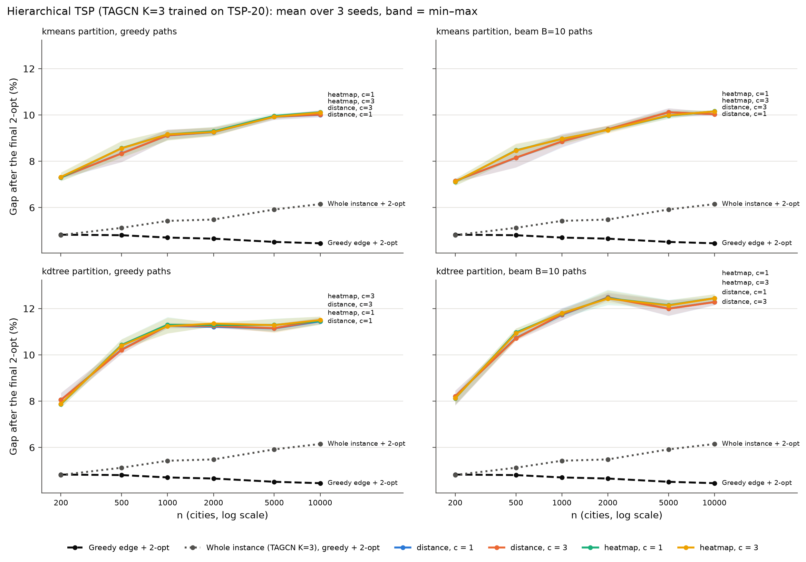

# Phase 3 — multilevel hierarchical TSP with the TSP-20 model

Generated by `scripts/phase3_hier_report.py` on 2026-10-21 (results from commit(s) 6375317, af975d3).

## Setup

- **Model.** TAGCN K=3, BatchNorm, best.pt, seeds 0–2, trained on TSP-20 (no retraining). Every point set given to it is rescaled to [0, 1]² and gets a k-NN graph with k = round(0.5 m).
- **Hierarchy** (`src/tsp_gnn/hier.py`). Level 0 = cities; each level is split into groups of ~20 and the centroids form the next level, until ≤ 60 points. *kmeans*: sklearn k-means with k = round(m/20), then a capacity repair so that every group has 10–30 points. *kdtree*: recursive median bisection of the longer axis until ≤ 30 points (groups of 15–30).
- **Top.** TSP over the top-level points with the model (greedy + full 2-opt).
- **Descent.** For each consecutive pair of groups (a, b) one child of a (exit) and one child of b (entry) are linked: *distance* = closest pair; *heatmap* = the model on a ∪ b (the cities if ≤ 100, otherwise the children's centroids), attraction = summed edge probability between the children. *c* best pairs per link and dynamic programming around the cycle under the constraint entry ≠ exit (with c = 1 the DP only acts when the best pairs conflict; if no choice satisfies the constraint, c is doubled, Table 6). Inside each group the children are visited along a Hamiltonian path from entry to exit decoded from the model's heatmap on them: *greedy* (the phase 1 greedy with the ends' degree capped at 1) or *beam10*.
- **Final 2-opt.** The neighbour-list 2-opt of the scale experiment on the whole tour, k = min(0.5 n, 100), the same as the greedy edge + 2-opt baseline (`results/phase2_scale/baselines`).
- **Baselines** (read from the scale experiment, same instances): greedy edge (+ 2-opt) and the whole instance with the same TAGCN K=3 checkpoint (k = min(0.5 n, 100), greedy + 2-opt), paired seed by seed.
- **Tests.** Paired Wilcoxon where there are ≥ 20 instances (n ≤ 1000); max p over the 3 seeds, the seeds' medians must agree in sign; Bonferroni within each size (16 variants × 2 references).

## Table 1 — Hierarchy (mean over instances)

| n | Partition | Points per level | Group sizes per level: min / mean / max |
|---|---|---|---|
| 200 | kmeans | 200 → 10 | L1: 10 / 20.0 / 30 |
| 200 | kdtree | 200 → 8 | L1: 25 / 25.0 / 25 |
| 500 | kmeans | 500 → 25 | L1: 10 / 20.0 / 30 |
| 500 | kdtree | 500 → 32 | L1: 15 / 15.6 / 16 |
| 1000 | kmeans | 1000 → 50 | L1: 10 / 20.0 / 30 |
| 1000 | kdtree | 1000 → 64 → 4 | L1: 15 / 15.6 / 16; L2: 16 / 16.0 / 16 |
| 2000 | kmeans | 2000 → 100 → 5 | L1: 10 / 20.0 / 30; L2: 15 / 20.0 / 25 |
| 2000 | kdtree | 2000 → 128 → 8 | L1: 15 / 15.6 / 16; L2: 16 / 16.0 / 16 |
| 5000 | kmeans | 5000 → 250 → 12 | L1: 10 / 20.0 / 30; L2: 14 / 20.8 / 28 |
| 5000 | kdtree | 5000 → 256 → 16 | L1: 19 / 19.5 / 20; L2: 16 / 16.0 / 16 |
| 10000 | kmeans | 10000 → 500 → 25 | L1: 10 / 20.0 / 30; L2: 13 / 20.0 / 29 |
| 10000 | kdtree | 10000 → 512 → 32 | L1: 19 / 19.5 / 20; L2: 16 / 16.0 / 16 |

## Table 2 — Gap (%) after the final 2-opt

Mean ± std over the 3 seeds; variants are partition / attract / c / path decoder.

| Method | 200 | 500 | 1000 | 2000 | 5000 | 10000 |
|---|---|---|---|---|---|---|
| Greedy edge | 19.09 | 18.11 | 17.02 | 16.09 | 14.95 | 14.80 |
| Greedy edge + 2-opt | 4.83 | 4.81 | 4.70 | 4.66 | 4.52 | 4.46 |
| Whole instance (TAGCN K=3), greedy | 12.16 ± 0.48 | 15.12 ± 0.37 | 16.14 ± 0.25 | 17.17 ± 0.26 | 18.13 ± 0.73 | 19.24 ± 1.88 |
| Whole instance (TAGCN K=3), greedy + 2-opt | 4.81 ± 0.12 | 5.12 ± 0.16 | 5.43 ± 0.29 | 5.48 ± 0.47 | 5.92 ± 0.56 | 6.15 ± 0.50 |
| kmeans/distance/c1/greedy | 7.30 ± 0.05 | 8.34 ± 0.33 | 9.11 ± 0.23 | 9.26 ± 0.16 | 9.92 ± 0.12 | 10.01 ± 0.17 |
| kmeans/distance/c1/beam10 | 7.15 ± 0.05 | 8.15 ± 0.37 | 8.86 ± 0.30 | 9.38 ± 0.14 | 10.12 ± 0.19 | 10.03 ± 0.07 |
| kmeans/distance/c3/greedy | 7.31 ± 0.05 | 8.34 ± 0.32 | 9.12 ± 0.22 | 9.27 ± 0.18 | 9.93 ± 0.11 | 10.02 ± 0.17 |
| kmeans/distance/c3/beam10 | 7.15 ± 0.06 | 8.16 ± 0.37 | 8.86 ± 0.28 | 9.38 ± 0.14 | 10.12 ± 0.18 | 10.03 ± 0.08 |
| kmeans/heatmap/c1/greedy | 7.30 ± 0.19 | 8.57 ± 0.36 | 9.16 ± 0.23 | 9.29 ± 0.20 | 9.96 ± 0.11 | 10.12 ± 0.06 |
| kmeans/heatmap/c1/beam10 | 7.10 ± 0.15 | 8.47 ± 0.31 | 8.96 ± 0.19 | 9.35 ± 0.15 | 9.97 ± 0.22 | 10.16 ± 0.05 |
| kmeans/heatmap/c3/greedy | 7.32 ± 0.19 | 8.56 ± 0.37 | 9.16 ± 0.23 | 9.26 ± 0.20 | 9.92 ± 0.09 | 10.10 ± 0.06 |
| kmeans/heatmap/c3/beam10 | 7.12 ± 0.15 | 8.46 ± 0.32 | 8.97 ± 0.19 | 9.35 ± 0.18 | 9.98 ± 0.18 | 10.15 ± 0.05 |
| kdtree/distance/c1/greedy | 8.05 ± 0.27 | 10.23 ± 0.20 | 11.25 ± 0.10 | 11.21 ± 0.08 | 11.14 ± 0.17 | 11.45 ± 0.14 |
| kdtree/distance/c1/beam10 | 8.21 ± 0.35 | 10.73 ± 0.11 | 11.73 ± 0.28 | 12.48 ± 0.19 | 12.00 ± 0.35 | 12.28 ± 0.18 |
| kdtree/distance/c3/greedy | 8.05 ± 0.27 | 10.21 ± 0.19 | 11.26 ± 0.12 | 11.24 ± 0.09 | 11.15 ± 0.18 | 11.49 ± 0.13 |
| kdtree/distance/c3/beam10 | 8.21 ± 0.35 | 10.71 ± 0.15 | 11.75 ± 0.25 | 12.47 ± 0.17 | 11.99 ± 0.33 | 12.28 ± 0.17 |
| kdtree/heatmap/c1/greedy | 7.87 ± 0.17 | 10.43 ± 0.22 | 11.30 ± 0.35 | 11.29 ± 0.07 | 11.29 ± 0.28 | 11.46 ± 0.18 |
| kdtree/heatmap/c1/beam10 | 8.12 ± 0.24 | 10.96 ± 0.26 | 11.79 ± 0.18 | 12.44 ± 0.34 | 12.15 ± 0.20 | 12.45 ± 0.18 |
| kdtree/heatmap/c3/greedy | 7.88 ± 0.19 | 10.40 ± 0.24 | 11.24 ± 0.34 | 11.35 ± 0.11 | 11.28 ± 0.30 | 11.50 ± 0.18 |
| kdtree/heatmap/c3/beam10 | 8.13 ± 0.24 | 10.93 ± 0.27 | 11.80 ± 0.11 | 12.43 ± 0.30 | 12.13 ± 0.19 | 12.45 ± 0.19 |

## Table 3 — Gap (%) before the final 2-opt

| Method | 200 | 500 | 1000 | 2000 | 5000 | 10000 |
|---|---|---|---|---|---|---|
| Greedy edge | 19.09 | 18.11 | 17.02 | 16.09 | 14.95 | 14.80 |
| Greedy edge + 2-opt | 4.83 | 4.81 | 4.70 | 4.66 | 4.52 | 4.46 |
| Whole instance (TAGCN K=3), greedy | 12.16 ± 0.48 | 15.12 ± 0.37 | 16.14 ± 0.25 | 17.17 ± 0.26 | 18.13 ± 0.73 | 19.24 ± 1.88 |
| Whole instance (TAGCN K=3), greedy + 2-opt | 4.81 ± 0.12 | 5.12 ± 0.16 | 5.43 ± 0.29 | 5.48 ± 0.47 | 5.92 ± 0.56 | 6.15 ± 0.50 |
| kmeans/distance/c1/greedy | 16.24 ± 0.64 | 17.63 ± 0.93 | 19.12 ± 0.82 | 21.21 ± 0.61 | 21.94 ± 0.94 | 22.39 ± 1.23 |
| kmeans/distance/c1/beam10 | 10.66 ± 0.22 | 12.09 ± 0.51 | 13.21 ± 0.47 | 13.76 ± 0.54 | 14.49 ± 0.40 | 14.71 ± 0.41 |
| kmeans/distance/c3/greedy | 16.23 ± 0.64 | 17.62 ± 0.93 | 19.12 ± 0.79 | 21.21 ± 0.64 | 21.94 ± 0.95 | 22.39 ± 1.23 |
| kmeans/distance/c3/beam10 | 10.65 ± 0.22 | 12.08 ± 0.52 | 13.22 ± 0.44 | 13.77 ± 0.53 | 14.48 ± 0.40 | 14.71 ± 0.41 |
| kmeans/heatmap/c1/greedy | 16.61 ± 0.73 | 18.16 ± 0.98 | 19.22 ± 0.82 | 21.67 ± 0.54 | 21.95 ± 0.90 | 22.55 ± 0.76 |
| kmeans/heatmap/c1/beam10 | 10.87 ± 0.30 | 12.61 ± 0.54 | 13.37 ± 0.53 | 14.07 ± 0.40 | 14.75 ± 0.42 | 14.99 ± 0.45 |
| kmeans/heatmap/c3/greedy | 16.63 ± 0.70 | 18.17 ± 0.98 | 19.21 ± 0.81 | 21.61 ± 0.53 | 21.98 ± 0.99 | 22.52 ± 0.77 |
| kmeans/heatmap/c3/beam10 | 10.89 ± 0.30 | 12.60 ± 0.53 | 13.36 ± 0.53 | 14.07 ± 0.36 | 14.76 ± 0.48 | 14.98 ± 0.45 |
| kdtree/distance/c1/greedy | 22.01 ± 0.50 | 28.74 ± 1.28 | 28.49 ± 1.63 | 34.24 ± 1.82 | 28.78 ± 1.97 | 33.65 ± 1.46 |
| kdtree/distance/c1/beam10 | 15.55 ± 0.48 | 21.66 ± 0.50 | 20.63 ± 0.75 | 24.59 ± 0.56 | 21.14 ± 0.89 | 24.42 ± 0.62 |
| kdtree/distance/c3/greedy | 22.01 ± 0.50 | 28.73 ± 1.28 | 28.49 ± 1.65 | 34.20 ± 1.82 | 28.79 ± 1.97 | 33.63 ± 1.48 |
| kdtree/distance/c3/beam10 | 15.55 ± 0.48 | 21.64 ± 0.50 | 20.61 ± 0.77 | 24.57 ± 0.55 | 21.15 ± 0.90 | 24.41 ± 0.62 |
| kdtree/heatmap/c1/greedy | 22.32 ± 0.35 | 28.14 ± 1.09 | 28.61 ± 1.41 | 33.49 ± 1.35 | 28.40 ± 1.63 | 33.46 ± 1.24 |
| kdtree/heatmap/c1/beam10 | 15.76 ± 0.28 | 21.23 ± 0.38 | 20.59 ± 0.43 | 23.95 ± 0.46 | 21.01 ± 0.61 | 24.35 ± 0.71 |
| kdtree/heatmap/c3/greedy | 22.31 ± 0.31 | 28.10 ± 1.08 | 28.54 ± 1.48 | 33.51 ± 1.37 | 28.40 ± 1.61 | 33.47 ± 1.24 |
| kdtree/heatmap/c3/beam10 | 15.75 ± 0.23 | 21.21 ± 0.38 | 20.53 ± 0.44 | 23.92 ± 0.48 | 21.01 ± 0.62 | 24.35 ± 0.73 |

## Table 4 — Paired tests, gap after 2-opt

Cell: verdict, mean difference hierarchy − reference (pp; negative = hierarchy better), max p over seeds. Bonferroni: n = 200: 0.05/32 = 1.56e-03; n = 500: 0.05/32 = 1.56e-03; n = 1000: 0.05/32 = 1.56e-03.

### vs. greedy edge + 2-opt

| Variant | 200 | 500 | 1000 |
|---|---|---|---|
| kmeans/distance/c1/greedy | **worse** +2.47 (p 1.6e-13) | **worse** +3.54 (p 1.8e-15) | **worse** +4.41 (p 1.9e-06) |
| kmeans/distance/c1/beam10 | **worse** +2.32 (p 3.2e-13) | **worse** +3.34 (p 9.8e-14) | **worse** +4.15 (p 1.9e-06) |
| kmeans/distance/c3/greedy | **worse** +2.48 (p 1.4e-13) | **worse** +3.53 (p 1.8e-15) | **worse** +4.41 (p 1.9e-06) |
| kmeans/distance/c3/beam10 | **worse** +2.32 (p 3.0e-13) | **worse** +3.35 (p 9.8e-14) | **worse** +4.15 (p 1.9e-06) |
| kmeans/heatmap/c1/greedy | **worse** +2.47 (p 4.9e-12) | **worse** +3.76 (p 1.2e-14) | **worse** +4.46 (p 1.9e-06) |
| kmeans/heatmap/c1/beam10 | **worse** +2.28 (p 1.6e-12) | **worse** +3.67 (p 3.6e-15) | **worse** +4.26 (p 1.9e-06) |
| kmeans/heatmap/c3/greedy | **worse** +2.49 (p 2.6e-12) | **worse** +3.75 (p 1.2e-14) | **worse** +4.46 (p 1.9e-06) |
| kmeans/heatmap/c3/beam10 | **worse** +2.29 (p 1.1e-12) | **worse** +3.66 (p 3.6e-15) | **worse** +4.26 (p 1.9e-06) |
| kdtree/distance/c1/greedy | **worse** +3.22 (p 4.2e-16) | **worse** +5.42 (p 1.8e-15) | **worse** +6.55 (p 1.9e-06) |
| kdtree/distance/c1/beam10 | **worse** +3.38 (p 1.8e-15) | **worse** +5.92 (p 1.8e-15) | **worse** +7.02 (p 1.9e-06) |
| kdtree/distance/c3/greedy | **worse** +3.22 (p 4.2e-16) | **worse** +5.41 (p 1.8e-15) | **worse** +6.55 (p 1.9e-06) |
| kdtree/distance/c3/beam10 | **worse** +3.38 (p 1.8e-15) | **worse** +5.91 (p 1.8e-15) | **worse** +7.04 (p 1.9e-06) |
| kdtree/heatmap/c1/greedy | **worse** +3.04 (p 3.6e-15) | **worse** +5.62 (p 1.8e-15) | **worse** +6.59 (p 1.9e-06) |
| kdtree/heatmap/c1/beam10 | **worse** +3.29 (p 7.5e-16) | **worse** +6.16 (p 1.8e-15) | **worse** +7.09 (p 1.9e-06) |
| kdtree/heatmap/c3/greedy | **worse** +3.06 (p 4.1e-15) | **worse** +5.59 (p 1.8e-15) | **worse** +6.53 (p 1.9e-06) |
| kdtree/heatmap/c3/beam10 | **worse** +3.31 (p 7.5e-16) | **worse** +6.12 (p 1.8e-15) | **worse** +7.10 (p 1.9e-06) |

### vs. the whole instance (same model and seed) + 2-opt

| Variant | 200 | 500 | 1000 |
|---|---|---|---|
| kmeans/distance/c1/greedy | **worse** +2.49 (p 1.2e-12) | **worse** +3.22 (p 1.8e-15) | **worse** +3.69 (p 1.9e-06) |
| kmeans/distance/c1/beam10 | **worse** +2.34 (p 3.0e-13) | **worse** +3.02 (p 2.0e-13) | **worse** +3.43 (p 1.9e-06) |
| kmeans/distance/c3/greedy | **worse** +2.49 (p 8.4e-13) | **worse** +3.21 (p 1.8e-15) | **worse** +3.69 (p 1.9e-06) |
| kmeans/distance/c3/beam10 | **worse** +2.34 (p 3.5e-13) | **worse** +3.03 (p 2.0e-13) | **worse** +3.43 (p 1.9e-06) |
| kmeans/heatmap/c1/greedy | **worse** +2.49 (p 1.5e-11) | **worse** +3.44 (p 3.6e-15) | **worse** +3.74 (p 1.9e-06) |
| kmeans/heatmap/c1/beam10 | **worse** +2.29 (p 3.1e-12) | **worse** +3.35 (p 5.3e-15) | **worse** +3.54 (p 1.9e-06) |
| kmeans/heatmap/c3/greedy | **worse** +2.51 (p 4.5e-12) | **worse** +3.44 (p 8.9e-15) | **worse** +3.73 (p 1.9e-06) |
| kmeans/heatmap/c3/beam10 | **worse** +2.31 (p 1.5e-12) | **worse** +3.34 (p 5.3e-15) | **worse** +3.54 (p 1.9e-06) |
| kdtree/distance/c1/greedy | **worse** +3.24 (p 3.7e-16) | **worse** +5.10 (p 1.8e-15) | **worse** +5.82 (p 1.9e-06) |
| kdtree/distance/c1/beam10 | **worse** +3.40 (p 4.4e-16) | **worse** +5.60 (p 1.8e-15) | **worse** +6.30 (p 1.9e-06) |
| kdtree/distance/c3/greedy | **worse** +3.24 (p 3.7e-16) | **worse** +5.09 (p 1.8e-15) | **worse** +5.83 (p 1.9e-06) |
| kdtree/distance/c3/beam10 | **worse** +3.40 (p 4.4e-16) | **worse** +5.59 (p 1.8e-15) | **worse** +6.32 (p 1.9e-06) |
| kdtree/heatmap/c1/greedy | **worse** +3.05 (p 2.0e-15) | **worse** +5.31 (p 1.8e-15) | **worse** +5.87 (p 1.9e-06) |
| kdtree/heatmap/c1/beam10 | **worse** +3.31 (p 2.4e-16) | **worse** +5.84 (p 1.8e-15) | **worse** +6.37 (p 1.9e-06) |
| kdtree/heatmap/c3/greedy | **worse** +3.07 (p 2.3e-15) | **worse** +5.28 (p 1.8e-15) | **worse** +5.81 (p 1.9e-06) |
| kdtree/heatmap/c3/beam10 | **worse** +3.32 (p 2.4e-16) | **worse** +5.81 (p 1.8e-15) | **worse** +6.37 (p 1.9e-06) |

### n with fewer than 20 instances (no test): difference vs. greedy edge + 2-opt

| Variant | 2000 | 5000 | 10000 |
|---|---|---|---|
| kmeans/distance/c1/greedy | +4.60 (0/30 better) | +5.41 (0/15 better) | +5.55 (0/9 better) |
| kmeans/distance/c1/beam10 | +4.72 (0/30 better) | +5.60 (0/15 better) | +5.57 (0/9 better) |
| kmeans/distance/c3/greedy | +4.61 (0/30 better) | +5.41 (0/15 better) | +5.56 (0/9 better) |
| kmeans/distance/c3/beam10 | +4.72 (0/30 better) | +5.60 (0/15 better) | +5.58 (0/9 better) |
| kmeans/heatmap/c1/greedy | +4.64 (0/30 better) | +5.44 (0/15 better) | +5.66 (0/9 better) |
| kmeans/heatmap/c1/beam10 | +4.70 (0/30 better) | +5.45 (0/15 better) | +5.70 (0/9 better) |
| kmeans/heatmap/c3/greedy | +4.61 (0/30 better) | +5.41 (0/15 better) | +5.65 (0/9 better) |
| kmeans/heatmap/c3/beam10 | +4.69 (0/30 better) | +5.47 (0/15 better) | +5.70 (0/9 better) |
| kdtree/distance/c1/greedy | +6.56 (0/30 better) | +6.63 (0/15 better) | +6.99 (0/9 better) |
| kdtree/distance/c1/beam10 | +7.82 (0/30 better) | +7.48 (0/15 better) | +7.82 (0/9 better) |
| kdtree/distance/c3/greedy | +6.59 (0/30 better) | +6.64 (0/15 better) | +7.03 (0/9 better) |
| kdtree/distance/c3/beam10 | +7.81 (0/30 better) | +7.47 (0/15 better) | +7.82 (0/9 better) |
| kdtree/heatmap/c1/greedy | +6.63 (0/30 better) | +6.77 (0/15 better) | +7.00 (0/9 better) |
| kdtree/heatmap/c1/beam10 | +7.78 (0/30 better) | +7.63 (0/15 better) | +7.99 (0/9 better) |
| kdtree/heatmap/c3/greedy | +6.69 (0/30 better) | +6.77 (0/15 better) | +7.04 (0/9 better) |
| kdtree/heatmap/c3/beam10 | +7.77 (0/30 better) | +7.62 (0/15 better) | +7.99 (0/9 better) |

## Table 5 — Heatmap vs. distance attraction

Heatmap − distance on the same instances (pp; negative = heatmap better). For n ≤ 1000: paired test, Bonferroni over the 16 rows of a size.

| Partition / cands / paths | Gap | 200 | 500 | 1000 | 2000 | 5000 | 10000 |
|---|---|---|---|---|---|---|---|
| kmeans / c1 / greedy | before 2-opt | +0.37 (n.s., p 4e-01) | +0.53 (n.s., p 9e-02) | +0.10 (n.s., p 6e-01) | +0.46 | +0.01 | +0.16 |
| kmeans / c1 / greedy | after 2-opt | -0.00 (n.s., p 5e-01) | +0.23 (n.s., p 2e-01) | +0.05 (n.s., p 8e-01) | +0.04 | +0.04 | +0.11 |
| kmeans / c1 / beam10 | before 2-opt | +0.21 (n.s., p 8e-01) | +0.52 (n.s., p 1e-02) | +0.16 (n.s., p 7e-01) | +0.30 | +0.26 | +0.27 |
| kmeans / c1 / beam10 | after 2-opt | -0.05 (n.s., p 1e+00) | +0.33 (n.s., p 1e-01) | +0.11 (n.s., p 6e-01) | -0.02 | -0.15 | +0.13 |
| kmeans / c3 / greedy | before 2-opt | +0.40 (n.s., p 4e-01) | +0.55 (n.s., p 8e-02) | +0.09 (n.s., p 6e-01) | +0.40 | +0.04 | +0.13 |
| kmeans / c3 / greedy | after 2-opt | +0.02 (n.s., p 7e-01) | +0.22 (n.s., p 2e-01) | +0.04 (n.s., p 9e-01) | -0.00 | -0.01 | +0.08 |
| kmeans / c3 / beam10 | before 2-opt | +0.23 (n.s., p 7e-01) | +0.53 (n.s., p 1e-02) | +0.15 (n.s., p 8e-01) | +0.30 | +0.28 | +0.28 |
| kmeans / c3 / beam10 | after 2-opt | -0.03 (n.s., p 9e-01) | +0.31 (n.s., p 2e-01) | +0.11 (n.s., p 8e-01) | -0.03 | -0.13 | +0.12 |
| kdtree / c1 / greedy | before 2-opt | +0.31 (n.s., p 6e-01) | -0.60 (n.s., p 2e-01) | +0.12 (n.s., p 7e-01) | -0.75 | -0.38 | -0.19 |
| kdtree / c1 / greedy | after 2-opt | -0.19 (n.s., p 8e-01) | +0.20 (n.s., p 5e-01) | +0.05 (n.s., p 7e-01) | +0.08 | +0.15 | +0.01 |
| kdtree / c1 / beam10 | before 2-opt | +0.21 (n.s., p 7e-01) | -0.42 (n.s., p 6e-01) | -0.04 (n.s., p 7e-01) | -0.64 | -0.13 | -0.08 |
| kdtree / c1 / beam10 | after 2-opt | -0.09 (n.s., p 9e-01) | +0.24 (n.s., p 9e-01) | +0.07 (n.s., p 9e-01) | -0.04 | +0.15 | +0.17 |
| kdtree / c3 / greedy | before 2-opt | +0.31 (n.s., p 7e-01) | -0.63 (n.s., p 3e-01) | +0.05 (n.s., p 8e-01) | -0.69 | -0.38 | -0.15 |
| kdtree / c3 / greedy | after 2-opt | -0.17 (n.s., p 8e-01) | +0.19 (n.s., p 6e-01) | -0.02 (n.s., p 4e-01) | +0.11 | +0.13 | +0.01 |
| kdtree / c3 / beam10 | before 2-opt | +0.20 (n.s., p 9e-01) | -0.43 (n.s., p 5e-01) | -0.08 (n.s., p 9e-01) | -0.65 | -0.13 | -0.07 |
| kdtree / c3 / beam10 | after 2-opt | -0.08 (n.s., p 8e-01) | +0.22 (n.s., p 1e+00) | +0.05 (n.s., p 8e-01) | -0.04 | +0.14 | +0.17 |

## Table 6 — c = 3 vs. c = 1

Mean difference c3 − c1 after 2-opt (pp), share of instances with the same final tour gap, and share of c = 1 runs where some link had to look past its best pair (entry = exit conflict).

| Partition / attract / paths | 200 | 500 | 1000 | 2000 | 5000 | 10000 |
|---|---|---|---|---|---|---|
| kmeans / distance / greedy | +0.01; same tour 95 %; c1 expanded 32 % | -0.01; same tour 95 %; c1 expanded 58 % | +0.00; same tour 90 %; c1 expanded 80 % | +0.01; same tour 73 %; c1 expanded 100 % | +0.01; same tour 80 %; c1 expanded 100 % | +0.01; same tour 56 %; c1 expanded 100 % |
| kmeans / distance / beam10 | -0.01; same tour 96 %; c1 expanded 32 % | +0.01; same tour 95 %; c1 expanded 58 % | +0.00; same tour 90 %; c1 expanded 80 % | +0.00; same tour 77 %; c1 expanded 100 % | +0.00; same tour 67 %; c1 expanded 100 % | +0.00; same tour 44 %; c1 expanded 100 % |
| kmeans / heatmap / greedy | +0.03; same tour 90 %; c1 expanded 69 % | -0.01; same tour 87 %; c1 expanded 83 % | -0.00; same tour 73 %; c1 expanded 100 % | -0.03; same tour 70 %; c1 expanded 100 % | -0.03; same tour 53 %; c1 expanded 100 % | -0.01; same tour 44 %; c1 expanded 100 % |
| kmeans / heatmap / beam10 | +0.01; same tour 90 %; c1 expanded 69 % | -0.01; same tour 87 %; c1 expanded 83 % | +0.00; same tour 75 %; c1 expanded 100 % | -0.00; same tour 50 %; c1 expanded 100 % | +0.02; same tour 47 %; c1 expanded 100 % | -0.01; same tour 56 %; c1 expanded 100 % |
| kdtree / distance / greedy | +0.00; same tour 100 %; c1 expanded 15 % | -0.01; same tour 91 %; c1 expanded 58 % | +0.01; same tour 77 %; c1 expanded 98 % | +0.03; same tour 57 %; c1 expanded 100 % | +0.01; same tour 53 %; c1 expanded 100 % | +0.04; same tour 33 %; c1 expanded 100 % |
| kdtree / distance / beam10 | +0.00; same tour 100 %; c1 expanded 15 % | -0.02; same tour 91 %; c1 expanded 58 % | +0.02; same tour 75 %; c1 expanded 93 % | -0.01; same tour 60 %; c1 expanded 100 % | -0.01; same tour 67 %; c1 expanded 100 % | -0.00; same tour 33 %; c1 expanded 100 % |
| kdtree / heatmap / greedy | +0.02; same tour 96 %; c1 expanded 37 % | -0.03; same tour 79 %; c1 expanded 94 % | -0.06; same tour 60 %; c1 expanded 100 % | +0.06; same tour 40 %; c1 expanded 100 % | -0.01; same tour 73 %; c1 expanded 100 % | +0.04; same tour 44 %; c1 expanded 100 % |
| kdtree / heatmap / beam10 | +0.01; same tour 96 %; c1 expanded 37 % | -0.03; same tour 79 %; c1 expanded 94 % | +0.01; same tour 67 %; c1 expanded 100 % | -0.01; same tour 30 %; c1 expanded 100 % | -0.01; same tour 53 %; c1 expanded 100 % | -0.00; same tour 33 %; c1 expanded 100 % |

## Table 7 — Time per instance (ms)

One CPU process per seed (3 in parallel), network on the GPU in batches. Steps of the hierarchy are averaged over the variants named in the row; the network time is included in the top/stitching/paths rows.

| Step | 200 | 500 | 1000 | 2000 | 5000 | 10000 |
|---|---|---|---|---|---|---|
| Partition: k-means | 20.0 | 40.7 | 87.2 | 215 | 619 | 2,017 |
| Partition: k-d bisection | 0.7 | 1.9 | 3.6 | 7.3 | 18.4 | 38.2 |
| Top TSP | 7.3 | 9.4 | 9.6 | 7.9 | 10.7 | 17.0 |
| Stitching: distance | 0.6 | 1.4 | 3.1 | 6.8 | 23.6 | 54.0 |
| Stitching: heatmap | 34.3 | 69.1 | 129 | 270 | 708 | 1,463 |
| Paths: greedy | 19.3 | 39.7 | 72.7 | 146 | 350 | 762 |
| Paths: beam B=10 | 60.8 | 133 | 250 | 509 | 1,311 | 2,787 |
|   of which network (distance / greedy variants) | 12.6 | 13.8 | 17.1 | 25.1 | 40.4 | 86.3 |
|   of which network (heatmap / greedy variants) | 18.4 | 19.6 | 26.4 | 41.2 | 73.9 | 141 |
| Final 2-opt | 25.2 | 66.6 | 123 | 251 | 634 | 1,374 |
| Greedy edge + 2-opt (baseline) | 51.1 | 150 | 307 | 672 | 1,652 | 2,987 |
| Whole instance: graph + network + greedy + 2-opt | 82.3 | 243 | 449 | 933 | 2,417 | 4,769 |

## Table 8 — Where the errors are (before 2-opt) and what the 2-opt moves

Boundary = tour edges between two level-0 groups (the stitching links); inside = path edges within a group. Wrong = not in the LKH tour. Averaged over c = 1 and 3.

| n | Partition | Attract | Paths | Boundary edges (% of n) | Wrong at boundary | Wrong inside | Share of wrong edges at the boundary | Cities moved between groups by 2-opt (% of n) |
|---|---|---|---|---|---|---|---|---|
| 200 | kmeans | distance | greedy | 5.0 | 37.8 % | 30.8 % | 6.1 % | 6.9 |
| 200 | kmeans | distance | beam10 | 5.0 | 37.8 % | 28.4 % | 6.6 % | 5.0 |
| 200 | kmeans | heatmap | greedy | 5.0 | 47.1 % | 30.8 % | 7.5 % | 7.6 |
| 200 | kmeans | heatmap | beam10 | 5.0 | 47.1 % | 28.3 % | 8.1 % | 5.7 |
| 200 | kdtree | distance | greedy | 4.0 | 19.4 % | 33.5 % | 2.4 % | 12.1 |
| 200 | kdtree | distance | beam10 | 4.0 | 19.4 % | 31.5 % | 2.5 % | 9.7 |
| 200 | kdtree | heatmap | greedy | 4.0 | 27.9 % | 33.6 % | 3.3 % | 12.6 |
| 200 | kdtree | heatmap | beam10 | 4.0 | 27.9 % | 31.6 % | 3.5 % | 10.2 |
| 500 | kmeans | distance | greedy | 5.0 | 40.0 % | 32.1 % | 6.2 % | 7.7 |
| 500 | kmeans | distance | beam10 | 5.0 | 40.0 % | 30.4 % | 6.5 % | 5.9 |
| 500 | kmeans | heatmap | greedy | 5.0 | 47.8 % | 32.2 % | 7.2 % | 8.3 |
| 500 | kmeans | heatmap | beam10 | 5.0 | 47.8 % | 30.5 % | 7.6 % | 6.2 |
| 500 | kdtree | distance | greedy | 6.4 | 26.5 % | 38.1 % | 4.5 % | 21.8 |
| 500 | kdtree | distance | beam10 | 6.4 | 26.5 % | 37.1 % | 4.6 % | 18.1 |
| 500 | kdtree | heatmap | greedy | 6.4 | 35.1 % | 37.8 % | 6.0 % | 21.4 |
| 500 | kdtree | heatmap | beam10 | 6.4 | 35.1 % | 37.0 % | 6.1 % | 17.5 |
| 1000 | kmeans | distance | greedy | 5.0 | 40.4 % | 33.2 % | 6.0 % | 8.4 |
| 1000 | kmeans | distance | beam10 | 5.0 | 40.4 % | 31.6 % | 6.3 % | 6.2 |
| 1000 | kmeans | heatmap | greedy | 5.0 | 51.2 % | 33.1 % | 7.5 % | 8.7 |
| 1000 | kmeans | heatmap | beam10 | 5.0 | 51.2 % | 31.4 % | 7.9 % | 6.6 |
| 1000 | kdtree | distance | greedy | 6.4 | 32.5 % | 38.8 % | 5.4 % | 21.7 |
| 1000 | kdtree | distance | beam10 | 6.4 | 29.7 % | 38.1 % | 5.1 % | 16.6 |
| 1000 | kdtree | heatmap | greedy | 6.4 | 40.7 % | 38.7 % | 6.7 % | 21.6 |
| 1000 | kdtree | heatmap | beam10 | 6.4 | 38.2 % | 38.1 % | 6.4 % | 16.7 |
| 2000 | kmeans | distance | greedy | 5.0 | 40.1 % | 33.3 % | 6.0 % | 10.0 |
| 2000 | kmeans | distance | beam10 | 5.0 | 39.3 % | 31.9 % | 6.1 % | 6.3 |
| 2000 | kmeans | heatmap | greedy | 5.0 | 49.5 % | 33.1 % | 7.3 % | 10.7 |
| 2000 | kmeans | heatmap | beam10 | 5.0 | 48.3 % | 31.9 % | 7.4 % | 6.9 |
| 2000 | kdtree | distance | greedy | 6.4 | 29.8 % | 39.2 % | 4.9 % | 25.1 |
| 2000 | kdtree | distance | beam10 | 6.4 | 27.6 % | 38.7 % | 4.6 % | 20.0 |
| 2000 | kdtree | heatmap | greedy | 6.4 | 39.7 % | 39.1 % | 6.5 % | 24.6 |
| 2000 | kdtree | heatmap | beam10 | 6.4 | 38.6 % | 38.5 % | 6.4 % | 19.4 |
| 5000 | kmeans | distance | greedy | 5.0 | 42.3 % | 33.4 % | 6.2 % | 10.4 |
| 5000 | kmeans | distance | beam10 | 5.0 | 40.3 % | 32.4 % | 6.1 % | 6.7 |
| 5000 | kmeans | heatmap | greedy | 5.0 | 52.5 % | 33.4 % | 7.6 % | 10.7 |
| 5000 | kmeans | heatmap | beam10 | 5.0 | 50.7 % | 31.8 % | 7.7 % | 7.1 |
| 5000 | kdtree | distance | greedy | 5.1 | 30.5 % | 38.1 % | 4.1 % | 19.8 |
| 5000 | kdtree | distance | beam10 | 5.1 | 27.2 % | 37.6 % | 3.8 % | 15.7 |
| 5000 | kdtree | heatmap | greedy | 5.1 | 41.3 % | 37.8 % | 5.6 % | 20.1 |
| 5000 | kdtree | heatmap | beam10 | 5.1 | 38.2 % | 37.4 % | 5.2 % | 15.9 |
| 10000 | kmeans | distance | greedy | 5.0 | 45.2 % | 33.4 % | 6.6 % | 10.6 |
| 10000 | kmeans | distance | beam10 | 5.0 | 43.1 % | 32.3 % | 6.6 % | 7.0 |
| 10000 | kmeans | heatmap | greedy | 5.0 | 55.4 % | 33.3 % | 8.1 % | 10.9 |
| 10000 | kmeans | heatmap | beam10 | 5.0 | 54.0 % | 32.1 % | 8.1 % | 7.4 |
| 10000 | kdtree | distance | greedy | 5.1 | 27.6 % | 39.2 % | 3.7 % | 22.8 |
| 10000 | kdtree | distance | beam10 | 5.1 | 25.9 % | 38.4 % | 3.5 % | 18.5 |
| 10000 | kdtree | heatmap | greedy | 5.1 | 40.3 % | 38.9 % | 5.3 % | 22.8 |
| 10000 | kdtree | heatmap | beam10 | 5.1 | 38.6 % | 38.2 % | 5.2 % | 18.6 |

## 2-opt timeouts

None.

## Three lines

1. **The hierarchy never beats greedy edge + 2-opt, at any n, nor the whole instance.** After the final 2-opt the best variants (k-means) give 7.1 % on TSP-200 and 10.0 % on TSP-10000, against 4.8 % and 4.5 % for greedy edge + 2-opt. All 16 variants are significantly worse at n = 200/500/1000 (+2.3 to +7.1 pp; Table 4), and from n = 2000 on no instance of any variant is better (0/30, 0/15, 0/9). They are also significantly worse than the whole instance with the same checkpoint (+2.3 to +6.4 pp). The gap grows with n (k-means: 7.3 → 10.0 %), and it is not cheaper: at n = 10000 k-means + distance + greedy paths + 2-opt takes ≈ 4.2 s per instance against 3.0 s for greedy edge + 2-opt. k-means is better than k-d bisection by 0.6–3.2 pp. Beam B=10 paths cut the gap before 2-opt by about a third (k-means 16–22 % → 11–15 %), but after 2-opt they gain at most 0.25 pp with k-means (up to n = 1000; from n = 2000 on they lose up to 0.2 pp) and lose 0.2–1.3 pp with k-d. c = 3 instead of c = 1 changes the gap by ≤ 0.06 pp: the attractions add up independently, so the DP only acts on entry = exit conflicts. Those conflicts appear in every instance from n = 1000–2000 on, so c = 1 is already expanded somewhere.
2. **The heatmap attraction is worth nothing measurable over the distance attraction, and costs 27–57× more stitching time.** Heatmap − distance is n.s. in all 48 tests (n ≤ 1000) and within ±0.8 pp before / ±0.35 pp after 2-opt at every n, with no consistent sign. The links it picks are more often wrong: with k-means, 47–55 % of the stitching edges are not in the LKH tour, against 38–45 % with distance. Stitching takes 1.5 s instead of 0.05 s at n = 10000.
3. **The errors are inside the groups, and they come from the structure, not from the links.** Only 2–8 % of the wrong edges (before 2-opt) are stitching edges; 28–39 % of the path edges inside the groups are not in the LKH tour, while stitching edges are only 4–6 % of the tour. The cause is that the hierarchy visits each level-0 group exactly once, whereas the LKH tour enters each k-means group 2.7–2.8 times on average (k-d groups: 3.6–4.4 times; 13–14 % resp. 22–23 % of its edges cross group boundaries, measured on TSP-1000/10000). Each group is then forced into one sweep between two fixed ends, and the 2-opt has to undo it: it moves 5–11 % of the cities across group boundaries with k-means and 10–25 % with k-d, without reaching greedy edge + 2-opt. Better paths or links cannot fix this. The partition would have to allow several visits per group (or overlapping windows refined after a first tour) before a TSP-20 model can help at large n.

## Missing results

None.
