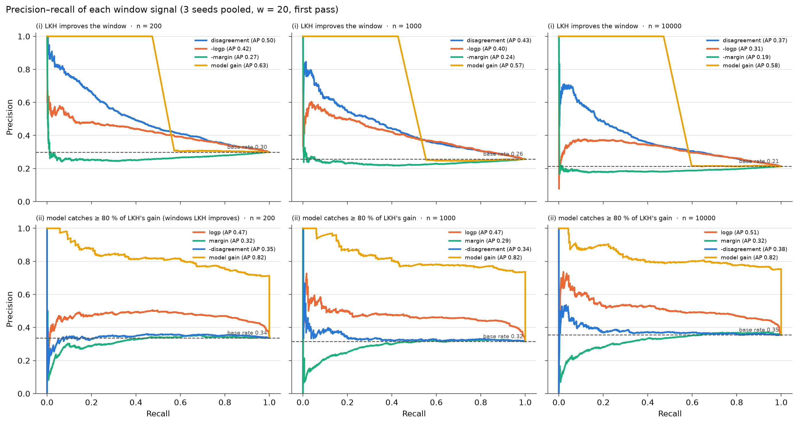
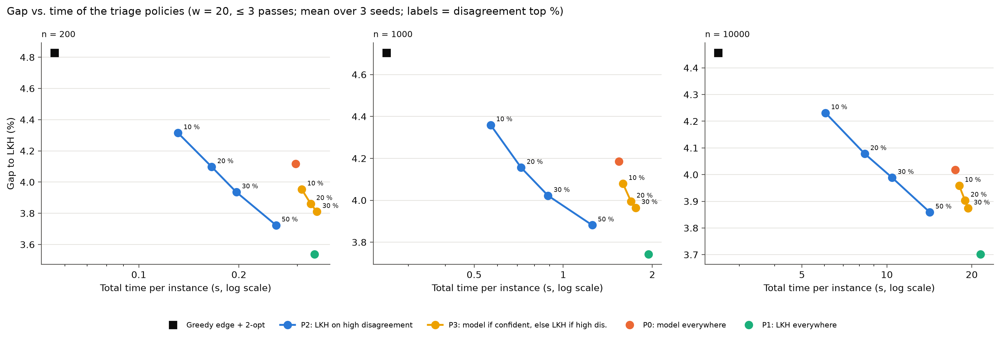

# Phase 3 — window triage: nothing, the model, or LKH?

Generated by `scripts/phase3_triage_report.py` on 2026-10-22 (results from commit(s) 168f9b6, c0962ec).

## Three lines

1. **Disagreement separates the windows LKH can improve, but only moderately; it says nothing about whether the model will manage it.**
   - **Predicting (i), "LKH improves the window":** average precision is 0.53 / 0.47 / 0.40 at n = 200 / 1000 / 10000, against base rates of 0.30 / 0.26 / 0.21 (about 1.8×).
   - **Where the gain lies:** the top decile of disagreement holds 35 % of LKH's gain at every size, the top three deciles 63–67 %, and the bottom half only 19–20 %.
   - **The other signals:** logp is weaker for (i). The beam margin is useless (AP at or below the base rate).
   - **Predicting (ii), "the model catches ≥ 80 % of LKH's gain":** only logp helps (AP 0.48–0.53 against 0.32–0.35). Disagreement is flat there: the model catches about a third of the improvable windows in every decile (27–50 %, no trend). So disagreement tells *where* to look, not *who* should look.
   - **Transfer:** thresholds fixed on tsp200 select slightly fewer windows at larger n (top-20 % threshold: 17–19 % of windows at 1000, 15–16 % at 10000).
2. **Sending only the high-disagreement windows to LKH (P2) halves the time for the same gain as the model everywhere, but every bit of time saved costs gain.**
   - **P2 with the top 20 %** (LKH on 14–18 % of windows): the same gain as P0 (50–57 % of P1's gain, against 54–58 %), n.s. against P0 at n = 200 and 1000. It needs 37–49 % of P1's time, against 79–88 % for P0 (n = 10000: 8.4 s against 17.5 s; P1 takes 21.5 s).
   - **P2 with the top 50 %:** 79–86 % of P1's gain in 65–77 % of its time, and better than P0 (−0.30 to −0.39 pp, significant; 9/9 instances at n = 10000).
   - **Against LKH everywhere:** no policy reaches P1. All of them are significantly worse than P1 at n = 200 and 1000, and 0/9 instances beat it at n = 10000. The savings are roughly proportional: about 20 % of the gain is lost for 30 % of the time saved.
   - **P3 (model where confident, LKH where disagreement is high and confidence low):** it beats P0 (−0.16 to −0.31 pp, significant at 5 of 6 tests), but P2 dominates it on the gap-vs-time curve at every n. P3 must run the beam on every window to know its confidence, which costs 4 ms per window against 7 ms for LKH.
3. **The model is a safe substitute only where it is confident, and even there it saves little.**
   - **Most confident 40 % of windows (top two logp quintiles):** the beam leaves behind only 5–6 % of LKH's total gain.
   - **Least confident quintile:** it leaves 25–31 %, and catches only 10–13 % of the windows LKH improves.
   - **Why it saves little:** with the current Python decoder, a beam path costs about 60 % of an LKH call on the same 20 cities (≈ 4 ms against ≈ 7 ms). Replacing LKH by the model on confident windows therefore saves at most ~40 % of their time.
   - **Where the model pays off:** the cheap part, the network (0.1–0.7 ms per window, batched). It is the triage signal that tells LKH where to work.

## Setup

- **Tour and windows:** greedy edge + 2-opt tour (the baseline of the scale experiment). Windows of w = 20 consecutive tour cities, ends fixed, a window replaced only if shorter (as in the window experiment).
- **Model:** TAGCN K=3 (best.pt, seeds 0–2), beam B = 10 paths.
- **Record (first pass):** every window of the initial tour at offsets 0 and w/2, each evaluated alone. Signals, all on the window rescaled to [0, 1]²:
  - **disagreement** = 1 − mean model probability of the 19 edges of the current segment (an edge outside the model's k-NN graph counts as 0);
  - **logp** = mean log-probability per edge of the returned beam path;
  - **margin** = highest − second highest final beam score, per edge;
  - **model gain** = relative shortening by the beam path (it needs the beam, so it is not free; for (i) it is trivially exact when positive, since LKH is at least as good, hence the flat start of its curve).
- **Targets:** (i) LKH shortens the window; (ii) the beam path catches ≥ 80 % of LKH's gain, defined only on the windows of (i).
- **Policies** (≤ 3 passes, each pass = offsets 0 and w/2):
  - P0: beam everywhere; P1: LKH everywhere;
  - P2: LKH on windows with disagreement above the tsp200 top-q % threshold, nothing elsewhere (needs only the network);
  - P3: LKH where disagreement is above the top-q % threshold and confidence below its threshold; beam path where confidence is above it; nothing elsewhere. Confidence needs the beam on every window, so P3 pays the decoding everywhere, and keeping only the confident beam paths cannot be faster than P0.
- **Thresholds** are chosen on the tsp200 record of each seed and used as fixed numbers on tsp1000 and tsp10000. The confidence signal is the one (logp or margin) with the higher average precision for (ii); its threshold maximises F1 for (ii). tsp200 is therefore a validation set: its policy results are in-sample.
- **Time** = initial tour + refinement (network + beam decoding + LKH), per instance, with the network on the shared T4 GPU and everything else in single-thread Python/LKH.

## 1. How often a window can be improved

| n | Windows per seed | LKH improves | Model (beam) improves | Model catches ≥ 80 % of LKH's gain (of the windows LKH improves) | Share of LKH's gain the model catches | ms per window: network / beam / LKH |
|---|---|---|---|---|---|---|
| 200 | 2000 | 29.9 ± 0.0 % | 14.2 ± 1.0 % | 33.7 ± 4.5 % | 52.0 ± 5.5 % | 0.69 / 3.92 / 6.72 |
| 1000 | 2000 | 25.7 ± 0.0 % | 11.0 ± 1.0 % | 31.5 ± 3.6 % | 47.1 ± 4.9 % | 0.30 / 4.39 / 7.21 |
| 10000 | 3000 | 21.3 ± 0.0 % | 10.0 ± 0.7 % | 35.5 ± 3.8 % | 52.2 ± 4.5 % | 0.14 / 3.92 / 6.54 |

## 2. Does a signal separate the windows?

Average precision (AP; a random signal scores the base rate) and Spearman ρ with the continuous version of the target (LKH's relative gain for (i); the share of LKH's gain the model catches, clipped to [−1, 1], for (ii)). Mean ± std over the 3 seeds.

| Target | Signal (higher = more likely) | AP n = 200 | AP n = 1000 | AP n = 10000 | ρ n = 200 | ρ n = 1000 | ρ n = 10000 |
|---|---|---|---|---|---|---|---|
| (i) LKH improves | base rate | 0.30 ± 0.00 | 0.26 ± 0.00 | 0.21 ± 0.00 | — | — | — |
| (i) LKH improves | disagreement | 0.53 ± 0.05 | 0.47 ± 0.03 | 0.40 ± 0.03 | 0.33 ± 0.06 | 0.31 ± 0.04 | 0.28 ± 0.04 |
| (i) LKH improves | -logp | 0.43 ± 0.01 | 0.41 ± 0.01 | 0.32 ± 0.02 | 0.24 ± 0.02 | 0.27 ± 0.02 | 0.23 ± 0.02 |
| (i) LKH improves | -margin | 0.27 ± 0.01 | 0.24 ± 0.01 | 0.19 ± 0.01 | -0.12 ± 0.02 | -0.10 ± 0.03 | -0.10 ± 0.01 |
| (i) LKH improves | model gain | 0.63 ± 0.02 | 0.57 ± 0.03 | 0.59 ± 0.03 | 0.29 ± 0.04 | 0.19 ± 0.04 | 0.24 ± 0.04 |
| (ii) model catches ≥ 80 % | base rate | 0.34 ± 0.04 | 0.32 ± 0.04 | 0.35 ± 0.04 | — | — | — |
| (ii) model catches ≥ 80 % | logp | 0.48 ± 0.02 | 0.49 ± 0.02 | 0.53 ± 0.02 | 0.42 ± 0.09 | 0.45 ± 0.07 | 0.41 ± 0.02 |
| (ii) model catches ≥ 80 % | margin | 0.33 ± 0.06 | 0.29 ± 0.04 | 0.33 ± 0.04 | 0.04 ± 0.02 | 0.05 ± 0.04 | 0.01 ± 0.03 |
| (ii) model catches ≥ 80 % | -disagreement | 0.35 ± 0.02 | 0.35 ± 0.01 | 0.39 ± 0.04 | 0.03 ± 0.11 | 0.02 ± 0.09 | 0.03 ± 0.06 |
| (ii) model catches ≥ 80 % | model gain | 0.82 ± 0.05 | 0.82 ± 0.03 | 0.82 ± 0.01 | 0.89 ± 0.01 | 0.90 ± 0.01 | 0.90 ± 0.01 |

### By decile of disagreement

Per decile: fraction of windows LKH improves / fraction of those the model catches (≥ 80 %) / share of all of LKH's gain that lies in this decile. Deciles of each seed's own windows, averaged over seeds.

| Disagreement decile | n = 200: LKH improves / model catches / LKH gain share | n = 1000: LKH improves / model catches / LKH gain share | n = 10000: LKH improves / model catches / LKH gain share |
|---|---|---|---|
| 1 (lowest) | 13 % / 31 % / 3 % | 12 % / 39 % / 3 % | 8 % / 50 % / 2 % |
| 2 | 17 % / 43 % / 3 % | 15 % / 35 % / 4 % | 11 % / 35 % / 3 % |
| 3 | 18 % / 30 % / 3 % | 16 % / 34 % / 4 % | 12 % / 31 % / 4 % |
| 4 | 23 % / 33 % / 5 % | 15 % / 35 % / 3 % | 16 % / 44 % / 5 % |
| 5 | 22 % / 41 % / 5 % | 18 % / 35 % / 6 % | 16 % / 33 % / 5 % |
| 6 | 25 % / 31 % / 7 % | 22 % / 27 % / 6 % | 18 % / 39 % / 7 % |
| 7 | 34 % / 37 % / 10 % | 27 % / 27 % / 8 % | 22 % / 32 % / 10 % |
| 8 | 36 % / 37 % / 12 % | 32 % / 32 % / 12 % | 27 % / 30 % / 11 % |
| 9 | 45 % / 32 % / 17 % | 42 % / 31 % / 20 % | 32 % / 37 % / 16 % |
| 10 (highest) | 67 % / 31 % / 35 % | 59 % / 30 % / 35 % | 51 % / 35 % / 36 % |

### By quintile of model confidence (logp)

Per quintile: fraction of the windows LKH improves that the model catches / LKH gain the model leaves behind in this quintile, as a share of all of LKH's gain.

| logp quintile | n = 200: catches / LKH gain left | n = 1000: catches / LKH gain left | n = 10000: catches / LKH gain left |
|---|---|---|---|
| 1 (least confident) | 12 % / 25 % | 10 % / 31 % | 13 % / 28 % |
| 2 | 35 % / 10 % | 35 % / 10 % | 41 % / 10 % |
| 3 | 45 % / 6 % | 46 % / 5 % | 48 % / 5 % |
| 4 | 52 % / 4 % | 50 % / 3 % | 50 % / 3 % |
| 5 (most confident) | 49 % / 2 % | 50 % / 2 % | 58 % / 2 % |

## 3. Triage policies

### Thresholds (from tsp200) and how they transfer

| Seed | Disagreement top 10 / 20 / 30 / 50 % | Confidence signal (AP logp / margin) | Confidence threshold | Windows above top-20 % threshold, n = 200 | Windows above top-20 % threshold, n = 1000 | Windows above top-20 % threshold, n = 10000 |
|---|---|---|---|---|---|---|
| 0 | 0.217 / 0.197 / 0.184 / 0.160 | logp (0.50 / 0.27) | -0.347 | 20.0 % | 18.9 % | 16.0 % |
| 1 | 0.150 / 0.132 / 0.118 / 0.096 | logp (0.47 / 0.35) | -0.261 | 20.0 % | 16.9 % | 15.2 % |
| 2 | 0.205 / 0.183 / 0.167 / 0.139 | logp (0.48 / 0.37) | -0.375 | 20.0 % | 18.5 % | 15.6 % |

### n = 200

| Policy | Gap (%) | Gain (pp) | Share of P1's gain | Total time (s) | Time / P1 | Windows to LKH | Windows to model |
|---|---|---|---|---|---|---|---|
| Greedy edge + 2-opt (initial tour) | 4.83 | — | — | 0.06 | — | — | — |
| P1: LKH everywhere | 3.54 | 1.29 | 100 % | 0.34 | 100 % | 100.0 % | 0.0 % |
| P0: model everywhere | 4.12 ± 0.07 | 0.71 ± 0.07 | 55 % | 0.30 ± 0.02 | 88 % | 0.0 ± 0.0 % | 100.0 ± 0.0 % |
| P2: LKH on top 10 % disagreement | 4.31 ± 0.06 | 0.51 ± 0.06 | 40 % | 0.13 ± 0.01 | 39 % | 9.0 ± 0.4 % | 0.0 ± 0.0 % |
| P2: LKH on top 20 % disagreement | 4.10 ± 0.06 | 0.73 ± 0.06 | 57 % | 0.17 ± 0.01 | 49 % | 17.8 ± 0.6 % | 0.0 ± 0.0 % |
| P2: LKH on top 30 % disagreement | 3.94 ± 0.06 | 0.89 ± 0.06 | 69 % | 0.20 ± 0.01 | 58 % | 27.8 ± 0.9 % | 0.0 ± 0.0 % |
| P2: LKH on top 50 % disagreement | 3.72 ± 0.04 | 1.11 ± 0.04 | 86 % | 0.26 ± 0.00 | 77 % | 47.7 ± 0.1 % | 0.0 ± 0.0 % |
| P3: model if confident, LKH if top 10 % dis. and not confident | 3.95 ± 0.02 | 0.87 ± 0.02 | 68 % | 0.31 ± 0.02 | 91 % | 5.3 ± 1.0 % | 79.4 ± 7.3 % |
| P3: model if confident, LKH if top 20 % dis. and not confident | 3.86 ± 0.02 | 0.97 ± 0.02 | 75 % | 0.33 ± 0.02 | 97 % | 9.8 ± 3.4 % | 79.6 ± 7.3 % |
| P3: model if confident, LKH if top 30 % dis. and not confident | 3.81 ± 0.03 | 1.02 ± 0.03 | 79 % | 0.34 ± 0.01 | 101 % | 12.8 ± 4.1 % | 79.6 ± 7.2 % |

### n = 1000

| Policy | Gap (%) | Gain (pp) | Share of P1's gain | Total time (s) | Time / P1 | Windows to LKH | Windows to model |
|---|---|---|---|---|---|---|---|
| Greedy edge + 2-opt (initial tour) | 4.70 | — | — | 0.25 | — | — | — |
| P1: LKH everywhere | 3.74 | 0.96 | 100 % | 1.94 | 100 % | 100.0 % | 0.0 % |
| P0: model everywhere | 4.19 ± 0.04 | 0.52 ± 0.04 | 54 % | 1.54 ± 0.06 | 79 % | 0.0 ± 0.0 % | 100.0 ± 0.0 % |
| P2: LKH on top 10 % disagreement | 4.36 ± 0.04 | 0.34 ± 0.04 | 36 % | 0.57 ± 0.01 | 29 % | 7.4 ± 0.9 % | 0.0 ± 0.0 % |
| P2: LKH on top 20 % disagreement | 4.16 ± 0.02 | 0.55 ± 0.02 | 57 % | 0.72 ± 0.02 | 37 % | 16.1 ± 0.9 % | 0.0 ± 0.0 % |
| P2: LKH on top 30 % disagreement | 4.02 ± 0.02 | 0.68 ± 0.02 | 71 % | 0.89 ± 0.01 | 46 % | 26.1 ± 1.0 % | 0.0 ± 0.0 % |
| P2: LKH on top 50 % disagreement | 3.88 ± 0.03 | 0.82 ± 0.03 | 86 % | 1.25 ± 0.03 | 65 % | 46.2 ± 0.4 % | 0.0 ± 0.0 % |
| P3: model if confident, LKH if top 10 % dis. and not confident | 4.08 ± 0.05 | 0.62 ± 0.05 | 65 % | 1.59 ± 0.03 | 82 % | 4.8 ± 1.0 % | 80.8 ± 6.4 % |
| P3: model if confident, LKH if top 20 % dis. and not confident | 3.99 ± 0.04 | 0.71 ± 0.04 | 74 % | 1.69 ± 0.06 | 87 % | 8.7 ± 2.4 % | 81.1 ± 6.4 % |
| P3: model if confident, LKH if top 30 % dis. and not confident | 3.96 ± 0.04 | 0.74 ± 0.04 | 77 % | 1.76 ± 0.12 | 91 % | 11.7 ± 3.6 % | 81.2 ± 6.4 % |

### n = 10000

| Policy | Gap (%) | Gain (pp) | Share of P1's gain | Total time (s) | Time / P1 | Windows to LKH | Windows to model |
|---|---|---|---|---|---|---|---|
| Greedy edge + 2-opt (initial tour) | 4.46 | — | — | 2.52 | — | — | — |
| P1: LKH everywhere | 3.70 | 0.76 | 100 % | 21.45 | 100 % | 100.0 % | 0.0 % |
| P0: model everywhere | 4.02 ± 0.03 | 0.44 ± 0.03 | 58 % | 17.50 ± 0.57 | 82 % | 0.0 ± 0.0 % | 100.0 ± 0.0 % |
| P2: LKH on top 10 % disagreement | 4.23 ± 0.03 | 0.23 ± 0.03 | 30 % | 6.06 ± 0.44 | 28 % | 5.3 ± 0.6 % | 0.0 ± 0.0 % |
| P2: LKH on top 20 % disagreement | 4.08 ± 0.03 | 0.38 ± 0.03 | 50 % | 8.35 ± 0.38 | 39 % | 13.7 ± 0.3 % | 0.0 ± 0.0 % |
| P2: LKH on top 30 % disagreement | 3.99 ± 0.03 | 0.47 ± 0.03 | 62 % | 10.44 ± 0.22 | 49 % | 22.9 ± 0.8 % | 0.0 ± 0.0 % |
| P2: LKH on top 50 % disagreement | 3.86 ± 0.03 | 0.60 ± 0.03 | 79 % | 14.20 ± 0.47 | 66 % | 41.6 ± 0.4 % | 0.0 ± 0.0 % |
| P3: model if confident, LKH if top 10 % dis. and not confident | 3.96 ± 0.04 | 0.50 ± 0.04 | 66 % | 18.04 ± 0.58 | 84 % | 3.5 ± 1.0 % | 83.9 ± 6.1 % |
| P3: model if confident, LKH if top 20 % dis. and not confident | 3.90 ± 0.02 | 0.55 ± 0.02 | 73 % | 18.93 ± 0.83 | 88 % | 7.0 ± 2.0 % | 83.9 ± 6.0 % |
| P3: model if confident, LKH if top 30 % dis. and not confident | 3.87 ± 0.03 | 0.58 ± 0.03 | 77 % | 19.41 ± 1.00 | 90 % | 9.8 ± 3.4 % | 83.9 ± 6.0 % |

Mean ± std over the 3 seeds (P1 and the initial tour have no seed). Share of P1's gain and time / P1 use the means.

### Paired tests (sizes with ≥ 20 instances)

| Policy | n = 200 vs. P0 | n = 200 vs. P1 | n = 1000 vs. P0 | n = 1000 vs. P1 |
|---|---|---|---|---|
| P0: model everywhere | — | **worse** +0.58 (p 1.7e-16) | — | **worse** +0.44 (p 1.9e-06) |
| P2: LKH on top 10 % disagreement | n.s. +0.20 (p 9.4e-02) | **worse** +0.78 (p 8.9e-17) | n.s. +0.17 (p 8.3e-03) | **worse** +0.62 (p 1.9e-06) |
| P2: LKH on top 20 % disagreement | n.s. -0.02 (p 2.9e-01) | **worse** +0.56 (p 6.3e-16) | n.s. -0.03 (p 7.3e-01) | **worse** +0.41 (p 1.9e-06) |
| P2: LKH on top 30 % disagreement | n.s. -0.18 (p 1.7e-01) | **worse** +0.40 (p 4.4e-15) | n.s. -0.16 (p 4.4e-02) | **worse** +0.28 (p 1.9e-06) |
| P2: LKH on top 50 % disagreement | **better** -0.39 (p 8.4e-09) | **worse** +0.19 (p 1.3e-10) | **better** -0.30 (p 1.0e-04) | **worse** +0.14 (p 7.6e-06) |
| P3: model if confident, LKH if top 10 % dis. and not confident | **better** -0.16 (p 2.6e-05) | **worse** +0.42 (p 4.5e-15) | n.s. -0.11 (p 5.6e-03) | **worse** +0.34 (p 3.8e-06) |
| P3: model if confident, LKH if top 20 % dis. and not confident | **better** -0.26 (p 1.3e-08) | **worse** +0.32 (p 1.9e-14) | **better** -0.19 (p 1.0e-04) | **worse** +0.25 (p 1.9e-06) |
| P3: model if confident, LKH if top 30 % dis. and not confident | **better** -0.31 (p 5.3e-10) | **worse** +0.27 (p 1.2e-13) | **better** -0.22 (p 8.2e-05) | **worse** +0.22 (p 1.9e-06) |

Each cell: verdict, mean gap difference policy − reference (pp; negative = policy shorter), largest p over the 3 seeds. Bonferroni within each size: n = 200: 0.05/15 = 0.0033; n = 1000: 0.05/15 = 0.0033.

### Sizes with fewer than 20 instances (no test)

Mean gap difference policy − reference (pp) and the instances where the policy is shorter, over 3 seeds.

| Policy | n = 10000 vs. P0 | n = 10000 vs. P1 |
|---|---|---|
| P0: model everywhere | — | +0.32 (0/9 shorter) |
| P2: LKH on top 10 % disagreement | +0.21 (0/9 shorter) | +0.53 (0/9 shorter) |
| P2: LKH on top 20 % disagreement | +0.06 (3/9 shorter) | +0.38 (0/9 shorter) |
| P2: LKH on top 30 % disagreement | -0.03 (5/9 shorter) | +0.29 (0/9 shorter) |
| P2: LKH on top 50 % disagreement | -0.16 (9/9 shorter) | +0.16 (0/9 shorter) |
| P3: model if confident, LKH if top 10 % dis. and not confident | -0.06 (9/9 shorter) | +0.26 (0/9 shorter) |
| P3: model if confident, LKH if top 20 % dis. and not confident | -0.11 (9/9 shorter) | +0.20 (0/9 shorter) |
| P3: model if confident, LKH if top 30 % dis. and not confident | -0.14 (9/9 shorter) | +0.17 (0/9 shorter) |

## Missing results

None.
