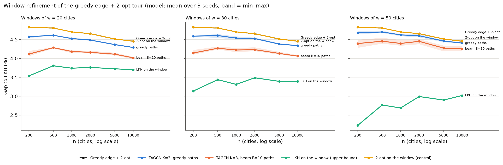

# Phase 3 — window refinement of a tour with the TSP-20 model

Generated by `scripts/phase3_window_report.py` on 2026-10-21 (results from commit(s) 99c1987, d803b62).

## Setup

- **Initial tour.** Greedy edge + neighbour-list 2-opt (k = min(0.5 n, 100)): the baseline of the scale experiment (Table 1 checks it is the same tour).
- **Windows** (`src/tsp_gnn/window.py`). Segments of w = 20, 30 or 50 consecutive cities of the current tour; the two end cities stay, the interior is re-ordered by a path solver and the segment is replaced only if the path is shorter, so the tour never gets longer. One pass = two half-passes with offsets 0 and w/2; each half-pass cuts the cycle into disjoint windows (solved together, the network in one batch), so consecutive windows overlap by w/2. Passes repeat until one brings no improvement (at most 5).
- **Path solvers.** TAGCN K=3 (BatchNorm, best.pt, seeds 0–2, trained on TSP-20; the w cities rescaled to [0, 1]², k-NN graph with k = round(0.5 w)) decoded as a Hamiltonian path between the ends: greedy, or beam B=10 (`hier.greedy_path` / `hier.beam_path`). LKH (1 run) on the window plus a dummy city joined only to the two ends: what a window of this size can give at best. 2-opt on the segment alone: control without model.
- **Tests.** Paired Wilcoxon of the final gap against the initial tour where there are ≥ 20 instances (n ≤ 1000); max p over the 3 seeds for the model; Bonferroni within each size (12 tests). Improvements are never negative, so a test can only say "better" or n.s.

## Table 1 — Consistency of the initial tour

| n | Instances | Initial tour = greedy edge + 2-opt of the scale experiment (all folders) |
|---|---|---|
| 200 | 100 | 500/500 identical |
| 500 | 50 | 250/250 identical |
| 1000 | 20 | 100/100 identical |
| 2000 | 10 | 50/50 identical |
| 5000 | 5 | 25/25 identical |
| 10000 | 3 | 15/15 identical |

## Table 2 — Final gap (%)

Mean ± std over the 3 seeds for the model; LKH and 2-opt windows are deterministic.

| Method | w | 200 | 500 | 1000 | 2000 | 5000 | 10000 |
|---|---|---|---|---|---|---|---|
| Greedy edge + 2-opt (initial tour) | — | 4.83 | 4.81 | 4.70 | 4.66 | 4.52 | 4.46 |
| Whole instance TAGCN K=3 + 2-opt (scale experiment) | — | 4.81 ± 0.12 | 5.12 ± 0.16 | 5.43 ± 0.29 | 5.48 ± 0.47 | 5.92 ± 0.56 | 6.15 ± 0.50 |
| TAGCN K=3, greedy paths | 20 | 4.58 ± 0.03 | 4.61 ± 0.00 | 4.53 ± 0.02 | 4.49 ± 0.02 | 4.37 ± 0.01 | 4.29 ± 0.01 |
| TAGCN K=3, greedy paths | 30 | 4.59 ± 0.01 | 4.61 ± 0.05 | 4.54 ± 0.04 | 4.53 ± 0.02 | 4.38 ± 0.02 | 4.34 ± 0.01 |
| TAGCN K=3, greedy paths | 50 | 4.68 ± 0.04 | 4.70 ± 0.03 | 4.62 ± 0.03 | 4.60 ± 0.04 | 4.46 ± 0.02 | 4.41 ± 0.02 |
| TAGCN K=3, beam B=10 paths | 20 | 4.12 ± 0.07 | 4.29 ± 0.02 | 4.19 ± 0.04 | 4.16 ± 0.04 | 4.11 ± 0.03 | 4.02 ± 0.03 |
| TAGCN K=3, beam B=10 paths | 30 | 4.15 ± 0.07 | 4.27 ± 0.04 | 4.22 ± 0.06 | 4.23 ± 0.05 | 4.13 ± 0.04 | 4.06 ± 0.02 |
| TAGCN K=3, beam B=10 paths | 50 | 4.40 ± 0.11 | 4.46 ± 0.08 | 4.40 ± 0.08 | 4.45 ± 0.07 | 4.28 ± 0.08 | 4.26 ± 0.06 |
| LKH on the window (upper bound) | 20 | 3.54 | 3.81 | 3.74 | 3.76 | 3.73 | 3.70 |
| LKH on the window (upper bound) | 30 | 3.14 | 3.44 | 3.31 | 3.49 | 3.39 | 3.39 |
| LKH on the window (upper bound) | 50 | 2.23 | 2.77 | 2.69 | 2.99 | 2.90 | 3.02 |
| 2-opt on the window (control) | 20 | 4.83 | 4.81 | 4.70 | 4.66 | 4.52 | 4.46 |
| 2-opt on the window (control) | 30 | 4.83 | 4.81 | 4.70 | 4.66 | 4.52 | 4.46 |
| 2-opt on the window (control) | 50 | 4.83 | 4.81 | 4.70 | 4.66 | 4.52 | 4.46 |

## Table 3 — Gain over greedy edge + 2-opt (pp)

| Method | w | 200 | 500 | 1000 | 2000 | 5000 | 10000 |
|---|---|---|---|---|---|---|---|
| TAGCN K=3, greedy paths | 20 | 0.25 ± 0.03 | 0.19 ± 0.00 | 0.18 ± 0.02 | 0.17 ± 0.02 | 0.15 ± 0.01 | 0.17 ± 0.01 |
| TAGCN K=3, greedy paths | 30 | 0.24 ± 0.01 | 0.20 ± 0.05 | 0.17 ± 0.04 | 0.13 ± 0.02 | 0.13 ± 0.02 | 0.12 ± 0.01 |
| TAGCN K=3, greedy paths | 50 | 0.15 ± 0.04 | 0.10 ± 0.03 | 0.08 ± 0.03 | 0.05 ± 0.04 | 0.06 ± 0.02 | 0.05 ± 0.02 |
| TAGCN K=3, beam B=10 paths | 20 | 0.71 ± 0.07 | 0.52 ± 0.02 | 0.52 ± 0.04 | 0.49 ± 0.04 | 0.40 ± 0.03 | 0.44 ± 0.03 |
| TAGCN K=3, beam B=10 paths | 30 | 0.68 ± 0.07 | 0.54 ± 0.04 | 0.48 ± 0.06 | 0.42 ± 0.05 | 0.38 ± 0.04 | 0.39 ± 0.02 |
| TAGCN K=3, beam B=10 paths | 50 | 0.43 ± 0.11 | 0.35 ± 0.08 | 0.31 ± 0.08 | 0.20 ± 0.07 | 0.24 ± 0.08 | 0.20 ± 0.06 |
| LKH on the window (upper bound) | 20 | 1.29 | 1.00 | 0.96 | 0.89 | 0.79 | 0.76 |
| LKH on the window (upper bound) | 30 | 1.69 | 1.37 | 1.39 | 1.17 | 1.12 | 1.07 |
| LKH on the window (upper bound) | 50 | 2.60 | 2.04 | 2.02 | 1.66 | 1.62 | 1.44 |
| 2-opt on the window (control) | 20 | 0.00 | 0.00 | 0.00 | 0.00 | 0.00 | 0.00 |
| 2-opt on the window (control) | 30 | 0.00 | 0.00 | 0.00 | 0.00 | 0.00 | 0.00 |
| 2-opt on the window (control) | 50 | 0.00 | 0.00 | 0.00 | 0.00 | 0.00 | 0.00 |

## Table 4 — Share of the LKH window gain obtained

| Method | w | 200 | 500 | 1000 | 2000 | 5000 | 10000 |
|---|---|---|---|---|---|---|---|
| TAGCN K=3, greedy paths | 20 | 20 % | 19 % | 18 % | 19 % | 19 % | 22 % |
| TAGCN K=3, greedy paths | 30 | 14 % | 14 % | 12 % | 11 % | 12 % | 11 % |
| TAGCN K=3, greedy paths | 50 | 6 % | 5 % | 4 % | 3 % | 3 % | 3 % |
| TAGCN K=3, beam B=10 paths | 20 | 55 % | 52 % | 54 % | 55 % | 51 % | 58 % |
| TAGCN K=3, beam B=10 paths | 30 | 40 % | 39 % | 34 % | 36 % | 34 % | 37 % |
| TAGCN K=3, beam B=10 paths | 50 | 17 % | 17 % | 15 % | 12 % | 15 % | 14 % |
| 2-opt on the window (control) | 20 | 0 % | 0 % | 0 % | 0 % | 0 % | 0 % |
| 2-opt on the window (control) | 30 | 0 % | 0 % | 0 % | 0 % | 0 % | 0 % |
| 2-opt on the window (control) | 50 | 0 % | 0 % | 0 % | 0 % | 0 % | 0 % |

## Table 5 — Windows that improved (all passes) and passes made

| Method | w | 200 | 500 | 1000 | 2000 | 5000 | 10000 |
|---|---|---|---|---|---|---|---|
| TAGCN K=3, greedy paths | 20 | 3.0 % (1.7 passes) | 2.0 % (2.0 passes) | 1.7 % (2.2 passes) | 1.6 % (2.4 passes) | 1.3 % (2.6 passes) | 1.2 % (2.8 passes) |
| TAGCN K=3, greedy paths | 30 | 3.6 % (1.6 passes) | 2.4 % (1.8 passes) | 2.1 % (1.9 passes) | 1.7 % (2.2 passes) | 1.5 % (2.3 passes) | 1.3 % (2.8 passes) |
| TAGCN K=3, greedy paths | 50 | 3.3 % (1.3 passes) | 2.1 % (1.5 passes) | 1.4 % (1.7 passes) | 1.1 % (1.9 passes) | 0.9 % (2.1 passes) | 0.8 % (2.4 passes) |
| TAGCN K=3, beam B=10 paths | 20 | 7.0 % (2.2 passes) | 4.8 % (2.4 passes) | 4.4 % (2.7 passes) | 4.1 % (2.7 passes) | 3.3 % (3.1 passes) | 3.4 % (3.0 passes) |
| TAGCN K=3, beam B=10 paths | 30 | 8.3 % (2.0 passes) | 6.0 % (2.3 passes) | 5.7 % (2.4 passes) | 4.4 % (2.8 passes) | 3.8 % (2.9 passes) | 4.0 % (3.0 passes) |
| TAGCN K=3, beam B=10 paths | 50 | 7.8 % (1.7 passes) | 5.2 % (2.0 passes) | 4.5 % (2.3 passes) | 3.7 % (2.3 passes) | 3.3 % (2.5 passes) | 2.8 % (3.0 passes) |
| LKH on the window (upper bound) | 20 | 12.1 % (2.2 passes) | 8.8 % (2.5 passes) | 8.5 % (2.6 passes) | 6.9 % (2.8 passes) | 5.4 % (3.4 passes) | 5.8 % (3.0 passes) |
| LKH on the window (upper bound) | 30 | 17.6 % (2.2 passes) | 14.8 % (2.3 passes) | 14.0 % (2.6 passes) | 12.1 % (2.6 passes) | 9.6 % (3.2 passes) | 9.9 % (3.0 passes) |
| LKH on the window (upper bound) | 50 | 30.1 % (2.3 passes) | 23.4 % (2.6 passes) | 21.5 % (2.9 passes) | 18.8 % (2.9 passes) | 17.0 % (3.0 passes) | 15.1 % (3.3 passes) |
| 2-opt on the window (control) | 20 | 0.0 % (1.0 passes) | 0.0 % (1.0 passes) | 0.0 % (1.0 passes) | 0.0 % (1.0 passes) | 0.0 % (1.0 passes) | 0.0 % (1.0 passes) |
| 2-opt on the window (control) | 30 | 0.0 % (1.0 passes) | 0.0 % (1.0 passes) | 0.0 % (1.0 passes) | 0.0 % (1.0 passes) | 0.0 % (1.0 passes) | 0.0 % (1.0 passes) |
| 2-opt on the window (control) | 50 | 0.0 % (1.0 passes) | 0.0 % (1.0 passes) | 0.0 % (1.0 passes) | 0.0 % (1.0 passes) | 0.0 % (1.0 passes) | 0.0 % (1.0 passes) |

## Table 6 — Paired tests against greedy edge + 2-opt

Cell: verdict, mean difference final − initial (pp), max p over seeds. Bonferroni: n = 200: 0.05/12 = 4.17e-03; n = 500: 0.05/12 = 4.17e-03; n = 1000: 0.05/12 = 4.17e-03.

| Method | w | 200 | 500 | 1000 |
|---|---|---|---|---|
| TAGCN K=3, greedy paths | 20 | **better** -0.25 (p 1.6e-11) | **better** -0.19 (p 2.3e-13) | **better** -0.18 (p 1.9e-06) |
| TAGCN K=3, greedy paths | 30 | **better** -0.24 (p 2.4e-10) | **better** -0.20 (p 1.5e-11) | **better** -0.17 (p 6.1e-05) |
| TAGCN K=3, greedy paths | 50 | **better** -0.15 (p 4.8e-07) | **better** -0.10 (p 6.1e-05) | **better** -0.08 (p 2.0e-03) |
| TAGCN K=3, beam B=10 paths | 20 | **better** -0.71 (p 5.6e-17) | **better** -0.52 (p 1.8e-15) | **better** -0.52 (p 1.9e-06) |
| TAGCN K=3, beam B=10 paths | 30 | **better** -0.68 (p 3.7e-15) | **better** -0.54 (p 7.1e-15) | **better** -0.48 (p 1.9e-06) |
| TAGCN K=3, beam B=10 paths | 50 | **better** -0.43 (p 2.4e-11) | **better** -0.35 (p 1.5e-11) | **better** -0.31 (p 1.9e-06) |
| LKH on the window (upper bound) | 20 | **better** -1.29 (p 5.7e-18) | **better** -1.00 (p 1.8e-15) | **better** -0.96 (p 1.9e-06) |
| LKH on the window (upper bound) | 30 | **better** -1.69 (p 3.9e-18) | **better** -1.37 (p 1.8e-15) | **better** -1.39 (p 1.9e-06) |
| LKH on the window (upper bound) | 50 | **better** -2.60 (p 3.9e-18) | **better** -2.04 (p 1.8e-15) | **better** -2.02 (p 1.9e-06) |
| 2-opt on the window (control) | 20 | n.s. +0.00 (p 1.0e+00) | n.s. +0.00 (p 1.0e+00) | n.s. +0.00 (p 1.0e+00) |
| 2-opt on the window (control) | 30 | n.s. +0.00 (p 1.0e+00) | n.s. +0.00 (p 1.0e+00) | n.s. +0.00 (p 1.0e+00) |
| 2-opt on the window (control) | 50 | n.s. +0.00 (p 1.0e+00) | n.s. +0.00 (p 1.0e+00) | n.s. +0.00 (p 1.0e+00) |

### n with fewer than 20 instances (no test): mean difference final − initial and instances improved

| Method | w | 2000 | 5000 | 10000 |
|---|---|---|---|---|
| TAGCN K=3, greedy paths | 20 | -0.17 (30/30 better) | -0.15 (15/15 better) | -0.17 (9/9 better) |
| TAGCN K=3, greedy paths | 30 | -0.13 (30/30 better) | -0.13 (15/15 better) | -0.12 (9/9 better) |
| TAGCN K=3, greedy paths | 50 | -0.05 (22/30 better) | -0.06 (15/15 better) | -0.05 (9/9 better) |
| TAGCN K=3, beam B=10 paths | 20 | -0.49 (30/30 better) | -0.40 (15/15 better) | -0.44 (9/9 better) |
| TAGCN K=3, beam B=10 paths | 30 | -0.42 (30/30 better) | -0.38 (15/15 better) | -0.39 (9/9 better) |
| TAGCN K=3, beam B=10 paths | 50 | -0.20 (30/30 better) | -0.24 (15/15 better) | -0.20 (9/9 better) |
| LKH on the window (upper bound) | 20 | -0.89 (10/10 better) | -0.79 (5/5 better) | -0.76 (3/3 better) |
| LKH on the window (upper bound) | 30 | -1.17 (10/10 better) | -1.12 (5/5 better) | -1.07 (3/3 better) |
| LKH on the window (upper bound) | 50 | -1.66 (10/10 better) | -1.62 (5/5 better) | -1.44 (3/3 better) |
| 2-opt on the window (control) | 20 | -0.00 (0/10 better) | -0.00 (0/5 better) | -0.00 (0/3 better) |
| 2-opt on the window (control) | 30 | -0.00 (0/10 better) | -0.00 (0/5 better) | -0.00 (0/3 better) |
| 2-opt on the window (control) | 50 | -0.00 (0/10 better) | -0.00 (0/5 better) | -0.00 (0/3 better) |

## Table 7 — Time per instance (ms)

One CPU process per solver/seed (5 in parallel), network on the GPU in batches.

| Step | w | 200 | 500 | 1000 | 2000 | 5000 | 10000 |
|---|---|---|---|---|---|---|---|
| Initial tour (greedy edge + 2-opt) | — | 58.6 | 132 | 276 | 536 | 1,365 | 2,688 |
| Refinement: TAGCN K=3, greedy paths | 20 | 68.9 | 156 | 327 | 676 | 1,793 | 3,925 |
| Refinement: TAGCN K=3, greedy paths | 30 | 63.2 | 143 | 286 | 628 | 1,666 | 4,188 |
| Refinement: TAGCN K=3, greedy paths | 50 | 60.4 | 141 | 303 | 725 | 1,941 | 4,595 |
| Refinement: TAGCN K=3, beam B=10 paths | 20 | 259 | 631 | 1,412 | 2,820 | 7,957 | 15,321 |
| Refinement: TAGCN K=3, beam B=10 paths | 30 | 292 | 743 | 1,607 | 3,531 | 9,561 | 19,402 |
| Refinement: TAGCN K=3, beam B=10 paths | 50 | 416 | 1,051 | 2,508 | 4,851 | 13,896 | 32,086 |
| Refinement: LKH on the window (upper bound) | 20 | 315 | 873 | 1,814 | 3,691 | 11,498 | 21,344 |
| Refinement: LKH on the window (upper bound) | 30 | 513 | 1,294 | 2,964 | 5,531 | 17,185 | 33,458 |
| Refinement: LKH on the window (upper bound) | 50 | 1,043 | 2,816 | 6,128 | 11,842 | 31,959 | 70,389 |
| Refinement: 2-opt on the window (control) | 20 | 9.6 | 18.4 | 38.3 | 73.1 | 183 | 355 |
| Refinement: 2-opt on the window (control) | 30 | 9.9 | 19.1 | 39.5 | 76.2 | 193 | 383 |
| Refinement: 2-opt on the window (control) | 50 | 10.5 | 20.4 | 41.8 | 81.7 | 205 | 417 |
|   of which network (greedy) | 20 | 22.6 | 28.2 | 43.8 | 65.8 | 136 | 267 |
|   of which network (beam10) | 20 | 26.1 | 28.7 | 38.4 | 50.1 | 109 | 202 |

## Three lines

1. **Window refinement is the first use of the TSP-20 model that beats greedy edge + 2-opt at every n, and the gain does not fade with n.**
   - **Best variant** (beam B=10 paths, w = 20): 4.83 → 4.12 % on TSP-200 and 4.46 → 4.02 % on TSP-10000.
   - **Gain:** 0.40–0.71 pp at every size, about 0.4–0.5 pp from n = 500 on.
   - **Tests:** all 18 model tests at n ≤ 1000 are significantly better. From n = 2000 on every instance improves (only greedy paths with w = 50 leave 8 of 30 unchanged at n = 2000).
   - **Against the other model approaches:** the whole-instance model (+ 2-opt) gets worse with n, from 4.81 % to 6.15 %, and the hierarchy reached 7–10 %. The windows stay below the baseline because they start from its tour and are only kept when shorter. The model only has to see 20 cities at the scale it was trained on, and a region can be revisited by overlapping windows.
2. **The model gets about half of what a window can give, but only at its training size, and the gain is not 2-opt.**
   - **2-opt on each window:** improves nothing (0 windows, 0.00 pp), because the initial tour is already 2-opt-optimal. Every model gain is therefore a re-ordering that 2-opt cannot find.
   - **Against LKH on the same windows** (the exact optimum of each window):
     - beam paths get 51–58 % of LKH's gain with w = 20, but only 34–40 % with w = 30 and 12–17 % with w = 50;
     - greedy paths get 18–22 % with w = 20 and only 3–6 % with w = 50.
   - **What window size does:** LKH's gain grows with w (0.8–1.3 pp at w = 20, 1.4–2.6 pp at w = 50), while the model's shrinks. Larger windows have more to win, but the TSP-20 model cannot win it.
   - **Improving windows:** 3–7 % with beam w = 20, against 5–12 % for LKH.
3. **It is cheap enough to use, but it is not cheaper than an exact solver on the same windows.**
   - **Time on top of the 2.7 s initial tour, at n = 10000:**
     - greedy paths, w = 20: 3.9 s for 0.17 pp;
     - beam paths, w = 20: 15.3 s for 0.44 pp;
     - LKH, w = 20 / 50: 21 s / 70 s for 0.76 / 1.44 pp.
   - **Network time:** only 0.2–0.3 s of that. Most of it is the Python path decoder.
   - **Cost per pp gained:** LKH windows with w = 20 cost about the same as beam paths or less (28 s/pp against 35 s/pp at n = 10000; 1.9 against 2.7 s/pp at n = 1000), and reach about twice the gain.
   - **Conclusion:** the TSP-20 model works as a local improver, but as a replacement for an exact window solver it is not competitive yet.

## Missing results

None.
