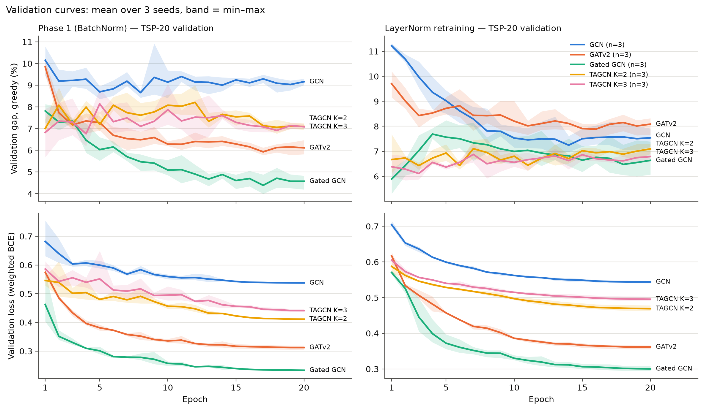

# TAGCN — fourth encoder, phase 1 and phase 2 protocol

Generated by `scripts/tagcn_report.py` on 2026-10-20. TAGCN (Topology Adaptive Graph Convolutional Networks, Du, Zhang, Wu, Moura & Kar, 2017), K = 2 and K = 3, against GCN, GATv2 and Gated GCN with the same protocol. Gaps to LKH in %, mean over seeds 0, 1, 2; baselines are deterministic. The GCN / GATv2 / Gated GCN numbers are the earlier results, not recomputed.

## Three things that look most important or suspicious

1. **TAGCN generalizes best, but part of that comes from early-selected checkpoints.** On TSP-20 the ranking is still Gated < GATv2 < TAGCN < GCN. With k = 0.5 n, a TAGCN best.pt has the lowest greedy gap of every model in every TSP-50/100 column: 10.01 / 11.66 for the phase 1 checkpoints, 10.17 / 11.87 with LayerNorm and 3.59 / 6.31 with B=100 (K=3 everywhere, except LayerNorm TSP-100, where K=2 is best). K=3's B=100 + 2-opt gap on TSP-50 (1.75) is the best of all models, and both K beat both baselines + 2-opt on TSP-20/50/100 (Table 5). It does this with about 1/3 of the Gated GCN's parameters. The last epoch is worse than best.pt everywhere off TSP-20 (K=3 with k = 0.5 n: 11.18 / 12.65 instead of 10.01 / 11.66; B=100 + 2-opt on TSP-50: 1.94 instead of 1.75; Table 7). Even so, K=3 last.pt keeps the best greedy gap with k = 0.5 n among the BatchNorm models, but no longer the best B=100 + 2-opt (GCN: 1.88 on TSP-50, 2.84 on TSP-100). Against Christofides without 2-opt (k = 0.5 n, Table 5b), no TAGCN checkpoint is significantly better (K=3 best.pt on TSP-50: −1.01 pp, max p 0.039 > 0.005), while GCN is significantly worse on both sizes.
2. **Suspicious: selecting the checkpoint by validation gap is close to noise for TAGCN.** From epoch 1 on, the validation gap stays flat at 6–7 % while the validation loss keeps going down; the loss is lowest at epoch 20 in all 18 TAGCN runs. The selected epochs were 1, 1, 18 (K=2) and 12, 1, 4 (K=3), and in the reruns with the same seeds 19, 1, 13 and 18, 3, 4 (Table 8): only 2 of 6 runs selected the same epoch again. The reruns already differ at epoch 1 (training loss in the 4th decimal, like the GCN LayerNorm reruns), so this comes from GPU non-determinism amplified by training, not from a bug. A different selection rule (val loss or last epoch) should be used for TAGCN.
3. **Training longer makes TSP-50 at k = 10 worse, much more for K=2 than for K=3.** K=2: the three runs selected at epoch 1 give 13.3–13.9 % greedy on TSP-50; the runs selected at epochs 13–19 and every last.pt give 19.4–21.6 % (rerun seed 1: epoch 1 → 13.29 %, epoch 20 → 19.40 %, the same network). K=3: 14.9–16.0 % for epochs 1–18 and 16.3–18.2 % at epoch 20. This explains the std of 4.46 in Table 3 and fits the distance-scale hypothesis: the longer the model trains, the more it fits the TSP-20 scale. With k = 0.5 n the effect is smaller, but last.pt is still worse than best.pt (note 1).

## Table 1 — main table (mean gap %, *without 2-opt / with 2-opt*)

Phase 1: k = 10 test graphs. k=0.5n: the same phase 1 checkpoints on test graphs with k = 0.5 n (25 on TSP-50, 50 on TSP-100). LayerNorm: retrained with LayerNorm, last epoch, k = 0.5 n. B=100: beam search of width 100 on the phase 1 checkpoints, k = 0.5 n; baseline cells there are the plain baselines. Bold = best model in that column and variant (best.pt rows only). *last.pt, rerun*: last epoch of the BatchNorm reruns (Table 7); its phase 1 columns use k = 10 graphs (`last_k10/`), the others k = 0.5 n; LayerNorm is a different training, so those cells are empty.

| Method | Phase 1 TSP-20 | Phase 1 TSP-50 | k=0.5n TSP-50 | k=0.5n TSP-100 | LayerNorm TSP-50 | LayerNorm TSP-100 | B=100 TSP-50 | B=100 TSP-100 |
|---|---|---|---|---|---|---|---|---|
| Classical greedy | 12.83 / 2.02 | 16.63 / 3.66 | 16.63 / 3.66 | 17.71 / 4.29 | 16.63 / 3.66 | 17.71 / 4.29 | 16.63 / 3.66 | 17.71 / 4.29 |
| Christofides | 9.06 / 2.16 | 11.02 / 3.63 | 11.02 / 3.63 | 12.07 / 4.40 | 11.02 / 3.63 | 12.07 / 4.40 | 11.02 / 3.63 | 12.07 / 4.40 |
| GCN | 8.53 / 1.79 | 15.91 / **3.66** | 12.60 / 3.32 | 14.23 / **4.07** | 11.26 / 3.00 | 13.00 / 3.90 | 4.56 / 1.88 | 7.37 / **2.84** |
| GATv2 | 6.04 / 1.23 | **14.68** / 4.07 | 12.27 / 3.99 | 14.31 / 4.60 | 13.07 / 3.76 | 14.25 / 4.33 | 4.24 / 2.36 | 7.37 / 3.46 |
| Gated GCN | **4.85** / **0.90** | 16.38 / 4.78 | 13.74 / 4.48 | 15.83 / 5.39 | 12.83 / 3.96 | 14.50 / 4.74 | 4.03 / 2.32 | 8.09 / 4.12 |
| TAGCN K=2 (best.pt) | 7.03 / 1.46 | 16.40 / 3.87 | 11.07 / 3.37 | 12.61 / 4.34 | 10.39 / 2.96 | **11.87** / 3.73 | 4.31 / 1.97 | 7.36 / 3.23 |
| TAGCN K=3 (best.pt) | 6.44 / 1.43 | 15.47 / 3.66 | **10.01** / **3.16** | **11.66** / 4.18 | **10.17** / **2.91** | 11.99 / **3.69** | **3.59** / **1.75** | **6.31** / 3.01 |
| TAGCN K=2 (last.pt, rerun) | 7.53 / 1.41 | 20.18 / 4.58 | 12.00 / 3.58 | 13.69 / 4.71 | — | — | 5.06 / 2.26 | 8.27 / 3.55 |
| TAGCN K=3 (last.pt, rerun) | 7.28 / 1.46 | 17.36 / 4.16 | 11.18 / 3.28 | 12.65 / 4.19 | — | — | 4.33 / 1.94 | 7.11 / 3.11 |

## Table 2 — parameters

Counted by building each model with H = 64. *Encoder layers only* = convolutions + their normalizations (GATv2 and Gated GCN layers include their own). The rest (embeddings 2→64 and 1→64, head 192→64→64→1) is the same 16,897 parameters for every model.

| Model | Layers L | Hops per layer | Reach (hops) | Parameters | Encoder layers only | Peak GPU (MB, max over runs) | Training time per run (min, mean) |
|---|---|---|---|---|---|---|---|
| GCN | 6 | 1 | 6 | 42,625 | 25,728 | 113 | 1.6 |
| GATv2 | 6 | 1 | 6 | 92,929 | 76,032 | 160 | 3.9 |
| Gated GCN | 6 | 1 | 6 | 143,233 | 126,336 | 178 | 3.8 |
| TAGCN K=2 | 3 | 2 | 6 | 54,337 | 37,440 | 114 | 1.5 |
| TAGCN K=3 | 2 | 3 | 6 | 50,049 | 33,152 | 114 | 1.3 |

## Table 3 — detailed results (mean ± std over seeds)

### Phase 1: k = 10, BatchNorm, best val gap

| Method | TSP-20 greedy | TSP-20 + 2-opt | TSP-50 greedy | TSP-50 + 2-opt | Selected epochs |
|---|---|---|---|---|---|
| Classical greedy | 12.83 | 2.02 | 16.63 | 3.66 | — |
| Christofides | 9.06 | 2.16 | 11.02 | 3.63 | — |
| GCN | 8.53 ± 0.19 | 1.79 ± 0.06 | 15.91 ± 0.49 | 3.66 ± 0.07 | 13, 2, 5 |
| GATv2 | 6.04 ± 0.22 | 1.23 ± 0.07 | 14.68 ± 1.02 | 4.07 ± 0.25 | 17, 7, 17 |
| Gated GCN | 4.85 ± 0.20 | 0.90 ± 0.03 | 16.38 ± 0.80 | 4.78 ± 0.17 | 17, 20, 17 |
| TAGCN K=2 | 7.03 ± 0.49 | 1.46 ± 0.04 | 16.40 ± 4.46 | 3.87 ± 0.87 | 1, 1, 18 |
| TAGCN K=3 | 6.44 ± 0.25 | 1.43 ± 0.03 | 15.47 ± 0.06 | 3.66 ± 0.08 | 12, 1, 4 |

### Phase 1 checkpoints, test graphs k = 0.5 n

| Method | TSP-50 greedy | TSP-50 + 2-opt | TSP-100 greedy | TSP-100 + 2-opt |
|---|---|---|---|---|
| Classical greedy | 16.63 | 3.66 | 17.71 | 4.29 |
| Christofides | 11.02 | 3.63 | 12.07 | 4.40 |
| GCN | 12.60 ± 0.15 | 3.32 ± 0.08 | 14.23 ± 0.14 | 4.07 ± 0.03 |
| GATv2 | 12.27 ± 0.45 | 3.99 ± 0.35 | 14.31 ± 0.76 | 4.60 ± 0.40 |
| Gated GCN | 13.74 ± 0.60 | 4.48 ± 0.35 | 15.83 ± 0.87 | 5.39 ± 0.51 |
| TAGCN K=2 | 11.07 ± 1.01 | 3.37 ± 0.39 | 12.61 ± 0.76 | 4.34 ± 0.36 |
| TAGCN K=3 | 10.01 ± 0.78 | 3.16 ± 0.21 | 11.66 ± 0.75 | 4.18 ± 0.13 |

### LayerNorm retraining, last epoch, k = 0.5 n

| Method | TSP-20 greedy | TSP-20 + 2-opt | TSP-50 greedy | TSP-50 + 2-opt | TSP-100 greedy | TSP-100 + 2-opt |
|---|---|---|---|---|---|---|
| Classical greedy | 12.83 | 2.02 | 16.63 | 3.66 | 17.71 | 4.29 |
| Christofides | 9.06 | 2.16 | 11.02 | 3.63 | 12.07 | 4.40 |
| GCN | 7.86 ± 0.25 | 1.68 ± 0.06 | 11.26 ± 0.34 | 3.00 ± 0.06 | 13.00 ± 0.51 | 3.90 ± 0.10 |
| GATv2 | 8.18 ± 0.18 | 1.52 ± 0.03 | 13.07 ± 0.51 | 3.76 ± 0.26 | 14.25 ± 0.19 | 4.33 ± 0.10 |
| Gated GCN | 6.70 ± 0.16 | 1.49 ± 0.05 | 12.83 ± 0.29 | 3.96 ± 0.30 | 14.50 ± 0.20 | 4.74 ± 0.09 |
| TAGCN K=2 | 7.05 ± 0.19 | 1.39 ± 0.04 | 10.39 ± 0.25 | 2.96 ± 0.06 | 11.87 ± 0.09 | 3.73 ± 0.04 |
| TAGCN K=3 | 7.10 ± 0.02 | 1.52 ± 0.06 | 10.17 ± 0.19 | 2.91 ± 0.15 | 11.99 ± 0.29 | 3.69 ± 0.09 |

### Phase 1 checkpoints, beam search, k = 0.5 n

| Method | TSP-20 greedy | TSP-20 + 2-opt | TSP-20 B=10 | TSP-20 B=10 + 2-opt | TSP-20 B=100 | TSP-20 B=100 + 2-opt | TSP-50 greedy | TSP-50 + 2-opt | TSP-50 B=10 | TSP-50 B=10 + 2-opt | TSP-50 B=100 | TSP-50 B=100 + 2-opt | TSP-100 greedy | TSP-100 + 2-opt | TSP-100 B=10 | TSP-100 B=10 + 2-opt | TSP-100 B=100 | TSP-100 B=100 + 2-opt |
|---|---|---|---|---|---|---|---|---|---|---|---|---|---|---|---|---|---|---|
| Classical greedy | 12.83 | 2.02 | — | — | — | — | 16.63 | 3.66 | — | — | — | — | 17.71 | 4.29 | — | — | — | — |
| Christofides | 9.06 | 2.16 | — | — | — | — | 11.02 | 3.63 | — | — | — | — | 12.07 | 4.40 | — | — | — | — |
| GCN | 8.53 ± 0.19 | 1.79 ± 0.06 | 3.12 ± 0.19 | 1.04 ± 0.09 | 1.10 ± 0.13 | 0.51 ± 0.08 | 12.60 ± 0.15 | 3.32 ± 0.08 | 7.32 ± 0.21 | 2.51 ± 0.06 | 4.56 ± 0.36 | 1.88 ± 0.15 | 14.23 ± 0.14 | 4.07 ± 0.03 | 10.02 ± 0.10 | 3.45 ± 0.07 | 7.37 ± 0.38 | 2.84 ± 0.20 |
| GATv2 | 6.04 ± 0.22 | 1.23 ± 0.07 | 1.37 ± 0.21 | 0.59 ± 0.06 | 0.27 ± 0.06 | 0.16 ± 0.03 | 12.27 ± 0.45 | 3.99 ± 0.35 | 7.24 ± 0.45 | 3.22 ± 0.45 | 4.24 ± 0.25 | 2.36 ± 0.30 | 14.31 ± 0.76 | 4.60 ± 0.40 | 9.96 ± 0.71 | 4.03 ± 0.43 | 7.37 ± 0.66 | 3.46 ± 0.47 |
| Gated GCN | 4.85 ± 0.20 | 0.90 ± 0.03 | 0.66 ± 0.05 | 0.32 ± 0.03 | 0.11 ± 0.01 | 0.07 ± 0.00 | 13.74 ± 0.60 | 4.48 ± 0.35 | 7.75 ± 0.56 | 3.51 ± 0.42 | 4.03 ± 0.33 | 2.32 ± 0.24 | 15.83 ± 0.87 | 5.39 ± 0.51 | 11.01 ± 0.79 | 4.73 ± 0.48 | 8.09 ± 0.66 | 4.12 ± 0.49 |
| TAGCN K=2 | 7.03 ± 0.49 | 1.46 ± 0.04 | 2.32 ± 0.17 | 0.79 ± 0.04 | 0.60 ± 0.11 | 0.31 ± 0.05 | 11.07 ± 1.01 | 3.37 ± 0.39 | 6.68 ± 0.89 | 2.63 ± 0.37 | 4.31 ± 0.73 | 1.97 ± 0.33 | 12.61 ± 0.76 | 4.34 ± 0.36 | 9.16 ± 0.93 | 3.72 ± 0.30 | 7.36 ± 0.92 | 3.23 ± 0.34 |
| TAGCN K=3 | 6.44 ± 0.25 | 1.43 ± 0.03 | 2.12 ± 0.05 | 0.77 ± 0.02 | 0.60 ± 0.06 | 0.31 ± 0.02 | 10.01 ± 0.78 | 3.16 ± 0.21 | 5.73 ± 0.73 | 2.43 ± 0.24 | 3.59 ± 0.43 | 1.75 ± 0.17 | 11.66 ± 0.75 | 4.18 ± 0.13 | 8.36 ± 0.64 | 3.56 ± 0.18 | 6.31 ± 0.67 | 3.01 ± 0.19 |

## Validation curves

`figs/tagcn_curves.png`: validation gap (greedy) and validation loss per epoch on TSP-20, phase 1 runs (BatchNorm) and LayerNorm retraining; mean over seeds with a min–max band. The values are in each run's `history.json`.

## Table 4 — phase 1: TAGCN against the baselines (paired Wilcoxon)

Diff. = TAGCN − baseline with the same decoder (negative = TAGCN better). k = 10 test graphs. *Equal* = difference ≤ 1e-06 pp.

Bonferroni: 0.05/16 tests, threshold 3.13e-03.

| Model | Dataset | Decoder | Reference | Model gap | Ref. gap | Better | Equal | Worse | Mean diff. (pp) | Median diff. (pp) | max p (seeds) | Conclusion |
|---|---|---|---|---|---|---|---|---|---|---|---|---|
| TAGCN K=2 | TSP-20 | greedy | Classical greedy | 7.03 | 12.83 | 73.3% | 0.7% | 26.0% | -5.80 | -4.84 | 2.4e-50 | **better** |
| TAGCN K=2 | TSP-20 | greedy | Christofides | 7.03 | 9.06 | 63.3% | 0.1% | 36.6% | -2.02 | -2.54 | 3.5e-12 | **better** |
| TAGCN K=2 | TSP-20 | + 2-opt | Classical greedy | 1.46 | 2.02 | 50.2% | 8.7% | 41.1% | -0.56 | -0.00 | 2.5e-05 | **better** |
| TAGCN K=2 | TSP-20 | + 2-opt | Christofides | 1.46 | 2.16 | 55.2% | 5.7% | 39.1% | -0.70 | -0.00 | 8.6e-12 | **better** |
| TAGCN K=2 | TSP-50 | greedy | Classical greedy | 16.40 | 16.63 | 51.3% | 0.0% | 48.7% | -0.22 | -0.05 | 2.5e-13 | n.s. |
| TAGCN K=2 | TSP-50 | greedy | Christofides | 16.40 | 11.02 | 24.9% | 0.0% | 75.1% | +5.39 | +5.24 | 4.0e-17 | **worse** |
| TAGCN K=2 | TSP-50 | + 2-opt | Classical greedy | 3.87 | 3.66 | 47.9% | 0.4% | 51.7% | +0.20 | +0.25 | 9.1e-02 | n.s. |
| TAGCN K=2 | TSP-50 | + 2-opt | Christofides | 3.87 | 3.63 | 51.0% | 0.0% | 49.0% | +0.24 | -0.02 | 3.0e-02 | n.s. |
| TAGCN K=3 | TSP-20 | greedy | Classical greedy | 6.44 | 12.83 | 75.2% | 0.6% | 24.2% | -6.39 | -5.34 | 7.6e-72 | **better** |
| TAGCN K=3 | TSP-20 | greedy | Christofides | 6.44 | 9.06 | 66.9% | 0.1% | 33.1% | -2.62 | -2.90 | 1.4e-28 | **better** |
| TAGCN K=3 | TSP-20 | + 2-opt | Classical greedy | 1.43 | 2.02 | 51.2% | 8.6% | 40.2% | -0.59 | -0.00 | 2.7e-06 | **better** |
| TAGCN K=3 | TSP-20 | + 2-opt | Christofides | 1.43 | 2.16 | 55.6% | 5.9% | 38.5% | -0.73 | -0.00 | 8.8e-12 | **better** |
| TAGCN K=3 | TSP-50 | greedy | Classical greedy | 15.47 | 16.63 | 57.1% | 0.0% | 42.9% | -1.16 | -1.13 | 2.5e-03 | **better** |
| TAGCN K=3 | TSP-50 | greedy | Christofides | 15.47 | 11.02 | 25.1% | 0.0% | 74.9% | +4.45 | +4.02 | 4.2e-34 | **worse** |
| TAGCN K=3 | TSP-50 | + 2-opt | Classical greedy | 3.66 | 3.66 | 48.4% | 0.4% | 51.2% | +0.00 | +0.02 | 8.2e-01 | n.s. |
| TAGCN K=3 | TSP-50 | + 2-opt | Christofides | 3.66 | 3.63 | 51.5% | 0.0% | 48.5% | +0.04 | -0.07 | 8.4e-01 | n.s. |

## Table 5 — beam search: TAGCN B=100 + 2-opt against the baselines + 2-opt

k = 0.5 n test graphs. The GCN / GATv2 / Gated GCN versions of these tests are in `phase2_beam_report.md` (Table 3, Bonferroni over 54 tests there).

Bonferroni: 0.05/12 tests, threshold 4.17e-03.

| Model | Dataset | Decoder | Reference | Model gap | Ref. gap | Better | Equal | Worse | Mean diff. (pp) | Median diff. (pp) | max p (seeds) | Conclusion |
|---|---|---|---|---|---|---|---|---|---|---|---|---|
| TAGCN K=2 | TSP-20 | B=100 + 2-opt | Classical greedy + 2-opt | 0.31 | 2.02 | 68.3% | 9.3% | 22.4% | -1.71 | -0.31 | 8.2e-76 | **better** |
| TAGCN K=2 | TSP-20 | B=100 + 2-opt | Christofides + 2-opt | 0.31 | 2.16 | 72.0% | 7.3% | 20.7% | -1.85 | -0.80 | 1.5e-86 | **better** |
| TAGCN K=2 | TSP-50 | B=100 + 2-opt | Classical greedy + 2-opt | 1.97 | 3.66 | 70.5% | 0.3% | 29.3% | -1.69 | -1.30 | 2.5e-19 | **better** |
| TAGCN K=2 | TSP-50 | B=100 + 2-opt | Christofides + 2-opt | 1.97 | 3.63 | 72.5% | 0.0% | 27.5% | -1.66 | -1.62 | 1.5e-21 | **better** |
| TAGCN K=2 | TSP-100 | B=100 + 2-opt | Classical greedy + 2-opt | 3.23 | 4.29 | 66.9% | 0.0% | 33.1% | -1.06 | -0.92 | 1.7e-08 | **better** |
| TAGCN K=2 | TSP-100 | B=100 + 2-opt | Christofides + 2-opt | 3.23 | 4.40 | 71.1% | 0.0% | 28.9% | -1.17 | -1.21 | 1.5e-13 | **better** |
| TAGCN K=3 | TSP-20 | B=100 + 2-opt | Classical greedy + 2-opt | 0.31 | 2.02 | 67.3% | 9.5% | 23.2% | -1.71 | -0.23 | 3.6e-74 | **better** |
| TAGCN K=3 | TSP-20 | B=100 + 2-opt | Christofides + 2-opt | 0.31 | 2.16 | 72.2% | 7.3% | 20.5% | -1.85 | -0.78 | 7.8e-87 | **better** |
| TAGCN K=3 | TSP-50 | B=100 + 2-opt | Classical greedy + 2-opt | 1.75 | 3.66 | 73.9% | 0.7% | 25.4% | -1.91 | -1.64 | 3.0e-31 | **better** |
| TAGCN K=3 | TSP-50 | B=100 + 2-opt | Christofides + 2-opt | 1.75 | 3.63 | 76.4% | 0.1% | 23.5% | -1.88 | -1.90 | 1.0e-33 | **better** |
| TAGCN K=3 | TSP-100 | B=100 + 2-opt | Classical greedy + 2-opt | 3.01 | 4.29 | 69.7% | 0.0% | 30.3% | -1.28 | -1.18 | 1.6e-20 | **better** |
| TAGCN K=3 | TSP-100 | B=100 + 2-opt | Christofides + 2-opt | 3.01 | 4.40 | 74.3% | 0.0% | 25.7% | -1.39 | -1.43 | 9.2e-31 | **better** |

## Table 5b — greedy with k = 0.5 n against Christofides (no 2-opt)

Diff. = model greedy − Christofides (negative = model better), no 2-opt on either side, k = 0.5 n test graphs. TAGCN best.pt (first runs), TAGCN last.pt (BatchNorm reruns) and GCN best.pt (`phase2_batch2/kfrac05/`). Bonferroni over this family only.

Bonferroni: 0.05/10 tests, threshold 5.00e-03.

| Model | Dataset | Decoder | Reference | Model gap | Ref. gap | Better | Equal | Worse | Mean diff. (pp) | Median diff. (pp) | max p (seeds) | Conclusion |
|---|---|---|---|---|---|---|---|---|---|---|---|---|
| TAGCN K=2 best.pt | TSP-50 | greedy | Christofides | 11.07 | 11.02 | 51.7% | 0.0% | 48.3% | +0.05 | -0.14 | 2.3e-01 | n.s. |
| TAGCN K=2 best.pt | TSP-100 | greedy | Christofides | 12.61 | 12.07 | 46.6% | 0.0% | 53.4% | +0.53 | +0.40 | 7.8e-01 | n.s. |
| TAGCN K=3 best.pt | TSP-50 | greedy | Christofides | 10.01 | 11.02 | 58.3% | 0.0% | 41.7% | -1.01 | -1.10 | 3.9e-02 | n.s. |
| TAGCN K=3 best.pt | TSP-100 | greedy | Christofides | 11.66 | 12.07 | 54.9% | 0.0% | 45.1% | -0.41 | -0.39 | 3.3e-01 | n.s. |
| TAGCN K=2 last.pt | TSP-50 | greedy | Christofides | 12.00 | 11.02 | 44.5% | 0.0% | 55.5% | +0.99 | +0.80 | 1.4e-02 | n.s. |
| TAGCN K=2 last.pt | TSP-100 | greedy | Christofides | 13.69 | 12.07 | 35.7% | 0.0% | 64.3% | +1.61 | +1.49 | 5.2e-12 | **worse** |
| TAGCN K=3 last.pt | TSP-50 | greedy | Christofides | 11.18 | 11.02 | 50.8% | 0.0% | 49.2% | +0.16 | -0.12 | 2.9e-01 | n.s. |
| TAGCN K=3 last.pt | TSP-100 | greedy | Christofides | 12.65 | 12.07 | 44.2% | 0.0% | 55.8% | +0.58 | +0.54 | 1.9e-01 | n.s. |
| GCN best.pt | TSP-50 | greedy | Christofides | 12.60 | 11.02 | 41.3% | 0.0% | 58.7% | +1.58 | +1.28 | 1.7e-06 | **worse** |
| GCN best.pt | TSP-100 | greedy | Christofides | 14.23 | 12.07 | 34.2% | 0.0% | 65.8% | +2.16 | +2.09 | 4.0e-17 | **worse** |

## Table 6 — consistency check: TAGCN greedy in the beam run vs. earlier evaluation of the same checkpoint

| Model | Dataset | Compared with | Instances | Different (> 1e-6 pp) | max abs. diff. (pp) |
|---|---|---|---|---|---|
| TAGCN K=2 | TSP-20 | phase 1 eval (k = 10 = 0.5 × 20) | 3000 | 0 | 0.00e+00 |
| TAGCN K=2 | TSP-50 | kfrac05 eval | 1500 | 0 | 0.00e+00 |
| TAGCN K=2 | TSP-100 | kfrac05 eval | 1500 | 0 | 0.00e+00 |
| TAGCN K=3 | TSP-20 | phase 1 eval (k = 10 = 0.5 × 20) | 3000 | 0 | 0.00e+00 |
| TAGCN K=3 | TSP-50 | kfrac05 eval | 1500 | 1 | 3.87e-01 |
| TAGCN K=3 | TSP-100 | kfrac05 eval | 1500 | 0 | 0.00e+00 |

## Table 7 — TAGCN last.pt (BatchNorm reruns), k = 0.5 n

The first TAGCN batch trained the BatchNorm runs without `--extra-checkpoints`, so it has no last.pt. The 6 runs were trained again with the same code, seeds and protocol into `results/runs/tagcn_k<K>_ckpt_seed<s>/` and their last.pt (epoch 20) was evaluated (greedy and B=100, without / with 2-opt). Mean ± std over seeds.

| Method | TSP-20 greedy | TSP-20 + 2-opt | TSP-20 B=100 | TSP-20 B=100 + 2-opt | TSP-50 greedy | TSP-50 + 2-opt | TSP-50 B=100 | TSP-50 B=100 + 2-opt | TSP-100 greedy | TSP-100 + 2-opt | TSP-100 B=100 | TSP-100 B=100 + 2-opt | Epoch |
|---|---|---|---|---|---|---|---|---|---|---|---|---|---|
| Classical greedy | 12.83 | 2.02 | — | — | 16.63 | 3.66 | — | — | 17.71 | 4.29 | — | — | — |
| Christofides | 9.06 | 2.16 | — | — | 11.02 | 3.63 | — | — | 12.07 | 4.40 | — | — | — |
| TAGCN K=2 last.pt | 7.53 ± 0.20 | 1.41 ± 0.12 | 0.48 ± 0.01 | 0.24 ± 0.02 | 12.00 ± 0.19 | 3.58 ± 0.05 | 5.06 ± 0.12 | 2.26 ± 0.03 | 13.69 ± 0.18 | 4.71 ± 0.12 | 8.27 ± 0.06 | 3.55 ± 0.06 | 20, 20, 20 |
| TAGCN K=3 last.pt | 7.28 ± 0.12 | 1.46 ± 0.07 | 0.54 ± 0.01 | 0.29 ± 0.01 | 11.18 ± 0.70 | 3.28 ± 0.12 | 4.33 ± 0.22 | 1.94 ± 0.14 | 12.65 ± 0.29 | 4.19 ± 0.13 | 7.11 ± 0.53 | 3.11 ± 0.15 | 20, 20, 20 |

## Table 8 — best.pt of the first run vs. the rerun

Same code, seed, data and batch order. The two runs are still not bit-for-bit identical: the message sums on the GPU (`scatter` with atomic additions) are done in a non-deterministic order, so the floating point roundings differ from run to run, and the small differences grow during training. Because the validation gap is nearly flat over the epochs (see note 2), such differences can change which epoch is selected. Hence last.pt (Table 7) and the best.pt of Tables 1–5 come from different, equivalent runs.

| Run | Selected epoch (first / rerun) | Val gap at that epoch (first / rerun) | Max abs. diff. of the val loss curves | TSP-20 greedy (first / rerun) | TSP-50 greedy (first / rerun) | Identical per-instance gaps, TSP-20 + TSP-50 greedy |
|---|---|---|---|---|---|---|
| tagcn_k2_seed0 | 1 / 19 | 6.81 / 7.04 | 3.6e-02 | 6.90 / 7.25 | 13.91 / 19.93 | 103/1500 |
| tagcn_k2_seed1 | 1 / 1 | 6.79 / 6.75 | 2.6e-02 | 6.62 / 6.51 | 13.74 / 13.29 | 521/1500 |
| tagcn_k2_seed2 | 18 / 13 | 6.77 / 6.87 | 3.7e-02 | 7.57 / 7.17 | 21.56 / 20.90 | 353/1500 |
| tagcn_k3_seed0 | 12 / 18 | 6.42 / 6.75 | 2.3e-02 | 6.67 / 7.22 | 15.53 / 15.95 | 303/1500 |
| tagcn_k3_seed1 | 1 / 3 | 5.69 / 6.17 | 7.3e-02 | 6.17 / 6.67 | 15.40 / 14.86 | 176/1500 |
| tagcn_k3_seed2 | 4 / 4 | 6.19 / 6.41 | 3.1e-02 | 6.49 / 6.48 | 15.46 / 15.90 | 638/1500 |

## Decisions

- Layer: `torch_geometric.nn.TAGConv(64, 64, K)` (installed PyG 2.8.1 has it), i.e. Σ_{k=0..K} Â^k H W_k + b with  = D^-1/2 A D^-1/2 of the k-NN graph *without* self-loops (PyG default; the k = 0 term already is the node itself). Like the other encoders, each layer is wrapped as h ← h + ReLU(Norm(TAGConv(h))) — residual + BatchNorm/LayerNorm — instead of the bare ReLU(Σ Â^k H W_k), so the only difference from the GCN encoder is the convolution. Like GCN, TAGCN does not see the edge lengths in the encoder (only the head does, through e_ij).
- Layers: round(6 / K), so the reach L × K is exactly 6 hops for K = 2 (L = 3) and K = 3 (L = 2), as the 6 one-hop layers of the other models. Everything else is the phase 1 protocol (H = 64, 20 epochs, batch 64, Adam 1e-3 + cosine, pos_weight from the data, selection by greedy val gap, seeds 0/1/2).
- LayerNorm retraining uses `--extra-checkpoints`; `last.pt` (epoch 20) is evaluated, as for the other models (`results/phase2_checks/ln/last_kfrac05/`). The best-val-gap `best.pt` is evaluated with k = 10 at the end of training (in the run folder) but not used in the tables.
- Beam search uses the phase 1 checkpoints (best.pt), like the `phase1` configuration of the beam report.
- All new outputs are inside `results/runs/tagcn_*` (evaluations in subfolders of the run they evaluate); nothing earlier was recomputed or rewritten.
- Statistical rule (same as the corrected beam report): two-sided Wilcoxon per seed (ties dropped), max p over the 3 seeds, Bonferroni within each family; the medians of the seeds must agree in sign, a seed with a zero median (|median| ≤ 1e-06 pp) is neutral, and if every median is zero the direction comes from the mean.

## Missing results

None.
