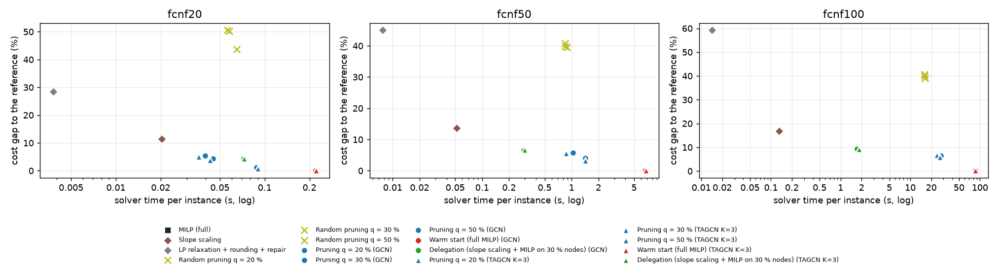

# FCNF phase 1: a GNN prior for fixed-charge network flow

Instances: directed graphs with k = 4 nearest-neighbour arcs both ways, 20 % supplies and 20 % demands; formulation in `docs/fcnf_formulation.md`. Labels: open arcs of the MILP solution (HiGHS). Models trained on fcnf20 only and applied to fcnf20 / fcnf50 / fcnf100.

## Summary

1. **Does the prior generalize from 20 to 100? Partly.**
   - The fcnf100 AP is 84 % of the fcnf20 AP, but it is still 3.8–3.9× the base rate.
   - Guided pruning beats random pruning by 32–35 gap points at every size.
   - The pruning gap grows with n: q = 50 goes from 0.8–1.2 % (fcnf20) to 3.3–4.1 % (fcnf50) to 5.9–6.5 % (fcnf100).
   - At fcnf100 almost no pruned problem is feasible on the first try (0–1 % at q = 20 / 30, 32–40 % at q = 50). The repair brings the kept fraction to about 0.6–0.65 whatever q was, so q stops mattering.

2. **How much time does pruning save, and at what cost?**
   - On fcnf100 it takes about 25 s per instance instead of 85 s (about 3.3× faster), for a gap of 5.9–7.0 %.
   - On fcnf50 it takes about 1 s instead of 6.7 s, for a gap of 3.3–5.8 %.
   - On fcnf20 the absolute saving is tiny (0.04–0.09 s instead of 0.22 s).
   - The time saved is significant at every size, and so is the loss in cost.
   - TAGCN is slightly better than GCN.
   - Warm start with y = 1[p ≥ 0.5] gives nothing. That y almost never admits a flow (2 % of fcnf50 instances, 0 % of fcnf100), and the MILP time is not significantly different.

3. **Does delegation beat pruning? No in cost, yes in time.**
   - Delegation is significantly worse than pruning on fcnf50 (+0.8 to +3.4 points) and on fcnf100 (+2.3 to +3.3 points).
   - On fcnf20 it is not distinguishable from q = 20 / 30 and worse than q = 50.
   - It is much faster: 1.8 s instead of 25 s on fcnf100.
   - It improves slope scaling by about 7 points at every size, and is about 47× faster than the full MILP on fcnf100.

Caveats:
- Some fcnf20 / fcnf50 results were timed with 2 processes instead of 8 (see section 4). Every fcnf100 result used 8.
- The fcnf100 warm start has 3 seeds per encoder, and the MILP time is not significantly different (85.3–85.4 s vs 85.4 s).

## 1. Generator and reference solutions

| set | instances | arcs (mean) | MILP s mean | MILP s max | open arcs (base rate) | proven optimal (120 s / none on fcnf20) | reference |
|---|---|---|---|---|---|---|---|
| fcnf20 | 1000 | 101.0 | 0.22 | 2.6 | 0.105 | 1000 / 1000 | MILP optimum (all proven) |
| fcnf50 | 500 | 249.2 | 6.66 | 62.8 | 0.115 | 500 / 500 | MILP optimum (all proven) |
| fcnf100 | 200 | 496.5 | 85.43 | 120.0 | 0.120 | 105 / 200 | best of the 120 s and 600 s MILP runs |

Fixed-cost ratio F / (c u) ∈ {0.5, 1, 2}, drawn once per instance:

| set | ratio 0.5: MILP s / open | ratio 1 | ratio 2 |
|---|---|---|---|
| fcnf20 | 0.23 s / 0.106 | 0.21 s / 0.104 | 0.22 s / 0.106 |
| fcnf50 | 7.26 s / 0.114 | 5.80 s / 0.115 | 6.84 s / 0.116 |
| fcnf100 | 92.11 s / 0.118 | 79.64 s / 0.119 | 85.75 s / 0.122 |

The ratio changes neither the MILP time nor the fraction of open arcs: the difficulty lever here is the size n, not the ratio (a harder set, e.g. ratio 10, would be generated separately).

**fcnf100, 600 s re-solve** of the 95 instances without a proof at 120 s (6 processes, warm start = the 120 s solution): 73 proven optimal, 22 still unproven; the cost improved on 83 (mean 0.32 %, max 1.86 %). Mean solver gap of those instances: 5.53 % at 120 s -> 0.87 % after (gap against the best bound of both runs). Overall, 178 / 200 fcnf100 references are proven optimal.

## 2. Training

Best epoch by validation F1 at p ≥ 0.5 (20 epochs, Adam 1e-3 with cosine, batch 64, 64 channels, 3 layers, residual + LayerNorm, BCE with pos_weight from the training arcs).

| run | parameters | pos_weight | best epoch | val F1 | val AP | val precision | val recall |
|---|---|---|---|---|---|---|---|
| gcn_seed0 | 30,209 | 8.48 | 3 | 0.499 | 0.534 | 0.371 | 0.763 |
| gcn_seed1 | 30,209 | 8.48 | 5 | 0.509 | 0.545 | 0.383 | 0.757 |
| gcn_seed2 | 30,209 | 8.48 | 16 | 0.480 | 0.555 | 0.337 | 0.832 |
| tagcn_k3_seed0 | 67,073 | 8.48 | 5 | 0.501 | 0.567 | 0.363 | 0.807 |
| tagcn_k3_seed1 | 67,073 | 8.48 | 5 | 0.518 | 0.564 | 0.392 | 0.764 |
| tagcn_k3_seed2 | 67,073 | 8.48 | 4 | 0.501 | 0.552 | 0.369 | 0.783 |

## 3. The prior: average precision of the heatmap

AP for "arc open in the reference solution" (all arcs of the set pooled), mean ± std over 3 seeds; the base rate is the AP of a constant heatmap. On fcnf100 the labels are the reference solutions (best known, see section 1). *lift* = AP / base rate.

| encoder | fcnf20 AP | lift | fcnf50 AP | lift | fcnf100 AP | lift |
|---|---|---|---|---|---|---|
| base rate | 0.105 | 1 | 0.115 | 1 | 0.120 | 1 |
| GCN | 0.541 ± 0.011 | 5.15 | 0.485 ± 0.010 | 4.21 | 0.454 ± 0.009 | 3.79 |
| TAGCN K=3 | 0.556 ± 0.008 | 5.29 | 0.507 ± 0.003 | 4.40 | 0.469 ± 0.003 | 3.92 |

AP relative to fcnf20 (the training size): GCN fcnf50 0.90, fcnf100 0.84; TAGCN K=3 fcnf50 0.91, fcnf100 0.84.

## 4. Decoders × size

gap = 100 (cost / reference − 1), mean over the instances (solved ones), mean ± std over 3 seeds for the heatmap decoders; *s* = solver time per instance (LPs + MILPs + heuristic; the network adds the inference time below); *1st feas.* = % of instances that needed no repair (pruning: the restricted MILP had a solution; warm start: y = 1[p ≥ 0.5] admits a flow; LP rounding: the rounded arcs admit a flow); *kept* = mean fraction of arcs the MILP could open (delegation: free arcs); *solved* = % with a solution. Every MILP: no limit on fcnf20, 120 s on fcnf50 / fcnf100; 8 instances in parallel, one HiGHS thread each (2 at a time while the 600 s re-solve ran).

Network inference: fcnf20 0.07 ms, fcnf50 0.11 ms, fcnf100 0.17 ms per instance (batched on the GPU).

Processes in parallel when each result was measured (the reference MILP times: 8): **2**: 17 results (fcnf20/baselines/baselines, fcnf50/baselines/baselines, fcnf20/gcn_seed0/guided, fcnf20/gcn_seed0/warm, fcnf50/gcn_seed0/guided, fcnf20/gcn_seed1/guided, fcnf20/gcn_seed1/warm, fcnf50/gcn_seed1/guided, fcnf20/gcn_seed2/guided, fcnf20/gcn_seed2/warm, fcnf50/gcn_seed2/guided, fcnf20/tagcn_k3_seed0/guided, …); **8**: 22 results (fcnf100/baselines/baselines, fcnf100/gcn_seed0/guided, fcnf100/gcn_seed0/warm, fcnf50/gcn_seed0/warm, fcnf100/gcn_seed1/guided, fcnf100/gcn_seed1/warm, fcnf50/gcn_seed1/warm, fcnf100/gcn_seed2/guided, fcnf100/gcn_seed2/warm, fcnf50/gcn_seed2/warm, fcnf100/tagcn_k3_seed0/guided, fcnf100/tagcn_k3_seed0/warm, …). Fewer processes means less contention, so times measured with 2 are slightly favourable to the method.

### fcnf20 (reference: MILP optimum (all proven))

| method | heatmap | gap (%) | s | 1st feas. (%) | kept | solved (%) |
|---|---|---|---|---|---|---|
| MILP (full) | — | 0.00 | 0.22 | 100 | 1.00 | 100 |
| Slope scaling | — | 11.43 | 0.02 | 100 | 1.00 | 100 |
| LP relaxation + rounding + repair | — | 28.46 | 0.00 | 0 | 0.13 | 100 |
| Random pruning q = 20 % | — | 50.33 | 0.06 | 5 | 0.54 | 100 |
| Random pruning q = 30 % | — | 50.52 | 0.06 | 13 | 0.55 | 100 |
| Random pruning q = 50 % | — | 43.67 | 0.06 | 55 | 0.59 | 100 |
| Pruning q = 20 % | GCN | 5.38 ± 0.25 | 0.04 ± 0.00 | 36 ± 1 | 0.33 ± 0.01 | 100 ± 0 |
| Pruning q = 20 % | TAGCN K=3 | 5.05 ± 0.24 | 0.04 ± 0.00 | 39 ± 4 | 0.31 ± 0.01 | 100 ± 0 |
| Pruning q = 30 % | GCN | 4.25 ± 0.20 | 0.04 ± 0.00 | 70 ± 4 | 0.36 ± 0.01 | 100 ± 0 |
| Pruning q = 30 % | TAGCN K=3 | 3.86 ± 0.07 | 0.04 ± 0.00 | 75 ± 3 | 0.35 ± 0.01 | 100 ± 0 |
| Pruning q = 50 % | GCN | 1.17 ± 0.12 | 0.09 ± 0.00 | 94 ± 1 | 0.52 ± 0.00 | 100 ± 0 |
| Pruning q = 50 % | TAGCN K=3 | 0.84 ± 0.07 | 0.09 ± 0.00 | 96 ± 1 | 0.51 ± 0.00 | 100 ± 0 |
| Warm start (full MILP) | GCN | -0.00 ± 0.00 | 0.22 ± 0.00 | 37 ± 12 | 1.00 ± 0.00 | 100 ± 0 |
| Warm start (full MILP) | TAGCN K=3 | -0.00 ± 0.00 | 0.22 ± 0.00 | 39 ± 9 | 1.00 ± 0.00 | 100 ± 0 |
| Delegation (slope scaling + MILP on 30 % nodes) | GCN | 4.31 ± 0.27 | 0.07 ± 0.00 | 100 ± 0 | 0.50 ± 0.00 | 100 ± 0 |
| Delegation (slope scaling + MILP on 30 % nodes) | TAGCN K=3 | 4.31 ± 0.14 | 0.07 ± 0.00 | 100 ± 0 | 0.50 ± 0.00 | 100 ± 0 |

### fcnf50 (reference: MILP optimum (all proven))

| method | heatmap | gap (%) | s | 1st feas. (%) | kept | solved (%) |
|---|---|---|---|---|---|---|
| MILP (full) | — | 0.00 | 6.66 | 100 | 1.00 | 100 |
| Slope scaling | — | 13.65 | 0.05 | 100 | 1.00 | 100 |
| LP relaxation + rounding + repair | — | 44.97 | 0.01 | 0 | 0.19 | 100 |
| Random pruning q = 20 % | — | 39.85 | 0.85 | 0 | 0.62 | 100 |
| Random pruning q = 30 % | — | 40.82 | 0.85 | 2 | 0.62 | 100 |
| Random pruning q = 50 % | — | 39.57 | 0.89 | 35 | 0.63 | 100 |
| Pruning q = 20 % | GCN | 5.71 ± 0.06 | 1.04 ± 0.08 | 0 ± 0 | 0.53 ± 0.01 | 100 ± 0 |
| Pruning q = 20 % | TAGCN K=3 | 5.57 ± 0.53 | 0.88 ± 0.05 | 1 ± 0 | 0.48 ± 0.01 | 100 ± 0 |
| Pruning q = 30 % | GCN | 5.76 ± 0.13 | 1.03 ± 0.08 | 13 ± 3 | 0.53 ± 0.01 | 100 ± 0 |
| Pruning q = 30 % | TAGCN K=3 | 5.55 ± 0.57 | 0.87 ± 0.02 | 21 ± 4 | 0.49 ± 0.01 | 100 ± 0 |
| Pruning q = 50 % | GCN | 4.05 ± 0.21 | 1.43 ± 0.09 | 60 ± 3 | 0.58 ± 0.01 | 100 ± 0 |
| Pruning q = 50 % | TAGCN K=3 | 3.28 ± 0.16 | 1.43 ± 0.02 | 72 ± 3 | 0.56 ± 0.01 | 100 ± 0 |
| Warm start (full MILP) | GCN | -0.00 ± 0.00 | 6.71 ± 0.05 | 2 ± 2 | 1.00 ± 0.00 | 100 ± 0 |
| Warm start (full MILP) | TAGCN K=3 | -0.00 ± 0.00 | 6.75 ± 0.15 | 2 ± 1 | 1.00 ± 0.00 | 100 ± 0 |
| Delegation (slope scaling + MILP on 30 % nodes) | GCN | 6.56 ± 0.17 | 0.29 ± 0.02 | 100 ± 0 | 0.48 ± 0.00 | 100 ± 0 |
| Delegation (slope scaling + MILP on 30 % nodes) | TAGCN K=3 | 6.65 ± 0.12 | 0.30 ± 0.00 | 100 ± 0 | 0.48 ± 0.00 | 100 ± 0 |

### fcnf100 (reference: best of the 120 s and 600 s MILP runs)

| method | heatmap | gap (%) | s | 1st feas. (%) | kept | solved (%) |
|---|---|---|---|---|---|---|
| MILP (full) | — | 0.15 | 85.43 | 100 | 1.00 | 100 |
| Slope scaling | — | 16.75 | 0.13 | 100 | 1.00 | 100 |
| LP relaxation + rounding + repair | — | 59.19 | 0.01 | 0 | 0.20 | 100 |
| Random pruning q = 20 % | — | 38.93 | 16.27 | 0 | 0.65 | 100 |
| Random pruning q = 30 % | — | 39.94 | 15.99 | 0 | 0.65 | 100 |
| Random pruning q = 50 % | — | 40.63 | 16.16 | 22 | 0.66 | 100 |
| Pruning q = 20 % | GCN | 6.93 ± 0.35 | 26.15 ± 2.48 | 0 ± 0 | 0.64 ± 0.01 | 100 ± 0 |
| Pruning q = 20 % | TAGCN K=3 | 6.68 ± 0.74 | 24.66 ± 1.03 | 0 ± 0 | 0.61 ± 0.02 | 100 ± 0 |
| Pruning q = 30 % | GCN | 6.96 ± 0.39 | 26.83 ± 1.73 | 1 ± 0 | 0.64 ± 0.01 | 100 ± 0 |
| Pruning q = 30 % | TAGCN K=3 | 6.70 ± 0.81 | 24.15 ± 1.33 | 1 ± 1 | 0.61 ± 0.02 | 100 ± 0 |
| Pruning q = 50 % | GCN | 6.53 ± 0.36 | 27.43 ± 1.40 | 32 ± 5 | 0.65 ± 0.01 | 100 ± 0 |
| Pruning q = 50 % | TAGCN K=3 | 5.89 ± 0.50 | 26.39 ± 0.90 | 40 ± 5 | 0.63 ± 0.01 | 100 ± 0 |
| Warm start (full MILP) | GCN | 0.15 ± 0.00 | 85.29 ± 0.07 | 0 ± 0 | 1.00 ± 0.00 | 100 ± 0 |
| Warm start (full MILP) | TAGCN K=3 | 0.15 ± 0.00 | 85.39 ± 0.13 | 0 ± 0 | 1.00 ± 0.00 | 100 ± 0 |
| Delegation (slope scaling + MILP on 30 % nodes) | GCN | 9.27 ± 0.26 | 1.73 ± 0.06 | 100 ± 0 | 0.47 ± 0.00 | 100 ± 0 |
| Delegation (slope scaling + MILP on 30 % nodes) | TAGCN K=3 | 9.20 ± 0.22 | 1.83 ± 0.12 | 100 ± 0 | 0.47 ± 0.00 | 100 ± 0 |

## 5. Paired tests

Wilcoxon signed-rank per instance, one test per seed, p = max over seeds (a baseline is repeated against each seed); Bonferroni within each size (threshold 0.05 / number of tests of that size). *better* = the first method has the lower gap (or time). Δ = mean difference over the instances, averaged over seeds (gap in % points, time in s).

### fcnf20 (32 tests, threshold 1.6e-03)

| comparison | metric | Δ | better / equal / worse (%) | p max | seeds | verdict |
|---|---|---|---|---|---|---|
| GCN pruning q20 vs random pruning q20 | gap | -44.947 | 94 / 1 / 5 | 4.1e-157 | 3 | better |
| GCN pruning q30 vs random pruning q30 | gap | -46.265 | 95 / 1 / 4 | 2.2e-158 | 3 | better |
| GCN pruning q50 vs random pruning q50 | gap | -42.502 | 96 / 2 / 2 | 3.6e-160 | 3 | better |
| GCN pruning q20 vs MILP | gap | +5.378 | 0 / 31 / 69 | 2.5e-113 | 3 | worse |
| GCN pruning q20 vs MILP | seconds | -0.183 | 93 / 0 / 7 | 1.7e-143 | 3 | better |
| GCN pruning q30 vs MILP | gap | +4.254 | 0 / 39 / 61 | 8.3e-99 | 3 | worse |
| GCN pruning q30 vs MILP | seconds | -0.177 | 93 / 0 / 7 | 3.5e-139 | 3 | better |
| GCN pruning q50 vs MILP | gap | +1.168 | 0 / 75 / 25 | 3.9e-40 | 3 | worse |
| GCN pruning q50 vs MILP | seconds | -0.135 | 88 / 0 / 12 | 1.0e-126 | 3 | better |
| GCN warm start vs MILP | gap | -0.000 | 0 / 100 / 0 | 1.0e+00 | 3 | n.s. |
| GCN warm start vs MILP | seconds | -0.003 | 32 / 0 / 68 | 2.7e-15 | 3 | worse |
| GCN delegation vs slope scaling | gap | -7.128 | 80 / 20 / 0 | 1.1e-128 | 3 | better |
| GCN delegation vs MILP | seconds | -0.150 | 79 / 0 / 21 | 2.9e-101 | 3 | better |
| GCN delegation vs GCN pruning q20 | gap | -1.073 | 44 / 16 / 40 | 1.3e-01 | 3 | n.s. |
| GCN delegation vs GCN pruning q30 | gap | +0.051 | 35 / 20 / 45 | 4.5e-01 | 3 | n.s. |
| GCN delegation vs GCN pruning q50 | gap | +3.137 | 12 / 27 / 61 | 3.8e-56 | 3 | worse |
| TAGCN K=3 pruning q20 vs random pruning q20 | gap | -45.271 | 94 / 1 / 5 | 2.9e-157 | 3 | better |
| TAGCN K=3 pruning q30 vs random pruning q30 | gap | -46.657 | 95 / 1 / 4 | 1.9e-159 | 3 | better |
| TAGCN K=3 pruning q50 vs random pruning q50 | gap | -42.831 | 97 / 2 / 1 | 5.5e-161 | 3 | better |
| TAGCN K=3 pruning q20 vs MILP | gap | +5.054 | 0 / 30 / 69 | 2.6e-114 | 3 | worse |
| TAGCN K=3 pruning q20 vs MILP | seconds | -0.186 | 94 / 0 / 6 | 4.5e-150 | 3 | better |
| TAGCN K=3 pruning q30 vs MILP | gap | +3.861 | 0 / 40 / 60 | 1.2e-97 | 3 | worse |
| TAGCN K=3 pruning q30 vs MILP | seconds | -0.179 | 93 / 0 / 7 | 4.2e-148 | 3 | better |
| TAGCN K=3 pruning q50 vs MILP | gap | +0.838 | 0 / 78 / 22 | 1.1e-37 | 3 | worse |
| TAGCN K=3 pruning q50 vs MILP | seconds | -0.132 | 89 / 0 / 11 | 8.2e-127 | 3 | better |
| TAGCN K=3 warm start vs MILP | gap | -0.000 | 0 / 100 / 0 | 1.0e+00 | 3 | n.s. |
| TAGCN K=3 warm start vs MILP | seconds | +0.000 | 30 / 0 / 70 | 3.1e-21 | 3 | worse |
| TAGCN K=3 delegation vs slope scaling | gap | -7.118 | 80 / 20 / 0 | 2.7e-130 | 3 | better |
| TAGCN K=3 delegation vs MILP | seconds | -0.149 | 80 / 0 / 20 | 1.2e-104 | 3 | better |
| TAGCN K=3 delegation vs TAGCN K=3 pruning q20 | gap | -0.740 | 43 / 17 / 40 | 1.2e-01 | 3 | n.s. |
| TAGCN K=3 delegation vs TAGCN K=3 pruning q30 | gap | +0.453 | 34 / 20 / 46 | 2.2e-03 | 3 | n.s. |
| TAGCN K=3 delegation vs TAGCN K=3 pruning q50 | gap | +3.476 | 10 / 28 / 62 | 3.2e-72 | 3 | worse |

### fcnf50 (32 tests, threshold 1.6e-03)

| comparison | metric | Δ | better / equal / worse (%) | p max | seeds | verdict |
|---|---|---|---|---|---|---|
| GCN pruning q20 vs random pruning q20 | gap | -34.142 | 94 / 1 / 5 | 6.7e-79 | 3 | better |
| GCN pruning q30 vs random pruning q30 | gap | -35.063 | 95 / 0 / 5 | 5.6e-79 | 3 | better |
| GCN pruning q50 vs random pruning q50 | gap | -35.517 | 94 / 1 / 5 | 1.0e-79 | 3 | better |
| GCN pruning q20 vs MILP | gap | +5.713 | 0 / 20 / 80 | 2.6e-66 | 3 | worse |
| GCN pruning q20 vs MILP | seconds | -5.622 | 94 / 0 / 6 | 2.3e-76 | 3 | better |
| GCN pruning q30 vs MILP | gap | +5.762 | 0 / 20 / 80 | 1.8e-66 | 3 | worse |
| GCN pruning q30 vs MILP | seconds | -5.625 | 94 / 0 / 6 | 1.0e-75 | 3 | better |
| GCN pruning q50 vs MILP | gap | +4.050 | 0 / 28 / 72 | 6.5e-61 | 3 | worse |
| GCN pruning q50 vs MILP | seconds | -5.227 | 94 / 0 / 6 | 9.6e-76 | 3 | better |
| GCN warm start vs MILP | gap | -0.000 | 0 / 100 / 0 | 1.0e+00 | 3 | n.s. |
| GCN warm start vs MILP | seconds | +0.056 | 33 / 0 / 67 | 1.6e-02 | 3 | n.s. |
| GCN delegation vs slope scaling | gap | -7.093 | 98 / 2 / 0 | 7.9e-82 | 3 | better |
| GCN delegation vs MILP | seconds | -6.366 | 100 / 0 / 0 | 1.7e-83 | 3 | better |
| GCN delegation vs GCN pruning q20 | gap | +0.848 | 37 / 0 / 62 | 2.3e-05 | 3 | worse |
| GCN delegation vs GCN pruning q30 | gap | +0.799 | 38 / 0 / 62 | 1.0e-04 | 3 | worse |
| GCN delegation vs GCN pruning q50 | gap | +2.511 | 26 / 1 / 73 | 1.3e-20 | 3 | worse |
| TAGCN K=3 pruning q20 vs random pruning q20 | gap | -34.285 | 94 / 1 / 5 | 4.8e-79 | 3 | better |
| TAGCN K=3 pruning q30 vs random pruning q30 | gap | -35.276 | 95 / 0 / 5 | 1.1e-78 | 3 | better |
| TAGCN K=3 pruning q50 vs random pruning q50 | gap | -36.289 | 94 / 1 / 4 | 7.9e-81 | 3 | better |
| TAGCN K=3 pruning q20 vs MILP | gap | +5.569 | 0 / 17 / 83 | 6.1e-68 | 3 | worse |
| TAGCN K=3 pruning q20 vs MILP | seconds | -5.778 | 94 / 0 / 6 | 7.3e-78 | 3 | better |
| TAGCN K=3 pruning q30 vs MILP | gap | +5.548 | 0 / 18 / 82 | 1.3e-67 | 3 | worse |
| TAGCN K=3 pruning q30 vs MILP | seconds | -5.792 | 95 / 0 / 5 | 7.7e-78 | 3 | better |
| TAGCN K=3 pruning q50 vs MILP | gap | +3.278 | 0 / 30 / 70 | 2.7e-58 | 3 | worse |
| TAGCN K=3 pruning q50 vs MILP | seconds | -5.228 | 94 / 0 / 6 | 2.9e-77 | 3 | better |
| TAGCN K=3 warm start vs MILP | gap | -0.000 | 0 / 100 / 0 | 1.0e+00 | 3 | n.s. |
| TAGCN K=3 warm start vs MILP | seconds | +0.095 | 41 / 0 / 59 | 8.9e-01 | 3 | n.s. |
| TAGCN K=3 delegation vs slope scaling | gap | -6.999 | 98 / 2 / 0 | 7.9e-82 | 3 | better |
| TAGCN K=3 delegation vs MILP | seconds | -6.356 | 100 / 0 / 0 | 1.9e-83 | 3 | better |
| TAGCN K=3 delegation vs TAGCN K=3 pruning q20 | gap | +1.085 | 36 / 1 / 63 | 4.7e-06 | 3 | worse |
| TAGCN K=3 delegation vs TAGCN K=3 pruning q30 | gap | +1.106 | 36 / 1 / 64 | 1.4e-06 | 3 | worse |
| TAGCN K=3 delegation vs TAGCN K=3 pruning q50 | gap | +3.377 | 22 / 1 / 77 | 2.9e-32 | 3 | worse |

### fcnf100 (32 tests, threshold 1.6e-03)

| comparison | metric | Δ | better / equal / worse (%) | p max | seeds | verdict |
|---|---|---|---|---|---|---|
| GCN pruning q20 vs random pruning q20 | gap | -31.997 | 93 / 1 / 6 | 3.6e-32 | 3 | better |
| GCN pruning q30 vs random pruning q30 | gap | -32.980 | 94 / 1 / 5 | 1.7e-32 | 3 | better |
| GCN pruning q50 vs random pruning q50 | gap | -34.102 | 93 / 1 / 6 | 2.0e-32 | 3 | better |
| GCN pruning q20 vs MILP | gap | +6.782 | 3 / 10 / 87 | 2.3e-30 | 3 | worse |
| GCN pruning q20 vs MILP | seconds | -59.282 | 91 / 0 / 9 | 7.5e-32 | 3 | better |
| GCN pruning q30 vs MILP | gap | +6.805 | 2 / 11 / 87 | 8.6e-30 | 3 | worse |
| GCN pruning q30 vs MILP | seconds | -58.598 | 90 / 0 / 10 | 7.1e-31 | 3 | better |
| GCN pruning q50 vs MILP | gap | +6.378 | 3 / 10 / 87 | 4.2e-30 | 3 | worse |
| GCN pruning q50 vs MILP | seconds | -57.996 | 90 / 0 / 10 | 2.6e-31 | 3 | better |
| GCN warm start vs MILP | gap | -0.001 | 1 / 99 / 0 | 1.0e+00 | 3 | n.s. |
| GCN warm start vs MILP | seconds | -0.139 | 38 / 0 / 62 | 9.0e-01 | 3 | n.s. |
| GCN delegation vs slope scaling | gap | -7.487 | 100 / 0 / 0 | 1.4e-34 | 3 | better |
| GCN delegation vs MILP | seconds | -83.704 | 100 / 0 / 0 | 1.4e-34 | 3 | better |
| GCN delegation vs GCN pruning q20 | gap | +2.333 | 30 / 0 / 70 | 6.4e-06 | 3 | worse |
| GCN delegation vs GCN pruning q30 | gap | +2.311 | 30 / 0 / 70 | 1.0e-05 | 3 | worse |
| GCN delegation vs GCN pruning q50 | gap | +2.737 | 28 / 0 / 72 | 1.2e-06 | 3 | worse |
| TAGCN K=3 pruning q20 vs random pruning q20 | gap | -32.250 | 93 / 0 / 7 | 5.6e-33 | 3 | better |
| TAGCN K=3 pruning q30 vs random pruning q30 | gap | -33.234 | 94 / 0 / 6 | 9.6e-33 | 3 | better |
| TAGCN K=3 pruning q50 vs random pruning q50 | gap | -34.737 | 94 / 1 / 5 | 3.5e-33 | 3 | better |
| TAGCN K=3 pruning q20 vs MILP | gap | +6.529 | 3 / 10 / 88 | 4.8e-30 | 3 | worse |
| TAGCN K=3 pruning q20 vs MILP | seconds | -60.772 | 92 / 0 / 8 | 3.5e-32 | 3 | better |
| TAGCN K=3 pruning q30 vs MILP | gap | +6.551 | 3 / 10 / 88 | 5.5e-30 | 3 | worse |
| TAGCN K=3 pruning q30 vs MILP | seconds | -61.284 | 90 / 0 / 10 | 2.0e-31 | 3 | better |
| TAGCN K=3 pruning q50 vs MILP | gap | +5.743 | 2 / 10 / 87 | 6.7e-30 | 3 | worse |
| TAGCN K=3 pruning q50 vs MILP | seconds | -59.044 | 91 / 0 / 9 | 6.8e-32 | 3 | better |
| TAGCN K=3 warm start vs MILP | gap | +0.002 | 1 / 99 / 1 | 1.0e+00 | 3 | n.s. |
| TAGCN K=3 warm start vs MILP | seconds | -0.036 | 33 / 0 / 67 | 3.1e-01 | 3 | n.s. |
| TAGCN K=3 delegation vs slope scaling | gap | -7.557 | 100 / 0 / 0 | 1.4e-34 | 3 | better |
| TAGCN K=3 delegation vs MILP | seconds | -83.603 | 100 / 0 / 0 | 1.4e-34 | 3 | better |
| TAGCN K=3 delegation vs TAGCN K=3 pruning q20 | gap | +2.516 | 31 / 0 / 69 | 1.7e-04 | 3 | worse |
| TAGCN K=3 delegation vs TAGCN K=3 pruning q30 | gap | +2.494 | 31 / 0 / 69 | 3.7e-04 | 3 | worse |
| TAGCN K=3 delegation vs TAGCN K=3 pruning q50 | gap | +3.302 | 26 / 0 / 74 | 9.6e-08 | 3 | worse |

## 6. Figure

## Missing results

None.
