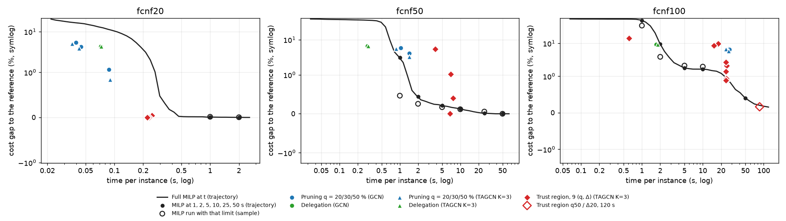

# FCNF phase 1b: equal-time baseline, trust region, feasible warm start

Same instances, models and reference solutions as phase 1 (`docs/phase1_fcnf_report.md`).

## Summary

1. **Does any decoder beat the full MILP at equal time? Only at budgets too short for the MILP to have found a good incumbent.** The comparison is with the MILP run with the same time limit, on a sample (2.2).
   - **fcnf20 and fcnf50:** pruning and delegation stop after 0.04–1.4 s with gaps of 0.4–6 %. At those times the MILP is still at 11–37 %, so they win significantly. The trust region on fcnf20 (about 0.25 s, gap ≈ 0) also beats the MILP's 0.6–1.2 %.
   - **fcnf100, delegation:** it still wins (1.4 s, 8 % against the MILP's 33 %).
   - **fcnf100, pruning:** it loses. At its 16–25 s the MILP already reaches 3–10 % against pruning's 7–8 %; the loss is significant for q = 50 and has p ≈ 0.05–0.06 for q = 20 / 30 on 40 instances.
   - **fcnf100, trust region q50 / Δ20 at 25 s:** it ties with the MILP (1.0 % against 0.9 %, n.s.).
   - **Method:** reading the unlimited run's trajectory overstates the MILP gap at short times. HiGHS reports one more solution when it hits its limit, which an unlimited run does not show at that moment. The verdicts in 2.3 have the same direction but larger margins.
2. **Does the trust region replace pruning with repair? For solution quality yes, for saving time no.**
   - It is much better in cost at every size (fcnf100 q = 50: 0.9 % against 6.8 %; fcnf50: ≈ 0 % against 3.3 %).
   - It costs about the time of the full MILP: about 7 s against about 1 s on fcnf50. On fcnf100 it stops at the 25 s limit, and only 11–16 % of instances are proven optimal.
   - A small Δ is often infeasible: q20 / Δ5 has no solution on 20 % of fcnf50 instances and 95 % of fcnf100 instances. q ≥ 30 with Δ ≥ 10 never failed.
   - At equal time it ties with the full MILP at best (fcnf50 mixed; fcnf100 n.s.).
3. **Does a feasible warm start save time to ≤ 1 %? No.**
   - **Slope scaling:** n.s. at every size. On fcnf100 the mean is 19.4 s against 25.1 s, but the median difference is +0.08 s.
   - **Trust region:** significantly slower to ≤ 1 % at every size (fcnf100: 34.5 s against 25.1 s; fcnf50: 6.8 s against 1.9 s). Its own run takes longer than the time the full MILP needs to get within 1 %.
   - Neither warm start shortens the time to proof.

Caveats:
- **fcnf100 trust region:** tagcn_k3_seed0 only, the first 100 instances, with a 25 s limit (user's choice).
- **Equal-time sample:** tagcn_k3_seed0 only, on 100 / 100 / 40 instances.
- **Timing of phase 1 runs:** pruning and delegation times are those measured in phase 1, some of them on fcnf20 / fcnf50 with 2 processes instead of 8.

## 1. What was run

- **Equal-time baseline**: the full MILP run with time_limit = the time a decoder used on that instance, on a sample (tagcn_k3_seed0; 100 instances of fcnf20 / fcnf50, 40 of fcnf100), and read for every decoder, seed and instance from one unlimited run per instance that records every improving solution (no warm start; limit as the reference: none on fcnf20, 120 s on fcnf50 / fcnf100). The two differ at short times (section 2).
- **Trust region** (Han et al. 2023, predict-and-search): the top q % arcs by p are free and at most Δ of the others may open (Σ y ≤ Δ on them); no repair. TAGCN K=3 (the better encoder of phase 1): 3 seeds on fcnf20 / fcnf50 with the usual MILP limit; on fcnf100 seed 0 only, the first 100 instances, with a 25 s limit (about the time of pruning q50 there), plus q50 / Δ20 with the usual 120 s as a reference point.
- **Feasible warm start**: the full MILP started from (a) the trust-region solution q50 / Δ20 (on fcnf100 the 25 s one) or (b) the slope scaling solution; the heuristic's time is added to the MILP's. On fcnf100 the first 100 instances.
- Pruning and delegation are the phase 1 runs (both encoders, 3 seeds), times as measured there (some fcnf20 / fcnf50 results with 2 processes in parallel instead of 8, see the phase 1 report). Everything else here: 8 processes, one HiGHS thread each.

Full MILP of this phase (trajectory run) vs the phase 1 reference run:

| set | instances | MILP s (this run) | MILP s (phase 1) | proven | improving solutions per instance |
|---|---|---|---|---|---|
| fcnf20 | 1000 | 0.22 | 0.22 | 1000 | 3.7 |
| fcnf50 | 500 | 6.67 | 6.66 | 500 | 5.5 |
| fcnf100 | 200 | 85.68 | 85.43 | 104 | 8.4 |

## 2. Decoders vs the full MILP at equal time

**Trajectory vs a run with the time limit.** When HiGHS hits its time limit it often reports one more improving solution at that instant (the work in progress, e.g. a heuristic sub-MIP, still returns its incumbent; the overshoot of the limit itself is below 2 %). The unlimited run does not show that solution at that time, so reading its trajectory overstates the MILP gap at short limits (section 2.4: at 1–2 s on fcnf50 / fcnf100 by several points; from 5 s on they agree). The runs with the time limit itself are therefore the main comparison (2.2, a sample: tagcn_k3_seed0, the first 100 instances of fcnf20 / fcnf50 and 40 of fcnf100); 2.3 has every decoder and seed from the trajectory, pessimistic for the MILP at short times.

### 2.1 The full MILP stopped at a fixed time

Mean gap (%) over the instances that have a solution by then (in brackets: % of instances with a solution, when below 100). *run* = runs with the time limit itself (sample of 2.2); *traj.* = read from the trajectory (all instances).

| set | 1 s | 2 s | 5 s | 10 s | 25 s | 50 s | end (limit) |
|---|---|---|---|---|---|---|---|
| fcnf20, traj. (1000) | 0.01 | 0.00 | 0.00 | 0.00 | 0.00 | 0.00 | 0.00 |
| fcnf20, run (100) | 0.01 | 0.00 | 0.00 | 0.00 | 0.00 | 0.00 | — |
| fcnf50, traj. (500) | 3.08 | 0.45 | 0.21 | 0.13 | 0.01 | 0.00 | 0.00 |
| fcnf50, run (100) | 0.46 | 0.26 | 0.17 | 0.12 | 0.06 | 0.00 | — |
| fcnf100, traj. (200) | 49.70 | 9.54 | 1.78 | 1.64 | 0.93 | 0.40 | 0.16 |
| fcnf100, run (40) | 34.58 | 3.88 | 2.10 | 1.95 | 0.88 | — | — |

### 2.2 Each decoder vs the MILP run with the decoder's time (sample, the main comparison)

tagcn_k3_seed0 (pruning, delegation, trust region), first instances of each set; per instance the full MILP is run with time_limit = the time the decoder used there. Instances where the trust region found no solution are left out (*instances*). Wilcoxon signed-rank on the gap; Bonferroni within each size. *better* = the decoder has the lower gap.

#### fcnf20 (13 tests, threshold 3.8e-03)

| decoder (TAGCN K=3, seed 0) | instances | s | decoder gap | MILP gap, run with that limit | MILP no sol. (%) | Δ median | better / equal / worse (%) | p | verdict |
|---|---|---|---|---|---|---|---|---|---|
| Pruning q = 20 % | 100 | 0.04 | 4.44 | 37.46 | 8 | -15.450 | 80 / 10 / 10 | 5.6e-14 | better |
| Pruning q = 30 % | 100 | 0.04 | 2.65 | 31.47 | 2 | -15.397 | 79 / 10 / 11 | 3.7e-14 | better |
| Pruning q = 50 % | 100 | 0.10 | 0.36 | 10.69 | 0 | -5.631 | 59 / 33 / 8 | 1.2e-11 | better |
| Delegation | 100 | 0.07 | 3.69 | 10.76 | 0 | -1.639 | 53 / 22 / 25 | 1.1e-06 | better |
| Trust region q = 20 %, Δ = 5 | 100 | 0.30 | 0.01 | 0.63 | 0 | +0.000 | 8 / 91 / 1 | 1.2e-02 | n.s. |
| Trust region q = 20 %, Δ = 10 | 100 | 0.27 | 0.00 | 0.64 | 0 | +0.000 | 9 / 91 / 0 | 3.9e-03 | n.s. |
| Trust region q = 20 %, Δ = 20 | 100 | 0.25 | 0.00 | 0.72 | 1 | +0.000 | 13 / 87 / 0 | 2.4e-04 | better |
| Trust region q = 30 %, Δ = 5 | 100 | 0.26 | 0.00 | 0.69 | 0 | +0.000 | 12 / 88 / 0 | 4.9e-04 | better |
| Trust region q = 30 %, Δ = 10 | 100 | 0.26 | 0.00 | 0.65 | 0 | +0.000 | 11 / 89 / 0 | 9.8e-04 | better |
| Trust region q = 30 %, Δ = 20 | 100 | 0.26 | 0.00 | 1.06 | 0 | +0.000 | 15 / 85 / 0 | 6.1e-05 | better |
| Trust region q = 50 %, Δ = 5 | 100 | 0.24 | -0.00 | 0.74 | 0 | +0.000 | 15 / 85 / 0 | 6.1e-05 | better |
| Trust region q = 50 %, Δ = 10 | 100 | 0.25 | -0.00 | 0.70 | 0 | +0.000 | 14 / 86 / 0 | 1.2e-04 | better |
| Trust region q = 50 %, Δ = 20 | 100 | 0.26 | -0.00 | 1.17 | 0 | +0.000 | 14 / 86 / 0 | 1.2e-04 | better |

#### fcnf50 (13 tests, threshold 3.8e-03)

| decoder (TAGCN K=3, seed 0) | instances | s | decoder gap | MILP gap, run with that limit | MILP no sol. (%) | Δ median | better / equal / worse (%) | p | verdict |
|---|---|---|---|---|---|---|---|---|---|
| Pruning q = 20 % | 100 | 0.72 | 5.84 | 22.24 | 0 | -14.835 | 65 / 6 / 29 | 1.0e-09 | better |
| Pruning q = 30 % | 100 | 0.75 | 5.96 | 22.93 | 0 | -15.575 | 67 / 4 / 29 | 4.3e-10 | better |
| Pruning q = 50 % | 100 | 1.40 | 3.31 | 13.81 | 0 | -0.247 | 52 / 8 / 40 | 3.3e-04 | better |
| Delegation | 100 | 0.32 | 5.92 | 28.99 | 0 | -26.804 | 81 / 0 / 19 | 6.8e-15 | better |
| Trust region q = 20 %, Δ = 5 | 81 | 4.00 | 5.21 | 3.56 | 0 | +2.110 | 14 / 14 / 73 | 4.8e-06 | worse |
| Trust region q = 20 %, Δ = 10 | 100 | 7.05 | 0.46 | 0.40 | 0 | +0.000 | 6 / 63 / 31 | 1.3e-04 | worse |
| Trust region q = 20 %, Δ = 20 | 100 | 6.47 | -0.00 | 0.28 | 0 | +0.000 | 10 / 90 / 0 | 2.0e-03 | better |
| Trust region q = 30 %, Δ = 5 | 99 | 7.23 | 1.30 | 0.47 | 0 | +0.006 | 5 / 43 / 52 | 9.6e-08 | worse |
| Trust region q = 30 %, Δ = 10 | 100 | 6.68 | 0.02 | 0.09 | 0 | +0.000 | 9 / 88 / 3 | 1.5e-01 | n.s. |
| Trust region q = 30 %, Δ = 20 | 100 | 6.73 | -0.00 | 0.10 | 0 | +0.000 | 7 / 93 / 0 | 1.6e-02 | n.s. |
| Trust region q = 50 %, Δ = 5 | 100 | 6.69 | 0.09 | 0.31 | 0 | +0.000 | 9 / 87 / 4 | 1.7e-01 | n.s. |
| Trust region q = 50 %, Δ = 10 | 100 | 6.52 | -0.00 | 0.73 | 0 | +0.000 | 12 / 88 / 0 | 4.9e-04 | better |
| Trust region q = 50 %, Δ = 20 | 100 | 6.57 | 0.00 | 0.86 | 0 | +0.000 | 12 / 88 / 0 | 4.9e-04 | better |

#### fcnf100 (6 tests, threshold 8.3e-03)

| decoder (TAGCN K=3, seed 0) | instances | s | decoder gap | MILP gap, run with that limit | MILP no sol. (%) | Δ median | better / equal / worse (%) | p | verdict |
|---|---|---|---|---|---|---|---|---|---|
| Pruning q = 20 % | 40 | 16.08 | 8.12 | 9.42 | 0 | +2.945 | 25 / 0 / 75 | 5.0e-02 | n.s. |
| Pruning q = 30 % | 40 | 15.93 | 8.50 | 10.09 | 0 | +3.504 | 22 / 2 / 75 | 6.4e-02 | n.s. |
| Pruning q = 50 % | 40 | 19.52 | 7.17 | 3.27 | 0 | +3.234 | 12 / 0 / 88 | 5.4e-06 | worse |
| Delegation | 40 | 1.43 | 8.17 | 32.93 | 0 | -34.860 | 75 / 0 / 25 | 1.5e-05 | better |
| Trust region q = 20 %, Δ = 5 | 1 | 2.08 | 14.40 | 1.66 | 0 | +12.738 | 0 / 0 / 100 | 1.0e+00 | n.s. |
| Trust region q = 50 %, Δ = 20 | 40 | 24.16 | 1.02 | 0.91 | 0 | +0.000 | 35 / 20 / 45 | 8.5e-01 | n.s. |

### 2.3 Each decoder vs the MILP read from the trajectory (all instances and seeds)

Pessimistic for the MILP at short times (see above); use it for the seeds / encoders the sample does not cover. Per instance, the MILP gets exactly the time the decoder used there. *MILP no sol.* = % instances where the MILP has no solution yet (counted as a decoder win). Wilcoxon signed-rank on the gap, one test per seed, p = max over seeds; Bonferroni within each size. Δ = median of decoder gap − MILP gap (% points), averaged over seeds. *better* = the decoder has the lower gap.

#### fcnf20 (17 tests, threshold 2.9e-03)

| decoder | instances | s | decoder gap | MILP gap at that time | MILP no sol. (%) | Δ median | better / equal / worse (%) | p max | seeds | verdict |
|---|---|---|---|---|---|---|---|---|---|---|
| Pruning q = 20 % (GCN) | 1000 | 0.04 ± 0.00 | 5.38 ± 0.25 | 21.65 ± 1.17 | 3 ± 0 | -12.422 | 82 / 6 / 12 | 2.0e-111 | 3 | better |
| Pruning q = 30 % (GCN) | 1000 | 0.04 ± 0.00 | 4.25 ± 0.20 | 17.81 ± 0.94 | 1 ± 0 | -12.417 | 82 / 7 / 11 | 1.0e-111 | 3 | better |
| Pruning q = 50 % (GCN) | 1000 | 0.09 ± 0.00 | 1.17 ± 0.12 | 13.99 ± 0.07 | 0 ± 0 | -11.840 | 73 / 20 / 8 | 9.0e-115 | 3 | better |
| Delegation (GCN) | 1000 | 0.07 ± 0.00 | 4.31 ± 0.27 | 13.49 ± 0.14 | 0 ± 0 | -7.780 | 64 / 15 / 21 | 5.6e-77 | 3 | better |
| Pruning q = 20 % (TAGCN K=3) | 1000 | 0.04 ± 0.00 | 5.05 ± 0.24 | 21.06 ± 0.43 | 3 ± 1 | -13.103 | 85 / 6 / 9 | 6.6e-120 | 3 | better |
| Pruning q = 30 % (TAGCN K=3) | 1000 | 0.04 ± 0.00 | 3.86 ± 0.07 | 18.31 ± 0.82 | 1 ± 0 | -12.725 | 84 / 7 / 9 | 4.4e-120 | 3 | better |
| Pruning q = 50 % (TAGCN K=3) | 1000 | 0.09 ± 0.00 | 0.84 ± 0.07 | 13.88 ± 0.46 | 0 ± 0 | -11.890 | 73 / 20 / 7 | 7.7e-120 | 3 | better |
| Delegation (TAGCN K=3) | 1000 | 0.07 ± 0.00 | 4.31 ± 0.14 | 13.41 ± 0.11 | 0 ± 0 | -7.858 | 64 / 15 / 21 | 4.1e-76 | 3 | better |
| Trust region q = 20 %, Δ = 5 (TAGCN K=3) | 1000 | 0.25 ± 0.00 | 0.04 ± 0.00 | 3.83 ± 0.30 | 0 ± 0 | +0.000 | 19 / 78 / 3 | 2.5e-32 | 3 | better |
| Trust region q = 20 %, Δ = 10 (TAGCN K=3) | 1000 | 0.23 ± 0.00 | 0.00 ± 0.00 | 3.95 ± 0.44 | 0 ± 0 | +0.000 | 20 / 80 / 0 | 1.3e-31 | 3 | better |
| Trust region q = 20 %, Δ = 20 (TAGCN K=3) | 1000 | 0.23 ± 0.00 | 0.00 ± 0.00 | 4.03 ± 0.29 | 0 ± 0 | +0.000 | 20 / 80 / 0 | 1.3e-32 | 3 | better |
| Trust region q = 30 %, Δ = 5 (TAGCN K=3) | 1000 | 0.23 ± 0.01 | 0.00 ± 0.00 | 4.14 ± 0.22 | 0 ± 0 | +0.000 | 22 / 78 / 0 | 3.3e-36 | 3 | better |
| Trust region q = 30 %, Δ = 10 (TAGCN K=3) | 1000 | 0.23 ± 0.01 | -0.00 ± 0.00 | 4.20 ± 0.17 | 0 ± 0 | +0.000 | 22 / 78 / 0 | 7.3e-37 | 3 | better |
| Trust region q = 30 %, Δ = 20 (TAGCN K=3) | 1000 | 0.23 ± 0.01 | -0.00 ± 0.00 | 4.14 ± 0.19 | 0 ± 0 | +0.000 | 22 / 78 / 0 | 1.1e-36 | 3 | better |
| Trust region q = 50 %, Δ = 5 (TAGCN K=3) | 1000 | 0.22 ± 0.00 | -0.00 ± 0.00 | 4.94 ± 0.13 | 0 ± 0 | +0.000 | 25 / 75 / 0 | 8.9e-42 | 3 | better |
| Trust region q = 50 %, Δ = 10 (TAGCN K=3) | 1000 | 0.22 ± 0.00 | 0.00 ± 0.00 | 4.90 ± 0.04 | 0 ± 0 | +0.000 | 24 / 76 / 0 | 2.8e-41 | 3 | better |
| Trust region q = 50 %, Δ = 20 (TAGCN K=3) | 1000 | 0.22 ± 0.00 | 0.00 ± 0.00 | 4.88 ± 0.08 | 0 ± 0 | +0.000 | 24 / 76 / 0 | 8.5e-41 | 3 | better |

#### fcnf50 (17 tests, threshold 2.9e-03)

| decoder | instances | s | decoder gap | MILP gap at that time | MILP no sol. (%) | Δ median | better / equal / worse (%) | p max | seeds | verdict |
|---|---|---|---|---|---|---|---|---|---|---|
| Pruning q = 20 % (GCN) | 500 | 1.04 ± 0.08 | 5.71 ± 0.06 | 22.29 ± 1.07 | 0 ± 0 | -16.260 | 66 / 10 / 25 | 3.2e-41 | 3 | better |
| Pruning q = 30 % (GCN) | 500 | 1.03 ± 0.08 | 5.76 ± 0.13 | 22.20 ± 1.05 | 0 ± 0 | -16.116 | 65 / 10 / 25 | 1.4e-39 | 3 | better |
| Pruning q = 50 % (GCN) | 500 | 1.43 ± 0.09 | 4.05 ± 0.21 | 15.72 ± 1.21 | 0 ± 0 | -0.842 | 55 / 13 / 33 | 1.1e-17 | 3 | better |
| Delegation (GCN) | 500 | 0.29 ± 0.02 | 6.56 ± 0.17 | 33.50 ± 0.26 | 0 ± 0 | -28.696 | 91 / 0 / 9 | 3.5e-78 | 3 | better |
| Pruning q = 20 % (TAGCN K=3) | 500 | 0.88 ± 0.05 | 5.57 ± 0.53 | 23.85 ± 0.63 | 0 ± 0 | -20.069 | 69 / 7 / 24 | 1.0e-48 | 3 | better |
| Pruning q = 30 % (TAGCN K=3) | 500 | 0.87 ± 0.02 | 5.55 ± 0.57 | 23.55 ± 0.86 | 0 ± 0 | -19.531 | 68 / 7 / 25 | 1.1e-43 | 3 | better |
| Pruning q = 50 % (TAGCN K=3) | 500 | 1.43 ± 0.02 | 3.28 ± 0.16 | 14.70 ± 0.36 | 0 ± 0 | -0.229 | 52 / 12 / 36 | 2.1e-17 | 3 | better |
| Delegation (TAGCN K=3) | 500 | 0.30 ± 0.00 | 6.65 ± 0.12 | 33.43 ± 0.31 | 0 ± 0 | -28.312 | 90 / 0 / 10 | 7.6e-78 | 3 | better |
| Trust region q = 20 %, Δ = 5 (TAGCN K=3) | 415 | 3.87 ± 0.22 | 5.42 ± 0.31 | 3.94 ± 0.35 | 0 ± 0 | +2.226 | 15 / 9 / 76 | 3.2e-16 | 3 | worse |
| Trust region q = 20 %, Δ = 10 (TAGCN K=3) | 500 | 7.60 ± 0.05 | 0.40 ± 0.03 | 0.86 ± 0.33 | 0 ± 0 | +0.000 | 9 / 63 / 28 | 2.5e-04 | 3 | better |
| Trust region q = 20 %, Δ = 20 (TAGCN K=3) | 500 | 6.98 ± 0.10 | 0.00 ± 0.00 | 0.88 ± 0.28 | 0 ± 0 | +0.000 | 11 / 89 / 0 | 1.6e-11 | 3 | better |
| Trust region q = 30 %, Δ = 5 (TAGCN K=3) | 497 | 6.99 ± 0.07 | 1.04 ± 0.06 | 1.33 ± 0.25 | 0 ± 0 | +0.000 | 10 / 48 / 42 | 2.6e-10 | 3 | better |
| Trust region q = 30 %, Δ = 10 (TAGCN K=3) | 500 | 7.07 ± 0.09 | 0.01 ± 0.00 | 0.93 ± 0.18 | 0 ± 0 | +0.000 | 11 / 87 / 2 | 3.9e-07 | 3 | better |
| Trust region q = 30 %, Δ = 20 (TAGCN K=3) | 500 | 6.98 ± 0.12 | 0.00 ± 0.00 | 0.96 ± 0.21 | 0 ± 0 | +0.000 | 11 / 89 / 0 | 5.1e-10 | 3 | better |
| Trust region q = 50 %, Δ = 5 (TAGCN K=3) | 500 | 6.88 ± 0.08 | 0.03 ± 0.01 | 1.39 ± 0.13 | 0 ± 0 | +0.000 | 14 / 84 / 3 | 1.2e-09 | 3 | better |
| Trust region q = 50 %, Δ = 10 (TAGCN K=3) | 500 | 6.82 ± 0.11 | 0.00 ± 0.00 | 1.55 ± 0.03 | 0 ± 0 | +0.000 | 15 / 85 / 0 | 3.6e-13 | 3 | better |
| Trust region q = 50 %, Δ = 20 (TAGCN K=3) | 500 | 6.79 ± 0.14 | 0.00 ± 0.00 | 1.49 ± 0.03 | 0 ± 0 | +0.000 | 14 / 86 / 0 | 7.6e-13 | 3 | better |

#### fcnf100 (17 tests, threshold 2.9e-03)

| decoder | instances | s | decoder gap | MILP gap at that time | MILP no sol. (%) | Δ median | better / equal / worse (%) | p max | seeds | verdict |
|---|---|---|---|---|---|---|---|---|---|---|
| Pruning q = 20 % (GCN) | 200 | 26.15 ± 2.48 | 6.93 ± 0.35 | 5.16 ± 0.54 | 0 ± 0 | +2.007 | 25 / 5 / 70 | 1.7e-08 | 3 | worse |
| Pruning q = 30 % (GCN) | 200 | 26.83 ± 1.73 | 6.96 ± 0.39 | 5.09 ± 0.27 | 0 ± 0 | +2.184 | 23 / 6 / 71 | 3.9e-10 | 3 | worse |
| Pruning q = 50 % (GCN) | 200 | 27.43 ± 1.40 | 6.53 ± 0.36 | 4.18 ± 0.46 | 0 ± 0 | +2.199 | 23 / 6 / 71 | 3.8e-11 | 3 | worse |
| Delegation (GCN) | 200 | 1.73 ± 0.06 | 9.27 ± 0.26 | 36.93 ± 0.38 | 0 ± 0 | -37.545 | 70 / 0 / 30 | 4.9e-21 | 3 | better |
| Pruning q = 20 % (TAGCN K=3) | 200 | 24.66 ± 1.03 | 6.68 ± 0.74 | 5.34 ± 1.84 | 0 ± 0 | +2.061 | 27 / 5 / 68 | 7.4e-08 | 3 | worse |
| Pruning q = 30 % (TAGCN K=3) | 200 | 24.15 ± 1.33 | 6.70 ± 0.81 | 5.30 ± 1.73 | 0 ± 0 | +1.914 | 27 / 5 / 68 | 1.1e-06 | 3 | worse |
| Pruning q = 50 % (TAGCN K=3) | 200 | 26.39 ± 0.90 | 5.89 ± 0.50 | 2.41 ± 0.41 | 0 ± 0 | +2.156 | 23 / 5 / 72 | 4.1e-14 | 3 | worse |
| Delegation (TAGCN K=3) | 200 | 1.83 ± 0.12 | 9.20 ± 0.22 | 35.67 ± 1.79 | 0 ± 0 | -36.429 | 70 / 0 / 30 | 6.1e-17 | 3 | better |
| Trust region q = 20 %, Δ = 5 (TAGCN K=3) | 5 | 0.61 | 14.14 | 21.52 | 0 | +5.602 | 40 / 0 / 60 | 8.1e-01 | 1 | n.s. |
| Trust region q = 20 %, Δ = 10 (TAGCN K=3) | 67 | 17.88 | 9.64 | 1.11 | 0 | +6.567 | 0 / 0 / 100 | 1.1e-12 | 1 | worse |
| Trust region q = 20 %, Δ = 20 (TAGCN K=3) | 100 | 24.53 | 2.10 | 0.93 | 0 | +0.324 | 19 / 10 / 71 | 5.3e-07 | 1 | worse |
| Trust region q = 30 %, Δ = 5 (TAGCN K=3) | 76 | 15.26 | 8.44 | 1.20 | 0 | +4.719 | 3 / 0 / 97 | 7.1e-14 | 1 | worse |
| Trust region q = 30 %, Δ = 10 (TAGCN K=3) | 99 | 23.97 | 2.66 | 0.95 | 0 | +0.734 | 20 / 8 / 72 | 6.2e-09 | 1 | worse |
| Trust region q = 30 %, Δ = 20 (TAGCN K=3) | 100 | 24.25 | 0.94 | 0.93 | 0 | +0.000 | 35 / 21 / 44 | 7.6e-01 | 1 | n.s. |
| Trust region q = 50 %, Δ = 5 (TAGCN K=3) | 100 | 23.92 | 1.40 | 0.95 | 0 | +0.000 | 38 / 15 / 47 | 2.4e-02 | 1 | n.s. |
| Trust region q = 50 %, Δ = 10 (TAGCN K=3) | 100 | 24.28 | 0.87 | 0.93 | 0 | -0.000 | 39 / 24 / 37 | 7.2e-01 | 1 | n.s. |
| Trust region q = 50 %, Δ = 20 (TAGCN K=3) | 100 | 23.99 | 0.88 | 0.94 | 0 | -0.000 | 42 / 26 / 32 | 1.2e-01 | 1 | n.s. |

### 2.4 Check: trajectory vs a run with the time limit itself

tagcn_k3_seed0, first instances of each set: the MILP re-run with time_limit = the decoder's time (or the fixed limit) against the cost read from the trajectory. Besides timing noise, the run with the limit gains the solution HiGHS reports when it stops (see above), so it is better at short limits. *same* = equal cost (rel. 1e-6); p = Wilcoxon on the gap, run vs trajectory.

| set | limit | instances | gap, run with the limit | gap, trajectory | no sol. run / traj. | same (%) | p |
|---|---|---|---|---|---|---|---|
| fcnf20 | time of Delegation | 100 | 10.76 | 14.27 | 0 / 0 | 70 | 3.8e-06 |
| fcnf20 | time of Pruning q = 20 % | 100 | 37.46 | 18.76 | 8 / 11 | 73 | 0.063 |
| fcnf20 | time of Pruning q = 30 % | 100 | 31.47 | 28.44 | 2 / 6 | 71 | 0.0038 |
| fcnf20 | time of Pruning q = 50 % | 100 | 10.69 | 15.66 | 0 / 0 | 60 | 7.9e-09 |
| fcnf20 | time of Trust region q = 20 %, Δ = 10 | 100 | 0.64 | 6.15 | 0 / 0 | 67 | 2.9e-10 |
| fcnf20 | time of Trust region q = 20 %, Δ = 20 | 100 | 0.72 | 6.61 | 1 / 0 | 66 | 2.5e-07 |
| fcnf20 | time of Trust region q = 20 %, Δ = 5 | 100 | 0.63 | 5.46 | 0 / 0 | 73 | 1.5e-08 |
| fcnf20 | time of Trust region q = 30 %, Δ = 10 | 100 | 0.65 | 6.47 | 0 / 0 | 68 | 2.3e-10 |
| fcnf20 | time of Trust region q = 30 %, Δ = 20 | 100 | 1.06 | 6.28 | 0 / 0 | 69 | 1e-07 |
| fcnf20 | time of Trust region q = 30 %, Δ = 5 | 100 | 0.69 | 6.66 | 0 / 0 | 67 | 2.9e-11 |
| fcnf20 | time of Trust region q = 50 %, Δ = 10 | 100 | 0.70 | 6.45 | 0 / 0 | 67 | 7.3e-10 |
| fcnf20 | time of Trust region q = 50 %, Δ = 20 | 100 | 1.17 | 6.87 | 0 / 0 | 65 | 5.4e-08 |
| fcnf20 | time of Trust region q = 50 %, Δ = 5 | 100 | 0.74 | 6.40 | 0 / 0 | 67 | 4.1e-10 |
| fcnf20 | 1 s | 100 | 0.01 | 0.03 | 0 / 0 | 99 | 0.5 |
| fcnf20 | 2 s | 100 | 0.00 | 0.00 | 0 / 0 | 100 | 1 |
| fcnf20 | 5 s | 100 | 0.00 | 0.00 | 0 / 0 | 100 | 1 |
| fcnf20 | 10 s | 100 | 0.00 | 0.00 | 0 / 0 | 100 | 1 |
| fcnf20 | 25 s | 100 | 0.00 | 0.00 | 0 / 0 | 100 | 1 |
| fcnf20 | 50 s | 100 | 0.00 | 0.00 | 0 / 0 | 100 | 1 |
| fcnf50 | time of Delegation | 100 | 28.99 | 31.97 | 0 / 0 | 86 | 0.00012 |
| fcnf50 | time of Pruning q = 20 % | 100 | 22.24 | 26.98 | 0 / 0 | 78 | 4.8e-07 |
| fcnf50 | time of Pruning q = 30 % | 100 | 22.93 | 26.17 | 0 / 0 | 86 | 0.00012 |
| fcnf50 | time of Pruning q = 50 % | 100 | 13.81 | 17.58 | 0 / 0 | 77 | 1.7e-06 |
| fcnf50 | time of Trust region q = 20 %, Δ = 10 | 100 | 0.40 | 1.22 | 0 / 0 | 97 | 0.25 |
| fcnf50 | time of Trust region q = 20 %, Δ = 20 | 100 | 0.28 | 1.02 | 0 / 0 | 96 | 0.12 |
| fcnf50 | time of Trust region q = 20 %, Δ = 5 | 100 | 8.39 | 9.59 | 0 / 0 | 92 | 0.0039 |
| fcnf50 | time of Trust region q = 30 %, Δ = 10 | 100 | 0.09 | 1.11 | 0 / 0 | 95 | 0.062 |
| fcnf50 | time of Trust region q = 30 %, Δ = 20 | 100 | 0.10 | 1.23 | 0 / 0 | 94 | 0.031 |
| fcnf50 | time of Trust region q = 30 %, Δ = 5 | 100 | 0.61 | 2.23 | 0 / 0 | 93 | 0.016 |
| fcnf50 | time of Trust region q = 50 %, Δ = 10 | 100 | 0.73 | 2.57 | 0 / 0 | 90 | 0.0039 |
| fcnf50 | time of Trust region q = 50 %, Δ = 20 | 100 | 0.86 | 2.30 | 0 / 0 | 91 | 0.0039 |
| fcnf50 | time of Trust region q = 50 %, Δ = 5 | 100 | 0.31 | 1.78 | 0 / 0 | 91 | 0.0039 |
| fcnf50 | 1 s | 100 | 0.46 | 4.30 | 0 / 0 | 58 | 2.3e-13 |
| fcnf50 | 2 s | 100 | 0.26 | 0.48 | 0 / 0 | 93 | 0.0059 |
| fcnf50 | 5 s | 100 | 0.17 | 0.18 | 0 / 0 | 98 | 0.5 |
| fcnf50 | 10 s | 100 | 0.12 | 0.12 | 0 / 0 | 100 | 1 |
| fcnf50 | 25 s | 100 | 0.06 | 0.06 | 0 / 0 | 100 | 1 |
| fcnf50 | 50 s | 100 | 0.00 | 0.00 | 0 / 0 | 100 | 1 |
| fcnf100 | time of Delegation | 40 | 32.93 | 37.32 | 0 / 0 | 80 | 0.0078 |
| fcnf100 | time of Pruning q = 20 % | 40 | 9.42 | 10.25 | 0 / 0 | 82 | 0.16 |
| fcnf100 | time of Pruning q = 30 % | 40 | 10.09 | 11.57 | 0 / 0 | 88 | 0.12 |
| fcnf100 | time of Pruning q = 50 % | 40 | 3.27 | 4.85 | 0 / 0 | 78 | 0.16 |
| fcnf100 | time of Trust region q = 20 %, Δ = 5 | 40 | 48.86 | 51.45 | 0 / 0 | 92 | 0.25 |
| fcnf100 | time of Trust region q = 50 %, Δ = 20 | 40 | 0.91 | 0.90 | 0 / 0 | 90 | 0.12 |
| fcnf100 | 1 s | 40 | 34.58 | 46.40 | 0 / 0 | 70 | 0.00049 |
| fcnf100 | 2 s | 40 | 3.88 | 10.63 | 0 / 0 | 35 | 3e-08 |
| fcnf100 | 5 s | 40 | 2.10 | 2.19 | 0 / 0 | 92 | 0.25 |
| fcnf100 | 10 s | 40 | 1.95 | 2.00 | 0 / 0 | 98 | 1 |
| fcnf100 | 25 s | 40 | 0.88 | 0.89 | 0 / 0 | 82 | 0.81 |

## 3. Trust region vs pruning with repair

TAGCN K=3. gap over the instances with a solution, mean ± std over seeds. *no sol.* = % instances where the restricted MILP found no solution (infeasible, or none by the time limit); *proven* = % where it was solved to optimality; *outside* = open arcs outside the top q % in the solution (mean); *binding* = % of solved instances with outside = Δ. The pruning row of the same q is the phase 1 result (with repair) on the same instances. Tests: trust region vs pruning, same q and seed, instances where the trust region has a solution; Bonferroni within each size.

### fcnf20 (1000 instances, 3 seed(s), restricted MILP limit: no limit)

| method | gap (%) | s | no sol. (%) | proven (%) | outside | binding (%) |
|---|---|---|---|---|---|---|
| Pruning q = 20 % (with repair) | 5.05 ± 0.24 | 0.04 ± 0.00 | 0 | — | — | — |
| Trust region q = 20 %, Δ = 5 | 0.04 ± 0.00 | 0.25 ± 0.00 | 0.0 ± 0.0 | 100 ± 0 | 2.5 ± 0.0 | 10 ± 0 |
| Trust region q = 20 %, Δ = 10 | 0.00 ± 0.00 | 0.23 ± 0.00 | 0.0 ± 0.0 | 100 ± 0 | 2.5 ± 0.0 | 0 ± 0 |
| Trust region q = 20 %, Δ = 20 | 0.00 ± 0.00 | 0.23 ± 0.00 | 0.0 ± 0.0 | 100 ± 0 | 2.5 ± 0.0 | 0 ± 0 |
| Pruning q = 30 % (with repair) | 3.86 ± 0.07 | 0.04 ± 0.00 | 0 | — | — | — |
| Trust region q = 30 %, Δ = 5 | 0.00 ± 0.00 | 0.23 ± 0.01 | 0.0 ± 0.0 | 100 ± 0 | 1.3 ± 0.0 | 0 ± 0 |
| Trust region q = 30 %, Δ = 10 | -0.00 ± 0.00 | 0.23 ± 0.01 | 0.0 ± 0.0 | 100 ± 0 | 1.3 ± 0.0 | 0 ± 0 |
| Trust region q = 30 %, Δ = 20 | -0.00 ± 0.00 | 0.23 ± 0.01 | 0.0 ± 0.0 | 100 ± 0 | 1.3 ± 0.0 | 0 ± 0 |
| Pruning q = 50 % (with repair) | 0.84 ± 0.07 | 0.09 ± 0.00 | 0 | — | — | — |
| Trust region q = 50 %, Δ = 5 | -0.00 ± 0.00 | 0.22 ± 0.00 | 0.0 ± 0.0 | 100 ± 0 | 0.3 ± 0.0 | 0 ± 0 |
| Trust region q = 50 %, Δ = 10 | 0.00 ± 0.00 | 0.22 ± 0.00 | 0.0 ± 0.0 | 100 ± 0 | 0.3 ± 0.0 | 0 ± 0 |
| Trust region q = 50 %, Δ = 20 | 0.00 ± 0.00 | 0.22 ± 0.00 | 0.0 ± 0.0 | 100 ± 0 | 0.3 ± 0.0 | 0 ± 0 |

Paired tests (18, threshold 2.8e-03); Δ = trust region − pruning (mean and median over instances, averaged over seeds):

| comparison | metric | Δ mean | Δ median | better / equal / worse (%) | p max | seeds | verdict |
|---|---|---|---|---|---|---|---|
| Trust region q = 20 %, Δ = 5 vs pruning q20 | gap | -5.016 | -2.418 | 69 / 30 / 1 | 7.6e-113 | 3 | better |
| Trust region q = 20 %, Δ = 5 vs pruning q20 | seconds | +0.210 | +0.099 | 5 / 0 / 95 | 1.2e-156 | 3 | worse |
| Trust region q = 20 %, Δ = 10 vs pruning q20 | gap | -5.054 | -2.464 | 69 / 30 / 0 | 2.6e-114 | 3 | better |
| Trust region q = 20 %, Δ = 10 vs pruning q20 | seconds | +0.197 | +0.097 | 5 / 0 / 95 | 1.7e-155 | 3 | worse |
| Trust region q = 20 %, Δ = 20 vs pruning q20 | gap | -5.054 | -2.464 | 69 / 30 / 0 | 2.6e-114 | 3 | better |
| Trust region q = 20 %, Δ = 20 vs pruning q20 | seconds | +0.195 | +0.096 | 5 / 0 / 95 | 1.5e-155 | 3 | worse |
| Trust region q = 30 %, Δ = 5 vs pruning q30 | gap | -3.861 | -1.197 | 60 / 40 / 0 | 1.2e-97 | 3 | better |
| Trust region q = 30 %, Δ = 5 vs pruning q30 | seconds | +0.189 | +0.089 | 5 / 0 / 95 | 7.2e-153 | 3 | worse |
| Trust region q = 30 %, Δ = 10 vs pruning q30 | gap | -3.861 | -1.197 | 60 / 40 / 0 | 1.2e-97 | 3 | better |
| Trust region q = 30 %, Δ = 10 vs pruning q30 | seconds | +0.186 | +0.088 | 5 / 0 / 95 | 6.7e-153 | 3 | worse |
| Trust region q = 30 %, Δ = 20 vs pruning q30 | gap | -3.861 | -1.197 | 60 / 40 / 0 | 1.2e-97 | 3 | better |
| Trust region q = 30 %, Δ = 20 vs pruning q30 | seconds | +0.189 | +0.087 | 6 / 0 / 94 | 6.2e-153 | 3 | worse |
| Trust region q = 50 %, Δ = 5 vs pruning q50 | gap | -0.838 | +0.000 | 22 / 78 / 0 | 1.1e-37 | 3 | better |
| Trust region q = 50 %, Δ = 5 vs pruning q50 | seconds | +0.133 | +0.059 | 10 / 0 / 90 | 5.1e-134 | 3 | worse |
| Trust region q = 50 %, Δ = 10 vs pruning q50 | gap | -0.838 | +0.000 | 22 / 78 / 0 | 1.1e-37 | 3 | better |
| Trust region q = 50 %, Δ = 10 vs pruning q50 | seconds | +0.133 | +0.059 | 10 / 0 / 90 | 1.8e-133 | 3 | worse |
| Trust region q = 50 %, Δ = 20 vs pruning q50 | gap | -0.838 | +0.000 | 22 / 78 / 0 | 1.1e-37 | 3 | better |
| Trust region q = 50 %, Δ = 20 vs pruning q50 | seconds | +0.131 | +0.060 | 10 / 0 / 90 | 2.8e-133 | 3 | worse |

### fcnf50 (500 instances, 3 seed(s), restricted MILP limit: 120 s)

| method | gap (%) | s | no sol. (%) | proven (%) | outside | binding (%) |
|---|---|---|---|---|---|---|
| Pruning q = 20 % (with repair) | 5.57 ± 0.53 | 0.88 ± 0.05 | 0 | — | — | — |
| Trust region q = 20 %, Δ = 5 | 5.42 ± 0.31 | 3.87 ± 0.22 | 19.5 ± 2.3 | 80 ± 2 | 4.9 ± 0.0 | 93 ± 0 |
| Trust region q = 20 %, Δ = 10 | 0.40 ± 0.03 | 7.60 ± 0.05 | 0.1 ± 0.1 | 100 ± 0 | 8.4 ± 0.1 | 39 ± 0 |
| Trust region q = 20 %, Δ = 20 | 0.00 ± 0.00 | 6.98 ± 0.10 | 0.0 ± 0.0 | 100 ± 0 | 9.2 ± 0.1 | 0 ± 0 |
| Pruning q = 30 % (with repair) | 5.55 ± 0.57 | 0.87 ± 0.02 | 0 | — | — | — |
| Trust region q = 30 %, Δ = 5 | 1.04 ± 0.06 | 6.99 ± 0.07 | 1.2 ± 0.5 | 99 ± 1 | 4.3 ± 0.1 | 62 ± 3 |
| Trust region q = 30 %, Δ = 10 | 0.01 ± 0.00 | 7.07 ± 0.09 | 0.0 ± 0.0 | 100 ± 0 | 5.4 ± 0.1 | 4 ± 0 |
| Trust region q = 30 %, Δ = 20 | 0.00 ± 0.00 | 6.98 ± 0.12 | 0.0 ± 0.0 | 100 ± 0 | 5.5 ± 0.1 | 0 ± 0 |
| Pruning q = 50 % (with repair) | 3.28 ± 0.16 | 1.43 ± 0.02 | 0 | — | — | — |
| Trust region q = 50 %, Δ = 5 | 0.03 ± 0.01 | 6.88 ± 0.08 | 0.0 ± 0.0 | 100 ± 0 | 2.0 ± 0.1 | 7 ± 1 |
| Trust region q = 50 %, Δ = 10 | 0.00 ± 0.00 | 6.82 ± 0.11 | 0.0 ± 0.0 | 100 ± 0 | 2.0 ± 0.1 | 0 ± 0 |
| Trust region q = 50 %, Δ = 20 | 0.00 ± 0.00 | 6.79 ± 0.14 | 0.0 ± 0.0 | 100 ± 0 | 2.0 ± 0.1 | 0 ± 0 |

Paired tests (18, threshold 2.8e-03); Δ = trust region − pruning (mean and median over instances, averaged over seeds):

| comparison | metric | Δ mean | Δ median | better / equal / worse (%) | p max | seeds | verdict |
|---|---|---|---|---|---|---|---|
| Trust region q = 20 %, Δ = 5 vs pruning q20 | gap | -0.488 | -0.310 | 52 / 3 / 45 | 2.0e-01 | 3 | n.s. |
| Trust region q = 20 %, Δ = 5 vs pruning q20 | seconds | +2.988 | +2.010 | 25 / 0 / 75 | 4.2e-37 | 3 | worse |
| Trust region q = 20 %, Δ = 10 vs pruning q20 | gap | -5.164 | -3.149 | 80 / 13 / 8 | 1.9e-58 | 3 | better |
| Trust region q = 20 %, Δ = 10 vs pruning q20 | seconds | +6.720 | +4.867 | 4 / 0 / 96 | 2.1e-79 | 3 | worse |
| Trust region q = 20 %, Δ = 20 vs pruning q20 | gap | -5.569 | -3.460 | 83 / 17 / 0 | 6.1e-68 | 3 | better |
| Trust region q = 20 %, Δ = 20 vs pruning q20 | seconds | +6.099 | +4.498 | 4 / 0 / 96 | 1.0e-79 | 3 | worse |
| Trust region q = 30 %, Δ = 5 vs pruning q30 | gap | -4.540 | -2.630 | 76 / 10 / 14 | 5.6e-47 | 3 | better |
| Trust region q = 30 %, Δ = 5 vs pruning q30 | seconds | +6.123 | +4.587 | 7 / 0 / 93 | 1.2e-74 | 3 | worse |
| Trust region q = 30 %, Δ = 10 vs pruning q30 | gap | -5.535 | -3.383 | 82 / 17 / 1 | 1.2e-67 | 3 | better |
| Trust region q = 30 %, Δ = 10 vs pruning q30 | seconds | +6.201 | +4.597 | 4 / 0 / 96 | 1.1e-79 | 3 | worse |
| Trust region q = 30 %, Δ = 20 vs pruning q30 | gap | -5.548 | -3.404 | 82 / 18 / 0 | 1.3e-67 | 3 | better |
| Trust region q = 30 %, Δ = 20 vs pruning q30 | seconds | +6.111 | +4.464 | 4 / 0 / 96 | 8.3e-80 | 3 | worse |
| Trust region q = 50 %, Δ = 5 vs pruning q50 | gap | -3.251 | -1.299 | 69 / 30 / 1 | 1.5e-57 | 3 | better |
| Trust region q = 50 %, Δ = 5 vs pruning q50 | seconds | +5.447 | +3.934 | 5 / 0 / 95 | 2.3e-78 | 3 | worse |
| Trust region q = 50 %, Δ = 10 vs pruning q50 | gap | -3.278 | -1.319 | 70 / 30 / 0 | 2.7e-58 | 3 | better |
| Trust region q = 50 %, Δ = 10 vs pruning q50 | seconds | +5.395 | +3.950 | 5 / 0 / 95 | 1.7e-78 | 3 | worse |
| Trust region q = 50 %, Δ = 20 vs pruning q50 | gap | -3.278 | -1.319 | 70 / 30 / 0 | 2.7e-58 | 3 | better |
| Trust region q = 50 %, Δ = 20 vs pruning q50 | seconds | +5.360 | +3.940 | 5 / 0 / 95 | 3.4e-78 | 3 | worse |

### fcnf100 (100 instances, 1 seed(s), restricted MILP limit: 25 s)

| method | gap (%) | s | no sol. (%) | proven (%) | outside | binding (%) |
|---|---|---|---|---|---|---|
| Pruning q = 20 % (with repair) | 7.62 | 22.65 | 0 | — | — | — |
| Trust region q = 20 %, Δ = 5 | 14.14 | 0.61 | 95.0 | 5 | 5.0 | 100 |
| Trust region q = 20 %, Δ = 10 | 9.64 | 17.88 | 33.0 | 17 | 9.9 | 93 |
| Trust region q = 20 %, Δ = 20 | 2.10 | 24.53 | 0.0 | 5 | 18.7 | 50 |
| Pruning q = 30 % (with repair) | 7.72 | 22.64 | 0 | — | — | — |
| Trust region q = 30 %, Δ = 5 | 8.44 | 15.26 | 24.0 | 39 | 4.9 | 95 |
| Trust region q = 30 %, Δ = 10 | 2.66 | 23.97 | 1.0 | 14 | 9.4 | 65 |
| Trust region q = 30 %, Δ = 20 | 0.94 | 24.25 | 0.0 | 11 | 12.8 | 3 |
| Pruning q = 50 % (with repair) | 6.79 | 26.56 | 0 | — | — | — |
| Trust region q = 50 %, Δ = 5 | 1.40 | 23.92 | 0.0 | 13 | 4.0 | 45 |
| Trust region q = 50 %, Δ = 10 | 0.87 | 24.28 | 0.0 | 11 | 5.1 | 7 |
| Trust region q = 50 %, Δ = 20 | 0.88 | 23.99 | 0.0 | 16 | 5.1 | 0 |
| Trust region q = 50 %, Δ = 20, 120 s limit (reference point) | 0.16 | 85.63 | 0.0 | 52 | 5.5 | 0 |

Paired tests (18, threshold 2.8e-03); Δ = trust region − pruning (mean and median over instances, averaged over seeds):

| comparison | metric | Δ mean | Δ median | better / equal / worse (%) | p max | seeds | verdict |
|---|---|---|---|---|---|---|---|
| Trust region q = 20 %, Δ = 5 vs pruning q20 | gap | +7.101 | +6.408 | 0 / 0 / 100 | 6.2e-02 | 1 | n.s. |
| Trust region q = 20 %, Δ = 5 vs pruning q20 | seconds | -22.034 | -9.050 | 96 / 0 / 4 | 3.4e-17 | 1 | better |
| Trust region q = 20 %, Δ = 10 vs pruning q20 | gap | +1.409 | +1.453 | 33 / 0 / 67 | 7.8e-02 | 1 | n.s. |
| Trust region q = 20 %, Δ = 10 vs pruning q20 | seconds | -4.764 | +6.294 | 45 / 0 / 55 | 3.9e-01 | 1 | n.s. |
| Trust region q = 20 %, Δ = 20 vs pruning q20 | gap | -5.527 | -3.710 | 71 / 1 / 28 | 2.2e-09 | 1 | better |
| Trust region q = 20 %, Δ = 20 vs pruning q20 | seconds | +1.888 | +14.105 | 27 / 0 / 73 | 1.2e-03 | 1 | worse |
| Trust region q = 30 %, Δ = 5 vs pruning q30 | gap | +0.377 | +1.241 | 41 / 1 / 58 | 4.4e-01 | 1 | n.s. |
| Trust region q = 30 %, Δ = 5 vs pruning q30 | seconds | -7.385 | +1.470 | 48 / 0 / 52 | 4.8e-01 | 1 | n.s. |
| Trust region q = 30 %, Δ = 10 vs pruning q30 | gap | -5.117 | -3.354 | 71 / 4 / 25 | 6.2e-08 | 1 | better |
| Trust region q = 30 %, Δ = 10 vs pruning q30 | seconds | +1.329 | +13.080 | 29 / 0 / 71 | 2.7e-03 | 1 | worse |
| Trust region q = 30 %, Δ = 20 vs pruning q30 | gap | -6.776 | -4.421 | 79 / 5 / 16 | 9.4e-14 | 1 | better |
| Trust region q = 30 %, Δ = 20 vs pruning q30 | seconds | +1.609 | +13.676 | 27 / 0 / 73 | 2.2e-03 | 1 | worse |
| Trust region q = 50 %, Δ = 5 vs pruning q50 | gap | -5.391 | -2.763 | 73 / 4 / 23 | 8.4e-11 | 1 | better |
| Trust region q = 50 %, Δ = 5 vs pruning q50 | seconds | -2.641 | +10.339 | 31 / 0 / 69 | 1.4e-01 | 1 | n.s. |
| Trust region q = 50 %, Δ = 10 vs pruning q50 | gap | -5.914 | -3.324 | 79 / 5 / 16 | 8.6e-14 | 1 | better |
| Trust region q = 50 %, Δ = 10 vs pruning q50 | seconds | -2.282 | +10.177 | 30 / 0 / 70 | 1.2e-01 | 1 | n.s. |
| Trust region q = 50 %, Δ = 20 vs pruning q50 | gap | -5.904 | -3.116 | 80 / 6 / 14 | 1.1e-13 | 1 | better |
| Trust region q = 50 %, Δ = 20 vs pruning q50 | seconds | -2.576 | +10.283 | 31 / 0 / 69 | 1.4e-01 | 1 | n.s. |

## 4. Feasible warm start

Time until the first solution with gap ≤ 1 % and ≤ 0.1 % (against the reference), and until the optimality proof. *total* = heuristic + MILP (the time to a threshold is the heuristic's time alone if the warm start is already within it). Means over instances, with an instance that never got there counted at the limit (so the mean is a lower bound when *reached* < 100 %); median in brackets. Trust region rows: mean ± std over seeds of those means.

### fcnf20 (1000 instances)

| warm start | warm-start gap (%) | heuristic s | ≤ 1 %: total s | reached (%) | ≤ 0.1 %: total s | reached (%) | proof: total s | proven (%) |
|---|---|---|---|---|---|---|---|---|
| No warm start | missing | 0.00 | 0.12 (0.09) | 100 | 0.13 (0.09) | 100 | 0.22 (0.12) | 100 |
| Slope scaling | 11.43 | 0.02 | 0.12 (0.09) | 100 | 0.13 (0.10) | 100 | 0.26 (0.16) | 100 |
| Trust region q50 / Δ20 (TAGCN K=3) | 0.00 ± 0.00 | 0.22 ± 0.00 | 0.22 ± 0.00 (0.12) | 100 ± 0 | 0.22 ± 0.00 (0.12) | 100 ± 0 | 0.57 ± 0.01 (0.36) | 100 ± 0 |

Paired tests on the total time (6, threshold 8.3e-03); Δ = warm start − none (s; mean and median over instances, averaged over seeds; the verdict follows the median):

| comparison | metric | Δ mean | Δ median | better / equal / worse (%) | p max | seeds | verdict |
|---|---|---|---|---|---|---|---|
| Slope scaling vs no warm start | time to ≤ 1 % | -0.002 | +0.012 | 37 / 0 / 63 | 1.5e-05 | 1 | worse |
| Slope scaling vs no warm start | time to ≤ 0.1 % | +0.001 | +0.012 | 35 / 0 / 65 | 6.5e-10 | 1 | worse |
| Slope scaling vs no warm start | time to proof | +0.039 | +0.024 | 14 / 0 / 86 | 1.6e-92 | 1 | worse |
| Trust region q50 / Δ20 (TAGCN K=3) vs no warm start | time to ≤ 1 % | +0.101 | +0.026 | 23 / 0 / 77 | 1.6e-78 | 3 | worse |
| Trust region q50 / Δ20 (TAGCN K=3) vs no warm start | time to ≤ 0.1 % | +0.097 | +0.026 | 23 / 0 / 77 | 8.4e-77 | 3 | worse |
| Trust region q50 / Δ20 (TAGCN K=3) vs no warm start | time to proof | +0.346 | +0.232 | 0 / 0 / 100 | 5.3e-165 | 3 | worse |

### fcnf50 (500 instances)

| warm start | warm-start gap (%) | heuristic s | ≤ 1 %: total s | reached (%) | ≤ 0.1 %: total s | reached (%) | proof: total s | proven (%) |
|---|---|---|---|---|---|---|---|---|
| No warm start | missing | 0.00 | 1.91 (0.97) | 100 | 3.05 (1.11) | 100 | 6.67 (5.07) | 100 |
| Slope scaling | 13.65 | 0.05 | 1.93 (0.99) | 100 | 3.05 (1.13) | 100 | 6.66 (5.17) | 100 |
| Trust region q50 / Δ20 (TAGCN K=3) | 0.00 ± 0.00 | 6.79 ± 0.14 | 6.79 ± 0.14 (5.17) | 100 ± 0 | 6.79 ± 0.14 (5.17) | 100 ± 0 | 13.41 ± 0.19 (10.44) | 100 ± 0 |

Paired tests on the total time (6, threshold 8.3e-03); Δ = warm start − none (s; mean and median over instances, averaged over seeds; the verdict follows the median):

| comparison | metric | Δ mean | Δ median | better / equal / worse (%) | p max | seeds | verdict |
|---|---|---|---|---|---|---|---|
| Slope scaling vs no warm start | time to ≤ 1 % | +0.017 | +0.041 | 36 / 0 / 64 | 5.1e-04 | 1 | worse |
| Slope scaling vs no warm start | time to ≤ 0.1 % | -0.003 | +0.040 | 38 / 0 / 62 | 3.8e-03 | 1 | worse |
| Slope scaling vs no warm start | time to proof | -0.018 | +0.039 | 44 / 0 / 56 | 3.7e-01 | 1 | n.s. |
| Trust region q50 / Δ20 (TAGCN K=3) vs no warm start | time to ≤ 1 % | +4.882 | +3.634 | 9 / 0 / 91 | 1.7e-72 | 3 | worse |
| Trust region q50 / Δ20 (TAGCN K=3) vs no warm start | time to ≤ 0.1 % | +3.740 | +2.902 | 13 / 0 / 87 | 4.2e-62 | 3 | worse |
| Trust region q50 / Δ20 (TAGCN K=3) vs no warm start | time to proof | +6.735 | +5.068 | 0 / 0 / 100 | 4.4e-83 | 3 | worse |

### fcnf100 (100 instances)

| warm start | warm-start gap (%) | heuristic s | ≤ 1 %: total s | reached (%) | ≤ 0.1 %: total s | reached (%) | proof: total s | proven (%) |
|---|---|---|---|---|---|---|---|---|
| No warm start | missing | 0.00 | 25.07 (11.85) | 95 | 55.58 (46.82) | 74 | 82.91 (98.35) | 56 |
| Slope scaling | 16.51 | 0.13 | 19.39 (5.85) | 98 | 57.85 (50.41) | 78 | 83.78 (96.88) | 54 |
| Trust region q50 / Δ20 (TAGCN K=3) | 0.88 | 23.99 | 34.53 (25.01) | 100 | 72.01 (62.32) | 80 | 106.26 (129.86) | 56 |

Paired tests on the total time (6, threshold 8.3e-03); Δ = warm start − none (s; mean and median over instances, averaged over seeds; the verdict follows the median):

| comparison | metric | Δ mean | Δ median | better / equal / worse (%) | p max | seeds | verdict |
|---|---|---|---|---|---|---|---|
| Slope scaling vs no warm start | time to ≤ 1 % | -5.675 | +0.078 | 38 / 0 / 62 | 8.5e-01 | 1 | n.s. |
| Slope scaling vs no warm start | time to ≤ 0.1 % | +2.265 | +0.077 | 45 / 0 / 55 | 8.6e-01 | 1 | n.s. |
| Slope scaling vs no warm start | time to proof | +0.865 | +0.141 | 23 / 0 / 77 | 3.5e-03 | 1 | worse |
| Trust region q50 / Δ20 (TAGCN K=3) vs no warm start | time to ≤ 1 % | +9.460 | +19.905 | 23 / 0 / 77 | 3.0e-05 | 1 | worse |
| Trust region q50 / Δ20 (TAGCN K=3) vs no warm start | time to ≤ 0.1 % | +16.426 | +20.771 | 23 / 0 / 77 | 2.0e-07 | 1 | worse |
| Trust region q50 / Δ20 (TAGCN K=3) vs no warm start | time to proof | +23.349 | +25.004 | 4 / 0 / 96 | 5.8e-18 | 1 | worse |

## 5. Figure

## Missing results

None.
