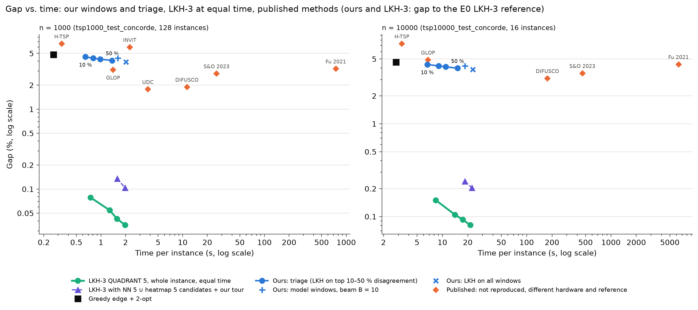

# Phase 3 benchmark: windows and triage against LKH-3 and the literature

Generated by `scripts/phase3_benchmark_report.py` on 2026-10-27.

**In three sentences.** (1) On the standard sets of Fu et al., our windows and triage beat the greedy edge + 2-opt tour
(4.81 / 4.61 % → 3.92–4.34 / 3.85–4.21 % at 1k / 10k) and, at 10k, several published neural methods (Fu 2021 4.39 %,
GLOP 4.90 %, H-TSP 7.32 %, INViT ≈ 6–7.5 %), though not DIFUSCO, Select & Optimize or SoftDist (and at 1k only H-TSP
and INViT). (2) But LKH-3 on the whole instance with geometric candidates (QUADRANT 5) beats all of them at the same
time by 30–110× in gap (1k: 0.035–0.079 %, 55–110× lower; 10k: 0.08–0.15 %, 28–47× lower). (3) The network does not
help LKH: as LKH's candidate set it is worse than the geometric ones, and as a triage signal its disagreement ranks
windows better than random only when few windows go to LKH (20 %), a gain that costs more network time than it
saves, so at equal time random selection is as good or better.

**Key numbers.**
- Equal time (E1 vs. E3): at the budget of triage top 20 % (0.72 s / 8.4 s) LKH-3 QUADRANT 5 reaches 0.079 % / 0.150 %
  against our 4.34 % / 4.21 %; at the budget of LKH on all windows (1.94 s / 21.5 s), 0.035 % / 0.081 % against 3.92 % /
  3.85 %. A single LK trial from LKH's own tour already gives 0.1–0.6 % with geometric candidates.
- Network candidates (E1): heatmap top 5 / 8 give 0.2–1.5 % (and 23–57 % at 10k when LKH builds its own start tour);
  the union NN 5 ∪ heatmap 5 with our start tour (0.07–0.14 % at 1k, 0.20–0.26 % at 10k) is worse than QUADRANT 5 alone.
- Triage ranking (E2, same share of windows to LKH): disagreement beats the simple geometric rule everywhere
  (−0.09 to −0.18 pp, significant) and random at 20 % (−0.09 to −0.17 pp, significant), not at 50 % (n.s.). The oracle
  shows the room left: at 20 % it gets 0.77–0.97 pp of gain against 0.49–0.61 pp for disagreement. But the network costs
  ≈ 0.4 s at 1k and ≈ 4 s at 10k: random at 50 % (1.26 s / 13.4 s) is already shorter than disagreement at 20 %
  (1.05 s / 11.4 s) on the standard sets.
- On the standard sets the old phase 3 conclusions hold: the triage at 20 % matches the model windows (4.34 % / 4.21 %)
  in half the time, and LKH on all windows is the best of our methods.

## Comparison table

| Method | Gap 1k (%) | Gap 10k (%) | Time 1k (s / inst.) | Time 10k (s / inst.) | Hardware | Reference | Trained at target size |
|---|---|---|---|---|---|---|---|
| Ours: greedy edge + 2-opt (no network) | 4.81 | 4.61 | 0.26 | 2.82 | Xeon E5-2620 v3 (8 cores, shared, nice 10) + T4 (< 5.5 GiB) | LKH-3.0.6, E0 (1k: RUNS = 10; 10k: RUNS = 5, ≤ 696 s per run) | n/a (no learning) |
| Ours: model windows, beam B = 10, w = 20 (≤ 5 passes) | 4.34 ± 0.03 | 4.19 ± 0.01 | 1.60 | 18.55 | Xeon E5-2620 v3 (8 cores, shared, nice 10) + T4 (< 5.5 GiB) | LKH-3.0.6, E0 (1k: RUNS = 10; 10k: RUNS = 5, ≤ 696 s per run) | no (TSP-20 only) |
| Ours: triage, LKH on top 20 % disagreement | 4.34 ± 0.03 | 4.21 ± 0.02 | 0.80 | 9.07 | Xeon E5-2620 v3 (8 cores, shared, nice 10) + T4 (< 5.5 GiB) | LKH-3.0.6, E0 (1k: RUNS = 10; 10k: RUNS = 5, ≤ 696 s per run) | no (TSP-20 only) |
| Ours: triage, LKH on top 50 % disagreement | 4.08 ± 0.02 | 3.98 ± 0.01 | 1.38 | 15.17 | Xeon E5-2620 v3 (8 cores, shared, nice 10) + T4 (< 5.5 GiB) | LKH-3.0.6, E0 (1k: RUNS = 10; 10k: RUNS = 5, ≤ 696 s per run) | no (TSP-20 only) |
| Ours: LKH on all windows (no network) | 3.92 | 3.85 | 2.02 | 22.92 | Xeon E5-2620 v3 (8 cores, shared, nice 10) + T4 (< 5.5 GiB) | LKH-3.0.6, E0 (1k: RUNS = 10; 10k: RUNS = 5, ≤ 696 s per run) | n/a (no learning) |
| **LKH-3 QUADRANT 5 on the whole instance, budget of triage top 20 %** (0.72 / 8.4 s) | 0.079 | 0.150 | 0.75 | 8.35 | Xeon E5-2620 v3 (8 cores, shared, nice 10), CPU only | LKH-3.0.6, E0 (1k: RUNS = 10; 10k: RUNS = 5, ≤ 696 s per run) | n/a (no learning) |
| **LKH-3 QUADRANT 5 on the whole instance, budget of LKH on all windows** (1.94 / 21.5 s) | 0.035 | 0.081 | 1.98 | 21.43 | Xeon E5-2620 v3 (8 cores, shared, nice 10), CPU only | LKH-3.0.6, E0 (1k: RUNS = 10; 10k: RUNS = 5, ≤ 696 s per run) | n/a (no learning) |
| Fu et al. 2021 (Att-GCRN + MCTS) *(published, not reproduced)* | 3.22 | 4.39 | 44 s net + 11.7 min MCTS | 4.2 min + 1.69 h | GTX 1080Ti + Xeon Gold 5118 (8 cores) | Concorde / LKH-3 | no (TSP-20/50 subgraphs) |
| Select & Optimize (Cheng et al. 2023) *(published, not reproduced)* | 2.80 | 3.52 | 2.9 s + 23 s | 40 s + 418 s | V100; LKH-3/MCTS on Xeon E5-2650 | LKH-3 | yes (TSP-200/500/1000) |
| H-TSP 2023 *(published, not reproduced)* | 6.62 (4.06 with LKH-3 lower level) | 7.32 (5.57 with LKH-3) | 0.33 s | 3.3 s | V100 16 GB | LKH-3 | yes (up to 10k) |
| GLOP 2024 (best reviser setting) *(published, not reproduced)* | 3.11 (3.85) | 4.90 (5.36) | 3 min (set) | 1.8 min (set) | RTX 3090 + Xeon (12 cores) | LKH-3 | no (revisers on small SHPP) |
| DIFUSCO 2023, greedy + 2-opt (+ MCTS) *(published, not reproduced)* | 1.90 (1.17) | 3.10 (2.58) | 24 min (set) | 47 min (set) | 8× V100 train; 1 GPU test | LKH-3 | yes (per size) |
| SoftDist + MCTS (Xia et al. 2024) *(published, not reproduced)* | 2.20 | 3.13 | MCTS budget as Fu | idem | EPYC 7V13 (64 threads); A100 | LKH-3 | n/a (no learning) |
| INViT 2024 *(published, not reproduced)* | 5.99 | ≈ 6–7.5 | 4.8 min (set) | — | RTX 4090 | LKH-3 | no (TSP-100, zero-shot) |
| UDC 2024 (×50) *(published, not reproduced)* | 1.78 | — | 8 min (set) | — | V100S | LKH-3 | yes (≤ 2k) |

Our rows and LKH-3: the standard sets of Fu et al. (tsp1000_test_concorde, 128 instances; tsp10000_test_concorde, 16), gap against the E0 reference, mean over the 3 TAGCN K=3 seeds (± std across seeds), wall-clock per instance including the greedy + 2-opt tour. Published rows: as reported by each paper (docs/literature_review_tsp.md); "(set)" = time for the whole test set.

**E4.** Gap against time per instance on the standard sets (both axes log). Green: LKH-3 with QUADRANT 5 candidates on the whole instance, at our four time budgets (E1). Blue: our triage curve, model windows and LKH on all windows (E3). Orange diamonds: published numbers, not reproduced (other hardware and reference; SoftDist has no time of its own and is not drawn).

## E0: LKH-3 reference

| Set | Instances | LKH-3 parameters | Mean length (E0) | Mean stored length | Improvement (mean / max) | Mean wall-clock (s) | Stored tours |
|---|---|---|---|---|---|---|---|
| tsp1000_test | 20 | RUNS=10 | 23.0955 | 23.0955 | +0.000 % / +0.000 % | 74 | elkai (LKH-3.0.8), RUNS = 10 |
| tsp1000_test_concorde | 128 | RUNS=10 | 23.1182 | 23.2268 | +0.468 % / +0.685 % | 68 | Fu et al. file ("concorde") |
| tsp10000_test | 3 | RUNS=5,TIME_LIMIT=696 | 71.8548 | 71.8550 | +0.000 % / +0.002 % | 3628 | elkai, 1 run |
| tsp10000_test_concorde | 16 | RUNS=5,TIME_LIMIT=696 | 71.7722 | 5211.7234 | — (no reference) | 3666 | none (the file's tour is the identity) |

Improvement = 100 × (stored − E0) / stored (> 0: the E0 tour is shorter). LKH-3.0.6, GitHub mirror cerebis/LKH3 (the official site is not reachable from this server). TIME_LIMIT is per run in 3.0.6 (checked between trials), so a 10k instance takes up to about 5 × 696 s + preprocessing.

## E1: LKH-3 on the whole instance at equal time

Budgets = the times of our triage policies (1k: P2 top 20 % 0.72 s, top 50 % 1.25 s, P0 1.54 s, P1 1.94 s; 10k: 8.4, 14.2, 17.5, 21.5 s). One LKH run per instance (RUNS = 1) with TIME_LIMIT = budget − fixed cost of the variant − our greedy / network time; the real total time is recorded.

### tsp1000_test_concorde (Fu et al., 1k)

| Candidate set | Start | B = 0.72 s | B = 1.25 s | B = 1.54 s | B = 1.94 s | Gap after 1 trial (%) |
|---|---|---|---|---|---|---|
| ALPHA (default) | LKH | does not fit | does not fit | does not fit | 0.039 (1.89 s, 35 tr.) | 0.134 |
| ALPHA (default) | ours | does not fit | does not fit | does not fit | 0.050 (2.16 s, 30 tr.) † | 0.163 |
| ALPHA, INITIAL_PERIOD = 100 | LKH | 0.047 (1.01 s, 27 tr.) † | 0.022 (1.52 s, 105 tr.) † | 0.018 (1.84 s, 153 tr.) † | 0.012 (2.25 s, 213 tr.) † | 0.142 |
| ALPHA, INITIAL_PERIOD = 100 | ours | does not fit | 0.036 (1.46 s, 46 tr.) † | 0.022 (1.77 s, 89 tr.) † | 0.015 (2.19 s, 152 tr.) † | 0.141 |
| ALPHA, INITIAL_PERIOD = 10 | LKH | 0.047 (0.82 s, 35 tr.) † | 0.025 (1.36 s, 115 tr.) † | 0.021 (1.65 s, 158 tr.) † | 0.017 (2.06 s, 231 tr.) | 0.154 |
| ALPHA, INITIAL_PERIOD = 10 | ours | 0.141 (0.85 s, 3 tr.) † | 0.038 (1.36 s, 64 tr.) † | 0.025 (1.66 s, 111 tr.) † | 0.016 (2.06 s, 171 tr.) | 0.160 |
| POPMUSIC | LKH | does not fit | 0.018 (1.40 s, 69 tr.) † | 0.012 (1.69 s, 115 tr.) † | 0.010 (2.10 s, 189 tr.) † | 0.123 |
| POPMUSIC | ours | does not fit | 0.064 (1.38 s, 11 tr.) † | 0.023 (1.65 s, 51 tr.) † | 0.010 (2.06 s, 116 tr.) † | 0.134 |
| NEAREST-NEIGHBOR 5 | LKH | 0.254 (0.74 s, 47 tr.) | 0.182 (1.27 s, 103 tr.) | 0.168 (1.56 s, 136 tr.) | 0.153 (1.97 s, 184 tr.) | 0.589 |
| NEAREST-NEIGHBOR 5 | ours | 0.255 (0.73 s, 15 tr.) | 0.142 (1.27 s, 55 tr.) | 0.122 (1.56 s, 79 tr.) | 0.105 (1.96 s, 120 tr.) | 0.453 |
| NEAREST-NEIGHBOR 8 | LKH | 0.142 (0.85 s, 5 tr.) † | 0.092 (1.33 s, 15 tr.) | 0.077 (1.61 s, 22 tr.) | 0.056 (2.02 s, 33 tr.) | 0.185 |
| NEAREST-NEIGHBOR 8 | ours | 0.173 (1.01 s, 2 tr.) † | 0.112 (1.35 s, 8 tr.) † | 0.085 (1.63 s, 14 tr.) | 0.060 (2.02 s, 23 tr.) | 0.180 |
| ALPHA, SUBGRADIENT = NO | LKH | 0.144 (0.71 s, 63 tr.) | 0.108 (1.24 s, 132 tr.) | 0.095 (1.53 s, 182 tr.) | 0.085 (1.95 s, 247 tr.) | 0.383 |
| ALPHA, SUBGRADIENT = NO | ours | 0.177 (0.67 s, 14 tr.) | 0.090 (1.21 s, 69 tr.) | 0.074 (1.50 s, 99 tr.) | 0.060 (1.90 s, 151 tr.) | 0.303 |
| **QUADRANT 5** | LKH | 0.079 (0.75 s, 55 tr.) | 0.054 (1.28 s, 107 tr.) | 0.042 (1.57 s, 148 tr.) | 0.035 (1.98 s, 193 tr.) | 0.298 |
| QUADRANT 5 | ours | 0.111 (0.74 s, 19 tr.) | 0.053 (1.27 s, 68 tr.) | 0.044 (1.56 s, 95 tr.) | 0.035 (1.97 s, 139 tr.) | 0.292 |
| QUADRANT 8 | LKH | 0.087 (0.78 s, 12 tr.) † | 0.048 (1.30 s, 35 tr.) | 0.036 (1.60 s, 49 tr.) | 0.027 (1.99 s, 71 tr.) | 0.181 |
| QUADRANT 8 | ours | does not fit | 0.077 (1.32 s, 19 tr.) | 0.053 (1.59 s, 32 tr.) | 0.040 (2.00 s, 52 tr.) | 0.178 |
| heatmap top 5 | LKH | does not fit | 0.770 (1.30 s, 96 tr.) | 0.668 (1.60 s, 142 tr.) | 0.580 (1.99 s, 205 tr.) | 2.310 |
| heatmap top 5 | ours | does not fit | 0.596 (1.27 s, 48 tr.) | 0.503 (1.56 s, 81 tr.) | 0.415 (1.98 s, 129 tr.) | 1.115 |
| heatmap top 8 | LKH | does not fit | does not fit | does not fit | 0.262 (1.98 s, 43 tr.) | 0.550 |
| heatmap top 8 | ours | does not fit | does not fit | does not fit | 0.192 (2.02 s, 27 tr.) | 0.395 |
| NN 5 ∪ heatmap top 5 | LKH | does not fit | does not fit | does not fit | 0.099 (1.98 s, 69 tr.) | 0.334 |
| NN 5 ∪ heatmap top 5 | ours | does not fit | does not fit | 0.135 (1.58 s, 23 tr.) | 0.104 (1.98 s, 40 tr.) | 0.311 |

128 instances. Each cell: mean gap (%) to the E0 reference (mean real total time per instance, mean number of LKH trials). † = more than 25 % of the instances took more than 1.1 × the budget (TIME_LIMIT is checked only between trials; 8 runs shared the 8 cores). "does not fit": the measured fixed cost + one trial already exceeds the budget. Start "ours" = INITIAL_TOUR_FILE with our greedy + 2-opt tour, whose time is part of the total; the heatmap variants also pay the graph + network time.

### tsp10000_test_concorde (Fu et al., 10k)

| Candidate set | Start | B = 8.4 s | B = 14.2 s | B = 17.5 s | B = 21.5 s | Gap after 1 trial (%) |
|---|---|---|---|---|---|---|
| ALPHA (default) | LKH | does not fit | does not fit | does not fit | does not fit | — |
| ALPHA (default) | ours | does not fit | does not fit | does not fit | does not fit | — |
| ALPHA, INITIAL_PERIOD = 1000 | LKH | does not fit | does not fit | does not fit | does not fit | — |
| ALPHA, INITIAL_PERIOD = 1000 | ours | does not fit | does not fit | does not fit | does not fit | — |
| ALPHA, INITIAL_PERIOD = 100 | LKH | does not fit | does not fit | does not fit | does not fit | — |
| ALPHA, INITIAL_PERIOD = 100 | ours | does not fit | does not fit | does not fit | does not fit | — |
| POPMUSIC | LKH | does not fit | does not fit | does not fit | does not fit | — |
| POPMUSIC | ours | does not fit | does not fit | does not fit | does not fit | — |
| NEAREST-NEIGHBOR 5 | LKH | 0.418 (8.50 s, 15 tr.) | 0.288 (14.41 s, 32 tr.) | 0.263 (17.61 s, 43 tr.) | 0.242 (21.61 s, 57 tr.) | 1.269 |
| NEAREST-NEIGHBOR 5 | ours | 0.325 (9.01 s, 7 tr.) | 0.218 (14.75 s, 20 tr.) | 0.187 (17.97 s, 29 tr.) | 0.164 (21.99 s, 39 tr.) | 0.515 |
| NEAREST-NEIGHBOR 8 | LKH | 0.199 (11.18 s, 2 tr.) † | 0.167 (17.33 s, 4 tr.) † | 0.160 (20.14 s, 5 tr.) † | 0.149 (22.70 s, 6 tr.) | 0.206 |
| NEAREST-NEIGHBOR 8 | ours | does not fit | 0.179 (16.18 s, 3 tr.) † | 0.153 (19.33 s, 4 tr.) † | 0.137 (22.96 s, 6 tr.) † | 0.218 |
| ALPHA, SUBGRADIENT = NO | LKH | does not fit | 0.234 (14.99 s, 15 tr.) | 0.195 (18.43 s, 27 tr.) | 0.174 (22.18 s, 42 tr.) | 0.496 |
| ALPHA, SUBGRADIENT = NO | ours | does not fit | 0.270 (14.76 s, 6 tr.) | 0.199 (18.04 s, 12 tr.) | 0.161 (22.17 s, 24 tr.) | 0.384 |
| **QUADRANT 5** | LKH | 0.150 (8.35 s, 14 tr.) | 0.105 (14.09 s, 30 tr.) | 0.093 (17.46 s, 40 tr.) | 0.081 (21.43 s, 53 tr.) | 0.320 |
| QUADRANT 5 | ours | 0.203 (8.71 s, 7 tr.) | 0.120 (14.48 s, 18 tr.) | 0.099 (17.72 s, 25 tr.) | 0.085 (21.78 s, 34 tr.) | 0.344 |
| QUADRANT 8 | LKH | 0.189 (9.79 s, 3 tr.) † | 0.155 (15.12 s, 6 tr.) | 0.132 (18.60 s, 9 tr.) | 0.120 (22.49 s, 12 tr.) | 0.200 |
| QUADRANT 8 | ours | does not fit | 0.180 (15.53 s, 4 tr.) † | 0.162 (18.67 s, 6 tr.) | 0.144 (22.10 s, 8 tr.) | 0.219 |
| heatmap top 5 | LKH | does not fit | 56.633 (15.91 s, 4 tr.) † | 40.324 (18.81 s, 6 tr.) † | 26.424 (22.78 s, 9 tr.) | 126.709 |
| heatmap top 5 | ours | does not fit | 1.533 (14.35 s, 29 tr.) | 1.463 (17.61 s, 44 tr.) | 1.402 (21.75 s, 66 tr.) | 1.947 |
| heatmap top 8 | LKH | does not fit | does not fit | does not fit | does not fit | — |
| heatmap top 8 | ours | does not fit | does not fit | 1.192 (18.55 s, 5 tr.) | 1.137 (21.92 s, 8 tr.) | 1.313 |
| NN 5 ∪ heatmap top 5 | LKH | does not fit | does not fit | does not fit | does not fit | — |
| NN 5 ∪ heatmap top 5 | ours | does not fit | does not fit | 0.240 (18.55 s, 6 tr.) | 0.204 (22.39 s, 9 tr.) | 0.359 |

16 instances. Each cell: mean gap (%) to the E0 reference (mean real total time per instance, mean number of LKH trials). † = more than 25 % of the instances took more than 1.1 × the budget (TIME_LIMIT is checked only between trials; 8 runs shared the 8 cores). "does not fit": the measured fixed cost + one trial already exceeds the budget. Start "ours" = INITIAL_TOUR_FILE with our greedy + 2-opt tour, whose time is part of the total; the heatmap variants also pay the graph + network time.

### Our own sets (tsp1000_test, 20 instances; tsp10000_test, 3)

| Candidate set | Start | B = 0.72 s | B = 1.25 s | B = 1.54 s | B = 1.94 s | Gap after 1 trial (%) |
|---|---|---|---|---|---|---|
| ALPHA (default) | LKH | does not fit | does not fit | does not fit | 0.045 (1.97 s, 31 tr.) | 0.151 |
| ALPHA (default) | ours | does not fit | does not fit | does not fit | 0.040 (2.23 s, 41 tr.) † | 0.138 |
| ALPHA, INITIAL_PERIOD = 100 | LKH | 0.049 (1.00 s, 17 tr.) † | 0.015 (1.51 s, 82 tr.) † | 0.008 (1.85 s, 128 tr.) † | 0.006 (2.19 s, 183 tr.) † | 0.101 |
| ALPHA, INITIAL_PERIOD = 100 | ours | does not fit | 0.035 (1.47 s, 36 tr.) † | 0.019 (1.70 s, 73 tr.) † | 0.013 (2.17 s, 121 tr.) † | 0.158 |
| ALPHA, INITIAL_PERIOD = 10 | LKH | 0.045 (0.82 s, 41 tr.) † | 0.024 (1.36 s, 122 tr.) † | 0.024 (1.65 s, 165 tr.) | 0.018 (2.09 s, 228 tr.) † | 0.176 |
| ALPHA, INITIAL_PERIOD = 10 | ours | 0.089 (0.80 s, 5 tr.) † | 0.026 (1.33 s, 74 tr.) | 0.019 (1.64 s, 112 tr.) | 0.016 (2.07 s, 163 tr.) † | 0.116 |
| POPMUSIC | LKH | does not fit | 0.022 (1.38 s, 65 tr.) † | 0.019 (1.68 s, 107 tr.) | 0.012 (2.03 s, 176 tr.) | 0.121 |
| POPMUSIC | ours | does not fit | 0.034 (1.42 s, 16 tr.) † | 0.013 (1.67 s, 59 tr.) † | 0.009 (2.10 s, 137 tr.) † | 0.093 |
| NEAREST-NEIGHBOR 5 | LKH | 0.241 (0.75 s, 45 tr.) | 0.186 (1.27 s, 99 tr.) | 0.168 (1.57 s, 111 tr.) | 0.139 (1.99 s, 163 tr.) | 0.511 |
| NEAREST-NEIGHBOR 5 | ours | 0.194 (0.73 s, 18 tr.) | 0.122 (1.26 s, 55 tr.) | 0.094 (1.56 s, 79 tr.) | 0.085 (1.96 s, 125 tr.) | 0.400 |
| NEAREST-NEIGHBOR 8 | LKH | 0.124 (0.83 s, 5 tr.) † | 0.089 (1.36 s, 15 tr.) † | 0.074 (1.60 s, 19 tr.) | 0.051 (2.00 s, 28 tr.) | 0.158 |
| NEAREST-NEIGHBOR 8 | ours | 0.147 (0.92 s, 3 tr.) † | 0.095 (1.32 s, 10 tr.) | 0.079 (1.61 s, 16 tr.) | 0.052 (2.03 s, 26 tr.) | 0.157 |
| ALPHA, SUBGRADIENT = NO | LKH | 0.137 (0.71 s, 66 tr.) | 0.101 (1.23 s, 133 tr.) | 0.102 (1.54 s, 173 tr.) | 0.087 (1.95 s, 220 tr.) | 0.302 |
| ALPHA, SUBGRADIENT = NO | ours | 0.120 (0.67 s, 16 tr.) | 0.066 (1.20 s, 67 tr.) | 0.056 (1.49 s, 92 tr.) | 0.048 (1.88 s, 152 tr.) | 0.294 |
| **QUADRANT 5** | LKH | 0.056 (0.76 s, 49 tr.) | 0.037 (1.28 s, 106 tr.) | 0.038 (1.56 s, 131 tr.) | 0.032 (1.98 s, 170 tr.) | 0.310 |
| QUADRANT 5 | ours | 0.105 (0.73 s, 21 tr.) | 0.043 (1.25 s, 71 tr.) | 0.038 (1.55 s, 98 tr.) | 0.033 (1.96 s, 144 tr.) | 0.248 |
| QUADRANT 8 | LKH | 0.056 (0.77 s, 11 tr.) | 0.035 (1.31 s, 35 tr.) | 0.022 (1.59 s, 53 tr.) | 0.024 (2.00 s, 76 tr.) | 0.149 |
| QUADRANT 8 | ours | does not fit | 0.084 (1.31 s, 19 tr.) | 0.055 (1.61 s, 35 tr.) | 0.041 (2.00 s, 54 tr.) | 0.174 |
| heatmap top 5 | LKH | does not fit | 0.870 (1.37 s, 93 tr.) | 0.757 (1.57 s, 143 tr.) | 0.644 (1.98 s, 207 tr.) | 1.943 |
| heatmap top 5 | ours | does not fit | 0.499 (1.28 s, 56 tr.) | 0.415 (1.57 s, 94 tr.) | 0.372 (1.95 s, 143 tr.) | 0.958 |
| heatmap top 8 | LKH | does not fit | does not fit | does not fit | 0.292 (1.98 s, 46 tr.) | 0.556 |
| heatmap top 8 | ours | does not fit | does not fit | does not fit | 0.249 (2.00 s, 23 tr.) | 0.394 |
| NN 5 ∪ heatmap top 5 | LKH | does not fit | does not fit | does not fit | 0.111 (1.98 s, 66 tr.) | 0.293 |
| NN 5 ∪ heatmap top 5 | ours | does not fit | does not fit | 0.098 (1.56 s, 30 tr.) | 0.073 (1.96 s, 48 tr.) | 0.240 |

20 instances. Each cell: mean gap (%) to the E0 reference (mean real total time per instance, mean number of LKH trials). † = more than 25 % of the instances took more than 1.1 × the budget (TIME_LIMIT is checked only between trials; 8 runs shared the 8 cores). "does not fit": the measured fixed cost + one trial already exceeds the budget. Start "ours" = INITIAL_TOUR_FILE with our greedy + 2-opt tour, whose time is part of the total; the heatmap variants also pay the graph + network time.

| Candidate set | Start | B = 8.4 s | B = 14.2 s | B = 17.5 s | B = 21.5 s | Gap after 1 trial (%) |
|---|---|---|---|---|---|---|
| ALPHA (default) | LKH | does not fit | does not fit | does not fit | does not fit | — |
| ALPHA (default) | ours | does not fit | does not fit | does not fit | does not fit | — |
| ALPHA, INITIAL_PERIOD = 1000 | LKH | does not fit | does not fit | does not fit | does not fit | — |
| ALPHA, INITIAL_PERIOD = 1000 | ours | does not fit | does not fit | does not fit | does not fit | — |
| ALPHA, INITIAL_PERIOD = 100 | LKH | does not fit | does not fit | does not fit | does not fit | — |
| ALPHA, INITIAL_PERIOD = 100 | ours | does not fit | does not fit | does not fit | does not fit | — |
| POPMUSIC | LKH | does not fit | does not fit | does not fit | does not fit | — |
| POPMUSIC | ours | does not fit | does not fit | does not fit | does not fit | — |
| NEAREST-NEIGHBOR 5 | LKH | 0.457 (8.78 s, 13 tr.) † | 0.296 (14.37 s, 32 tr.) | 0.273 (17.53 s, 45 tr.) | 0.249 (21.70 s, 59 tr.) | 1.417 |
| NEAREST-NEIGHBOR 5 | ours | 0.319 (9.58 s, 7 tr.) † | 0.210 (15.03 s, 25 tr.) † | 0.192 (18.12 s, 32 tr.) | 0.181 (22.25 s, 45 tr.) | 0.491 |
| NEAREST-NEIGHBOR 8 | LKH | 0.226 (10.89 s, 2 tr.) † | 0.202 (15.46 s, 4 tr.) † | 0.177 (18.66 s, 5 tr.) † | 0.164 (24.05 s, 7 tr.) † | 0.227 |
| NEAREST-NEIGHBOR 8 | ours | does not fit | 0.217 (17.09 s, 3 tr.) † | 0.209 (20.22 s, 4 tr.) † | 0.190 (25.49 s, 5 tr.) † | 0.221 |
| ALPHA, SUBGRADIENT = NO | LKH | does not fit | 0.262 (14.66 s, 13 tr.) | 0.224 (18.38 s, 22 tr.) | 0.203 (22.57 s, 33 tr.) | 0.648 |
| ALPHA, SUBGRADIENT = NO | ours | does not fit | 0.291 (15.45 s, 6 tr.) † | 0.190 (18.59 s, 13 tr.) | 0.146 (22.97 s, 26 tr.) † | 0.342 |
| **QUADRANT 5** | LKH | 0.187 (8.25 s, 12 tr.) | 0.107 (14.08 s, 27 tr.) | 0.099 (17.42 s, 33 tr.) | 0.095 (22.00 s, 42 tr.) | 0.324 |
| QUADRANT 5 | ours | 0.209 (8.69 s, 7 tr.) | 0.148 (14.43 s, 15 tr.) | 0.136 (18.00 s, 22 tr.) | 0.123 (21.68 s, 30 tr.) | 0.382 |
| QUADRANT 8 | LKH | 0.181 (9.32 s, 4 tr.) † | 0.120 (15.55 s, 7 tr.) † | 0.092 (18.40 s, 8 tr.) † | 0.081 (22.74 s, 13 tr.) † | 0.196 |
| QUADRANT 8 | ours | does not fit | 0.179 (16.32 s, 4 tr.) † | 0.163 (18.61 s, 5 tr.) † | 0.151 (23.24 s, 6 tr.) † | 0.198 |
| heatmap top 5 | LKH | does not fit | 53.200 (14.96 s, 3 tr.) | 37.171 (18.14 s, 6 tr.) | 23.292 (21.79 s, 11 tr.) | 117.616 |
| heatmap top 5 | ours | does not fit | 1.516 (14.55 s, 25 tr.) | 1.451 (17.71 s, 41 tr.) | 1.384 (21.92 s, 61 tr.) | 1.922 |
| heatmap top 8 | LKH | does not fit | does not fit | does not fit | does not fit | — |
| heatmap top 8 | ours | does not fit | does not fit | 1.131 (17.80 s, 5 tr.) | 1.076 (21.54 s, 12 tr.) | 1.253 |
| NN 5 ∪ heatmap top 5 | LKH | does not fit | does not fit | does not fit | does not fit | — |
| NN 5 ∪ heatmap top 5 | ours | does not fit | does not fit | 0.263 (18.22 s, 6 tr.) | 0.218 (23.69 s, 10 tr.) † | 0.350 |

3 instances. Each cell: mean gap (%) to the E0 reference (mean real total time per instance, mean number of LKH trials). † = more than 25 % of the instances took more than 1.1 × the budget (TIME_LIMIT is checked only between trials; 8 runs shared the 8 cores). "does not fit": the measured fixed cost + one trial already exceeds the budget. Start "ours" = INITIAL_TOUR_FILE with our greedy + 2-opt tour, whose time is part of the total; the heatmap variants also pay the graph + network time.

## E3: our methods on the standard sets

| Method | Gap n = 1000 (%) | Time n = 1000 (s) | Windows to LKH n = 1000 | Gap n = 10000 (%) | Time n = 10000 (s) | Windows to LKH n = 10000 |
|---|---|---|---|---|---|---|
| Greedy edge + 2-opt | 4.81 | 0.26 | 0 % | 4.61 | 2.82 | 0 % |
| Model windows, greedy path, w = 20 | 4.65 ± 0.02 | 0.56 | 0 % | 4.45 ± 0.01 | 6.66 | 0 % |
| Model windows, beam B = 10, w = 20 | 4.34 ± 0.03 | 1.60 | 0 % | 4.19 ± 0.01 | 18.55 | 0 % |
| P0: model (beam) everywhere, ≤ 3 passes | 4.34 ± 0.03 | 1.69 | 0 % | 4.19 ± 0.01 | 18.47 | 0 % |
| P2: LKH on top 10 % disagreement | 4.51 ± 0.03 | 0.65 | 7 % | 4.36 ± 0.02 | 6.61 | 6 % |
| P2: LKH on top 20 % disagreement | 4.34 ± 0.03 | 0.80 | 15 % | 4.21 ± 0.02 | 9.07 | 14 % |
| P2: LKH on top 30 % disagreement | 4.22 ± 0.02 | 0.98 | 24 % | 4.11 ± 0.02 | 10.97 | 22 % |
| P2: LKH on top 50 % disagreement | 4.08 ± 0.02 | 1.38 | 44 % | 3.98 ± 0.01 | 15.17 | 42 % |
| P3: model if confident, LKH if top 10 % dis. and not confident | 4.25 ± 0.01 | 1.80 | 4 % | 4.13 ± 0.01 | 19.52 | 4 % |
| P3: model if confident, LKH if top 20 % dis. and not confident | 4.17 ± 0.01 | 1.89 | 8 % | 4.06 ± 0.01 | 20.32 | 7 % |
| P3: model if confident, LKH if top 30 % dis. and not confident | 4.13 ± 0.02 | 1.97 | 11 % | 4.04 ± 0.01 | 20.89 | 10 % |
| P1: LKH on all windows | 3.92 | 2.02 | 100 % | 3.85 | 22.92 | 100 % |

Mean ± std over the 3 TAGCN K=3 seeds (no seed for the greedy + 2-opt tour and P1). Thresholds of P2 / P3: from the tsp200 record of the triage experiment (fixed numbers, as before).

## E2: which windows should go to LKH?

| Set | x | Policy | Gap (%) | Gain (pp) | Share of oracle gain | Time (s) | Windows to LKH |
|---|---|---|---|---|---|---|---|
| tsp1000_test | 20 % | Random (5 seeds) | 4.260 ± 0.038 | 0.444 | 46 % | 0.67 | 20 % |
| tsp1000_test | 20 % | Simple rule: length / Σ NN distance | 4.274 | 0.430 | 44 % | 0.61 | 20 % |
| tsp1000_test | 20 % | Disagreement (3 seeds) | 4.091 ± 0.041 | 0.613 | 63 % | 1.01 | 20 % |
| tsp1000_test | 20 % | Oracle: real LKH gain | 3.734 | 0.970 | 100 % | 2.38 * | 20 % |
| tsp1000_test | 50 % | Random (5 seeds) | 3.888 ± 0.016 | 0.816 | 85 % | 1.28 | 50 % |
| tsp1000_test | 50 % | Simple rule: length / Σ NN distance | 4.007 | 0.697 | 72 % | 1.18 | 50 % |
| tsp1000_test | 50 % | Disagreement (3 seeds) | 3.859 ± 0.017 | 0.845 | 88 % | 1.53 | 50 % |
| tsp1000_test | 50 % | Oracle: real LKH gain | 3.742 | 0.962 | 100 % | 2.15 * | 50 % |
| tsp1000_test_concorde | 20 % | Random (5 seeds) | 4.361 ± 0.008 | 0.444 | 50 % | 0.66 | 20 % |
| tsp1000_test_concorde | 20 % | Simple rule: length / Σ NN distance | 4.445 | 0.361 | 41 % | 0.65 | 20 % |
| tsp1000_test_concorde | 20 % | Disagreement (3 seeds) | 4.266 ± 0.023 | 0.539 | 61 % | 1.05 | 20 % |
| tsp1000_test_concorde | 20 % | Oracle: real LKH gain | 3.918 | 0.888 | 100 % | 2.21 * | 20 % |
| tsp1000_test_concorde | 50 % | Random (5 seeds) | 4.036 ± 0.009 | 0.770 | 87 % | 1.26 | 50 % |
| tsp1000_test_concorde | 50 % | Simple rule: length / Σ NN distance | 4.133 | 0.673 | 76 % | 1.23 | 50 % |
| tsp1000_test_concorde | 50 % | Disagreement (3 seeds) | 4.044 ± 0.025 | 0.762 | 86 % | 1.62 | 50 % |
| tsp1000_test_concorde | 50 % | Oracle: real LKH gain | 3.920 | 0.885 | 100 % | 2.02 * | 50 % |
| tsp10000_test_concorde | 20 % | Random (5 seeds) | 4.212 ± 0.007 | 0.397 | 52 % | 7.19 | 20 % |
| tsp10000_test_concorde | 20 % | Simple rule: length / Σ NN distance | 4.291 | 0.318 | 42 % | 7.63 | 20 % |
| tsp10000_test_concorde | 20 % | Disagreement (3 seeds) | 4.121 ± 0.023 | 0.488 | 64 % | 11.37 | 20 % |
| tsp10000_test_concorde | 20 % | Oracle: real LKH gain | 3.844 | 0.765 | 100 % | 23.40 * | 20 % |
| tsp10000_test_concorde | 50 % | Random (5 seeds) | 3.939 ± 0.007 | 0.670 | 88 % | 13.35 | 50 % |
| tsp10000_test_concorde | 50 % | Simple rule: length / Σ NN distance | 4.032 | 0.577 | 75 % | 14.51 | 50 % |
| tsp10000_test_concorde | 50 % | Disagreement (3 seeds) | 3.942 ± 0.015 | 0.667 | 87 % | 17.97 | 50 % |
| tsp10000_test_concorde | 50 % | Oracle: real LKH gain | 3.845 | 0.764 | 100 % | 23.26 * | 50 % |

w = 20, offsets 0 and w/2, ≤ 3 passes, from the greedy + 2-opt tour; in every half-pass exactly the top x % of the windows by the policy's score go to LKH (unlike P2, whose fixed thresholds send 14–46 %). Gap: mean over instances of the per-instance mean over seeds (± std of the seed means). * the oracle runs LKH on every window to know its gain: its time is not that of a usable policy.

### Paired tests

| Set | x | Disagreement vs. | Better / equal / worse (% inst.) | Mean diff (pp) | p (Wilcoxon) | Verdict |
|---|---|---|---|---|---|---|
| tsp1000_test (20) | 20 % | Random (5 seeds) | 90 / 0 / 10 | -0.170 | 6.3e-05 | **better** |
| tsp1000_test (20) | 20 % | Simple rule: length / Σ NN distance | 85 / 0 / 15 | -0.183 | 2.0e-03 | **better** |
| tsp1000_test (20) | 50 % | Random (5 seeds) | 50 / 0 / 50 | -0.028 | 4.7e-01 | n.s. |
| tsp1000_test (20) | 50 % | Simple rule: length / Σ NN distance | 80 / 0 / 20 | -0.148 | 5.6e-03 | **better** |
| tsp1000_test_concorde (128) | 20 % | Random (5 seeds) | 75 / 0 / 25 | -0.095 | 4.1e-10 | **better** |
| tsp1000_test_concorde (128) | 20 % | Simple rule: length / Σ NN distance | 87 / 0 / 13 | -0.179 | 9.4e-17 | **better** |
| tsp1000_test_concorde (128) | 50 % | Random (5 seeds) | 45 / 0 / 55 | +0.008 | 1.6e-01 | n.s. |
| tsp1000_test_concorde (128) | 50 % | Simple rule: length / Σ NN distance | 83 / 0 / 17 | -0.089 | 7.1e-14 | **better** |
| tsp10000_test_concorde (16) | 20 % | Random (5 seeds) | 100 / 0 / 0 | -0.091 | 3.1e-05 | **better** |
| tsp10000_test_concorde (16) | 20 % | Simple rule: length / Σ NN distance | 100 / 0 / 0 | -0.170 | 3.1e-05 | **better** |
| tsp10000_test_concorde (16) | 50 % | Random (5 seeds) | 38 / 0 / 62 | +0.004 | 6.0e-01 | n.s. |
| tsp10000_test_concorde (16) | 50 % | Simple rule: length / Σ NN distance | 100 / 0 / 0 | -0.090 | 3.1e-05 | **better** |

Paired two-sided Wilcoxon on the per-instance gaps (disagreement averaged over its 3 seeds, random over its 5); negative difference = disagreement shorter. Bonferroni within each set: 0.05 / 4 = 0.0125. With 16 instances (10k) the test has little power.

## Comparability caveats

1. **Reference (E0).** Our gaps and LKH-3's are measured against our E0 reference: LKH-3.0.6 (GitHub mirror
   cerebis/LKH3, commit ba346db, since the official site is unreachable from this server), RUNS = 10 at 1k and
   RUNS = 5 at 10k. At 10k, TIME_LIMIT = 696 s is **per run, not total** (in 3.0.6 it is checked between trials), so an
   instance took ≈ 1 h. This is not Concorde: the published gaps are against Concorde or long LKH-3 runs, which can be a
   few hundredths of a percent shorter at 10k. On our own sets the E0 reference equals the old one (tsp1000_test:
   identical; tsp10000_test: 0.0003 % shorter), so the earlier phase 2–3 reports stay valid (they only get a note).
2. **Fu et al. files.** The 1k file's "concorde" tours are not optimal: E0 is 0.47 % shorter on average (0.27–0.68 %),
   so a gap computed against the file is ≈ 0.47 pp too optimistic (or too pessimistic for a method that beats it).
   The 10k file has **no reference tour** (its "tour" is the identity): every 10k gap here is against E0, and the
   published 10k gaps are against each paper's own LKH-3 runs.
3. **Joshi et al. 2021 use k = 0.2 n** for test-time sparsification; our k = min(0.5 n, 100) neighbours (2-opt
   lists and the network's k-NN graph) is our own extension. A 0.2 n ablation was not run.
4. **Hardware and timing.** Ours: a shared Intel Xeon E5-2620 v3 (8 cores) under `nice -n 10` and a shared Tesla T4
   capped at 5.5 GiB; published times use 1080Ti to 8× V100, A100 or a 64-thread EPYC, often the network on GPU and
   the search on many cores. Several papers report the time of the whole test set (marked "(set)"; divided by 128 / 16
   in the figure) or network and search separately. Our times are wall-clock per instance, one instance at a time
   per process, with 4 processes (E3) or 8 LKH runs (E1) sharing the CPU.
5. **LKH-3 variants that exceed their budget.** TIME_LIMIT is checked only between trials, and the fixed cost was
   measured on one instance with a single process, so some variants overshoot (marked † in the E1 tables: more than
   25 % of the instances above 1.1 × the budget). On the standard sets: n = 1000: ALPHA (default) (our start; 1.94 s), ALPHA, INITIAL_PERIOD = 100 (LKH start; 0.72/1.25/1.54/1.94 s), ALPHA, INITIAL_PERIOD = 100 (our start; 1.25/1.54/1.94 s), ALPHA, INITIAL_PERIOD = 10 (LKH start; 0.72/1.25/1.54 s), ALPHA, INITIAL_PERIOD = 10 (our start; 0.72/1.25/1.54 s), POPMUSIC (LKH start; 1.25/1.54/1.94 s), POPMUSIC (our start; 1.25/1.54/1.94 s), NEAREST-NEIGHBOR 8 (LKH start; 0.72 s), NEAREST-NEIGHBOR 8 (our start; 0.72/1.25 s), QUADRANT 8 (LKH start; 0.72 s); n = 10000: NEAREST-NEIGHBOR 8 (LKH start; 8.4/14.2/17.5 s), NEAREST-NEIGHBOR 8 (our start; 14.2/17.5/21.5 s), QUADRANT 8 (LKH start; 8.4 s), QUADRANT 8 (our start; 14.2 s), heatmap top 5 (LKH start; 14.2/17.5 s). The main line (QUADRANT 5, LKH's own
   start) stays within its budgets. The hybrid NN 5 ∪ heatmap 5 variant was not probed: its fixed cost was estimated from heat5
   and nn8 / heat8.
6. **Training size.** Our network is trained on TSP-20 only and applied to windows of 20 cities; DIFUSCO, UDC,
   H-TSP and Select & Optimize train on or near the target size.
7. **Instance counts.** Our earlier reports used 20 (1k) and 3 (10k) own instances; E3 uses Fu's 128 and 16. The
   10k paired tests have 16 instances.
8. **Published numbers are not reproduced:** they are copied from the papers (docs/literature_review_tsp.md) and differ in
   hardware, reference, time accounting and sometimes in the test set.

## Reproduction

From `tsp/`: `bash scripts/build_lkh3.sh` (LKH-3.0.6, kept out of git for its licence), then `scripts/run_phase3_bench_e0.sh`, `run_phase3_bench_e1.sh` (after `scripts/lkh3_e1_prep.py`), `run_phase3_bench_e3.sh`, `run_phase3_bench_e2.sh` and `python scripts/phase3_benchmark_report.py`. E1 network candidates: tagcn_k3_seed0 (best.pt).
