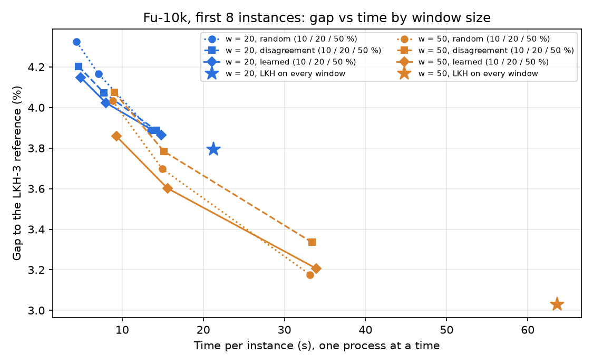

# Phase 3 — triage with larger windows (w = 20, 50, 100)

Generated 2026-10-30 by scripts/phase3_triage_wsize_report.py. Greedy edge + 2-opt tour, consecutive windows with fixed ends, offsets 0 and w/2, ≤ 3 passes, LKH on a window via a dummy city; TAGCN K=3 (3 seeds), batched scoring (fast triage, version A).

## Summary

1. **At which w does selection start saving time at equal time?** Already at w = 20, when the share sent to LKH is
   small (10–20 %). At w = 50 the margin is larger in absolute terms.
   - **Method.** Fu-10k, first 8 instances, one process at a time. Each policy is compared with random at the same
     time, interpolating along random's own gap-vs-time curve (10 / 20 / 50 / 100 %).
   - **w = 20.** The learned signal is −0.15 pp (top 10 %) and −0.10 pp (top 20 %) better than random at the same
     time. At top 50 % it is a tie (−0.01 pp).
   - **w = 50.** The learned signal is −0.15 pp (10 %) and −0.08 pp (20 %) better. At 50 % random is better
     (+0.03 pp).
   - **Why w = 50 leaves room for it.** At w = 50 an LKH call costs ~65 ms per window, against ~7 ms at w = 20, so
     the 0.35 s of scoring is 2–4 % of the time instead of 5–7 %.
   - **The disagreement at w = 50 is worse than random at equal time** (+0.05 to +0.16 pp), although its AP is higher
     (0.76–0.84 against 0.66–0.73). The network was trained on 20-city windows: in a rescaled 50-city window its p
     still says which windows improve, but not which gain the most. The learned model, retrained for w = 50, fixes
     this.
2. **How much of the oracle does the learned signal recover?**
   - **w = 50.** On Fu-10k: 49 % at top 10 %, 62 % at top 20 % and 88 % at top 50 %. On tsp1000: 51 %, 65 % and 89 %.
     Random gets 37 / 56 / 90 % and the disagreement 34 / 50 / 80 %.
   - **w = 100 was left out of the policies on purpose.** 93.5–99 % of its windows improve, so random already has an
     AP of 0.94–0.98 and the learned signal only reaches 0.97–0.99. A window costs ~0.3 s of LKH. There is almost
     nothing to select: any policy at x % gets about x % of the gain.
3. **Does the best (w, x %) beat LKH on every window at w = 20 on gap vs time?** Yes, clearly.
   - LKH on every w = 20 window gives **3.793 % in 21.3 s**.
   - **w = 50 with the learned signal at top 20 %** gives **3.602 % in 15.6 s**: 0.19 pp better and 27 % faster.
   - Even random at w = 50, top 20 % (3.697 % in 15.0 s) beats it.
   - LKH on every w = 50 window gives 3.028 % in 63.6 s. Larger windows simply give LKH more to work with, and
     selecting 10–20 % of them is where the time is best spent.

## Caveats

- **Sample size.** Fu-10k policies use the first 8 instances: the smallest possible Wilcoxon p is 0.0078, just under
  the Bonferroni threshold 0.0083.
- **Load during the timings.**
  - The w = 50 runs, and the w = 20 runs at top 10 % and LKH on every window, ran alone on a quiet machine (load
    average 1.1–1.5, no GPU used by other projects).
  - The w = 20 top 20 / 50 % rows reuse the earlier sequential run, done while another project kept the load average
    at 6–9. So the w = 20 equal-time comparisons at 20 / 50 % mix two load levels. The random and learned rows of
    that run share the same load, so their difference holds.
- **Fewer random seeds.** Random uses 3 rng seeds here (5 in the earlier w = 20 run).
- **Windows of different size.** The learned model for w = 50 / 100 was retrained on w = 50 / 100 windows. The
  network itself is the same TAGCN trained on TSP-20; its windows are rescaled to [0, 1]² as before.

## Windows: LKH cost and how many improve

| w | Set | Windows (first pass) | LKH improves (%) | Mean window gain (%) | LKH ms per window | … when it improves / when not |
|---|---|---|---|---|---|---|
| 50 | tsp200_test | 800 | 79.9 | 1.62 | 72.8 | 73.7 / 69.2 |
| 50 | tsp1000_test_concorde | 5120 | 69.8 | 1.16 | 65.3 | 66.4 / 62.6 |
| 50 | tsp1000_test | 800 | 73.4 | 1.26 | 77.5 | 78.3 / 75.4 |
| 50 | tsp10000_test_concorde | 6400 | 65.6 | 0.99 | 62.1 | 63.5 / 59.3 |
| 100 | tsp200_test | 400 | 99.0 | 2.65 | 400.0 | 400.6 / 340.1 |
| 100 | tsp1000_test_concorde | 2560 | 96.3 | 1.85 | 296.8 | 298.0 / 264.5 |
| 100 | tsp1000_test | 400 | 97.2 | 1.95 | 386.0 | 387.5 / 335.6 |
| 100 | tsp10000_test_concorde | 3200 | 93.5 | 1.52 | 281.0 | 282.5 / 259.6 |

w = 20 (from the learned-triage logs): 21–30 % of the windows improve, ~7 ms of LKH per window. Times measured with other projects loading the machine (see the load table).

## Signal quality: average precision by w

| w | Set | Windows | Random (= positive rate) | Disagreement | Learned (chosen) | Oracle | Learned − disagreement |
|---|---|---|---|---|---|---|---|
| 20 | tsp200_test (validation half) | 1000 | 0.286 ± 0.000 | 0.511 ± 0.046 | 0.550 ± 0.030 | 1 | +0.038 |
| 20 | tsp1000_test_concorde (validation half) | 6400 | 0.238 ± 0.000 | 0.451 ± 0.033 | 0.488 ± 0.029 | 1 | +0.038 |
| 20 | tsp1000_test (test) | 2000 | 0.257 ± 0.000 | 0.469 ± 0.025 | 0.517 ± 0.023 | 1 | +0.049 |
| 20 | tsp10000_test_concorde (test) | 16000 | 0.215 ± 0.000 | 0.414 ± 0.024 | 0.454 ± 0.021 | 1 | +0.041 |
| 50 | tsp200_test (validation half) | 400 | 0.775 ± 0.000 | 0.868 ± 0.021 | 0.899 ± 0.011 | 1 | +0.031 |
| 50 | tsp1000_test_concorde (validation half) | 2560 | 0.706 ± 0.000 | 0.799 ± 0.012 | 0.844 ± 0.006 | 1 | +0.045 |
| 50 | tsp1000_test (test) | 800 | 0.734 ± 0.000 | 0.840 ± 0.014 | 0.866 ± 0.009 | 1 | +0.026 |
| 50 | tsp10000_test_concorde (test) | 6400 | 0.656 ± 0.000 | 0.759 ± 0.010 | 0.801 ± 0.011 | 1 | +0.042 |
| 100 | tsp200_test (validation half) | 200 | 0.980 ± 0.000 | 0.997 ± 0.002 | 0.995 ± 0.001 | 1 | -0.002 |
| 100 | tsp1000_test_concorde (validation half) | 1280 | 0.968 ± 0.000 | 0.977 ± 0.002 | 0.990 ± 0.001 | 1 | +0.012 |
| 100 | tsp1000_test (test) | 400 | 0.973 ± 0.000 | 0.980 ± 0.004 | 0.981 ± 0.001 | 1 | +0.001 |
| 100 | tsp10000_test_concorde (test) | 3200 | 0.935 ± 0.000 | 0.948 ± 0.003 | 0.971 ± 0.000 | 1 | +0.023 |

AP of 'LKH improves the window'; mean ± std over the 3 TAGCN seeds; the learned model is retrained for each w (same protocol as the learned triage: train on half of tsp200 + Fu-1k, equal weight per set). w = 20 rows come from the learned-triage run.

## Policies on Fu-10k, first 8 instances, one process at a time

| w | x | Policy | Gap (%) | Share of oracle gain | Time (s) | of which LKH (s) | of which scoring (s) |
|---|---|---|---|---|---|---|---|
| 20 | 10 % | Random | 4.324 ± 0.014 | 30 % | 4.39 | 1.87 | 0.00 |
| 20 | 10 % | Disagreement | 4.202 ± 0.020 | 46 % | 4.64 | 2.01 | 0.15 |
| 20 | 10 % | Learned | 4.149 ± 0.022 | 53 % | 4.86 | 2.07 | 0.20 |
| 20 | 10 % | Oracle (not a usable policy) | 3.787 | 100 % | — | | |
| 20 | 20 % | Random | 4.165 ± 0.007 | 51 % | 7.09 | 4.23 | 0.00 |
| 20 | 20 % | Disagreement | 4.072 ± 0.032 | 63 % | 7.77 | 4.58 | 0.29 |
| 20 | 20 % | Learned | 4.023 ± 0.016 | 70 % | 8.02 | 4.52 | 0.34 |
| 20 | 20 % | Oracle (not a usable policy) | 3.792 | 100 % | — | | |
| 20 | 50 % | Random | 3.887 ± 0.008 | 88 % | 13.54 | 10.64 | 0.00 |
| 20 | 50 % | Disagreement | 3.887 ± 0.013 | 88 % | 14.22 | 10.99 | 0.29 |
| 20 | 50 % | Learned | 3.863 ± 0.003 | 91 % | 14.81 | 11.26 | 0.35 |
| 20 | 50 % | Oracle (not a usable policy) | 3.793 | 100 % | — | | |
| 20 | 100 % | LKH on every window | 3.793 | | 21.27 | 18.59 | 0.00 |
| 50 | 10 % | Random | 4.032 ± 0.021 | 37 % | 8.83 | 6.13 | 0.00 |
| 50 | 10 % | Disagreement | 4.074 ± 0.028 | 34 % | 9.06 | 6.23 | 0.28 |
| 50 | 10 % | Learned | 3.859 ± 0.032 | 49 % | 9.28 | 6.35 | 0.35 |
| 50 | 10 % | Oracle (not a usable policy) | 3.134 | 100 % | — | | |
| 50 | 20 % | Random | 3.697 ± 0.012 | 56 % | 14.97 | 12.27 | 0.00 |
| 50 | 20 % | Disagreement | 3.784 ± 0.028 | 50 % | 15.15 | 12.32 | 0.28 |
| 50 | 20 % | Learned | 3.602 ± 0.030 | 62 % | 15.59 | 12.65 | 0.35 |
| 50 | 20 % | Oracle (not a usable policy) | 3.023 | 100 % | — | | |
| 50 | 50 % | Random | 3.176 ± 0.011 | 90 % | 33.17 | 30.45 | 0.00 |
| 50 | 50 % | Disagreement | 3.335 ± 0.019 | 80 % | 33.43 | 30.52 | 0.34 |
| 50 | 50 % | Learned | 3.207 ± 0.016 | 88 % | 33.93 | 30.91 | 0.40 |
| 50 | 50 % | Oracle (not a usable policy) | 3.029 | 100 % | — | | |
| 50 | 100 % | LKH on every window | 3.028 | | 63.63 | 60.75 | 0.00 |

Time: greedy + refinement per instance, each policy run alone (no other process of ours). w = 20 top 20 / 50 % come from the fast-triage sequential run (same 8 instances, random with 5 seeds there); the oracle ran in parallel (its time is not that of a usable policy). w = 100 is not in the policy runs (see the summary).

### Paired tests (Fu-10k)

| w | x | Learned vs. | Better / equal / worse (% inst.) | Mean diff (pp) | p (Wilcoxon) | Verdict |
|---|---|---|---|---|---|---|
| 20 | 10 % | Random | 100 / 0 / 0 | -0.175 | 7.8e-03 | **better** |
| 20 | 10 % | Disagreement | 100 / 0 / 0 | -0.053 | 7.8e-03 | **better** |
| 20 | 20 % | Random | 100 / 0 / 0 | -0.143 | 7.8e-03 | **better** |
| 20 | 20 % | Disagreement | 100 / 0 / 0 | -0.049 | 7.8e-03 | **better** |
| 20 | 50 % | Random | 88 / 0 / 12 | -0.024 | 1.6e-02 | n.s. |
| 20 | 50 % | Disagreement | 88 / 0 / 12 | -0.024 | 1.6e-02 | n.s. |
| 50 | 10 % | Random | 100 / 0 / 0 | -0.174 | 7.8e-03 | **better** |
| 50 | 10 % | Disagreement | 100 / 0 / 0 | -0.215 | 7.8e-03 | **better** |
| 50 | 20 % | Random | 88 / 0 / 12 | -0.095 | 1.6e-02 | n.s. |
| 50 | 20 % | Disagreement | 100 / 0 / 0 | -0.182 | 7.8e-03 | **better** |
| 50 | 50 % | Random | 25 / 0 / 75 | +0.031 | 7.8e-02 | n.s. |
| 50 | 50 % | Disagreement | 100 / 0 / 0 | -0.128 | 7.8e-03 | **better** |

Paired two-sided Wilcoxon on the per-instance gaps (each policy averaged over its seeds); Bonferroni 0.05 / 6 within each w and set. With 8 instances the smallest possible p is 0.0078.

### Machine load during the sequential runs

| Run | Load average before (1 / 5 / 15 min) | after | GPU used by other processes before / after (MiB) |
|---|---|---|---|
| seq w50 random | 2.43 / 3.13 / 3.61 | 1.29 / 1.37 / 2.03 | 0 / 0 |
| seq w50 disagreement seed 0 | 1.29 / 1.37 / 2.03 | 1.27 / 1.37 / 1.79 | 0 / 0 |
| seq w50 learned seed 0 | 1.27 / 1.37 / 1.79 | 1.39 / 1.38 / 1.63 | 0 / 0 |
| seq w50 disagreement seed 1 | 1.39 / 1.38 / 1.63 | 1.41 / 1.32 / 1.49 | 0 / 0 |
| seq w50 learned seed 1 | 1.41 / 1.32 / 1.49 | 1.24 / 1.30 / 1.42 | 0 / 0 |
| seq w50 disagreement seed 2 | 1.24 / 1.30 / 1.42 | 1.39 / 1.32 / 1.38 | 0 / 0 |
| seq w50 learned seed 2 | 1.39 / 1.32 / 1.38 | 1.54 / 1.48 / 1.42 | 0 / 0 |
| seq w50 all | 1.54 / 1.48 / 1.42 | 1.20 / 1.27 / 1.34 | 0 / 0 |
| seq w20 random top10 | 1.20 / 1.27 / 1.34 | 1.06 / 1.20 / 1.31 | 0 / 0 |
| seq w20 disagreement seed 0 top10 | 1.06 / 1.20 / 1.31 | 1.15 / 1.21 / 1.30 | 0 / 0 |
| seq w20 learned seed 0 top10 | 1.15 / 1.21 / 1.30 | 1.10 / 1.19 / 1.29 | 0 / 0 |
| seq w20 disagreement seed 1 top10 | 1.10 / 1.19 / 1.29 | 1.24 / 1.22 / 1.29 | 0 / 0 |
| seq w20 learned seed 1 top10 | 1.24 / 1.22 / 1.29 | 1.52 / 1.28 / 1.31 | 0 / 0 |
| seq w20 disagreement seed 2 top10 | 1.52 / 1.28 / 1.31 | 1.41 / 1.29 / 1.31 | 0 / 0 |
| seq w20 learned seed 2 top10 | 1.41 / 1.29 / 1.31 | 1.27 / 1.26 / 1.30 | 0 / 0 |
| seq w20 all | 1.27 / 1.26 / 1.30 | 1.26 / 1.24 / 1.27 | 0 / 0 |

## Policies on tsp1000 (20 instances, run in parallel: gaps only)

| w | x | Policy | Gap (%) | Share of oracle gain | Time (s) | of which LKH (s) | of which scoring (s) |
|---|---|---|---|---|---|---|---|
| 20 | 10 % | Random | missing | | | | |
| 20 | 10 % | Disagreement | missing | | | | |
| 20 | 10 % | Learned | missing | | | | |
| 20 | 20 % | Random | 4.260 ± 0.038 | 46 % | 0.77 | 0.45 | 0.00 |
| 20 | 20 % | Disagreement | 4.091 ± 0.041 | 63 % | 0.78 | 0.43 | 0.05 |
| 20 | 20 % | Learned | 4.031 ± 0.028 | 69 % | 0.80 | 0.45 | 0.06 |
| 20 | 20 % | Oracle (not a usable policy) | 3.734 | 100 % | — | | |
| 20 | 50 % | Random | 3.888 ± 0.016 | 85 % | 1.43 | 1.11 | 0.00 |
| 20 | 50 % | Disagreement | 3.859 ± 0.017 | 88 % | 1.35 | 1.01 | 0.04 |
| 20 | 50 % | Learned | 3.838 ± 0.007 | 90 % | 1.36 | 1.02 | 0.05 |
| 20 | 50 % | Oracle (not a usable policy) | 3.742 | 100 % | — | | |
| 50 | 10 % | Random | 4.031 ± 0.020 | 39 % | 0.94 | 0.64 | 0.00 |
| 50 | 10 % | Disagreement | 4.105 ± 0.019 | 35 % | 0.91 | 0.58 | 0.06 |
| 50 | 10 % | Learned | 3.834 ± 0.043 | 51 % | 0.97 | 0.64 | 0.07 |
| 50 | 10 % | Oracle (not a usable policy) | 2.991 | 100 % | — | | |
| 50 | 20 % | Random | 3.533 ± 0.044 | 59 % | 1.62 | 1.32 | 0.00 |
| 50 | 20 % | Disagreement | 3.706 ± 0.034 | 50 % | 1.57 | 1.25 | 0.05 |
| 50 | 20 % | Learned | 3.413 ± 0.030 | 65 % | 1.63 | 1.31 | 0.07 |
| 50 | 20 % | Oracle (not a usable policy) | 2.711 | 100 % | — | | |
| 50 | 50 % | Random | 2.912 ± 0.052 | 88 % | 3.62 | 3.32 | 0.00 |
| 50 | 50 % | Disagreement | 3.110 ± 0.045 | 79 % | 3.43 | 3.10 | 0.05 |
| 50 | 50 % | Learned | 2.900 ± 0.033 | 89 % | 3.50 | 3.16 | 0.07 |
| 50 | 50 % | Oracle (not a usable policy) | 2.677 | 100 % | — | | |
| 50 | 100 % | LKH on every window | 2.689 | | 6.54 | 6.26 | 0.00 |

### Paired tests (tsp1000)

| w | x | Learned vs. | Better / equal / worse (% inst.) | Mean diff (pp) | p (Wilcoxon) | Verdict |
|---|---|---|---|---|---|---|
| 20 | 20 % | Random | 95 / 0 / 5 | -0.229 | 1.3e-05 | **better** |
| 20 | 20 % | Disagreement | 95 / 0 / 5 | -0.059 | 5.7e-06 | **better** |
| 20 | 50 % | Random | 60 / 0 / 40 | -0.050 | 1.9e-01 | n.s. |
| 20 | 50 % | Disagreement | 60 / 5 / 35 | -0.022 | 1.3e-01 | n.s. |
| 50 | 10 % | Random | 80 / 0 / 20 | -0.196 | 5.9e-04 | **better** |
| 50 | 10 % | Disagreement | 85 / 0 / 15 | -0.270 | 2.7e-05 | **better** |
| 50 | 20 % | Random | 70 / 0 / 30 | -0.120 | 7.0e-02 | n.s. |
| 50 | 20 % | Disagreement | 90 / 0 / 10 | -0.293 | 6.3e-05 | **better** |
| 50 | 50 % | Random | 55 / 0 / 45 | -0.011 | 9.0e-01 | n.s. |
| 50 | 50 % | Disagreement | 90 / 0 / 10 | -0.209 | 1.9e-05 | **better** |

Paired two-sided Wilcoxon on the per-instance gaps (each policy averaged over its seeds); Bonferroni 0.05 / 6 within each w and set. With 8 instances the smallest possible p is 0.0078.

