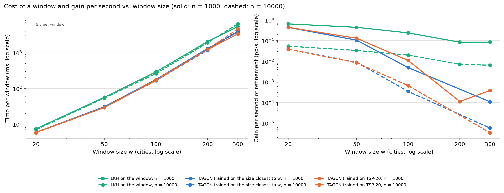
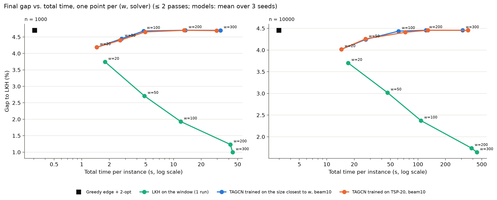

# Phase 3 — window size vs. solver: where does the model pay off against LKH?

Generated by `scripts/phase3_wsize_report.py` on 2026-10-22 (results from commit(s) cf8b1d7).

## Three lines

1. **LKH stops being cheap at w = 200.**
   - **Time per window grows about as w²:** 7 ms (w = 20), 55 ms (50), 260–290 ms (100), 1.9–2.1 s (200) and 5.5–6.5 s (300). At w = 300, LKH was therefore limited to 1 pass.
   - **Gain per second falls with every step of w:**
     - n = 1000: 0.65 → 0.44 → 0.24 → 0.08 → 0.09 pp/s;
     - n = 10000: 0.054 → 0.033 → 0.020 → 0.007 → 0.006 pp/s.
   - **Up to w = 100 the extra time still pays well:**
     - n = 1000: 4.70 % → 3.74 / 2.71 / 1.93 % in 1.8 / 4.8 / 12 s;
     - n = 10000: 3.70 / 3.02 / 2.37 % in 17 / 46 / 108 s.
   - **From w = 200 on the extra gain is small and expensive:** 1.93 → 1.23 % for 3.5 times the time at n = 1000; 2.37 → 1.74 % for 3.6 times at n = 10000. Per second it is 8–9 times less efficient than w = 20 (7.6–9.0 times).
2. **Training the model at the window size does not help: it catches 54–58 % of LKH's gain only at w = 20, 13–15 % at w = 50 and 0–2 % from w = 100 on.**
   - **TSP-50 model at w = 50:** gains 0.26 / 0.21 pp (n = 1000 / 10000), the same as the TSP-20 model (0.31 / 0.20 pp; n.s.).
   - **TSP-100 model at w = 100–300:** gains 0.00–0.02 pp, and is never better than the baseline (n.s.).
   - **Why this is not a weaker model:** the TSP-100 model is the best of the three on whole TSP-100 instances (3.7–3.8 % with 2-opt, against 4.0–4.3 % for TSP-20). As a window improver it still fails.
   - **Likely reason:** a window cut from a 2-opt tour is already within a few % of its best path. A beam path from the model is about 13 % from optimal before 2-opt, so it almost never comes out shorter.
3. **There is no w where the model beats LKH in gain per second.**
   - **Best case for the model (w = 20):** 0.44 against 0.65 pp/s at n = 1000, and 0.038 against 0.054 at n = 10000, about 0.7 times LKH.
   - **From w = 100 on:** the model gains about 0 pp/s, while LKH still gains 0.24 / 0.02 pp/s.
   - **Cost:** a beam window costs 52–81 % of an LKH window at every w (the network is under 1 % of it), so the model is never much cheaper and gains much less.
   - **Best use of the time:** for the same time, LKH on larger windows always gives a lower gap. For example, at n = 1000, LKH with w = 50 reaches 2.71 % in 4.8 s, while the model with w = 50 reaches 4.40 % in 2.6 s.

## Setup

- **Tour and windows:** greedy edge + 2-opt tour (the baseline of the scale experiment), refined with windows of w = 20, 50, 100, 200, 300 consecutive tour cities (ends fixed, replaced only if shorter, step w/2), at most 2 passes; a pass runs only if the previous one improved the tour.
- **Solvers on a window:**
  - LKH with 1 run (a dummy city joined only to the two ends gives the best path between them);
  - TAGCN K=3 (best.pt by validation gap, seeds 0–2), beam B = 10 paths: the model trained on TSP-20 at every w, and the model trained on the size closest to w (w = 50: TSP-50; w ≥ 100: TSP-100).
- **New models:** TSP-50 (data/tsp50_train, 12000 instances) and TSP-100 (data/tsp100_train, 12000 instances, seed 19; validation 500, seed 20), phase 1 protocol (20 epochs, Adam 1e-3 with cosine decay, batch 64, hidden 64, 2 layers) with k = 0.5 n (`--k-frac 0.5`), the k = round(0.5 m) the windows use. For TSP-20 this is the k = 10 of phase 1.
- **LKH time limit:** if the first pass of LKH on the first instance of a set takes more than 5 s per window, that width gets 1 pass on every instance of the set. Applied to: n = 1000, w = 300, n = 10000, w = 300.
- **Time** = initial tour + refinement (network on the shared T4 GPU, beam decoding in single-thread Python, LKH single-thread), per instance. Gain per second = gain (pp) / refinement time (s). Up to 8 jobs shared 8 cores, so absolute times include some contention; all solvers ran under the same conditions.

## 1. The new models

TSP-20 models: their phase 1 run (selected epoch, validation gap) and k = 0.5 n evaluation on TSP-50/100.

| Training set | Seed | Best epoch | Val gap (greedy) | TSP-50 test greedy / + 2-opt | TSP-100 test greedy / + 2-opt |
|---|---|---|---|---|---|
| TSP-20 | 0 | 12 | 6.42 | 10.62 / 3.31 | 12.29 / 4.24 |
| TSP-20 | 1 | 1 | 5.69 | 9.13 / 2.93 | 10.83 / 4.03 |
| TSP-20 | 2 | 4 | 6.19 | 10.28 / 3.25 | 11.86 / 4.26 |
| TSP-50 | 0 | 1 | 9.49 | 9.71 / 2.92 | 11.11 / 3.79 |
| TSP-50 | 1 | 1 | 10.66 | 10.15 / 2.90 | 11.43 / 3.65 |
| TSP-50 | 2 | 10 | 11.10 | 11.41 / 3.01 | 12.39 / 3.76 |
| TSP-100 | 0 | 5 | 13.37 | 12.69 / 2.96 | 13.28 / 3.83 |
| TSP-100 | 1 | 3 | 13.35 | 12.62 / 3.05 | 13.18 / 3.84 |
| TSP-100 | 2 | 1 | 13.51 | 12.72 / 3.26 | 13.34 / 3.67 |

## 2. Cost of a window

Milliseconds per window (refinement time / windows solved), mean ± std over seeds; network = the model's share inside the matched beam.

| w | n = 1000: LKH | n = 1000: beam (TSP-20) | n = 1000: beam (matched) | n = 1000: network | n = 10000: LKH | n = 10000: beam (TSP-20) | n = 10000: beam (matched) | n = 10000: network |
|---|---|---|---|---|---|---|---|---|
| 20 | 7.4 | 5.9 ± 0.2 | 5.9 ± 0.2 | 0.39 ± 0.01 | 7.0 | 5.7 ± 0.3 | 5.7 ± 0.3 | 0.19 ± 0.03 |
| 50 | 56.3 | 29.2 ± 0.5 | 30.7 ± 2.0 | 0.79 ± 0.28 | 53.8 | 29.4 ± 0.5 | 29.7 ± 0.1 | 0.67 ± 0.26 |
| 100 | 291.8 | 169.2 ± 1.7 | 178.2 ± 7.9 | 2.35 ± 0.63 | 262.0 | 174.3 ± 8.7 | 165.6 ± 11.7 | 1.41 ± 0.35 |
| 200 | 2069.0 | 1240.8 ± 33.1 | 1320.4 ± 67.3 | 10.06 ± 4.20 | 1916.9 | 1252.6 ± 34.5 | 1197.0 ± 145.9 | 5.81 ± 2.97 |
| 300 | 5463.9 | 3382.1 ± 117.0 | 3826.9 ± 385.5 | 17.11 ± 7.10 | 6462.2 | 4651.3 ± 105.3 | 4102.0 ± 621.0 | 10.15 ± 2.86 |

## 3. Gain and time per (w, solver)

### n = 1000

| w | Solver | Model trained on | Gap (%) | Gain (pp) | Share of LKH's gain | Total time (s) | ms per window | Gain per second (pp/s) | Windows improved | Passes |
|---|---|---|---|---|---|---|---|---|---|---|
| — | Greedy edge + 2-opt (initial tour) | — | 4.70 | — | — | 0.31 | — | — | — | — |
| 20 | LKH on the window (1 run) | — | 3.74 | 0.96 | — | 1.8 | 7.4 | 0.648 | 11.0 % | 2.0 |
| 20 | TAGCN trained on TSP-20 | TSP-20 | 4.19 ± 0.03 | 0.52 ± 0.03 | 54 % | 1.5 ± 0.1 | 5.9 ± 0.2 | 0.439 ± 0.023 | 6.0 ± 0.3 % | 2.0 ± 0.0 |
| 50 | LKH on the window (1 run) | — | 2.71 | 2.00 | — | 4.8 | 56.3 | 0.443 | 30.6 % | 2.0 |
| 50 | TAGCN | TSP-50 | 4.45 ± 0.04 | 0.26 ± 0.04 | 13 % | 2.7 ± 0.2 | 30.7 ± 2.0 | 0.106 ± 0.009 | 4.8 ± 0.4 % | 2.0 ± 0.0 |
| 50 | TAGCN trained on TSP-20 | TSP-20 | 4.40 ± 0.08 | 0.31 ± 0.08 | 15 % | 2.6 ± 0.1 | 29.2 ± 0.5 | 0.131 ± 0.036 | 5.2 ± 0.6 % | 2.0 ± 0.0 |
| 100 | LKH on the window (1 run) | — | 1.93 | 2.77 | — | 12.0 | 291.8 | 0.238 | 42.6 % | 2.0 |
| 100 | TAGCN | TSP-100 | 4.68 ± 0.01 | 0.02 ± 0.01 | 1 % | 4.7 ± 0.5 | 178.2 ± 7.9 | 0.005 ± 0.002 | 1.1 ± 0.7 % | 1.2 ± 0.1 |
| 100 | TAGCN trained on TSP-20 | TSP-20 | 4.65 ± 0.03 | 0.05 ± 0.03 | 2 % | 4.9 ± 0.0 | 169.2 ± 1.7 | 0.011 ± 0.007 | 1.9 ± 1.0 % | 1.4 ± 0.0 |
| 200 | LKH on the window (1 run) | — | 1.23 | 3.47 | — | 41.7 | 2069.0 | 0.084 | 52.0 % | 2.0 |
| 200 | TAGCN | TSP-100 | 4.70 ± 0.00 | 0.00 ± 0.00 | 0 % | 13.5 ± 0.7 | 1320.4 ± 67.3 | 0.000 ± 0.000 | 0.0 ± 0.0 % | 1.0 ± 0.0 |
| 200 | TAGCN trained on TSP-20 | TSP-20 | 4.70 ± 0.00 | 0.00 ± 0.00 | 0 % | 13.1 ± 0.4 | 1240.8 ± 33.1 | 0.000 ± 0.000 | 0.3 ± 0.5 % | 1.0 ± 0.1 |
| 300 | LKH on the window (1 run) | — | 1.00 | 3.71 | — | 44.0 | 5463.9 | 0.085 | 83.1 % | 1.0 (1 pass: LKH > 5 s per window) |
| 300 | TAGCN | TSP-100 | 4.70 ± 0.00 | 0.00 ± 0.00 | 0 % | 32.5 ± 4.4 | 3826.9 ± 385.5 | 0.000 ± 0.000 | 0.6 ± 0.6 % | 1.1 ± 0.1 |
| 300 | TAGCN trained on TSP-20 | TSP-20 | 4.69 ± 0.01 | 0.01 ± 0.01 | 0 % | 29.6 ± 0.9 | 3382.1 ± 117.0 | 0.000 ± 0.000 | 1.0 ± 0.3 % | 1.1 ± 0.0 |

### n = 10000

| w | Solver | Model trained on | Gap (%) | Gain (pp) | Share of LKH's gain | Total time (s) | ms per window | Gain per second (pp/s) | Windows improved | Passes |
|---|---|---|---|---|---|---|---|---|---|---|
| — | Greedy edge + 2-opt (initial tour) | — | 4.46 | — | — | 2.97 | — | — | — | — |
| 20 | LKH on the window (1 run) | — | 3.70 | 0.76 | — | 17.2 | 7.0 | 0.054 | 8.8 % | 2.0 |
| 20 | TAGCN trained on TSP-20 | TSP-20 | 4.02 ± 0.03 | 0.44 ± 0.03 | 58 % | 14.5 ± 0.8 | 5.7 ± 0.3 | 0.038 ± 0.004 | 5.1 ± 0.4 % | 2.0 ± 0.0 |
| 50 | LKH on the window (1 run) | — | 3.02 | 1.44 | — | 46.3 | 53.8 | 0.033 | 25.0 % | 2.0 |
| 50 | TAGCN | TSP-50 | 4.24 ± 0.02 | 0.21 ± 0.02 | 15 % | 26.7 ± 0.1 | 29.7 ± 0.1 | 0.009 ± 0.001 | 4.3 ± 0.2 % | 2.0 ± 0.0 |
| 50 | TAGCN trained on TSP-20 | TSP-20 | 4.26 ± 0.06 | 0.20 ± 0.06 | 14 % | 26.5 ± 0.7 | 29.4 ± 0.5 | 0.008 ± 0.003 | 4.2 ± 1.0 % | 2.0 ± 0.0 |
| 100 | LKH on the window (1 run) | — | 2.37 | 2.08 | — | 108.0 | 262.0 | 0.020 | 37.3 % | 2.0 |
| 100 | TAGCN | TSP-100 | 4.44 ± 0.01 | 0.02 ± 0.01 | 1 % | 61.3 ± 2.6 | 165.6 ± 11.7 | 0.000 ± 0.000 | 0.7 ± 0.4 % | 1.8 ± 0.2 |
| 100 | TAGCN trained on TSP-20 | TSP-20 | 4.41 ± 0.02 | 0.05 ± 0.02 | 2 % | 72.7 ± 3.8 | 174.3 ± 8.7 | 0.001 ± 0.000 | 1.2 ± 0.6 % | 2.0 ± 0.0 |
| 200 | LKH on the window (1 run) | — | 1.74 | 2.72 | — | 386.6 | 1916.9 | 0.007 | 45.5 % | 2.0 |
| 200 | TAGCN | TSP-100 | 4.46 ± 0.00 | 0.00 ± 0.00 | 0 % | 122.4 ± 14.8 | 1197.0 ± 145.9 | 0.000 ± 0.000 | 0.0 ± 0.0 % | 1.0 ± 0.0 |
| 200 | TAGCN trained on TSP-20 | TSP-20 | 4.46 ± 0.00 | 0.00 ± 0.00 | 0 % | 128.3 ± 3.7 | 1252.6 ± 34.5 | 0.000 ± 0.000 | 0.0 ± 0.0 % | 1.0 ± 0.0 |
| 300 | LKH on the window (1 run) | — | 1.64 | 2.81 | — | 442.6 | 6462.2 | 0.006 | 86.8 % | 1.0 (1 pass: LKH > 5 s per window) |
| 300 | TAGCN | TSP-100 | 4.45 ± 0.00 | 0.00 ± 0.00 | 0 % | 309.0 ± 36.2 | 4102.0 ± 621.0 | 0.000 ± 0.000 | 0.1 ± 0.2 % | 1.1 ± 0.2 |
| 300 | TAGCN trained on TSP-20 | TSP-20 | 4.46 ± 0.00 | 0.00 ± 0.00 | 0 % | 353.6 ± 52.7 | 4651.3 ± 105.3 | 0.000 ± 0.000 | 0.1 ± 0.2 % | 1.1 ± 0.2 |

Mean ± std over the 3 seeds (LKH and the initial tour have no seed). Share of LKH's gain: same w, means.

## 4. Paired tests (n = 1000, 20 instances)

| n | w | Comparison | Verdict | Mean difference (pp) | Largest p |
|---|---|---|---|---|---|
| 1000 | 20 | LKH vs. greedy edge + 2-opt | **better** | -0.96 | 1.9e-06 |
| 1000 | 20 | TSP-20 model vs. greedy edge + 2-opt | **better** | -0.52 | 1.9e-06 |
| 1000 | 20 | TSP-20 model vs. LKH | **worse** | +0.44 | 1.9e-06 |
| 1000 | 50 | LKH vs. greedy edge + 2-opt | **better** | -2.00 | 1.9e-06 |
| 1000 | 50 | TSP-20 model vs. greedy edge + 2-opt | **better** | -0.31 | 1.9e-06 |
| 1000 | 50 | TSP-20 model vs. LKH | **worse** | +1.69 | 1.9e-06 |
| 1000 | 50 | matched model vs. greedy edge + 2-opt | **better** | -0.26 | 3.8e-06 |
| 1000 | 50 | matched model vs. TSP-20 model | n.s. | +0.05 | 8.4e-01 |
| 1000 | 50 | matched model vs. LKH | **worse** | +1.74 | 1.9e-06 |
| 1000 | 100 | LKH vs. greedy edge + 2-opt | **better** | -2.77 | 1.9e-06 |
| 1000 | 100 | TSP-20 model vs. greedy edge + 2-opt | n.s. | -0.05 | 1.6e-02 |
| 1000 | 100 | TSP-20 model vs. LKH | **worse** | +2.72 | 1.9e-06 |
| 1000 | 100 | matched model vs. greedy edge + 2-opt | n.s. | -0.02 | 2.5e-01 |
| 1000 | 100 | matched model vs. TSP-20 model | n.s. | +0.03 | 1.0e+00 |
| 1000 | 100 | matched model vs. LKH | **worse** | +2.75 | 1.9e-06 |
| 1000 | 200 | LKH vs. greedy edge + 2-opt | **better** | -3.47 | 1.9e-06 |
| 1000 | 200 | TSP-20 model vs. greedy edge + 2-opt | n.s. | -0.00 | 1.0e+00 |
| 1000 | 200 | TSP-20 model vs. LKH | **worse** | +3.47 | 1.9e-06 |
| 1000 | 200 | matched model vs. greedy edge + 2-opt | n.s. | +0.00 | 1.0e+00 |
| 1000 | 200 | matched model vs. TSP-20 model | n.s. | +0.00 | 1.0e+00 |
| 1000 | 200 | matched model vs. LKH | **worse** | +3.47 | 1.9e-06 |
| 1000 | 300 | LKH vs. greedy edge + 2-opt | **better** | -3.71 | 1.9e-06 |
| 1000 | 300 | TSP-20 model vs. greedy edge + 2-opt | n.s. | -0.01 | 1.0e+00 |
| 1000 | 300 | TSP-20 model vs. LKH | **worse** | +3.70 | 1.9e-06 |
| 1000 | 300 | matched model vs. greedy edge + 2-opt | n.s. | -0.00 | 1.0e+00 |
| 1000 | 300 | matched model vs. TSP-20 model | n.s. | +0.01 | 1.0e+00 |
| 1000 | 300 | matched model vs. LKH | **worse** | +3.70 | 1.9e-06 |

Difference = final gap of the first − the second (negative = first shorter). Model rows: the largest p over the 3 seeds. Bonferroni over the set: n = 1000: 0.05/27 = 0.0019.

## 5. n = 10000 (3 instances, no test)

Mean gap difference (pp) and the instance × seed pairs where the first is shorter.

| n | w | Matched model vs. TSP-20 model | Matched model vs. LKH | TSP-20 model vs. LKH |
|---|---|---|---|---|
| 10000 | 20 | — (w = 20: the matched model is the TSP-20 model) | — (w = 20: the matched model is the TSP-20 model) | +0.32 (0/9 shorter) |
| 10000 | 50 | -0.01 (5/9 shorter) | +1.23 (0/9 shorter) | +1.24 (0/9 shorter) |
| 10000 | 100 | +0.03 (2/9 shorter) | +2.06 (0/9 shorter) | +2.04 (0/9 shorter) |
| 10000 | 200 | +0.00 (0/9 shorter) | +2.72 (0/9 shorter) | +2.72 (0/9 shorter) |
| 10000 | 300 | -0.00 (1/9 shorter) | +2.81 (0/9 shorter) | +2.81 (0/9 shorter) |

## Missing results

None.

---
**Note added 2026-10-27 (phase 3 benchmark, E0).** The references of tsp1000_test and tsp10000_test were recomputed with the stand-alone LKH-3.0.6 binary (1k: RUNS = 10; 10k: RUNS = 5, TIME_LIMIT = 696 s per run): tsp1000_test is unchanged (0.000 %) and tsp10000_test is 0.0003 % shorter on average, so the gaps above stand. Comparison with LKH-3 at equal time and with the literature: `phase3_benchmark_report.md`.
