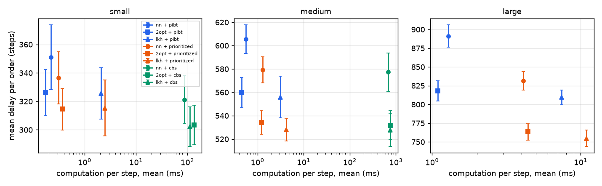
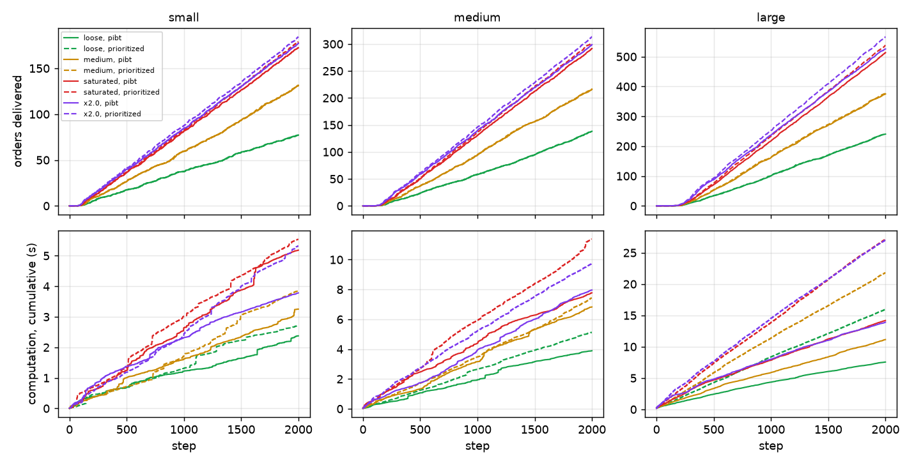
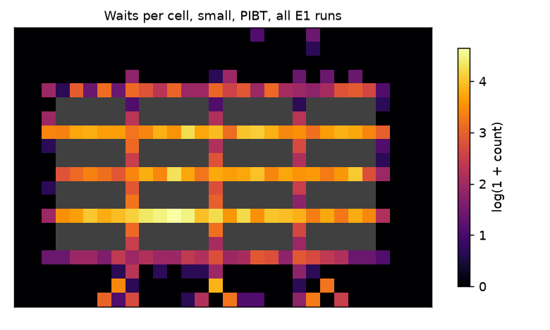
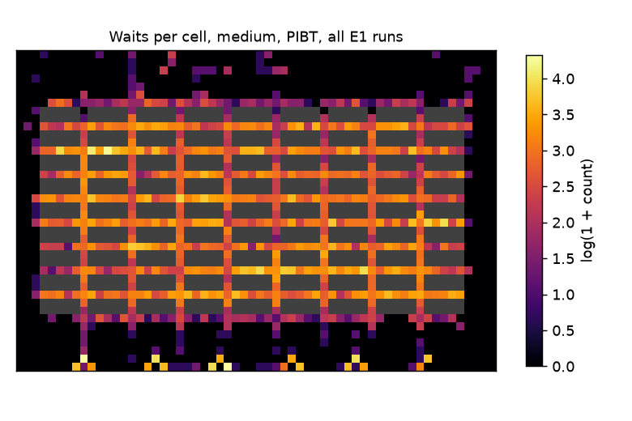
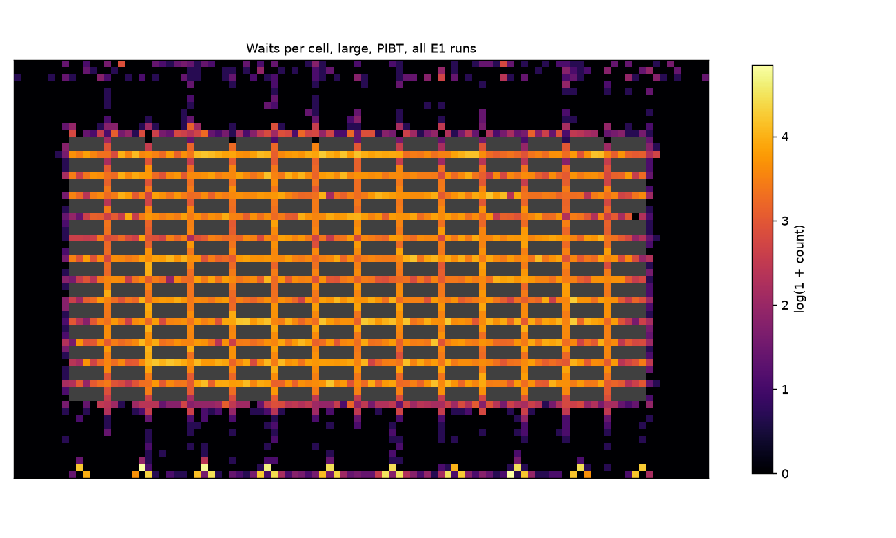
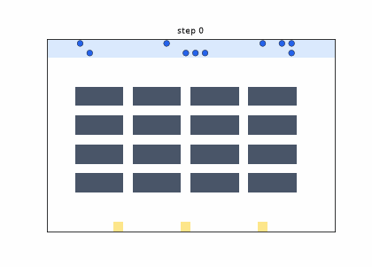

# Warehouse, phase A: simulator and classic baselines

## Conclusion

1. **Does the baseline work?** Yes: all 450 episodes passed the independent verifier with no collision, all 120 E1 lots were delivered in full, and LKH-3 + prioritized sustains 350, 604 and 1131 orders/h on the small, medium and large warehouses.
2. **Do conflicts concentrate?** Only moderately: the hottest 10 % of cells hold 67–99 % of the waits of an episode, but only 10–25 % of the cells see any wait, and the same share of cells chosen on other seeds catches 30–53 %, a little more than the busiest cells by traffic (21–45 %).
3. **What must the GNN predict in phase B?** Where and when the next wait will happen, per (cell, time box) and from the current state, because a static map is a weak predictor, the positive class is rare (0.6–2.2 % of boxes), and the model must beat the traffic map and spend the exact solver only where it pays: CBS gained 4.2 % over prioritized on the small warehouse and nothing on the medium one.

## Design

The grid is 4-connected, in the Kiva style: parking rows on top, blocks of shelves separated by one-cell corridors, and a free bottom row with the stations. Shelves are obstacles. Facing shelves of neighbouring blocks may share an access cell. A step moves a robot one cell or leaves it in place, and counts as one second. Service takes 3 steps at a shelf and at a station. Vertex and edge conflicts are forbidden.

An order has 3 to 12 products, each stored on one shelf, and goes to one station. The batch mode gives K orders at time 0; the lifelong mode draws Poisson arrivals. The number of products is twice the number of shelves.

The simulator has two layers. Layer 1 chooses the robot and the visit order; layer 2 moves the robots.

- **Assignment:** the free robot closest to any shelf of the order takes the oldest waiting order. The rule is simple on purpose and is the first thing to improve.
- **Visit order:** a TSP with fixed ends, solved by nearest neighbour (NN), NN + 2-opt, or LKH-3 on an explicit matrix with a dummy city. Orders with fewer than 4 stops are solved exactly by Held-Karp when LKH-3 is asked for.
- **PIBT:** one step at a time, with priority by age. Robots in service stay fixed.
- **Prioritized planning:** space-time A* in a rolling window, 20 steps planned and 5 executed, up to 3 retries with a new order of robots, then PIBT.
- **Windowed CBS:** exact on the next goal of every robot, with conflicts counted over 8 steps and 3 executed. Each call has a 30 s limit. A time-out hands 10 steps to PIBT, and 900 s per episode ends the use of CBS. It ran on small and medium only.

`verify.py` shares no code with the simulator. It reads the saved trajectory and events, and checks collisions, moves, picks, service times, deliveries and overlapping orders. Its tests alter episodes by hand and confirm that each violation is caught.

`pogema` was left out: it requires numpy 1.26 or older and pydantic 1.9 or older, and the project has numpy 2.5.

| size | rows x cols | corridor | free cells | shelves | stations | robots | K (E1) | products |
|---|---|---|---|---|---|---|---|---|
| small | 20 x 30 | 1 | 440 | 160 | 3 | 10 | 50 | 320 |
| medium | 40 x 60 | 1 | 1590 | 810 | 6 | 30 | 150 | 1620 |
| large | 60 x 100 | 1 | 4180 | 1820 | 10 | 80 | 400 | 3640 |

## Layer 1: visit order

Gaps are against LKH-3 on the same 200 orders. Lengths are shortest paths on the empty grid. 2-opt is nearly optimal at this size (1.6–1.7 % gap, optimal on 68–72 % of orders) because an order has only 7.6 stops on average. LKH-3 costs 11–16 ms per order, 150 to 200 times more than 2-opt. The per-order figures are measured here and are not comparable with the literature on long tours.

| size | orders | stops, mean (min–max) | NN gap %, mean / p95 | 2-opt gap %, mean / p95 | NN optimal % | 2-opt optimal % | NN µs | 2-opt µs | LKH-3 ms, mean / p95 |
|---|---|---|---|---|---|---|---|---|---|
| small | 200 | 7.5 (3–12) | 10.9 / 30.5 | 1.69 / 9.0 | 24 | 72 | 41 | 75 | 15.7 / 40.9 |
| medium | 200 | 7.6 (3–12) | 13.0 / 38.4 | 1.59 / 8.1 | 23 | 68 | 42 | 72 | 11.5 / 24.4 |
| large | 200 | 7.6 (3–12) | 12.6 / 34.7 | 1.66 / 8.6 | 17 | 68 | 42 | 75 | 10.9 / 20.8 |

Stops per order (distinct shelves):

| size | 1 | 2 | 3 | 4 | 5 | 6 | 7 | 8 | 9 | 10 | 11 | 12 |
|---|---|---|---|---|---|---|---|---|---|---|---|---|
| small | 0 | 0 | 15 | 19 | 16 | 28 | 30 | 18 | 22 | 17 | 21 | 14 |
| medium | 0 | 0 | 14 | 17 | 18 | 28 | 29 | 15 | 24 | 18 | 16 | 21 |
| large | 0 | 0 | 14 | 16 | 19 | 27 | 30 | 14 | 23 | 18 | 19 | 20 |

## Verifier

All 450 episodes were judged by `verify.py` from the saved trajectory: 450 passed, 0 failed. Collisions (vertex and edge): 0. E1 episodes with every order delivered: 120 of 120. E2 stops at step 2000, so a started order may be unfinished there; those were 9904 over the E2 episodes, and their picks were judged too.

## E1: offline lots

Each row is 5 seeds, mean ± 95 % interval; a seed fixes the warehouse catalogue and the orders, so the comparisons below are paired.

- **Sequence:** NN costs 7–9 % of delay against LKH-3. LKH-3 and 2-opt differ by about 1 % at most, and by nothing measurable on the small warehouse.
- **Planner:** prioritized beats PIBT by 3.2, 5.0 and 6.7 %, at 1.2 to 1.5 times its computation on the LKH-3 rows. On the medium warehouse CBS ties with prioritized (−0.0 %, p = 0.94) at about 180 times the computation; on the small one it gains 4.2 %.
- **CBS at 30 robots:** 23 % of the steps ran under PIBT on average (9–62 % by episode), after 17 time-outs per episode, and 3 of the 15 episodes used the whole 900 s budget. So the medium row is a mix of CBS and PIBT, not exact planning.

How to read the time columns: windowed planners plan only every few steps, so their p50 is close to 0 and the mean is the fair figure. The time includes the sequencing done in that step, which explains the LKH-3 rows. In the three episodes inspected, the slowest step was step 0, when all robots get their first order. Sequencing with LKH-3 goes through a subprocess, and these times were taken with 4 processes running on a shared machine.

| size | sequence | planner | delivered | makespan | sum of completion (k) | mean delay | orders/h | step ms, mean | p50 | p95 | max | steps under PIBT % | CBS time-outs |
|---|---|---|---|---|---|---|---|---|---|---|---|---|---|
| small | nn | pibt | 50/50 | 639 ± 47 | 17.6 ± 1.1 | 351 ± 23 | 283 ± 21 | 0.22 ± 0.09 | 0.16 | 0.3 | 37 | 0.0 | 0.0 |
| small | 2opt | pibt | 50/50 | 592 ± 24 | 16.3 ± 0.8 | 326 ± 16 | 304 ± 13 | 0.17 ± 0.00 | 0.11 | 0.4 | 19 | 0.0 | 0.0 |
| small | lkh | pibt | 50/50 | 599 ± 34 | 16.3 ± 0.9 | 326 ± 18 | 301 ± 17 | 2.09 ± 1.29 | 0.12 | 9.5 | 1463 | 0.0 | 0.0 |
| small | nn | prioritized | 50/50 | 622 ± 49 | 16.8 ± 0.9 | 336 ± 18 | 290 ± 23 | 0.31 ± 0.06 | 0.00 | 1.6 | 14 | 0.0 | 0.0 |
| small | 2opt | prioritized | 50/50 | 572 ± 28 | 15.7 ± 0.7 | 314 ± 15 | 315 ± 15 | 0.37 ± 0.17 | 0.00 | 2.0 | 26 | 0.0 | 0.0 |
| small | lkh | prioritized | 50/50 | 573 ± 37 | 15.8 ± 1.0 | 315 ± 20 | 315 ± 21 | 2.49 ± 0.47 | 0.00 | 9.1 | 867 | 0.0 | 0.0 |
| small | nn | cbs | 50/50 | 592 ± 44 | 16.1 ± 0.8 | 321 ± 17 | 305 ± 23 | 87.00 ± 47.53 | 0.00 | 27.8 | 30762 | 1.7 | 1.0 |
| small | 2opt | cbs | 50/50 | 559 ± 44 | 15.2 ± 0.7 | 303 ± 14 | 323 ± 25 | 136.22 ± 88.55 | 0.00 | 28.3 | 30598 | 2.5 | 1.4 |
| small | lkh | cbs | 50/50 | 554 ± 27 | 15.1 ± 0.7 | 302 ± 14 | 325 ± 16 | 112.48 ± 104.21 | 0.00 | 59.9 | 30671 | 2.2 | 1.2 |
| medium | nn | pibt | 150/150 | 1164 ± 30 | 90.8 ± 1.8 | 606 ± 12 | 464 ± 12 | 0.56 ± 0.12 | 0.24 | 1.3 | 203 | 0.0 | 0.0 |
| medium | 2opt | pibt | 150/150 | 1069 ± 28 | 84.0 ± 1.9 | 560 ± 13 | 505 ± 13 | 0.46 ± 0.16 | 0.19 | 1.4 | 185 | 0.0 | 0.0 |
| medium | lkh | pibt | 150/150 | 1057 ± 28 | 83.4 ± 2.7 | 556 ± 18 | 511 ± 13 | 3.11 ± 0.87 | 0.35 | 14.5 | 1372 | 0.0 | 0.0 |
| medium | nn | prioritized | 150/150 | 1124 ± 21 | 86.9 ± 1.7 | 579 ± 11 | 480 ± 9 | 1.31 ± 0.15 | 0.00 | 7.0 | 196 | 0.0 | 0.0 |
| medium | 2opt | prioritized | 150/150 | 1023 ± 26 | 80.2 ± 1.5 | 534 ± 10 | 528 ± 13 | 1.21 ± 0.20 | 0.00 | 6.4 | 188 | 0.0 | 0.0 |
| medium | lkh | prioritized | 150/150 | 1007 ± 21 | 79.2 ± 1.4 | 528 ± 10 | 536 ± 12 | 4.17 ± 0.81 | 0.00 | 20.0 | 1575 | 0.0 | 0.0 |
| medium | nn | cbs | 150/150 | 1117 ± 36 | 86.6 ± 2.5 | 577 ± 16 | 484 ± 16 | 684.74 ± 93.05 | 0.02 | 654.9 | 30667 | 23.1 | 16.8 |
| medium | 2opt | cbs | 150/150 | 1023 ± 33 | 79.8 ± 1.9 | 532 ± 13 | 528 ± 17 | 749.33 ± 127.72 | 0.02 | 1139.0 | 30754 | 20.6 | 18.0 |
| medium | lkh | cbs | 150/150 | 1008 ± 28 | 79.2 ± 2.2 | 528 ± 14 | 536 ± 15 | 756.00 ± 120.67 | 0.04 | 1094.2 | 30833 | 23.9 | 17.4 |
| large | nn | pibt | 400/400 | 1733 ± 33 | 356.5 ± 6.0 | 891 ± 15 | 831 ± 16 | 1.29 ± 0.19 | 0.42 | 3.0 | 1052 | 0.0 | 0.0 |
| large | 2opt | pibt | 400/400 | 1567 ± 47 | 327.2 ± 5.5 | 818 ± 14 | 920 ± 28 | 1.09 ± 0.07 | 0.39 | 2.7 | 604 | 0.0 | 0.0 |
| large | lkh | pibt | 400/400 | 1539 ± 34 | 323.8 ± 3.9 | 809 ± 10 | 936 ± 21 | 7.44 ± 2.39 | 0.93 | 26.2 | 3088 | 0.0 | 0.0 |
| large | nn | prioritized | 400/400 | 1640 ± 35 | 332.6 ± 5.0 | 831 ± 12 | 878 ± 19 | 4.10 ± 0.32 | 0.00 | 19.5 | 883 | 0.0 | 0.0 |
| large | 2opt | prioritized | 400/400 | 1472 ± 35 | 305.4 ± 4.4 | 763 ± 11 | 978 ± 24 | 4.42 ± 0.55 | 0.00 | 21.4 | 1062 | 0.0 | 0.0 |
| large | lkh | prioritized | 400/400 | 1451 ± 39 | 301.9 ± 4.4 | 755 ± 11 | 993 ± 27 | 10.93 ± 0.26 | 0.00 | 64.4 | 1836 | 0.0 | 0.0 |

| size | from | to | delay change % | p (paired t, 5 seeds) |
|---|---|---|---|---|
| small | nn + pibt | lkh + pibt | -7.2 | 0.000206 |
| small | 2opt + pibt | lkh + pibt | -0.2 | 0.83 |
| small | 2opt + prioritized | lkh + prioritized | +0.3 | 0.704 |
| small | lkh + pibt | lkh + prioritized | -3.2 | 0.000942 |
| small | lkh + prioritized | lkh + cbs | -4.2 | 0.0044 |
| medium | nn + pibt | lkh + pibt | -8.2 | 0.000265 |
| medium | 2opt + pibt | lkh + pibt | -0.7 | 0.248 |
| medium | 2opt + prioritized | lkh + prioritized | -1.2 | 0.00969 |
| medium | lkh + pibt | lkh + prioritized | -5.0 | 0.00115 |
| medium | lkh + prioritized | lkh + cbs | -0.0 | 0.941 |
| large | nn + pibt | lkh + pibt | -9.2 | 7.06e-06 |
| large | 2opt + pibt | lkh + pibt | -1.0 | 0.0922 |
| large | 2opt + prioritized | lkh + prioritized | -1.1 | 0.00019 |
| large | lkh + pibt | lkh + prioritized | -6.7 | 1.92e-06 |

## E2: lifelong

Sequencing is LKH-3 throughout. Rates are multiples of the E1 throughput of LKH-3 + PIBT. The three requested rates are loose (0.5), medium (0.8) and saturated (1.2).

The rule fixed before the run was that a method keeps up if the backlog grows, over the second half, at less than 5 % of the arrival rate. The first run did not reach the breaking point on the large warehouse, so the sweep was extended to 1.3, 1.4, 1.5, 1.7 and 2.0 and all of E2 was repeated. "Saturated" is therefore only a name: it does not saturate the large warehouse.

The rule is noisy at low rates: Poisson arrivals alone give about 12 % of the rate per run at 0.067 orders per step. That explains the isolated failures at 0.8 and 0.9 on the small warehouse, where the backlog stays near 9 orders. The table of limits therefore gives the first rate that fails together with every higher one. This reading was added after seeing the data.

The real limit is above the E1 throughput, because a lot ends with a tail in which few robots are busy. The clean measure of capacity is the throughput at 2.0 x, in the second half of the episode, when the queue never empties. PIBT stops keeping up at 1.2–1.3 x and prioritized at 1.2–1.4 x. Prioritized delivers 5–9 % more at saturation. Backlog at the end includes the orders in progress, up to one per robot.

| size | rate name | arrivals per step | planner | arrived | delivered | orders/h | backlog at the end | backlog slope, % of the rate | mean delay of the delivered | step ms, mean | p95 | max | keeps up |
|---|---|---|---|---|---|---|---|---|---|---|---|---|---|
| small | loose | 0.042 | pibt | 82 | 77 ± 8 | 139 ± 15 | 5 ± 3 | 0 | 95 ± 4 | 1.19 ± 0.37 | 0.4 | 840 | yes |
| small | loose | 0.042 | prioritized | 82 | 77 ± 9 | 139 ± 15 | 5 ± 3 | -0 | 95 ± 4 | 1.36 ± 1.36 | 2.2 | 1012 | yes |
| small | medium | 0.067 | pibt | 140 | 131 ± 3 | 237 ± 6 | 9 ± 6 | 7 | 107 ± 5 | 1.63 ± 0.50 | 10.7 | 508 | no |
| small | medium | 0.067 | prioritized | 140 | 131 ± 4 | 237 ± 7 | 9 ± 5 | 6 | 105 ± 4 | 1.92 ± 1.06 | 8.1 | 949 | no |
| small | x0.9 | 0.075 | pibt | 156 | 147 ± 4 | 265 ± 7 | 9 ± 4 | 5 | 119 ± 11 | 1.93 ± 0.21 | 13.4 | 819 | no |
| small | x0.9 | 0.075 | prioritized | 156 | 148 ± 5 | 266 ± 9 | 8 ± 3 | 4 | 115 ± 10 | 2.22 ± 0.83 | 10.9 | 590 | yes |
| small | x1.0 | 0.084 | pibt | 173 | 158 ± 3 | 285 ± 6 | 15 ± 3 | 2 | 137 ± 16 | 2.49 ± 2.12 | 13.0 | 960 | yes |
| small | x1.0 | 0.084 | prioritized | 173 | 161 ± 5 | 290 ± 9 | 12 ± 2 | 0 | 128 ± 14 | 2.24 ± 0.52 | 12.2 | 819 | yes |
| small | x1.1 | 0.092 | pibt | 191 | 169 ± 6 | 305 ± 10 | 21 ± 8 | 5 | 167 ± 18 | 2.72 ± 1.65 | 15.1 | 1023 | yes |
| small | x1.1 | 0.092 | prioritized | 191 | 173 ± 4 | 311 ± 7 | 18 ± 5 | 2 | 148 ± 20 | 2.66 ± 1.15 | 12.7 | 989 | yes |
| small | saturated | 0.100 | pibt | 208 | 172 ± 4 | 310 ± 7 | 36 ± 7 | 13 | 212 ± 11 | 2.59 ± 1.10 | 13.7 | 1023 | no |
| small | saturated | 0.100 | prioritized | 208 | 179 ± 4 | 322 ± 7 | 29 ± 8 | 8 | 187 ± 15 | 2.77 ± 1.42 | 14.6 | 1019 | no |
| small | x1.3 | 0.109 | pibt | 229 | 176 ± 2 | 316 ± 4 | 53 ± 8 | 19 | 257 ± 11 | 1.96 ± 0.57 | 13.4 | 917 | no |
| small | x1.3 | 0.109 | prioritized | 229 | 182 ± 2 | 328 ± 3 | 47 ± 6 | 16 | 235 ± 12 | 2.66 ± 0.92 | 12.5 | 1009 | no |
| small | x1.4 | 0.117 | pibt | 246 | 176 ± 3 | 317 ± 6 | 70 ± 11 | 26 | 310 ± 5 | 3.01 ± 2.27 | 14.1 | 1027 | no |
| small | x1.4 | 0.117 | prioritized | 246 | 184 ± 3 | 330 ± 5 | 63 ± 13 | 23 | 284 ± 15 | 2.95 ± 1.90 | 14.0 | 967 | no |
| small | x1.5 | 0.125 | pibt | 261 | 178 ± 2 | 321 ± 3 | 83 ± 10 | 32 | 354 ± 18 | 2.41 ± 1.14 | 14.8 | 1020 | no |
| small | x1.5 | 0.125 | prioritized | 261 | 184 ± 1 | 331 ± 2 | 77 ± 11 | 29 | 334 ± 12 | 2.85 ± 1.95 | 13.1 | 1400 | no |
| small | x1.7 | 0.142 | pibt | 294 | 176 ± 4 | 316 ± 7 | 118 ± 17 | 39 | 433 ± 12 | 2.15 ± 0.24 | 15.5 | 858 | no |
| small | x1.7 | 0.142 | prioritized | 294 | 185 ± 2 | 333 ± 4 | 109 ± 18 | 36 | 416 ± 18 | 3.32 ± 2.08 | 14.9 | 2140 | no |
| small | x2.0 | 0.167 | pibt | 346 | 177 ± 2 | 319 ± 4 | 169 ± 21 | 46 | 524 ± 6 | 1.89 ± 0.93 | 12.1 | 750 | no |
| small | x2.0 | 0.167 | prioritized | 346 | 184 ± 2 | 332 ± 4 | 162 ± 23 | 44 | 505 ± 6 | 2.66 ± 0.94 | 13.5 | 976 | no |
| medium | loose | 0.071 | pibt | 148 | 138 ± 8 | 249 ± 14 | 10 ± 2 | 2 | 165 ± 3 | 1.95 ± 0.56 | 11.2 | 782 | yes |
| medium | loose | 0.071 | prioritized | 148 | 138 ± 8 | 249 ± 14 | 10 ± 2 | 2 | 164 ± 3 | 2.56 ± 0.31 | 14.5 | 703 | yes |
| medium | medium | 0.114 | pibt | 240 | 216 ± 7 | 389 ± 13 | 23 ± 4 | 0 | 170 ± 2 | 3.41 ± 1.49 | 17.9 | 869 | yes |
| medium | medium | 0.114 | prioritized | 240 | 216 ± 8 | 390 ± 14 | 23 ± 4 | 0 | 165 ± 2 | 3.71 ± 0.41 | 20.6 | 582 | yes |
| medium | x0.9 | 0.128 | pibt | 264 | 245 ± 9 | 441 ± 16 | 19 ± 5 | -1 | 175 ± 3 | 3.34 ± 0.52 | 15.9 | 728 | yes |
| medium | x0.9 | 0.128 | prioritized | 264 | 246 ± 9 | 442 ± 17 | 19 ± 5 | -0 | 169 ± 2 | 4.24 ± 1.15 | 22.3 | 978 | yes |
| medium | x1.0 | 0.142 | pibt | 293 | 268 ± 7 | 483 ± 13 | 25 ± 10 | -2 | 184 ± 5 | 3.77 ± 1.44 | 19.5 | 1019 | yes |
| medium | x1.0 | 0.142 | prioritized | 293 | 269 ± 6 | 485 ± 12 | 24 ± 11 | -2 | 174 ± 4 | 4.34 ± 0.79 | 22.6 | 546 | yes |
| medium | x1.1 | 0.156 | pibt | 321 | 284 ± 5 | 511 ± 9 | 37 ± 17 | 1 | 211 ± 20 | 4.30 ± 2.03 | 20.7 | 1026 | yes |
| medium | x1.1 | 0.156 | prioritized | 321 | 291 ± 9 | 524 ± 15 | 30 ± 13 | -2 | 192 ± 13 | 4.80 ± 1.64 | 25.5 | 1026 | yes |
| medium | saturated | 0.170 | pibt | 351 | 292 ± 5 | 525 ± 8 | 60 ± 25 | 7 | 260 ± 19 | 3.89 ± 1.57 | 18.3 | 771 | no |
| medium | saturated | 0.170 | prioritized | 351 | 302 ± 6 | 544 ± 11 | 49 ± 26 | 3 | 226 ± 22 | 5.68 ± 2.51 | 27.7 | 1330 | yes |
| medium | x1.3 | 0.185 | pibt | 380 | 295 ± 6 | 531 ± 10 | 84 ± 26 | 15 | 310 ± 14 | 3.39 ± 0.91 | 17.2 | 784 | no |
| medium | x1.3 | 0.185 | prioritized | 380 | 306 ± 5 | 551 ± 8 | 73 ± 24 | 11 | 278 ± 17 | 5.50 ± 2.45 | 27.2 | 1012 | no |
| medium | x1.4 | 0.199 | pibt | 407 | 295 ± 2 | 532 ± 4 | 112 ± 27 | 21 | 357 ± 9 | 4.62 ± 1.94 | 20.2 | 1046 | no |
| medium | x1.4 | 0.199 | prioritized | 407 | 308 ± 4 | 554 ± 6 | 99 ± 27 | 16 | 327 ± 15 | 5.77 ± 3.53 | 27.8 | 1344 | no |
| medium | x1.5 | 0.213 | pibt | 435 | 295 ± 4 | 531 ± 7 | 140 ± 31 | 26 | 399 ± 12 | 3.60 ± 0.72 | 18.8 | 853 | no |
| medium | x1.5 | 0.213 | prioritized | 435 | 309 ± 5 | 557 ± 9 | 126 ± 30 | 22 | 368 ± 15 | 5.37 ± 1.25 | 27.1 | 1117 | no |
| medium | x1.7 | 0.241 | pibt | 492 | 297 ± 4 | 534 ± 8 | 196 ± 29 | 34 | 478 ± 10 | 5.17 ± 2.13 | 25.6 | 1138 | no |
| medium | x1.7 | 0.241 | prioritized | 492 | 312 ± 3 | 562 ± 5 | 180 ± 29 | 31 | 446 ± 12 | 5.43 ± 2.48 | 27.4 | 1175 | no |
| medium | x2.0 | 0.284 | pibt | 572 | 299 ± 3 | 538 ± 5 | 273 ± 25 | 43 | 557 ± 14 | 3.98 ± 0.72 | 22.8 | 1053 | no |
| medium | x2.0 | 0.284 | prioritized | 572 | 313 ± 4 | 564 ± 7 | 258 ± 25 | 40 | 535 ± 14 | 4.87 ± 0.89 | 27.7 | 237 | no |
| large | loose | 0.130 | pibt | 268 | 240 ± 8 | 433 ± 14 | 28 ± 5 | -0 | 235 ± 6 | 3.78 ± 0.41 | 22.5 | 250 | yes |
| large | loose | 0.130 | prioritized | 268 | 241 ± 8 | 434 ± 14 | 27 ± 5 | 0 | 230 ± 5 | 7.98 ± 0.19 | 48.0 | 287 | yes |
| large | medium | 0.208 | pibt | 427 | 375 ± 27 | 675 ± 48 | 52 ± 9 | -1 | 244 ± 7 | 5.57 ± 0.88 | 27.2 | 325 | yes |
| large | medium | 0.208 | prioritized | 427 | 377 ± 26 | 678 ± 47 | 50 ± 9 | -1 | 234 ± 6 | 10.90 ± 0.86 | 63.3 | 428 | yes |
| large | x0.9 | 0.234 | pibt | 477 | 420 ± 30 | 755 ± 54 | 57 ± 7 | -1 | 247 ± 8 | 6.16 ± 0.87 | 28.7 | 616 | yes |
| large | x0.9 | 0.234 | prioritized | 477 | 423 ± 30 | 762 ± 54 | 53 ± 9 | -1 | 236 ± 6 | 11.59 ± 0.99 | 69.1 | 721 | yes |
| large | x1.0 | 0.260 | pibt | 528 | 463 ± 30 | 834 ± 53 | 65 ± 10 | -1 | 254 ± 10 | 6.51 ± 1.39 | 29.5 | 457 | yes |
| large | x1.0 | 0.260 | prioritized | 528 | 464 ± 30 | 836 ± 53 | 64 ± 9 | -1 | 239 ± 7 | 12.22 ± 1.08 | 73.7 | 504 | yes |
| large | x1.1 | 0.286 | pibt | 575 | 495 ± 15 | 891 ± 27 | 80 ± 22 | 1 | 280 ± 31 | 7.00 ± 2.13 | 30.2 | 758 | yes |
| large | x1.1 | 0.286 | prioritized | 575 | 509 ± 27 | 917 ± 49 | 66 ± 10 | -2 | 248 ± 12 | 13.12 ± 0.11 | 77.8 | 927 | yes |
| large | saturated | 0.312 | pibt | 624 | 513 ± 8 | 924 ± 14 | 111 ± 29 | 3 | 325 ± 47 | 7.09 ± 1.65 | 30.9 | 514 | yes |
| large | saturated | 0.312 | prioritized | 624 | 538 ± 9 | 968 ± 16 | 86 ± 21 | -1 | 278 ± 36 | 13.57 ± 0.57 | 79.7 | 796 | yes |
| large | x1.3 | 0.338 | pibt | 683 | 513 ± 6 | 924 ± 12 | 170 ± 23 | 11 | 375 ± 44 | 7.45 ± 1.11 | 33.2 | 719 | no |
| large | x1.3 | 0.338 | prioritized | 683 | 553 ± 6 | 996 ± 11 | 130 ± 25 | 4 | 322 ± 50 | 13.80 ± 1.08 | 80.4 | 922 | yes |
| large | x1.4 | 0.364 | pibt | 734 | 516 ± 4 | 929 ± 8 | 218 ± 24 | 18 | 423 ± 44 | 7.09 ± 2.19 | 30.9 | 854 | no |
| large | x1.4 | 0.364 | prioritized | 734 | 555 ± 8 | 999 ± 14 | 179 ± 25 | 12 | 369 ± 49 | 13.79 ± 0.58 | 82.0 | 635 | no |
| large | x1.5 | 0.390 | pibt | 787 | 521 ± 5 | 938 ± 9 | 266 ± 21 | 24 | 457 ± 40 | 7.59 ± 2.15 | 31.3 | 940 | no |
| large | x1.5 | 0.390 | prioritized | 787 | 558 ± 7 | 1005 ± 12 | 229 ± 24 | 19 | 409 ± 45 | 13.73 ± 0.56 | 80.5 | 614 | no |
| large | x1.7 | 0.442 | pibt | 894 | 524 ± 7 | 943 ± 12 | 370 ± 28 | 35 | 525 ± 38 | 7.27 ± 2.14 | 32.0 | 477 | no |
| large | x1.7 | 0.442 | prioritized | 894 | 563 ± 7 | 1013 ± 12 | 331 ± 28 | 30 | 481 ± 40 | 14.61 ± 2.78 | 84.3 | 1777 | no |
| large | x2.0 | 0.520 | pibt | 1053 | 526 ± 4 | 946 ± 7 | 527 ± 21 | 46 | 598 ± 27 | 6.95 ± 0.81 | 30.9 | 817 | no |
| large | x2.0 | 0.520 | prioritized | 1053 | 567 ± 7 | 1020 ± 13 | 487 ± 21 | 42 | 565 ± 32 | 13.49 ± 0.61 | 81.0 | 537 | no |

| size | capacity of E1 (orders per step) | planner | failed at | stops keeping up at | throughput at 2.0 x, second half (orders per step) | same, orders/h |
|---|---|---|---|---|---|---|
| small | 0.084 | pibt | 0.8, 0.9, 1.2, 1.3, 1.4, 1.5, 1.7, 2.0 | 1.2 x (0.100) | 0.093 ± 0.002 | 334 |
| small | 0.084 | prioritized | 0.8, 1.2, 1.3, 1.4, 1.5, 1.7, 2.0 | 1.2 x (0.100) | 0.097 ± 0.001 | 350 |
| medium | 0.142 | pibt | 1.2, 1.3, 1.4, 1.5, 1.7, 2.0 | 1.2 x (0.170) | 0.159 ± 0.003 | 573 |
| medium | 0.142 | prioritized | 1.3, 1.4, 1.5, 1.7, 2.0 | 1.3 x (0.185) | 0.168 ± 0.004 | 604 |
| large | 0.260 | pibt | 1.3, 1.4, 1.5, 1.7, 2.0 | 1.3 x (0.338) | 0.289 ± 0.003 | 1040 |
| large | 0.260 | prioritized | 1.4, 1.5, 1.7, 2.0 | 1.4 x (0.364) | 0.314 ± 0.005 | 1131 |

## E3: where the conflicts are

Waits and detours are read from the E1 trajectories. A wait is a robot with a pending goal that stays in place outside service; a detour is a move that does not bring it closer to its goal.

The per-episode share of waits in the hottest 10 % of cells is inflated: with few waits and few cells touched, most waits fall into the top 10 % whatever their pattern, and prioritized reaches 99 % simply because it has fewer waits. The fair columns are the ones where the cells are chosen on all runs together (42–63 %) and on the other seeds (30–53 %). A uniform map would give 10 %, and the busiest cells by visits give 21–45 %, so there is a real spatial signal beyond traffic, but a small one.

The heat maps show waits spread along the horizontal aisles between shelves, plus the cells beside the stations, rather than a few fixed bottlenecks. Almost every wait has an identifiable blocker (89–100 %), and only 0.6–2.2 % of (cell, 50 steps) boxes contain a wait, so the events are sharp in time.

Congestion is a modest cost: PIBT loses 7–11 % of its robot-steps and prioritized 3–7 %.

| size | planner | runs | robot-steps lost % | waits | detours | cells with a wait % | waits in the hottest 10 % of cells, per episode | same, cells chosen on all runs together | same, cells chosen on the other seeds | busiest 10 % by visits, chosen on the other seeds | visits in the hottest 10 %, per episode | waits with a blocker % | waits in the hottest 1 % of (cell, 50 steps) boxes | boxes with a wait % |
|---|---|---|---|---|---|---|---|---|---|---|---|---|---|---|
| small | pibt | 15 | 11.2 | 268 | 240 | 17.8 | 82.3 % | 56.3 % | 43.2 % | 33.4 % | 43.1 % | 100 | 70.0 % | 2.2 |
| small | prioritized | 15 | 7.0 | 113 | 190 | 10.6 | 96.9 % | 59.7 % | 43.3 % | 32.3 % | 39.5 % | 89 | 96.1 % | 1.1 |
| small | cbs | 15 | 5.2 | 111 | 102 | 11.2 | 94.8 % | 62.9 % | 52.7 % | 44.8 % | 41.6 % | 96 | 88.8 % | 1.3 |
| medium | pibt | 15 | 7.1 | 811 | 1091 | 20.0 | 76.6 % | 42.4 % | 29.5 % | 21.4 % | 36.5 % | 100 | 89.4 % | 1.2 |
| medium | prioritized | 15 | 3.5 | 294 | 599 | 10.0 | 98.6 % | 50.8 % | 31.3 % | 26.7 % | 35.1 % | 91 | 100.0 % | 0.6 |
| medium | cbs | 15 | 3.8 | 437 | 515 | 13.6 | 87.8 % | 47.3 % | 33.8 % | 27.5 % | 36.3 % | 98 | 99.3 % | 0.8 |
| large | pibt | 15 | 7.6 | 3195 | 5085 | 25.2 | 67.4 % | 42.8 % | 33.3 % | 26.7 % | 38.7 % | 100 | 83.6 % | 1.4 |
| large | prioritized | 15 | 3.4 | 1061 | 2378 | 13.3 | 87.0 % | 51.8 % | 39.0 % | 35.2 % | 37.9 % | 90 | 100.0 % | 0.6 |

## Episode

## Time spent

| stage | wall clock |
|---|---|
| seq | 0:00:06 |
| e1 | 0:57:00 |
| e2 | 0:07:26 |
| e3 | 0:00:13 |
| gif | 0:00:07 |
| total of the first pass | 1:04:52 |
| e2, repeated with more rates (330 episodes) | 0:15:38 |

Compute time of the E1 and E2 episodes, both E2 runs included, added over the processes: 5.01 h.

## Limitations

- **Naive assignment:** the rule ignores other orders and congestion, and one robot serves one order at a time.
- **No batteries, no rotations, discrete time:** a robot turns at no cost, never charges, and all moves take one step.
- **No re-sequencing:** the visit order is fixed when the order is assigned and uses distances on the empty grid.
- **Five seeds:** intervals are wide, and E2 slopes at low rates are noisy.
- **Fixed layout parameters:** one corridor width and one robot density per size. Density changes the congestion figures.
- **CBS is limited by the budget:** the 30 s limit and the 900 s budget shape the medium results, and large was not attempted.
- **Timing:** measured on a shared machine with 4 processes, under `nice`. Isolated slow steps of about 1 s in E2 were not investigated.
- **E1 capacity as a unit:** rate multiples refer to the E1 throughput, which is below the sustained capacity.
- **First E2 run:** the verifier treated orders cut by the horizon as errors. After the fix the whole of E2 was rerun in `e2b/`. The first 180 episodes gave the same deliveries, and `e2/` remains on disk.
