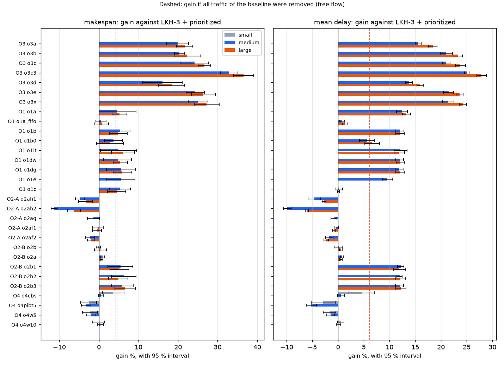

# Warehouse, phase B0: margins per component

## Recommendation

1. **Which component has margin for a learned model?** Only batching with 3 or more orders per trip, and only if a search confirms it: batching gives by far the largest gain (+24–27 % with 2 orders, +33–37 % with 3), but with 2 orders Clarke & Wright is already within 1.3 % / 0.8 % of the exact pairs, and hindsight on traffic stands at −0.4 % / +0.6 % against the best rule without learning, compared with the +4–5 % expected from Yu & Wolf 2023.
2. **What would it have to predict?** Input: a graph of the open orders (shelves, stations, shared products) with the robot positions; output: a score per pair of orders for sharing a trip; label: the trips of LKH-3 in CVRP mode with capacity 3, which has not been run on whole lots and has to show a gap above noise before anything is trained.
3. **Which baseline must it beat?** Clarke & Wright with capacity 3 + LKH-3 + prioritized: 676 steps on the medium warehouse and 920 on the large one, at 4 ms and 13 ms per step.

## Margins

One row per arm and size, over 5 seeds of the E1 lots. The gain is against the baseline, positive is better, with a 95 % interval. With 5 seeds the two-sided Wilcoxon p cannot go below 0.0625, so p = 0.0625 means every seed agrees and is the strongest result possible here; read the interval. "% own free flow" is the arm against its own assignment and routes with each robot alone; "% baseline free flow" uses the same reference for every arm, so batching falls below 100. O4 runs on small and medium only, MCA + LNS and GGO-lite on medium only. Letters follow the plan: O1(a) and O3(a) are the baseline.

| size | component | arm | makespan | % own free flow | % baseline free flow | x best of component | ms/step | makespan gain % | delay gain % |
|---|---|---|---|---|---|---|---|---|---|
| small | baseline | LKH-3 + prioritized, nearest robot, no batching | 573 | 110 | 110 | | 2.5 | | |
| small | O4 | o4cbs: windowed CBS, 3 x limits | 552 | - | 106 | 1.000 | 216.2 | +3.6 ± 2.7 (p=0.125) | +4.6 ± 2.5 (p=0.0625) |
| small | O4 | o4pibt5: PIBT, best of 5 rules | 587 | - | 113 | 1.064 | 1.3 (130 s offline) | -2.6 ± 2.0 (p=0.0625) | -2.9 ± 2.3 (p=0.0625) |
| small | O4 | o4w5: window 5 | 586 | - | 113 | 1.061 | 2.3 | -2.2 ± 1.9 (p=0.0625) | -1.6 ± 1.2 (p=0.0625) |
| small | O4 | o4w10: window 10 | 573 | - | 110 | 1.038 | 1.7 | -0.0 ± 1.5 (p=1) | +0.5 ± 0.6 (p=0.125) |
| small | O4 | **worst / best** | | | | **1.064** | | | |
| medium | baseline | LKH-3 + prioritized, nearest robot, no batching | 1007 | 105 | 105 | | 4.5 | | |
| medium | O3 | o3a: (b) seed, shelf overlap, 2 per trip | 807 | 107 | 84 | 1.194 | 4.3 | +19.9 ± 2.7 (p=0.0625) | +15.6 ± 0.6 (p=0.0625) |
| medium | O3 | o3b: (b) control, least added walking | 802 | 106 | 83 | 1.187 | 5.3 | +20.4 ± 1.3 (p=0.0625) | +21.0 ± 1.2 (p=0.0625) |
| medium | O3 | o3c: (c) Clarke & Wright, 2 per trip | 764 | 106 | 79 | 1.130 | 4.3 | +24.1 ± 3.6 (p=0.0625) | +21.0 ± 0.7 (p=0.0625) |
| medium | O3 | o3c3: (c) Clarke & Wright, 3 per trip | 676 | 106 | 70 | 1.000 | 4.3 | +32.9 ± 2.2 (p=0.0625) | +25.0 ± 0.5 (p=0.0625) |
| medium | O3 | o3d: (d) k-means regions | 845 | 106 | 88 | 1.250 | 4.6 | +16.1 ± 5.0 (p=0.0625) | +13.8 ± 0.7 (p=0.0625) |
| medium | O3 | o3e: (e) savings on the traffic map | 762 | 105 | 79 | 1.128 | 4.0 | +24.3 ± 2.3 (p=0.0625) | +21.5 ± 1.0 (p=0.0625) |
| medium | O3 | o3x: oracle: exact pairs of the whole lot | 754 | 107 | 78 | 1.116 | 4.1 | +25.1 ± 2.5 (p=0.0625) | +21.4 ± 1.1 (p=0.0625) |
| medium | O3 | **worst / best** | | | | **1.250** | | | |
| medium | O1 | o1a: Hungarian over the queue | 960 | 108 | 100 | 1.010 | 9.0 | +4.7 ± 4.7 (p=0.0625) | +12.4 ± 1.0 (p=0.0625) |
| medium | O1 | o1a_fifo: control: same, oldest orders only | 1002 | 106 | 104 | 1.054 | 7.1 | +0.6 ± 1.3 (p=0.438) | +0.8 ± 0.5 (p=0.0625) |
| medium | O1 | o1b: (b) Hungarian + reassignment | 953 | 107 | 99 | 1.003 | 12.4 | +5.3 ± 2.6 (p=0.0625) | +12.0 ± 0.8 (p=0.0625) |
| medium | O1 | o1b0: control: same, without the order length | 970 | 106 | 101 | 1.021 | 13.0 | +3.7 ± 2.3 (p=0.0625) | +5.6 ± 1.4 (p=0.0625) |
| medium | O1 | o1it: (c) greedy + iterative reassignment | 957 | 108 | 99 | 1.007 | 13.5 | +4.9 ± 4.6 (p=0.0625) | +12.1 ± 1.3 (p=0.0625) |
| medium | O1 | o1dw: (d) Hungarian on decayed edge waits | 959 | 108 | 100 | 1.009 | 16.4 | +4.7 ± 3.5 (p=0.0625) | +12.0 ± 0.8 (p=0.0625) |
| medium | O1 | o1dg: (d) Hungarian, delay near first goal x gamma | 950 | 108 | 99 | 1.000 | 13.0 | +5.6 ± 3.7 (p=0.0625) | +11.9 ± 0.9 (p=0.0625) |
| medium | O1 | o1e: (e) oracle: MCA + LNS | 951 | 105 | 99 | 1.001 | 2.6 (46 s offline) | +5.6 ± 3.5 (p=0.0625) | +9.6 ± 1.0 (p=0.0625) |
| medium | O1 | o1c: oracle: 200 simulated swaps | 954 | 104 | 99 | 1.003 | 0.9 (227 s offline) | +5.3 ± 2.7 (p=0.0625) | +0.2 ± 0.7 (p=0.812) |
| medium | O1 | **worst / best** | | | | **1.054** | | | |
| medium | O2-A | o2ah1: (i) crisscross, wrong way +1 | 1056 | - | 110 | 1.046 | 9.9 | -4.8 ± 1.1 (p=0.0625) | -4.6 ± 1.2 (p=0.0625) |
| medium | O2-A | o2ah2: (i) crisscross, wrong way +2 | 1121 | - | 116 | 1.110 | 7.7 | -11.3 ± 0.8 (p=0.0625) | -9.9 ± 0.7 (p=0.0625) |
| medium | O2-A | o2ag: (ii) GGO-lite, CMA-ES | 1021 | - | 106 | 1.011 | 10.2 | -1.4 ± 1.5 (p=0.125) | -0.8 ± 0.6 (p=0.0625) |
| medium | O2-A | o2af1: (iii) flow costs 0.1 / 0.5 | 1010 | - | 105 | 1.000 | 5.0 | -0.3 ± 1.3 (p=0.812) | -0.3 ± 0.4 (p=0.125) |
| medium | O2-A | o2af2: (iii) flow costs 0.3 / 1.0 | 1029 | - | 107 | 1.019 | 5.4 | -2.2 ± 1.2 (p=0.0625) | -1.7 ± 0.8 (p=0.0625) |
| medium | O2-A | **worst / best** | | | | **1.110** | | | |
| medium | O2-B | o2b: first version: static cell map | 1009 | - | 105 | 1.069 | 6.0 | -0.1 ± 0.5 (p=0.625) | +0.1 ± 0.7 (p=0.438) |
| medium | O2-B | o2a: first version: hindsight per cell | 998 | - | 104 | 1.058 | 6.5 (21 s offline) | +0.9 ± 0.4 (p=0.0625) | +0.8 ± 0.3 (p=0.0625) |
| medium | O2-B | o2b1: (i) static edge map, on o1b | 952 | 106 | 99 | 1.009 | 11.6 | +5.4 ± 3.2 (p=0.0625) | +12.2 ± 0.6 (p=0.0625) |
| medium | O2-B | o2b2: (ii) same x gamma | 944 | 108 | 98 | 1.000 | 11.1 | +6.3 ± 3.1 (p=0.0625) | +11.9 ± 0.5 (p=0.0625) |
| medium | O2-B | o2b3: (iii) oracle: hindsight per edge | 947 | 108 | 98 | 1.004 | 14.4 (87 s offline) | +5.9 ± 2.7 (p=0.0625) | +12.0 ± 0.8 (p=0.0625) |
| medium | O2-B | **worst / best** | | | | **1.069** | | | |
| medium | O4 | o4cbs: windowed CBS, 3 x limits | 1002 | - | 104 | 1.000 | 1927.8 | +0.5 ± 0.6 (p=0.0625) | +0.6 ± 0.6 (p=0.125) |
| medium | O4 | o4pibt5: PIBT, best of 5 rules | 1039 | - | 108 | 1.037 | 2.2 (103 s offline) | -3.2 ± 1.2 (p=0.0625) | -5.2 ± 1.0 (p=0.0625) |
| medium | O4 | o4w5: window 5 | 1028 | - | 107 | 1.026 | 4.4 | -2.0 ± 1.1 (p=0.0625) | -1.5 ± 0.8 (p=0.0625) |
| medium | O4 | o4w10: window 10 | 1003 | - | 104 | 1.001 | 4.2 | +0.4 ± 0.8 (p=0.188) | +0.1 ± 0.4 (p=0.438) |
| medium | O4 | **worst / best** | | | | **1.037** | | | |
| large | baseline | LKH-3 + prioritized, nearest robot, no batching | 1451 | 105 | 105 | | 12.3 | | |
| large | O3 | o3a: (b) seed, shelf overlap, 2 per trip | 1137 | 105 | 82 | 1.235 | 14.6 | +21.7 ± 2.1 (p=0.0625) | +18.4 ± 0.9 (p=0.0625) |
| large | O3 | o3b: (b) control, least added walking | 1127 | 107 | 81 | 1.225 | 15.0 | +22.3 ± 3.3 (p=0.0625) | +23.3 ± 0.8 (p=0.0625) |
| large | O3 | o3c: (c) Clarke & Wright, 2 per trip | 1064 | 107 | 77 | 1.156 | 11.7 | +26.7 ± 1.6 (p=0.0625) | +23.8 ± 1.0 (p=0.0625) |
| large | O3 | o3c3: (c) Clarke & Wright, 3 per trip | 920 | 107 | 67 | 1.000 | 13.4 | +36.6 ± 2.6 (p=0.0625) | +27.9 ± 0.9 (p=0.0625) |
| large | O3 | o3d: (d) k-means regions | 1184 | 107 | 86 | 1.287 | 13.9 | +18.4 ± 3.3 (p=0.0625) | +16.0 ± 0.6 (p=0.0625) |
| large | O3 | o3e: (e) savings on the traffic map | 1067 | 107 | 77 | 1.160 | 13.4 | +26.4 ± 3.0 (p=0.0625) | +23.6 ± 0.7 (p=0.0625) |
| large | O3 | o3x: oracle: exact pairs of the whole lot | 1056 | 106 | 76 | 1.147 | 11.6 | +27.2 ± 3.2 (p=0.0625) | +24.3 ± 0.7 (p=0.0625) |
| large | O3 | **worst / best** | | | | **1.287** | | | |
| large | O1 | o1a: Hungarian over the queue | 1375 | 105 | 99 | 1.010 | 18.8 | +5.2 ± 1.9 (p=0.0625) | +13.3 ± 0.8 (p=0.0625) |
| large | O1 | o1a_fifo: control: same, oldest orders only | 1441 | 105 | 104 | 1.057 | 18.0 | +0.7 ± 1.8 (p=0.375) | +1.3 ± 0.5 (p=0.0625) |
| large | O1 | o1b: (b) Hungarian + reassignment | 1380 | 107 | 100 | 1.013 | 37.4 | +4.9 ± 2.3 (p=0.0625) | +12.1 ± 0.8 (p=0.0625) |
| large | O1 | o1b0: control: same, without the order length | 1410 | 109 | 102 | 1.035 | 38.2 | +2.8 ± 3.4 (p=0.125) | +6.6 ± 1.5 (p=0.0625) |
| large | O1 | o1it: (c) greedy + iterative reassignment | 1362 | 108 | 98 | 1.000 | 48.8 | +6.1 ± 3.0 (p=0.0625) | +11.9 ± 1.0 (p=0.0625) |
| large | O1 | o1dw: (d) Hungarian on decayed edge waits | 1372 | 107 | 99 | 1.007 | 69.2 | +5.4 ± 1.8 (p=0.0625) | +12.1 ± 0.8 (p=0.0625) |
| large | O1 | o1dg: (d) Hungarian, delay near first goal x gamma | 1364 | 108 | 99 | 1.001 | 39.9 | +5.9 ± 2.4 (p=0.0625) | +12.1 ± 0.8 (p=0.0625) |
| large | O1 | o1c: oracle: 200 simulated swaps | 1385 | 104 | 100 | 1.017 | 3.4 (1104 s offline) | +4.5 ± 2.3 (p=0.0625) | +0.1 ± 0.2 (p=0.625) |
| large | O1 | **worst / best** | | | | **1.057** | | | |
| large | O2-A | o2ah1: (i) crisscross, wrong way +1 | 1500 | - | 108 | 1.029 | 31.0 | -3.4 ± 1.7 (p=0.0625) | -2.7 ± 0.4 (p=0.0625) |
| large | O2-A | o2ah2: (i) crisscross, wrong way +2 | 1543 | - | 111 | 1.058 | 30.6 | -6.3 ± 1.7 (p=0.0625) | -6.0 ± 0.3 (p=0.0625) |
| large | O2-A | o2af1: (iii) flow costs 0.1 / 0.5 | 1458 | - | 105 | 1.000 | 15.3 | -0.5 ± 1.2 (p=0.312) | -0.8 ± 0.2 (p=0.0625) |
| large | O2-A | o2af2: (iii) flow costs 0.3 / 1.0 | 1479 | - | 107 | 1.015 | 16.7 | -1.9 ± 0.9 (p=0.0625) | -2.3 ± 0.4 (p=0.0625) |
| large | O2-A | **worst / best** | | | | **1.058** | | | |
| large | O2-B | o2b: first version: static cell map | 1445 | - | 104 | 1.067 | 18.7 | +0.4 ± 1.5 (p=0.625) | +0.6 ± 0.3 (p=0.0625) |
| large | O2-B | o2a: first version: hindsight per cell | 1442 | - | 104 | 1.064 | 18.0 (78 s offline) | +0.6 ± 0.4 (p=0.0625) | +0.6 ± 0.2 (p=0.0625) |
| large | O2-B | o2b1: (i) static edge map, on o1b | 1375 | 108 | 99 | 1.015 | 49.0 | +5.2 ± 2.4 (p=0.0625) | +11.9 ± 1.2 (p=0.0625) |
| large | O2-B | o2b2: (ii) same x gamma | 1379 | 107 | 100 | 1.018 | 48.1 | +4.9 ± 2.5 (p=0.0625) | +12.1 ± 0.9 (p=0.0625) |
| large | O2-B | o2b3: (iii) oracle: hindsight per edge | 1355 | 107 | 98 | 1.000 | 46.4 (264 s offline) | +6.6 ± 2.6 (p=0.0625) | +12.2 ± 1.0 (p=0.0625) |
| large | O2-B | **worst / best** | | | | **1.067** | | | |

All 305 reported episodes passed the verifier with every order delivered; a free-flow run skips only the collision check.

## Protocol and decisions

- Every arm re-runs the E1 lots with one change. The baseline repeats E1 exactly, and every run is judged by the verifier. The report follows Merschformann 2019: each arm as a percentage of a free-flow limit, and a best/worst factor per component.
- **Free flow:** same assignment and routes, each robot alone. It is not measured for the O2-A and O4 arms, which change only the planner. The free flow stored for `o4pibt5` ran before the arm and repeats the baseline's plan, so it is ignored.
- **O1(b):** "reassignment on each arrival" fires when a robot becomes free, because in E1 every order arrives at step 0 and the literal rule would equal the plain Hungarian.
- **O1(e):** the real path is measured once per episode, as a per-robot scale, not by a simulation per insertion. It stops at 20 iterations, which takes 46 s of the 20 min allowed.
- **O1 costs with traffic:** they include waits and detours; γ is fitted by least squares per edge on other seeds, and comes to 0.46–0.55.
- **O2-B:** it runs on Hungarian + reassignment (`o1b`), and the metric reaches LKH-3 and the Hungarian.
- **PIBT rules:** `far` and `near` only break ties below age, because as real weights `far` blocks and delivers nothing. Only complete runs count.
- **Extra arm:** `o3x` gives the exact pairs of the whole lot to the simulator. The plan limited the exact check to 20 orders; a matching is polynomial, and this run answers the question directly in a few minutes of CPU.

## O3: batching

Grouping orders is by far the largest gain, and the way of grouping matters little once it uses real trip costs: the worst arm with capacity 2 (k-means regions) is 12 % above the exact pairs, and Clarke & Wright is 1.3 % / 0.8 % above in makespan. The seed rule of shelf overlap does not beat its plain control in makespan and loses in delay. A traffic map changes nothing (`o3e`). Capacity 3 was cheap and adds 9–10 points; its exact optimum is not polynomial and no oracle was run for it, so its residual margin is unknown.

The 20-order check of LKH-3 in CVRP mode matches the exact matching in all 40 subsets. On whole lots savings get closer to the optimum than on subsets of 20, since more orders give more good pairs.

| size | subsets of 20 orders | savings over exact % (mean, worst) | LKH-3 CVRP = exact | whole lot: exact walk | savings over exact % |
|---|---|---|---|---|---|
| medium | 20 | 1.50, 3.40 | 20 of 20 | 17088 | 0.86 |
| large | 20 | 1.77, 3.42 | 20 of 20 | 63035 | 0.97 |

## O1: assignment

The gain of about 5 % in makespan and 12 % in delay comes almost entirely from serving short orders first: the control restricted to the oldest orders (`o1a_fifo`) gains +0.6 %, and removing the order length from the cost (`o1b0`) halves the delay gain. Iterative reassignment, and costs with traffic, add nothing beyond noise.

The two oracles do not beat the online rules, but they are shallow: 200 swaps and 20 LNS iterations. `o1c` optimises only the makespan and leaves the delay unchanged. So "no margin" here means none found by a cheap search, not a proof, and the gap to the lower bound stays at about 21 % of the baseline; that bound ignores empty walking between orders, so it is loose.

| size | baseline makespan | bound | largest possible gain % | best one-order arm % |
|---|---|---|---|---|
| medium | 1007 | 734 | 27.1 | 6.3 |
| large | 1451 | 1042 | 28.2 | 6.6 |

| size | seed | o1c start | o1c end | swaps kept of 200 | o1e start | o1e end |
|---|---|---|---|---|---|---|
| medium | 0 | 999 | 950 | 17 | 990.0 | 946.0 |
| medium | 1 | 1024 | 984 | 7 | 1015.0 | 951.0 |
| medium | 2 | 1017 | 929 | 6 | 940.0 | 925.0 |
| medium | 3 | 1015 | 954 | 9 | 1033.0 | 1001.0 |
| medium | 4 | 981 | 951 | 9 | 968.0 | 933.0 |
| large | 0 | 1480 | 1397 | 7 | - | - |
| large | 1 | 1463 | 1391 | 9 | - | - |
| large | 2 | 1454 | 1395 | 11 | - | - |
| large | 3 | 1460 | 1367 | 13 | - | - |
| large | 4 | 1398 | 1377 | 5 | - | - |

## O2: traffic

Traffic costs 4.3–4.6 % of the baseline makespan and 6.2 % of the delay on medium and large (9 % on small), and about 6 % of the makespan once the batching or assignment improves. That is the ceiling of anything that only removes congestion.

**Hindsight − best not learned = −0.4 % on medium, +0.6 % on large, in makespan**, both within noise; in delay it is negative. That is the room for a GNN predicting travel times in layer 1, against the +4–5 % expected from Yu & Wolf 2023. Against the same dispatcher without traffic the oracle gives +0.6 % and +1.8 %. Even so, these numbers lean in its favour: it keeps the best of 3 runs per seed. Iterating does not converge, since new distances move the traffic elsewhere.

No O2-A arm beats the plain planner. Directed highways lose 3–11 %, flow costs at best tie, and GGO-lite overfits: it gains 1.6 % on its two seeds, loses 1.4 % on the five of the report, and pushes its weights towards zero.

| size | arm | makespan | free flow | steps lost to traffic % | delay | free-flow delay | delay lost % |
|---|---|---|---|---|---|---|---|
| small | base | 573 | 520 | 9.1 | 315 | 282 | 10.7 |
| medium | base | 1007 | 964 | 4.3 | 528 | 496 | 6.2 |
| medium | o1b | 953 | 893 | 6.3 | 465 | 429 | 7.7 |
| medium | o2b3 | 947 | 879 | 7.2 | 465 | 429 | 7.7 |
| medium | o3c | 764 | 718 | 5.9 | 417 | 383 | 8.1 |
| medium | o3c3 | 676 | 636 | 5.9 | 396 | 365 | 7.7 |
| large | base | 1451 | 1384 | 4.6 | 755 | 708 | 6.2 |
| large | o1b | 1380 | 1290 | 6.5 | 664 | 611 | 7.9 |
| large | o2b3 | 1355 | 1268 | 6.4 | 663 | 611 | 7.8 |
| large | o3c | 1064 | 999 | 6.1 | 575 | 530 | 7.8 |
| large | o3c3 | 920 | 863 | 6.2 | 544 | 495 | 9.1 |

| size | metric | hindsight | same dispatcher without traffic (o1b) | gain % | best not learned | gain % |
|---|---|---|---|---|---|---|
| medium | makespan | 947.0 | 953.2 | +0.6 ± 0.6 (p=0.125) | o2b2: 943.6 | -0.4 ± 1.2 (p=0.438) |
| medium | mean delay | 464.9 | 464.6 | -0.1 ± 0.7 (p=1) | o1a: 462.5 | -0.5 ± 0.8 (p=0.125) |
| large | makespan | 1354.6 | 1379.8 | +1.8 ± 1.8 (p=0.0625) | o1it: 1362.4 | +0.6 ± 1.1 (p=0.312) |
| large | mean delay | 662.6 | 663.8 | +0.2 ± 0.4 (p=0.438) | o1a: 654.5 | -1.2 ± 0.6 (p=0.0625) |

| size | iteration | makespan | mean delay |
|---|---|---|---|
| medium | 1 | 952 | 466 |
| medium | 2 | 950 | 465 |
| medium | 3 | 957 | 466 |
| large | 1 | 1365 | 665 |
| large | 2 | 1363 | 664 |
| large | 3 | 1369 | 665 |

The search ran 40 generations in 27 min. On its own two seeds the baseline makes 1009.5 steps and the best weights 993.5; on the five seeds of the report they make 1021 against 1007. Best wrong-way weights: 0.03, 0.25, 0.67, 0.13, 0.33, 0.06.

## O4: the path planner

A better planner gives almost nothing where traffic matters. CBS with 3 x the limits gains 3.6 % on small and 0.5 % on medium, at 86 and 428 times the computation per step; on medium 15 % of the steps still fall back to PIBT. No episode reached the budget. PIBT loses 2.6–3.2 % to prioritized even with the best of 5 rules per seed. A window of 10 ties with the window of 20, and a window of 5 loses about 2 %.

| size | steps under PIBT % | time-outs per episode | seconds in CBS per episode | episodes at the budget |
|---|---|---|---|---|
| small | 1.5 | 0.8 | 116 | 0 of 5 |
| medium | 15.2 | 15.2 | 1929 | 0 of 5 |

| size | age | far | near | load | fixed | best of 5 | window 20 prioritized |
|---|---|---|---|---|---|---|---|
| small | 599 | 597 | 594 | 596 | 601 | 587 | 573 |
| medium | 1057 | 1066 | 1059 | 1049 | 1056 | 1039 | 1007 |

## Budget and cuts

About 8 h of CPU, at the limit of the budget: 2.1 h of arms, 1.8 h of GGO-lite, 2.8 h of CBS, at most 1.1 h of free flow and some 0.2 h more. Nothing was cut. Not done: the optional O1(f), Liu 2019. Stopped by their own limits or the plan: GGO-lite and MCA + LNS ran on medium only, and O4 on small and medium only.

| stage (at most 4 processes) | wall clock |
|---|---|
| edges | 0:00:44 |
| o3 | 0:06:35 |
| o1 | 0:09:36 |
| o2 | 0:20:02 |
| ggo | 0:26:42 |
| o2g | 0:00:26 |
| ff | 0:16:37 |
| o4 | 0:07:09 |
| o4cbs | 0:53:46 |
| total | 2:21:37 |

## Limitations

- Five seeds: a difference below about 1 % is noise, and several arms in O1 and O2-B cannot be told apart.
- Gains do not add up, and only some combinations were measured. The batching arms keep orders by age (`Clusters` hands trips out by order id), so the short-first effect of O1 is not in them; adding it could improve the baseline of the recommendation.
- As noted by Varambally 2022, the model has no rotation and no real service durations.
- The free flow of `o2b3` uses routes in the plain metric, since the record does not keep its metric, so its percentage is approximate.
- E1 is offline: all orders are known at step 0. Lifelong margins were not measured.
- The Yu & Wolf figure is the expectation stated in the plan; it comes from a different setting.
