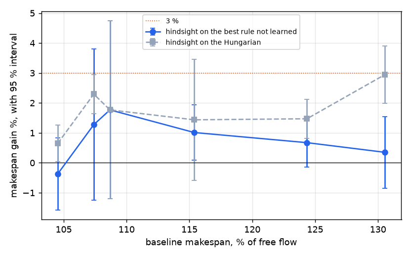

# Warehouse, phase B0b: capacity, arrivals, density

## Recommendation

1. **Which margin justifies a learned model?** None clears 3 %: the largest is capacity, where a near-exact grouping saves 2.2 % / 0.6 % of the walking (makespan +1.4 % / −1.1 %, within noise) on Clarke & Wright; knowing the arrivals gives at most +0.8 % in throughput, and hindsight on traffic at most +1.8 % over the rules without learning, even with the baseline at 131 % of free flow.
2. **What would a model predict, if one is tried anyway?** A score per pair or triple of orders for sharing a trip, from the graph of open orders, with labels from set partitioning on real trip costs, because LKH-3 in CVRP mode is worse than Clarke & Wright here.
3. **Which baseline must it beat?** Clarke & Wright with capacity 3 + LKH-3 + prioritized: 676 / 920 steps offline, and online the same rule at once under saturation, but one order per trip at the medium rate, where batching loses to it.

## T1: capacity

Whole lots fit: LKH-3 ran 120 s (medium) and 300 s (large) per lot, so no blocks were needed. "Best" is set partitioning on the real cost of each trip, by HiGHS, with 300 s; its candidates are the trips inside the 25 best partners of each order (12 at capacity 4), plus the trips of Clarke & Wright and LKH-3, so it is never worse than either on walking.

LKH-3 in CVRP mode loses to Clarke & Wright by 1–3 %. With 3 or more orders the CVRP is a surrogate: its arcs are pairwise, and a trip's real cost is not, so this row says nothing against the method in general. That is why set partitioning was added.

The gap to the best found is **below 3 % in every case**: 2.2 % of the walking on medium, 0.6 % on large and 1.0 % at capacity 4. The rule of the plan for describing a model is therefore not triggered. On large the solver stops at the time limit, with its bound 1.3 % lower, so 0.6 % may be an underestimate. Less walking does not reach the makespan reliably: the gain is +1.4 % and −1.1 %, both within noise, because the makespan depends on the last trip. Capacity 4 walks less but ends later than capacity 3 (702 against 676), so more capacity stops paying between the two.

| size | cap | walk C&W | walk LKH-3 CVRP | walk best | HiGHS bound over candidates | best gain on C&W % | makespan C&W | LKH-3 | best | best gain on C&W % | % free flow, C&W / best | ms/step, C&W / best |
|---|---|---|---|---|---|---|---|---|---|---|---|---|
| medium | 3 | 14121 | 14284 | 13803 | 13802 | +2.2 ± 0.3 (p=0.0625) | 676 | 666 | 666 | +1.4 ± 2.6 (p=0.188) | 106 / 108 | 4.6 / 5.0 |
| large | 3 | 50457 | 51490 | 50163 | 49507 | +0.6 ± 1.9 (p=0.625) | 920 | 936 | 930 | -1.1 ± 5.3 (p=0.812) | 107 / 109 | 13.0 / 13.2 |
| medium | 4 | 12481 | 12854 | 12353 | 12269 | +1.0 ± 0.4 (p=0.0625) | 702 | 728 | 698 | +0.6 ± 6.3 (p=1) | 105 / 106 | 4.7 / 4.8 |

The candidate list could hide the optimum, so one medium lot ran over every trip of 3. HiGHS did not finish in 20 min and its own solution is useless, but its lower bound covers all trips, for trip costs priced by 2-opt. The best of T1 is 0.16 % above that bound, so for this lot the near-exact figure is close to the true optimum.

| seed | every trip of 3 | lower bound over all of them | walk C&W | walk best of T1 | C&W over the bound % | best of T1 over the bound % | seconds |
|---|---|---|---|---|---|---|---|
| 0 | 562625 | 13871 | 14185 | 13893 | 2.26 | 0.16 | 1708 |

## T2: online against clairvoyant

Lifelong, 2000 steps, LKH-3 + prioritized. The medium rate is the one of E2, 0.8 x the E1 throughput of LKH-3 + PIBT. Rate x2.0 was added to the plan: at the medium rate arrivals fix the throughput, so orders/h cannot show capacity. Delay counts open orders at their age at the horizon, since otherwise a method that leaves more orders open looks better. The first row is the reference with one order per trip.

(b) holds a trip until its oldest order is 20 or 50 steps old. (c) knows the arrivals: a trip can wait for an order still to come, each step forced on an order costs λ steps of walking, and a trip is fixed when its first order would leave. λ is 0, 0.5 or 2 on medium and the best of those (2) on large. Each cell of (c) takes the best λ for that metric, which favours the oracle; λ = 0 with all arrivals known wrecks the delay (717). The second table gives what (c) adds to the best of (a) and (b); positive is better.

**The value of predicting arrivals is below 3 % everywhere.** At the medium rate it is negative: any wait costs more than the trip saves, and a very large λ would simply return (a), so the honest reading is zero. Under saturation it is +0.8 % in orders/h and at most +2.3 % in backlog, within noise except on large orders/h. The queue already offers partners, so future ones add little.

The unplanned result is load. At the medium rate trips of 3 **lose** to one order per trip: delay 193 against 158 and 293 against 221, because free robots are idle while orders share a trip. At 2 x they gain about 50 % in orders/h. When to batch matters more than what the future holds; a simple load rule may capture this, and that was not tested.

| size | rate | arm | orders/h | orders/h, second half | mean delay, open orders included | backlog, second half | ms/step |
|---|---|---|---|---|---|---|---|
| medium | medium | 1 order per trip, at once | 390 | 436 | 158 | 20 | 3.8 |
| medium | medium | (a) trips of 3, at once | 382 | 444 | 193 | 25 | 3.9 |
| medium | medium | (b) wait 20 | 364 | 444 | 268 | 36 | 4.1 |
| medium | medium | (b) wait 50 | 358 | 441 | 289 | 39 | 4.4 |
| medium | medium | (c) known 100 steps ahead | 365 | 449 | 265 | 35 | 5.0 |
| medium | medium | (c) all arrivals known | 366 | 500 | 264 | 35 | 17.5 |
| medium | x2.0 | 1 order per trip, at once | 564 | 604 | 508 | 206 | 3.8 |
| medium | x2.0 | (a) trips of 3, at once | 847 | 995 | 311 | 103 | 11.5 |
| medium | x2.0 | (b) wait 20 | 850 | 1009 | 323 | 104 | 11.8 |
| medium | x2.0 | (b) wait 50 | 842 | 999 | 331 | 106 | 12.3 |
| medium | x2.0 | (c) known 100 steps ahead | 854 | 1012 | 315 | 101 | 14.0 |
| medium | x2.0 | (c) all arrivals known | 856 | 1056 | 314 | 100 | 54.7 |
| large | medium | 1 order per trip, at once | 678 | 771 | 221 | 49 | 10.6 |
| large | medium | (a) trips of 3, at once | 646 | 762 | 293 | 67 | 10.6 |
| large | medium | (b) wait 20 | 623 | 771 | 360 | 84 | 11.8 |
| large | medium | (b) wait 50 | 610 | 763 | 373 | 88 | 12.5 |
| large | medium | (c) known 100 steps ahead | 621 | 766 | 354 | 83 | 16.8 |
| large | medium | (c) all arrivals known | 621 | 766 | 354 | 83 | 55.9 |
| large | x2.0 | 1 order per trip, at once | 1020 | 1131 | 516 | 379 | 12.6 |
| large | x2.0 | (a) trips of 3, at once | 1495 | 1888 | 371 | 222 | 24.5 |
| large | x2.0 | (b) wait 20 | 1491 | 1893 | 378 | 222 | 26.0 |
| large | x2.0 | (b) wait 50 | 1489 | 1915 | 386 | 227 | 30.6 |
| large | x2.0 | (c) known 100 steps ahead | 1506 | 1880 | 370 | 218 | 49.8 |
| large | x2.0 | (c) all arrivals known | 1506 | 1880 | 370 | 217 | 130.9 |

| size | rate | metric | best of (a, b) | best oracle (c) | value of the arrivals % |
|---|---|---|---|---|---|
| medium | medium | orders/h | 382 | 366 | -4.2 ± 2.3 (p=0.0625) |
| medium | medium | delay | 193 | 264 | -36.9 ± 2.4 (p=0.0625) |
| medium | medium | backlog | 25 | 35 | -39.1 ± 3.9 (p=0.0625) |
| medium | x2.0 | orders/h | 850 | 856 | +0.8 ± 1.4 (p=0.312) |
| medium | x2.0 | delay | 311 | 314 | -0.8 ± 3.0 (p=0.812) |
| medium | x2.0 | backlog | 103 | 100 | +2.3 ± 3.3 (p=0.188) |
| large | medium | orders/h | 646 | 621 | -3.9 ± 1.4 (p=0.0625) |
| large | medium | delay | 293 | 354 | -20.9 ± 2.7 (p=0.0625) |
| large | medium | backlog | 67 | 83 | -23.6 ± 3.9 (p=0.0625) |
| large | x2.0 | orders/h | 1495 | 1506 | +0.8 ± 0.6 (p=0.0625) |
| large | x2.0 | delay | 371 | 370 | +0.2 ± 1.5 (p=0.812) |
| large | x2.0 | backlog | 222 | 217 | +1.9 ± 2.0 (p=0.125) |

## T3: density

The medium warehouse with corridors of width 1, more robots and proportionally more orders, so the load per robot stays the same. The row at 1 x repeats B0 exactly. Above 120 robots the parking needs a third row, which shifts the blocks one row.

**Traffic never reaches 3 % for layer 1.** The baseline loses up to 24 % of its makespan to traffic at 131 % of free flow, yet hindsight on real edge times gains −0.4 to +1.8 % on the best rule without learning, all within noise or close to it, and at most +2.9 % on the Hungarian. Hindsight has the advantage of the best of 3 runs per seed. So no level of congestion in this range makes better distances worth more than 3 %. Congestion here is a problem of the planner: at 5 x 63 % of its calls fall back to PIBT. A model that acts on the planner rather than on layer 1 was not measured at these densities. γ grows from 0.46 to 0.86 with density.

| times robots | robots | orders | baseline, % free flow | steps under PIBT % | baseline | Hungarian | static map | map x gamma | hindsight | best not learned | hindsight gain on it % | gain on Hungarian % | seeds |
|---|---|---|---|---|---|---|---|---|---|---|---|---|---|
| 1 | 30 | 150 | 105 | 0 | 1007 | 953 | 952 | 944 | 947 | o2b2 | -0.4 ± 1.2 (p=0.438) | +0.6 ± 0.6 (p=0.125) | 5 |
| 1.5 | 45 | 225 | 107 | 0 | 1031 | 1021 | 1013 | 1010 | 997 | o2b2 | +1.3 ± 2.5 (p=0.438) | +2.3 ± 0.6 (p=0.0625) | 5 |
| 2 | 60 | 300 | 109 | 0 | 1055 | 1049 | 1059 | 1058 | 1030 | o1b | +1.8 ± 3.0 (p=0.188) | +1.8 ± 3.0 (p=0.188) | 5 |
| 3 | 90 | 450 | 115 | 3 | 1133 | 1126 | 1130 | 1121 | 1110 | o2b2 | +1.0 ± 0.9 (p=0.0625) | +1.4 ± 2.0 (p=0.188) | 5 |
| 4 | 120 | 600 | 124 | 29 | 1229 | 1223 | 1213 | 1225 | 1205 | o2b1 | +0.7 ± 0.8 (p=0.125) | +1.5 ± 0.7 (p=0.0625) | 5 |
| 5 | 150 | 750 | 131 | 63 | 1341 | 1357 | 1343 | 1322 | 1317 | o2b2 | +0.3 ± 1.2 (p=0.5) | +2.9 ± 1.0 (p=0.25) | 3 |

## Budget and changes

About 9.6 h of CPU against the ~6 h asked, over by 60 %: T1 2.0 h, T2 2.1 h, T3 4.9 h, the check over every trip 0.5 h, and some minutes of simulations and edge statistics. Large was the planned cut, but it had already run when the overrun became clear, because T1 and T2 came first. So the cuts fell elsewhere: 5 x robots ran 3 seeds instead of 5, the check over every trip ran on 1 lot instead of 2, and on large T2 ran only the best λ. Additions: set partitioning, the check over every trip, and rate x2.0, about half of T2.

| stage (at most 4 processes) | wall clock |
|---|---|
| t1 | 0:33:28 |
| t2 --sizes medium | 0:16:23 |
| t2 --sizes large | 0:19:06 |
| t3edges | 0:06:10 |
| t3 --densities 1.0 | 0:03:12 |
| t3 --densities 1.5 | 0:05:03 |
| t3 --densities 2.0 | 0:07:32 |
| t3 --densities 3.0 | 0:14:54 |
| t3 --densities 4.0 | 0:26:23 |
| t3 --densities 5.0 | 0:29:35 |
| t1all | 0:28:30 |

## Limitations

- Five seeds, three at 5 x, where the Wilcoxon p cannot go below 0.25. Differences of about 1–2 % are noise.
- "Best" in T1 is optimal only over its candidates; only one lot has a bound over all trips, and large stops at the time limit.
- The oracle of T2 holds orders but cannot send a robot ahead or add an order to a trip under way, so it understates what perfect knowledge could give.
- T2 trips leave by age and the nearest robot; there is no load rule and no Hungarian.
- The free-flow x-axis of T3 varies robots only; stations and layout stay fixed.
- The hindsight of T3 keeps the free flow of its best run in the metric of that run, not the plain one.
