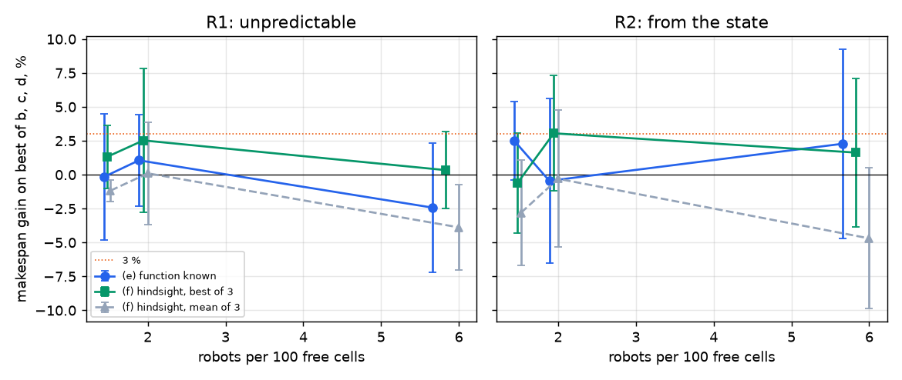

# Warehouse, phase B0c: imperfect execution

## Recommendation

1. **With imperfect execution, is there margin above 3 % for a delay predictor?** No evidence of it: the function known gains −0.5 to +2.5 % on the best rule in R2 with PIBT, and −0.3 to +0.9 % with prioritized; hindsight clears 3 % once in ten cells (+3.1 ± 4.3 %) and only by keeping the best of 3 runs, while its mean of 3 never beats the rules by more than +0.1 %; with 5 seeds the intervals are too wide to exclude 3 % on the makespan alone, and mean delay says the same (at most +2.3 ± 9.4 %).
2. **Only in R2, or also in R1?** In neither: R2 is not clearly above R1, so making delays predictable from the state did not open a margin; the arms that use delays at all, oracles or maps, stay within noise of the blind ones.
3. **What would a model have to see, and what would its label be?** If one is tried anyway it sees local occupancy, robot type, floor zone and distance to stations, plus the planned paths of the other robots, which no arm here used, and its label is the delay realized per edge, without turns; the baseline to beat is prioritized under action dependencies with turns known in layer 1, because the largest gap in this phase is not a prediction: on the blind arm prioritized beats PIBT by 6–8 % at 30 robots and 11–14 % at 90.

## The column that decides

Gain in makespan over 5 seeds, positive is better, with a 95 % interval. The best of (b, c, d) is the lowest mean in each row, chosen after the fact, which leans towards the rules. "Best of 3" keeps the best hindsight run per seed, as in B0, which leans towards the oracle; delays are random, so that choice alone produces a gain. The mean of 3 has no such selection and is the fair reading of hindsight: it never exceeds +0.1 %.

Read the intervals: a half-width of 3–7 % means that 5 seeds cannot tell a gain of 3 % from zero in most rows. These rows show no margin; they do not prove there is none. Only the sign pattern across rows is firm: neither oracle is above the rules consistently, in either regime or at either density.

| planner | regime | warehouse, robots | best of b, c, d | its value | (e) on it % | (f) best of 3 on it % | (f) mean of 3 on it % | (b) on (a) % |
|---|---|---|---|---|---|---|---|---|
| pibt | R1 | medium, 30 | (c) | 921 | +1.1 ± 3.4 (p=0.625) | +2.5 ± 5.3 (p=0.312) | +0.1 ± 3.8 (p=1) | +1.9 ± 11.1 (p=0.625) |
| pibt | R1 | large, 60 | (d) | 1234 | -0.2 ± 4.7 (p=1) | +1.3 ± 2.3 (p=0.188) | -1.2 ± 0.8 (p=0.0625) | -1.5 ± 4.2 (p=0.312) |
| pibt | R1 | medium, 90 | (d) | 1278 | -2.4 ± 4.7 (p=0.312) | +0.3 ± 2.8 (p=1) | -3.9 ± 3.2 (p=0.0625) | -2.9 ± 9.7 (p=0.625) |
| pibt | R2 | medium, 30 | (d) | 919 | -0.5 ± 6.1 (p=0.812) | +3.1 ± 4.3 (p=0.125) | -0.3 ± 5.1 (p=1) | -3.6 ± 8.0 (p=0.312) |
| pibt | R2 | large, 60 | (d) | 1224 | +2.5 ± 2.9 (p=0.125) | -0.6 ± 3.7 (p=1) | -2.8 ± 3.9 (p=0.188) | +1.5 ± 6.7 (p=1) |
| pibt | R2 | medium, 90 | (c) | 1296 | +2.3 ± 7.0 (p=0.312) | +1.6 ± 5.5 (p=0.625) | -4.7 ± 5.2 (p=0.125) | -4.1 ± 5.8 (p=0.0625) |
| prioritized | R1 | medium, 30 | (d) | 881 | +1.2 ± 2.2 (p=0.312) | -0.2 ± 2.4 (p=1) | -1.4 ± 2.6 (p=0.188) | +1.6 ± 6.5 (p=0.625) |
| prioritized | R1 | medium, 90 | (b) | 1122 | +1.0 ± 4.7 (p=0.625) | -0.1 ± 2.2 (p=1) | -1.5 ± 2.3 (p=0.188) | +0.8 ± 3.9 (p=0.812) |
| prioritized | R2 | medium, 30 | (b) | 869 | +0.9 ± 3.9 (p=0.625) | -0.1 ± 2.3 (p=0.625) | -2.3 ± 3.3 (p=0.188) | +0.8 ± 3.5 (p=0.625) |
| prioritized | R2 | medium, 90 | (c) | 1105 | -0.3 ± 2.5 (p=1) | +0.0 ± 3.2 (p=1) | -2.2 ± 3.5 (p=0.188) | +1.8 ± 6.5 (p=0.438) |

The same for mean delay, which depends less on the last trip than the makespan does. Hindsight is negative or close to zero nearly everywhere; the function known reaches +2.3 ± 9.4 % once, at medium 90 with PIBT, and is within ±1.3 % in every other row.

| planner | regime | warehouse, robots | best of b, c, d | its value | (e) on it % | (f) best of 3 on it % | (f) mean of 3 on it % | (b) on (a) % |
|---|---|---|---|---|---|---|---|---|
| pibt | R1 | medium, 30 | (d) | 524 | +0.1 ± 2.3 (p=1) | +0.1 ± 3.0 (p=1) | -1.2 ± 0.8 (p=0.0625) | +0.3 ± 2.9 (p=0.625) |
| pibt | R1 | large, 60 | (d) | 699 | -0.2 ± 0.5 (p=0.625) | -0.2 ± 1.9 (p=0.625) | -0.6 ± 1.0 (p=0.312) | +0.1 ± 3.4 (p=1) |
| pibt | R1 | medium, 90 | (d) | 725 | -1.1 ± 3.4 (p=0.438) | -2.0 ± 2.5 (p=0.0625) | -2.1 ± 1.9 (p=0.125) | -3.1 ± 6.3 (p=0.312) |
| pibt | R2 | medium, 30 | (c) | 527 | -0.7 ± 2.1 (p=0.625) | +0.6 ± 1.2 (p=0.312) | -0.1 ± 1.2 (p=1) | -1.7 ± 4.8 (p=0.312) |
| pibt | R2 | large, 60 | (d) | 698 | +0.4 ± 0.8 (p=0.625) | +0.3 ± 2.3 (p=0.812) | -0.2 ± 1.5 (p=1) | +0.5 ± 3.5 (p=0.625) |
| pibt | R2 | medium, 90 | (c) | 748 | +2.3 ± 9.4 (p=0.438) | +2.0 ± 7.2 (p=0.625) | -2.5 ± 6.0 (p=0.438) | -1.7 ± 2.9 (p=0.312) |
| prioritized | R1 | medium, 30 | (b) | 501 | +0.2 ± 1.0 (p=0.812) | -1.1 ± 1.0 (p=0.0625) | -1.6 ± 1.3 (p=0.0625) | +0.7 ± 2.3 (p=0.438) |
| prioritized | R1 | medium, 90 | (c) | 637 | -1.0 ± 3.4 (p=0.625) | -2.7 ± 4.1 (p=0.188) | -2.4 ± 3.1 (p=0.125) | +0.3 ± 4.3 (p=0.812) |
| prioritized | R2 | medium, 30 | (b) | 498 | -1.3 ± 1.8 (p=0.125) | -1.5 ± 0.5 (p=0.0625) | -1.3 ± 1.1 (p=0.0625) | +0.3 ± 3.2 (p=1) |
| prioritized | R2 | medium, 90 | (d) | 631 | -0.5 ± 2.3 (p=0.812) | -1.5 ± 4.0 (p=0.812) | -1.5 ± 2.5 (p=0.312) | +2.4 ± 8.4 (p=0.812) |

## Rotation alone

**(b) − (a), rotation known in layer 1, is worth nothing measurable:** between −4.1 and +1.9 % with PIBT, and +0.8 to +1.8 % with prioritized, all within noise; in mean delay, −3.1 to +2.4 %. It does cut turns per move by 2–7 %.

That does not mean rotation is cheap. Rotation itself cost +22 % of makespan in the pilot (682 to 835 steps, PIBT on medium with 30 robots, no delays, seed 0 only), the same order as Varambally 2022. But that cost falls on every assignment almost alike, so knowing it changes who does what very little.

## Every arm

"Own delay" is slips plus stopped steps per move; turns are counted apart. The free flow of each arm has rotation and no delays, so its percentage moves with the plan of that arm as well as with its makespan.

| planner | regime | warehouse, robots | arm | makespan | % free flow | mean delay | ms/step | own delay, steps per move | turns per move |
|---|---|---|---|---|---|---|---|---|---|
| pibt | R1 | medium, 30 | (a) blind | 980 | 139 | 536 | 6.0 | 0.152 | 0.191 |
| pibt | R1 | medium, 30 | (b) turns known | 956 | 134 | 534 | 13.7 | 0.151 | 0.177 |
| pibt | R1 | medium, 30 | (c) static map | 921 | 129 | 528 | 17.5 | 0.149 | 0.208 |
| pibt | R1 | medium, 30 | (d) map x gamma | 929 | 130 | 524 | 15.2 | 0.148 | 0.205 |
| pibt | R1 | medium, 30 | (e) oracle: function known | 911 | 131 | 524 | 14.6 | 0.151 | 0.203 |
| pibt | R1 | medium, 30 | (f) oracle: hindsight, best of 3 | 897 | 126 | 524 | 15.6 | 0.148 | 0.204 |
| pibt | R1 | large, 60 | (a) blind | 1223 | 127 | 704 | 15.4 | 0.149 | 0.153 |
| pibt | R1 | large, 60 | (b) turns known | 1241 | 132 | 703 | 41.1 | 0.147 | 0.145 |
| pibt | R1 | large, 60 | (c) static map | 1252 | 130 | 705 | 50.8 | 0.149 | 0.181 |
| pibt | R1 | large, 60 | (d) map x gamma | 1234 | 130 | 699 | 48.3 | 0.147 | 0.174 |
| pibt | R1 | large, 60 | (e) oracle: function known | 1236 | 131 | 701 | 47.6 | 0.150 | 0.168 |
| pibt | R1 | large, 60 | (f) oracle: hindsight, best of 3 | 1218 | 129 | 700 | 48.2 | 0.149 | 0.171 |
| pibt | R1 | medium, 90 | (a) blind | 1314 | 177 | 746 | 19.9 | 0.160 | 0.234 |
| pibt | R1 | medium, 90 | (b) turns known | 1347 | 181 | 768 | 25.7 | 0.162 | 0.219 |
| pibt | R1 | medium, 90 | (c) static map | 1279 | 170 | 731 | 30.0 | 0.164 | 0.264 |
| pibt | R1 | medium, 90 | (d) map x gamma | 1278 | 173 | 725 | 26.7 | 0.162 | 0.259 |
| pibt | R1 | medium, 90 | (e) oracle: function known | 1309 | 180 | 732 | 27.1 | 0.163 | 0.258 |
| pibt | R1 | medium, 90 | (f) oracle: hindsight, best of 3 | 1274 | 166 | 739 | 28.9 | 0.161 | 0.270 |
| pibt | R2 | medium, 30 | (a) blind | 929 | 129 | 528 | 5.5 | 0.151 | 0.186 |
| pibt | R2 | medium, 30 | (b) turns known | 963 | 136 | 537 | 11.8 | 0.151 | 0.176 |
| pibt | R2 | medium, 30 | (c) static map | 935 | 132 | 527 | 14.3 | 0.144 | 0.213 |
| pibt | R2 | medium, 30 | (d) map x gamma | 919 | 127 | 531 | 15.1 | 0.149 | 0.208 |
| pibt | R2 | medium, 30 | (e) oracle: function known | 922 | 127 | 531 | 31.5 | 0.148 | 0.216 |
| pibt | R2 | medium, 30 | control: (e) without the robot type | 907 | 128 | 519 | 15.1 | 0.144 | 0.213 |
| pibt | R2 | medium, 30 | (f) oracle: hindsight, best of 3 | 890 | 125 | 524 | 15.5 | 0.143 | 0.204 |
| pibt | R2 | large, 60 | (a) blind | 1253 | 129 | 704 | 12.2 | 0.147 | 0.153 |
| pibt | R2 | large, 60 | (b) turns known | 1233 | 128 | 700 | 38.1 | 0.146 | 0.143 |
| pibt | R2 | large, 60 | (c) static map | 1297 | 135 | 703 | 47.4 | 0.145 | 0.175 |
| pibt | R2 | large, 60 | (d) map x gamma | 1224 | 127 | 698 | 47.5 | 0.142 | 0.174 |
| pibt | R2 | large, 60 | (e) oracle: function known | 1193 | 123 | 695 | 100.2 | 0.137 | 0.183 |
| pibt | R2 | large, 60 | control: (e) without the robot type | 1231 | 130 | 691 | 45.6 | 0.136 | 0.181 |
| pibt | R2 | large, 60 | (f) oracle: hindsight, best of 3 | 1231 | 130 | 696 | 48.9 | 0.144 | 0.174 |
| pibt | R2 | medium, 90 | (a) blind | 1299 | 164 | 747 | 17.3 | 0.156 | 0.232 |
| pibt | R2 | medium, 90 | (b) turns known | 1351 | 178 | 759 | 22.8 | 0.157 | 0.218 |
| pibt | R2 | medium, 90 | (c) static map | 1296 | 178 | 748 | 32.0 | 0.156 | 0.275 |
| pibt | R2 | medium, 90 | (d) map x gamma | 1350 | 182 | 772 | 25.8 | 0.163 | 0.287 |
| pibt | R2 | medium, 90 | (e) oracle: function known | 1265 | 166 | 729 | 51.3 | 0.153 | 0.269 |
| pibt | R2 | medium, 90 | control: (e) without the robot type | 1266 | 170 | 731 | 32.3 | 0.154 | 0.265 |
| pibt | R2 | medium, 90 | (f) oracle: hindsight, best of 3 | 1273 | 160 | 731 | 31.2 | 0.153 | 0.265 |
| prioritized | R1 | medium, 30 | (a) blind | 900 | 126 | 504 | 8.1 | 0.150 | 0.201 |
| prioritized | R1 | medium, 30 | (b) turns known | 885 | 123 | 501 | 15.0 | 0.148 | 0.191 |
| prioritized | R1 | medium, 30 | (c) static map | 890 | 125 | 505 | 20.7 | 0.147 | 0.220 |
| prioritized | R1 | medium, 30 | (d) map x gamma | 881 | 124 | 504 | 19.6 | 0.147 | 0.217 |
| prioritized | R1 | medium, 30 | (e) oracle: function known | 870 | 122 | 500 | 19.6 | 0.147 | 0.203 |
| prioritized | R1 | medium, 30 | (f) oracle: hindsight, best of 3 | 882 | 124 | 507 | 20.8 | 0.148 | 0.220 |
| prioritized | R1 | medium, 90 | (a) blind | 1133 | 152 | 643 | 37.6 | 0.158 | 0.256 |
| prioritized | R1 | medium, 90 | (b) turns known | 1122 | 154 | 640 | 45.3 | 0.157 | 0.250 |
| prioritized | R1 | medium, 90 | (c) static map | 1129 | 158 | 637 | 72.7 | 0.156 | 0.262 |
| prioritized | R1 | medium, 90 | (d) map x gamma | 1140 | 160 | 654 | 80.4 | 0.155 | 0.261 |
| prioritized | R1 | medium, 90 | (e) oracle: function known | 1111 | 154 | 643 | 79.1 | 0.155 | 0.249 |
| prioritized | R1 | medium, 90 | (f) oracle: hindsight, best of 3 | 1123 | 154 | 654 | 78.7 | 0.156 | 0.275 |
| prioritized | R2 | medium, 30 | (a) blind | 876 | 123 | 500 | 7.9 | 0.148 | 0.200 |
| prioritized | R2 | medium, 30 | (b) turns known | 869 | 123 | 498 | 14.3 | 0.146 | 0.192 |
| prioritized | R2 | medium, 30 | (c) static map | 897 | 127 | 505 | 19.4 | 0.137 | 0.220 |
| prioritized | R2 | medium, 30 | (d) map x gamma | 881 | 124 | 500 | 20.0 | 0.137 | 0.216 |
| prioritized | R2 | medium, 30 | (e) oracle: function known | 861 | 121 | 505 | 36.1 | 0.140 | 0.211 |
| prioritized | R2 | medium, 30 | control: (e) without the robot type | 882 | 125 | 501 | 20.4 | 0.137 | 0.213 |
| prioritized | R2 | medium, 30 | (f) oracle: hindsight, best of 3 | 869 | 118 | 505 | 19.3 | 0.140 | 0.219 |
| prioritized | R2 | medium, 90 | (a) blind | 1150 | 149 | 666 | 40.5 | 0.146 | 0.256 |
| prioritized | R2 | medium, 90 | (b) turns known | 1127 | 152 | 647 | 46.6 | 0.145 | 0.248 |
| prioritized | R2 | medium, 90 | (c) static map | 1105 | 151 | 634 | 71.7 | 0.137 | 0.263 |
| prioritized | R2 | medium, 90 | (d) map x gamma | 1111 | 148 | 631 | 74.3 | 0.135 | 0.262 |
| prioritized | R2 | medium, 90 | (e) oracle: function known | 1108 | 154 | 635 | 92.3 | 0.137 | 0.248 |
| prioritized | R2 | medium, 90 | (f) oracle: hindsight, best of 3 | 1104 | 156 | 641 | 70.0 | 0.141 | 0.275 |

## What delays cost, and the two regimes

Both regimes lost the same, as asked: 0.15–0.16 steps of own delay per move with PIBT. The calibration targets PIBT, so prioritized at 90 robots lands 8 % lower in R2 (0.146 against 0.158). Delays and congestion together put the blind arm at 123–177 % of free flow, well above the 105 % of the nominal model in B0.

| planner | warehouse, robots | free flow with turns | R1 % free flow | R2 % free flow | own delay R1 | own delay R2 | slips R1 / R2 | stops R1 / R2 | s | q_bad |
|---|---|---|---|---|---|---|---|---|---|---|
| pibt | medium, 30 | 707 | 139 | 129 | 0.152 | 0.151 | 0.115 / 0.114 | 0.037 / 0.036 | 0.0838 | 0.0116 |
| pibt | large, 60 | 963 | 127 | 129 | 0.149 | 0.147 | 0.115 / 0.114 | 0.035 / 0.033 | 0.0856 | 0.0135 |
| pibt | medium, 90 | 743 | 177 | 164 | 0.160 | 0.156 | 0.123 / 0.123 | 0.037 / 0.033 | 0.0701 | 0.0107 |
| prioritized | medium, 30 | 717 | 126 | 123 | 0.150 | 0.148 | 0.114 / 0.111 | 0.035 / 0.037 | 0.0838 | 0.0116 |
| prioritized | medium, 90 | 745 | 152 | 149 | 0.158 | 0.146 | 0.120 / 0.113 | 0.038 / 0.033 | 0.0701 | 0.0107 |

The type of robot does not show a stable gain: −1.7, +3.1, +0.1 and +2.3 %, with intervals that mostly cover zero. It is also a constant per robot, which needs measuring rather than learning.

| planner | warehouse, robots | (e) with types on best rule % | (e) without types on best rule % | types alone: (e) on the control % |
|---|---|---|---|---|
| pibt | medium, 30 | -0.5 ± 6.1 (p=0.812) | +1.2 ± 4.8 (p=0.438) | -1.7 ± 4.0 (p=0.438) |
| pibt | large, 60 | +2.5 ± 2.9 (p=0.125) | -0.6 ± 3.2 (p=0.625) | +3.1 ± 2.3 (p=0.0625) |
| pibt | medium, 90 | +2.3 ± 7.0 (p=0.312) | +2.2 ± 5.1 (p=0.438) | +0.1 ± 2.8 (p=0.625) |
| prioritized | medium, 30 | +0.9 ± 3.9 (p=0.625) | -1.5 ± 3.5 (p=0.312) | +2.3 ± 3.4 (p=0.312) |

γ fitted per cell:

| planner | regime | warehouse, robots | gamma |
|---|---|---|---|
| pibt | R1 | medium, 30 | 0.50 |
| pibt | R1 | large, 60 | 0.49 |
| pibt | R1 | medium, 90 | 0.81 |
| pibt | R2 | medium, 30 | 0.49 |
| pibt | R2 | large, 60 | 0.52 |
| pibt | R2 | medium, 90 | 0.79 |
| prioritized | R1 | medium, 30 | 0.44 |
| prioritized | R1 | medium, 90 | 0.74 |
| prioritized | R2 | medium, 30 | 0.41 |
| prioritized | R2 | medium, 90 | 0.76 |

## Model and protocol

**Execution (src/warehouse/exec.py).** A turn costs 1 step whatever the angle, as asked, including a half turn. With probability p a robot that would advance does not. With probability q per step of trying to move it stops for 5–20 steps, never during a service. A stopped robot appears to the planner as a robot in service: seen, not predicted. Random draws are per robot and step, so arms of a seed share their delays as far as their trajectories allow.

**No collisions.** One executor serves both planners: a plan fixes who goes through each cell in what order, and a robot enters a cell only when all earlier visitors have left it or leave in that step (Hönig 2019). PIBT is the case of a plan one step long. With no turns and no delays the executor repeats the old simulator exactly, which a test checks. The verifier gained an independent check, that no robot changes direction between two moves without a step in place, and all reported episodes pass it with 0 collisions.

**R1:** p = 0.10, q = 0.002, values chosen for this phase, since the plan gave none.

**R2:** p(robot, cell, n) = min(0.9, s × speed[type] × (1 + 0.25 n) × (1 + near(cell))), where n counts the other robots within 2 cells along the grid, near falls from 1 at a station to 0 at 6 cells, and type is the robot index modulo 3 with speed 0.5, 1, 1.5. q(cell) = q_bad on the bad floor, 20 % of the free cells in patches, fixed per layout, and 0 elsewhere. s and q_bad are calibrated per warehouse on seeds 100–105, apart from those of the report.

**Arms.** The stack is Clarke & Wright with 3 orders + LKH-3 + Hungarian over trips, with reassignment. Trips are fixed per seed: plain distances for (a), distances with turns for the rest. Turns reach the Hungarian and the visit order. Delays reach those and also the paths of the planner, without the turns. (b) to (f) all include the turns. The map of (c) comes from the (a) runs of the other 4 seeds, in the same regime and with the same planner; γ is fitted as in B0.

**(e)** adds to (b) the map of traffic alone, from the other seeds with the robots' own delays taken out, plus the expected delay of the function, per robot type, with occupancy distributed as in the other seeds. So in R1 it reduces to (c), and there it is a control: −2.4 to +1.2 %, as it should be. **(f)** starts from the times of the (b) run of the same seed.

**Extra arm.** `e0` is an addition: (e) without robot types, to see what the type adds.

## Budget and changes

About 9 h of CPU against the ~6 h asked, over by 50 %: 6.0 h of episodes in the report, 0.8 h of a first version thrown away, and about 2.2 h of calibration, trips and diagnostics, from wall-clock stages rather than a meter. The cuts: prioritized did not run on large, and at 90 robots it has no `e0`. Fixing the trips per seed removed about half of the cost of an episode. The first version gave the distances with turns to PIBT as well; that made (b) lose to (a) by 6–8 % in delay, since a field that ignores the robot's heading sends it on detours. A diagnostic showed the turns help layer 1 and hurt the field, and that a field of delays without turns helps (delay 529 to 518 on (c)). Those runs are in `results/warehouse/phaseB0c_v1/`. Also added: a tie rule in PIBT, which keeps a robot going straight between equal options, in every arm (about a third fewer turns on seed 0, same makespan), and a stricter calibration, because the first one left stops 35 % off target.

Episodes of the report: 6.0 h of CPU.

| stage (at most 4 processes) | wall clock |
|---|---|
| calibrate | 0:00:01 |
| trips | 0:04:20 |
| run --cells m30 --planners pibt --arms a b | 0:00:57 |
| run --cells m30 --planners pibt --arms c d e e0 f | 0:06:01 |
| run --cells l60 --planners pibt --arms a b | 0:03:47 |
| run --cells l60 --planners pibt --arms c d e e0 f | 0:24:34 |
| run --cells m90 --planners pibt --arms a b | 0:16:14 |
| run --cells m90 --planners pibt --arms c d e e0 f | 0:14:38 |
| run --cells m30 --planners prioritized --arms a b | 0:01:38 |
| run --cells m30 --planners prioritized --arms c d e e0 f | 0:06:58 |
| run --cells m90 --planners prioritized --arms a b | 0:05:22 |
| run --cells m90 --planners prioritized --arms c d e f | 0:26:28 |

## Limitations

- Five seeds with random delays: differences of 3–7 % are noise in many rows, so "no margin" is the reading of the pattern, not a proof.
- (e) is not a strict ceiling: it uses the expected occupancy per cell from other seeds, not the live occupancy, and prioritized reads one table for all types. A predictor of live occupancy was not measured.
- Delays are charged to distances only. No arm reorders trips during an episode in response to a delay, beyond the reassignment before picking starts, and no arm uses the planned paths of other robots.
- R1 and R2 use parameters chosen here, and no other intensity was run. Stronger delays could change the result.
- The bad floor is fixed per layout, so the static map can learn it. A floor that changes between days would favour a live predictor.
- Trips are not re-grouped with delays, so grouping cannot avoid the bad floor. B0 found that a traffic map changes grouping little, but that was without delays.
- Large ran with 60 robots, not its usual 80, as asked, with 5 orders per robot; on prioritized it did not run.
- The offline lot ends on one last trip, so the makespan is noisy; a lifelong run with throughput could be sharper.
